# OpenDustpan architecture review, weighted for horizontal scale

opendustpan/opendustpan · origin/main 6909035 · 2026-10-16 · read-only review

**103 candidates**: 49 Strong, 40 Worth exploring, 14 Speculative. **13 bugs found while reading.** Eight sub-reviews merged into one list. Every candidate is kept, including the speculative ones. Bugs marked as confirmed were confirmed by reading the code, not by running a test.

## The owner's direction, checked against the code

| Claim | Verdict | Detail |
|---|---|---|
| The database is the only coordination point | Holds | Achievable. Today it fails in five places: backup and restore slots, the staging name, start-up recovery, unfenced server-scope writes, and in-process stripes and TryLock (A2, B2, A3, B4, G2, G5). It also argues for replacing ADR 48's calls between instances with an epoch recorded in the database (B3). |
| No lease per job | Partly | No lease per job and no lease service: yes. No lease at all: no. Something must turn silence into "dead" after a timeout. The minimum is one lease per instance, which ADR 48 already accepted (A1). Claims record the owner's registration ID and a claim epoch (A5). |
| Durable work items claimed with SKIP LOCKED | Partly | Right for the claim, which must commit. A row lock held for a long job pins one of four pool connections, holds back vacuum, cannot fence the holder's other connections, and can deadlock invisibly with the swap. Periodic singletons need a schedule row with a conditional UPDATE, not SKIP LOCKED. On SQLite, BEGIN IMMEDIATE does the claim (A4, A5). |
| Long operations become durable | Partly | Ownership and state: yes. Resumable execution only at real step boundaries. A backup export restarts, because its snapshot ends with the connection. A restore needs its control rows outside the swap (B1) and a staging handle (B2) before another instance can resume it. |
| Cache only immutable or versioned data | Restate | Blob keys are write-once, so they are safe to cache (A8). SQL rows by serial are not, because a restore can reuse a serial; key them by the failover version. Mutable singletons need a declared staleness bound and a writer barrier (A7). The token policy cache should be a join, not a cache (A9). |
| groupcache-go | Not now | Not for authorization data: it has no reliable invalidation, and a lost Remove would let a revoked token keep working. For blobs, it needs the registry for peers, a peer protocol that ADR 48 d6 may forbid, and a new dependency. A peer fetch of a value of several MB costs about the same as the S3 GET it replaces. Measure a local cache first. |
| Hidden ceilings the direction does not fix | Watch | Audit appends lock the namespace row FOR UPDATE, and every @server write in the cluster waits on one advisory lock (C1, C2). Adding instances does not raise sign-in or per-namespace audit throughput. |

## Bugs and probable bugs found while reading

| Finding | Evidence | Candidate |
|---|---|---|
| Maintenance probably ends when the restore swap commits | pkg/store/postgres/backup_stage_portable.go:68 loads the backup's installation row; finishSwap keeps only the chain state (restore.go:264-299); AfterApply assumes maintenance still holds (restore_service.go:82-86). | B1 |
| Deleted units are invisible to every non-admin | wireTokens (dustpan.go:619) wraps the authorizer before deletedReadScope gets it (dustpan.go:1744); the assertion at lifecycle.go:231 always fails. | D2, F4 |
| Collection audit entries record the load balancer's address | internal/api/inventory/collections.go:413, 503-510 use r.RemoteAddr, not clientip.String(r). | C4 |
| OpenTofu HTTP-backend traffic is labeled adapter=server | adapterForRequest (dustpan.go:2366-2394) has no /tofu/ case. | D4 |
| A crash-retried journaled build gets a permanent 409 | replay.go:921, 948 stamp now() into the manifest; the retry meets ErrExists with a different digest. | G3 |
| Seal sweep deletes another instance's uncommitted blobs, including force-unlock fence blobs | seal.go:331-362 has no grace; fence.go:52-74 records nothing before its Put. | G1 (#668) |
| Two concurrent workspace restores on two instances write two versions | Only the in-process stripe guards it (workspace/service.go:1320-1324). | G2 |
| Retention purge can delete blobs a running backup needs | No code checks running backups (ADR 30 d2). | B6 |
| Maintenance gate fails open on a read error at start | maintenance.go:634-654. | B8 |
| Any instance can renew any chain-migration claim | RenewAuditChainMigration is WHERE id = 1 AND migrating_at_ms <> 0 (queries.sql:1492-1507). | A6 |
| Server-scope writes are not fenced by a restore | access.go:923, 962 use the zero fence for the installation. | B4 |
| The e2e coverage gate does not see /tofu/state routes | tofuhttp has no exported Routes(); coverage.go never lists them. | H3 |
| The load harness's two-instance mode does not share blobs or the key | load/main.go:292, 445-464. | H6 |

## Index

| ID | Candidate | Strength | Size |
|---|---|---|---|
| [A1](#a1) | Build the instance registry: one lease per instance, the only lease the design needs | Strong | M–L (900–1,300 lines) |
| [A2](#a2) | One durable operations module for backup, restore and chain migration | Strong | L–XL (1,200–2,200 lines) |
| [A3](#a3) | Split start-up into read-only admission checks and owner-aware recovery | Strong | S alone, M with owner columns (about 300 lines) |
| [A4](#a4) | One job runner and schedule rows for periodic singleton work | Strong | M–L (+500 / −250 lines, migration per dialect) |
| [A5](#a5) | Stress test: SKIP LOCKED claims a work item; it does not prove the owner is alive | Strong | Design decision (RFC); code lands in A1–A4 |
| [A6](#a6) | One claim primitive on the database clock instead of three hand-made leases | Strong | M (about 600 lines) |
| [A7](#a7) | Restate the caching rule, then fold three TTL caches into one installation snapshot | Worth exploring | S–M (300–500 lines) |
| [A8](#a8) | Immutable blob read cache as a blob.Store decorator; groupcache only if measured | Worth exploring | S–M (250–400 lines); groupcache L |
| [A9](#a9) | Join the policy rows into the credential lookup and delete the token policy cache | Strong | S (−100 / +40 lines, sqlc regenerate) |
| [A10](#a10) | Auth failure budget: per instance by design now, a shared penalty list later | Strong | S (documentation or divide by live count); M for a shared budget |
| [A11](#a11) | TouchSession sends an UPDATE on every console request | Strong | S (< 10 lines) |
| [A12](#a12) | Rolling-upgrade rule: squash migrations before the first release, then expand/contract with a test | Worth exploring | S squash; M compatibility test |
| [A13](#a13) | PostgreSQL pool settings and pooler readiness | Speculative | S |
| [A14](#a14) | Guard the deployment shapes that cannot scale: fs blobs, dir: backups, file: sinks, no --public-url | Speculative | S |
| [B1](#b1) | Move the control tables out of the data the restore swaps | Strong | M–L (400–700 lines) |
| [B2](#b2) | Make the staging area a durable handle, and stage once | Strong | M (300–500 lines) |
| [B3](#b3) | Maintenance epoch confirmed through the database instead of calls between instances | Strong | M (400–600 lines with the registry) |
| [B4](#b4) | Fence installation-scope writes, not only namespace writes | Strong | M |
| [B5](#b5) | Move DROP SCHEMA out of the swap transaction and add a lock timeout | Strong | S–M (100–200 lines) |
| [B6](#b6) | Purges must not delete blobs a running backup still needs; background workers must pause in maintenance | Strong | S–M (150–250 lines) |
| [B7](#b7) | Enforce one running backup and one running restore with partial unique indexes now | Strong | S (about 100 lines + migrations) |
| [B8](#b8) | The maintenance Watcher fails open | Strong | S (about 30 lines) |
| [B9](#b9) | Backup retries need attempt-scoped keys; the export transaction should not span the upload | Worth exploring | S–M (150 lines) + M for a spool |
| [B10](#b10) | Maintenance has two owners of one flag; make it a set of holds | Worth exploring | M (about 300 lines) |
| [B11](#b11) | Maintenance's active-work listing is N+1 and imports both tool domains | Worth exploring | M (300–400 lines) |
| [B12](#b12) | The swap port is shallow and finds optional capabilities by type assertion | Worth exploring | M (about 300 lines) |
| [B13](#b13) | Split internal/api/server into sub-handlers with small ports | Worth exploring | M–L (mechanical) |
| [B14](#b14) | Move restore error sanitizing into its own module | Speculative | S |
| [B15](#b15) | Reset cached query plans on other instances after a schema swap | Speculative | S |
| [C1](#c1) | Append through a head row per scope, as the last statement, not through the namespace row | Strong | M (300–500 lines) |
| [C2](#c2) | Separate the @server audit lock from the access-domain mutex it also serves as | Strong | M (200–400 lines) |
| [C3](#c3) | One placement and hash policy in pkg/audit instead of a copy per dialect | Strong | M (about 400 moved, 300 deleted) |
| [C4](#c4) | One audit actor middleware (ADR 60 d3) instead of seven entry builders that have drifted | Strong | M–L (600–900 lines) |
| [C5](#c5) | Incremental chain check as per-scope work items with a stored result | Strong | M–L (500–800 lines) |
| [C6](#c6) | Persist the checkpoint verifier's memory outside the process | Strong | M (300–400 lines) |
| [C7](#c7) | Ship audit sinks from cursor rows claimed with SKIP LOCKED; delete the sink lease | Strong | M–L (−600 / +300 lines) |
| [C8](#c8) | Keep sink status (last error, lag) in the database | Strong | S–M (about 150 lines + migration) |
| [C9](#c9) | Sink configuration is per process while cursors are shared | Worth exploring | S (100 lines) / L for sinks in the API |
| [C10](#c10) | Chain migration as one work item per scope on the database clock | Worth exploring | M (about 400 lines) |
| [C11](#c11) | Audit inbox plus an asynchronous sequencer | Worth exploring | L–XL (1,000+ lines) |
| [C12](#c12) | Separate check errors from proven tampering | Worth exploring | S (about 50 lines) |
| [C13](#c13) | Checkpoint blob I/O grows with epochs × scopes × history | Worth exploring | S–M (about 150 lines) |
| [C14](#c14) | GET /api/audit/check runs a synchronous full walk per request | Worth exploring | S–M |
| [C15](#c15) | Retention will break a check that starts at sequence 1 | Speculative | Shapes C1/C5 table design |
| [C16](#c16) | One canonical wire encoder for an audit entry | Speculative | S |
| [C17](#c17) | Move the audit chain switch out of the composition root, with a clock and a barrier | Strong | M–L |
| [D1](#d1) | One aggregate store dependency instead of 11 pass-through options and about 30 type assertions | Strong | M (about −300 lines; touches every NewServer caller) |
| [D2](#d2) | Separate settings from the wiring output; build each service once | Strong | S–M (about 200 lines move) |
| [D3](#d3) | A component lifecycle for Run, and Start/Shutdown for embedders | Worth exploring | M (about 300 lines) |
| [D4](#d4) | One adapter descriptor table for prefixes, labels, gates and error writers | Worth exploring | S (about 150 lines) |
| [D5](#d5) | Group adapter tunables and share validation between cmd and the server | Worth exploring | S–M |
| [D6](#d6) | Server has test-only public accessors and a fat struct | Speculative | S (fold into D3) |
| [D7](#d7) | Move the request-log middleware out of dustpan.go | Speculative | S |
| [D8](#d8) | Remove the "store with no grants" mode and its nil fallbacks | Worth exploring | M |
| [E1](#e1) | A dialect-neutral store core over per-dialect queries and a lock policy | Strong | XL (about −5,000 net lines, incremental per port group) |
| [E2](#e2) | Test PostgreSQL lock correctness: a concurrency matrix and a two-handle factory | Strong | M (600–1,000 lines of suites) |
| [E3](#e3) | One column spec for the backup format instead of three lists | Strong | S–M (about −700 lines) |
| [E4](#e4) | Unit of work: a transaction the domain can open | Speculative | XL |
| [E5](#e5) | storefault: 74 hand-written forwarding methods | Worth exploring | S–M |
| [E6](#e6) | Delete the 2,832-line whole-store fake in storetest | Worth exploring | S (about −2,800 lines) |
| [E7](#e7) | Make every hand-written fake pass its port's suite, or use SQLite | Worth exploring | S–M |
| [E8](#e8) | Put each domain's conformance suite next to its domain | Worth exploring | M (moves) |
| [E9](#e9) | SQLite: take the swap RLock inside the transaction helpers; read without IMMEDIATE | Worth exploring | S (about −500 lines) |
| [E10](#e10) | Decide what SQLite is: a full adapter of every coordination port, plus a single-node guard | Worth exploring | S (decision + guard) |
| [E11](#e11) | Blob intent ledger instead of List plus ModifiedAt sweeps | Worth exploring | M–L |
| [F1](#f1) | One shared route-enforcement module for every HTTP adapter | Strong | L (−600 to −900 / +400 lines; route tests −1,000 to −1,500) |
| [F2](#f2) | Authenticate once at the edge and pass the caller in the context | Strong | M (200–300 lines) |
| [F3](#f3) | A fuller Caller: principal ID, credential kind and auth time in the interface | Strong | L (SDK break, many mechanical test edits) |
| [F4](#f4) | Widen the Authorizer port so lists cannot skip decorators | Strong | M (150–250 lines, SDK port) |
| [F5](#f5) | One query for an authorization decision instead of 4 to 9 sequential round trips | Strong | M–L (about 300 lines SQL + Go ×2 dialects) |
| [F6](#f6) | Sessions and access tokens are twin modules; account inactivity lives in the token package | Worth exploring | M (about 300 lines) |
| [F7](#f7) | One delegation module for "does A cover B"; delete tokengrants | Strong | L (S for the agreement test first) |
| [F8](#f8) | One authorizer stack: drop SelfAllowed duplication and WithAuthorizer's second truth | Worth exploring | S–M |
| [F9](#f9) | Freshness: a port with no adapter while the real rule lives in one HTTP adapter | Worth exploring | S–M |
| [F10](#f10) | IP allowlist gate: one read per action, an SDK package importing internal | Speculative | S–M |
| [F11](#f11) | Escalation checks read, then write, outside the write transaction | Speculative | M |
| [F12](#f12) | OIDC discovery is cached forever per instance | Speculative | S |
| [G1](#g1) | One staged-blob module for "write content, then publish a row" | Strong | L–XL (800–1,500 lines + migrations) |
| [G2](#g2) | Move workspace restore idempotency into the store; delete the striped mutexes | Strong | S–M (100–300 lines + migration if indexed) |
| [G3](#g3) | Make the journaled checkpoint build deterministic | Strong | S (30–80 lines) |
| [G4](#g4) | One classifier for core errors; fix the status-code drift | Strong | S–M (150–250 lines) |
| [G5](#g5) | Generalize the blob purge record into the durable work queue; move lifecycle out of inventory | Strong | L (600–1,000 lines + migrations) |
| [G6](#g6) | Move Pulumi state-view orchestration from the adapter into pkg/stack | Worth exploring | S–M (150–250 lines moved) |
| [G7](#g7) | The override allowance (ADR 44 d6) is implemented twice in adapters | Worth exploring | S (80–120 lines) |
| [G8](#g8) | Split pkg/workspace into the transactional service and a pure OpenTofu state reader | Worth exploring | M (6–8k lines moved, low behavior risk) |
| [G9](#g9) | Inventory projection rules live in each SQL dialect; ADR 13's core port is hypothetical | Worth exploring | M (300–500 lines) |
| [G10](#g10) | ADR 45 d4–d7 are not implemented for Pulumi checkpoints | Worth exploring | L to implement; S for a superseding ADR |
| [G11](#g11) | Unit listings: in-memory filtering and different authorization semantics per adapter | Worth exploring | S helper; M–L query-side |
| [G12](#g12) | Small domain cleanups: built-checkpoint port, OpenStateBlob copy, required body gate | Worth exploring | S (100–150 lines) |
| [G13](#g13) | A short-TTL cache of unwrapped data keys in secret.Service | Speculative | S |
| [H1](#h1) | A shared server fixture with StartCluster, used by tests, e2e, faults and load | Strong | L (1,500–2,500 lines changed, mostly deletions) |
| [H2](#h2) | Put a Backend interface behind the e2e Env, with a cluster backend | Strong | L (1,000–1,500 lines) |
| [H3](#h3) | Derive the e2e route coverage list from the real composition; close the tofuhttp gap | Strong | M (−800 / +150 lines) |
| [H4](#h4) | Covering tests must actually run in CI; run binary-mode e2e at least nightly | Strong | S–M (100–200 lines + CI minutes) |
| [H5](#h5) | Fix report-directory races and the pair report name collision | Strong | S (about 50 lines) |
| [H6](#h6) | Wire the load harness's two-instance mode like the target topology | Strong | S (50–100 lines) |
| [H7](#h7) | ADR 40's nightly load and budgets are missing | Strong | M |
| [H8](#h8) | Split e2e_test.go (14,429 lines) by feature, then into independent chapters | Worth exploring | S split; L chapters |
| [H9](#h9) | An e2e Matrix helper for tool, version and store | Worth exploring | M (about −1,000 lines) |
| [H10](#h10) | Route full Config literals in tests through one constructor per package | Worth exploring | M |
| [H11](#h11) | The binary-mode harness writes to the database behind the API | Worth exploring | S–M |
| [H12](#h12) | Flakiness risks in e2e and slow packages | Worth exploring | S each |
| [H13](#h13) | Run the harness's own unit tests outside the e2e tag | Speculative | S |

## Section A. Coordination across instances

The direction the owner set: the database is the only coordination point. These candidates turn per-process state into transactional state.

### A1

**Build the instance registry: one lease per instance, the only lease the design needs**

*Strong* · ports & adapters · size M–L (900–1,300 lines)

Before: random instance ID · "running" = dead? · 2 s cache hope  →  After: **instance registry** [register, renew on DB clock, live set, write gate]

**Files**

- `docs/adr/0048-instances-answer-over-the-network.md (accepted, not built)`
- `internal/instance/instance.go (20 lines, NewID only)`
- `cmd/opendustpan/main.go:492 (instance.NewID → WithInstanceID)`
- `pkg/dustpan/dustpan.go:184-186, 574 (instanceID)`
- `pkg/backup/restore_service.go:802-833 (no wait before apply)`
- `pkg/maintenance/maintenance.go:42-48 (2 s cache bound)`

- **Problem:** The instance ID is a random string with no row behind it. Nothing can tell a live peer from a dead owner, so start-up recovery assumes every running row is dead (#667), and the restore cannot wait for other instances (#669). `advertise` appears in no code.
- **Deletion test:** The module does not exist yet. Without it, each consumer (backup, restore, chain claim, sink lease, schedules) invents its own expiry. It concentrates liveness; it earns its keep.
- **Deepening:** A small interface (Register, Live, the current registration as a fence value, a Stopped channel that gates writes when renewal fails) over a deep implementation: renewal on the database clock, the one-address rule (ADR 48 d3), the schema-version refusal (d4), sweep of old rows (d10), audit entries. Two store adapters and an instancetest conformance suite.
- **Tests:** Conformance cases per ADR 48 decision. goleak on the renewal loop. Two registrations on one database become a normal test.
- **Risk and size:** M–L. "Stop serving writes at once" needs a gate on every write path, like the maintenance gate.
- **Horizontal scaling:** Foundation. Liveness for every claim (A2, A3), the confirmation set for a restore (B3), the peer list for any shared cache.
- **ADR:** Implements ADR 48. It is a lease: it contradicts a literal "no leases" reading of the owner's direction, but the owner accepted ADR 48 decision 2 on 2026-10-13.

### A2

**One durable operations module for backup, restore and chain migration**

*Strong* · ports & adapters · size L–XL (1,200–2,200 lines)

Before:

```mermaid
sequenceDiagram
  participant A as Instance A
  participant DB as PostgreSQL
  participant B as Instance B
  A->>A: backup slot (memory)
  B->>B: backup slot (memory)
  A->>DB: INSERT backup running
  B->>DB: INSERT backup running
  Note over A,B: two backups at once; restart of B fails A's row
```

After:

```mermaid
sequenceDiagram
  participant A as Instance A
  participant DB as PostgreSQL
  participant B as Instance B
  A->>DB: claim job (SKIP LOCKED, owner=regA, epoch=7), COMMIT
  B->>DB: claim job: unique index refuses (409)
  A->>DB: advance step WHERE epoch=7
  Note over A: A dies; regA lease ends
  B->>DB: take over (owner regA expired) epoch=8
  A-->>DB: late write WHERE epoch=7 refused
```

**Files**

- `pkg/backup/service.go:132-133, 213-229, 312-412 (in-process slot, go s.finish with context.WithoutCancel)`
- `pkg/backup/restore_service.go:114-123, 182-245, 286-420 (slot, inflight map, runningElsewhere, yieldToEarlierRunner by StartedAt)`
- `pkg/backup/backup.go:209 (Registry) and restore_record.go:73-98 (RestoreRegistry), mirrored with //nolint:dupl at pkg/store/postgres/restore.go:89`
- `pkg/dustpan/auditchain.go:61-91, 223-260, 757-800 (approval goes to an in-memory chan on one instance)`
- `pkg/dustpan/dustpan.go:1314-1323 (Run does not drain them); cmd/opendustpan/main.go:504-510, 969-973 (stores close under running goroutines)`

- **Problem:** Each long operation hand-rolls a slot, a registry row, a crash rule, a race resolver and an in-memory shadow. ADR 30's "one backup at a time" holds per process only. The restore singleton is a list-then-insert race resolved by wall clock. Shutdown abandons a restore mid-step, still in maintenance mode, with the row still applying.
- **Deletion test:** Delete both slots, inflight, runningElsewhere, yieldToEarlierRunner, recreateAfterSwap, PreserveAfterRestore and the FailRunning* start-up calls. The complexity does not come back in callers; it moves into one module with one takeover rule. Strong pass. Two store adapters make the seam real.
- **Deepening:** A jobs port (Enqueue, Claim, Advance(step, data, claimEpoch), Finish, Get, List). claimed_by is the A1 registration ID and claim_epoch is a fencing token checked inside every step transaction. A partial unique index gives one installation job at a time. SKIP LOCKED only inside the short claim transaction (PostgreSQL); BEGIN IMMEDIATE plus UPDATE … RETURNING on SQLite. Backup and restore become step functions run by a worker under the server's lifecycle context. Make ownership and state durable; make execution resumable only where a step boundary exists (the backup export must restart).
- **Tests:** Table-driven crash tests: crash after step k, another instance claims, check the result. A worktest suite: claim exclusivity, stale-epoch refusal, takeover only after the owner's registration ended. goleak stops depending on tests that wait.
- **Risk and size:** L–XL. A security-sensitive path. Land one step at a time behind the existing public restore states; add a separate step field instead of new state values the console might not know.
- **Horizontal scaling:** Core of the owner's direction. Fixes the in-process slots of #669 and, with A3, #667.
- **ADR:** Supersedes parts of ADR 30 d9 ("marks the row failed at the next start"), ADR 38 d9 and ADR 64 d6 (15-minute claim on the instance clock). Write an RFC first (ADR 15).

### A3

**Split start-up into read-only admission checks and owner-aware recovery**

*Strong* · in-process · size S alone, M with owner columns (about 300 lines)

Before:

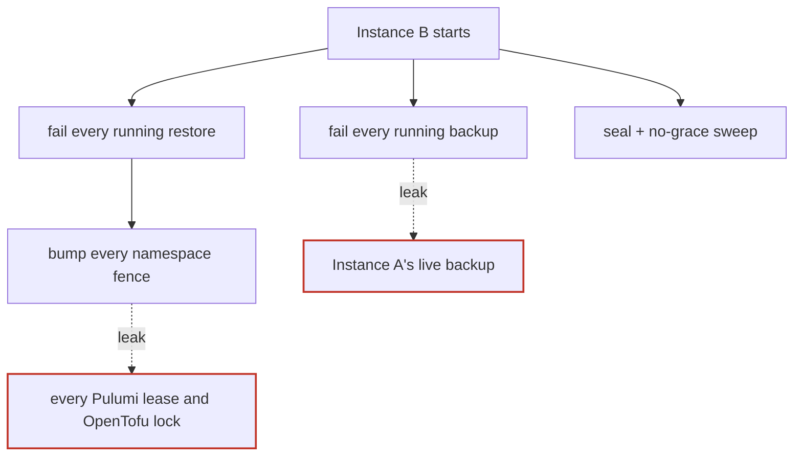

After:

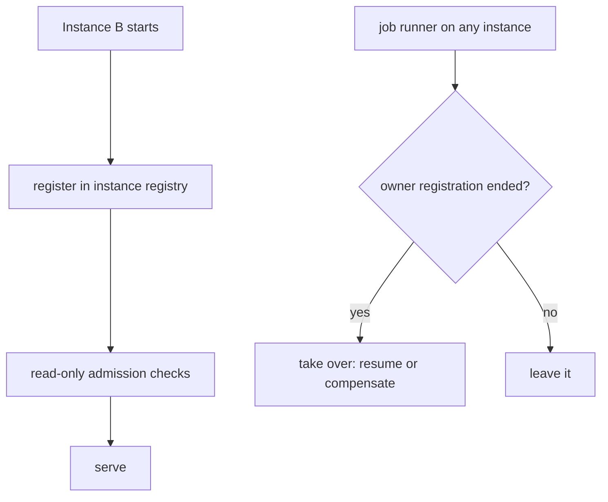

**Files**

- `pkg/dustpan/dustpan.go:1495-1524 (runStartUp), 1534-1581 (failStoppedRestores, fenceStoppedRestore), 1583-1601 (FailRunningBackups), 1603-1613 (seal), 1273-1278 (first sweep)`
- `pkg/store/postgres/queries.sql:646-654, 704-713 (no instance filter; BumpFailoverVersions)`
- `pkg/store/storetest/backup.go:947-1196 (the suite asserts the single-instance behavior)`
- `pkg/dustpan/auditchain.go:320-367, 374-435, 441-488 (chain record read-modify-write without compare-and-set)`

- **Problem:** Run mixes per-instance checks (key, provider binding, chain setting) with installation-wide crash recovery (fail every backup, fail every restore and fence every namespace, seal plus orphan sweep, enter or leave maintenance). With N instances a rolling deploy fails a live restore on another instance and moves every fence, which breaks every Pulumi lease and OpenTofu lock. A finished backup that another start marked failed stays failed. The fence bump is also redundant: both adapters fence atomically in the swap. Recovery never leaves maintenance mode, so a crash after Enter leaves the installation at 503 until an operator acts.
- **Deletion test:** Delete fenceStoppedRestore: nothing that needs a fence is left uncovered. Delete FailRunning*: A2 takeover replaces it. This code does not survive the deletion test.
- **Deepening:** Run keeps an ordered list of read-only admission checks. Recovery becomes takeover of work whose owner registration ended (A1, A2), including "leave maintenance only if still at the epoch I entered". Chain record writes become compare-and-set. Interim fix for #667 before A1/A2: skip recovery when another instance is live, or record an owner and heartbeat on backup and restore rows.
- **Tests:** Admission order becomes a pure list test (today: before_serve_test.go, seal_test.go:37). Two Servers on one database become possible. Rewrite the storetest backup cases that assert "fail every running row".
- **Risk and size:** S to delete once A1/A2 exist. Until then, gate it; do not delete it.
- **Horizontal scaling:** Fixes #667 directly, and the #668 trigger (every start seals).
- **ADR:** ADR 30 d9, ADR 38 d9, ADR 64 (start-up compare and enter maintenance). RFC first.

### A4

**One job runner and schedule rows for periodic singleton work**

*Strong* · ports & adapters · size M–L (+500 / −250 lines, migration per dialect)

Before: inactivity ticker · retention ticker · prune ticker · chain-check ticker · TryLock  →  After: **job runner + schedules** [claim row, fake clock, metrics, shutdown]

**Files**

- `pkg/dustpan/dustpan.go:1296-1321 (start and stop), 1326-1382 (sweepInactive)`
- `pkg/dustpan/sweep.go:21, 128-185 (retention ticker)`
- `pkg/dustpan/signin.go:221-257 (prune ticker)`
- `pkg/dustpan/auditchain.go:757-778, 905-1010 (migration loop, hourly chain check)`
- `pkg/inventory/sweep.go:100-161 (in-process TryLock, ErrSweepRunning "of this server")`
- `9 pkg/dustpan/*_internal_test.go files, about 2,250 lines`

- **Problem:** Four hand-rolled ticker loops, each with its own first-run rule, its own metrics, const periods (only signInPruneEvery is injectable), and a copied "skip while a chain change waits" precondition. Every instance runs every loop (#670). The only single-run guard is an in-process mutex. No test proves that a loop ticks, or ticks once across instances.
- **Deletion test:** Delete one loop and nothing moves. Delete all of them behind one runner and about 200 lines leave Run. The runner earns its keep across 5 loops plus 2 in cmd.
- **Deepening:** A job declares name, period, first-run policy, scope (per instance or once per installation), preconditions and body. The runner owns tickers, clock, wait group, metrics and shutdown. Installation jobs claim a schedules(name, next_run_at, last_owner, last_ok_at, last_error) row with one conditional UPDATE … RETURNING on the database clock. No SKIP LOCKED needed: one row, and the conditional write is the claim. Long runs (chain check, retention) enqueue an A2 item. Schedule rows are bookkeeping (B1): kept across a restore, which pushes next_run_at forward so the operator still gets one period after a restore.
- **Tests:** One runner suite with a fake clock replaces the struct-literal Server helpers. "Two runners on one database run a singleton once" on both stores.
- **Risk and size:** M. The "one period after restore" behavior must be kept on purpose.
- **Horizontal scaling:** Fixes the duplicated jobs of #670 and gives the seal step (#668) a home.
- **ADR:** GLOSSARY "Retention sweep" (first run one hour after start) and ADR 47 change wording. ADR 64 says each instance checks hourly. GLOSSARY "Lease" is reserved for the Pulumi CLI: name this "claim" or add a term.

### A5

**Stress test: SKIP LOCKED claims a work item; it does not prove the owner is alive**

*Strong* · ports & adapters · size Design decision (RFC); code lands in A1–A4

Before: FOR UPDATE held for minutes · pinned connection · xmin held · zombie still writes  →  After: **claim, commit, fence** [SKIP LOCKED in claim, owner = registration, claim_epoch check, DB clock]

**Files**

- `docs/rfc/0036-high-availability.md (PR #671)`
- `pkg/store/postgres/backup_portable.go:31-34 (export already holds a REPEATABLE READ tx)`
- `pkg/store/postgres/postgres.go:62 (pgxpool defaults, MaxConns = max(4, NumCPU))`
- `pkg/store/postgres/restore.go:223-299 (swap runs DROP SCHEMA … CASCADE)`
- `pkg/audit/sink_lease.go, pkg/store/postgres/queries.sql:1643-1660 (the existing claim-with-expiry template)`

- **Problem:** Holding FOR UPDATE for a multi-minute job pins one of four pool connections, holds back vacuum for the whole cluster, dies to idle_in_transaction_session_timeout, and cannot pass PgBouncer in transaction mode. A crashed host without a TCP reset keeps the lock for about 2 hours (keepalive default). A partitioned instance whose connection drops loses the lock while it still runs on another pooled connection: a row lock does not fence the holder's other connections. If the job row lives in the swapped schema, the swap's DROP SCHEMA waits on the instance's own other connection, a cycle PostgreSQL's deadlock detector cannot see.
- **Deletion test:** Not a module. The finding decides what A2 is: the claim commits, and liveness comes from elsewhere.
- **Deepening:** State the honest version in the RFC: no lease per job and no lease service, exactly one lease per instance (A1). A claim is SKIP LOCKED plus owner = registration, then commit. Takeover happens when the owner registration ended plus a clock-skew bound. Every completing write checks owner or claim_epoch in its transaction, like namespace.Fence. Every expiry uses the database clock. Coordination tables are bookkeeping (B1). On SQLite, BEGIN IMMEDIATE plus UPDATE … RETURNING; SKIP LOCKED is a PostgreSQL throughput option, not a correctness need.
- **Tests:** A worktest suite with a two-handle factory (E2): zombie write refused, takeover only after registration end, swap keeps rows.
- **Risk and size:** Low as a decision. The risk is skipping it and building row-lock-held jobs.
- **Horizontal scaling:** This is the scaling design. Existing leases that remain: the Pulumi update lease (protocol), the audit sink leases (C9 can remove them), the chain claim (A2 can absorb it).
- **ADR:** The audit sink leases came with #599 and no ADR records them. ADR 64 d6 uses the instance clock. RFC 36 proposes a job lease table the owner rejected; rewrite it around this.

### A6

**One claim primitive on the database clock instead of three hand-made leases**

*Strong* · ports & adapters · size M (about 600 lines)

Before: sink lease (DB clock) · chain claim (app clock) · yield by StartedAt · expiry on s.Now()  →  After: **claim** [DB clock, holder check, one suite]

**Files**

- `pkg/store/postgres/queries.sql:1643-1660, audit_sink_lease.go (database clock, holder checked)`
- `pkg/store/postgres/queries.sql:1492-1507, audit_chain.go:34, 72 (instance clock; RenewAuditChainMigration is WHERE id = 1 AND migrating_at_ms <> 0, so any instance renews any claim)`
- `pkg/backup/restore_service.go:381-411 (yield by StartedAt, each instance's clock)`
- `pkg/accesstoken/service.go:622-623, pkg/session/service.go:155-161 (expiry on s.Now()) vs postgres/accesstokens.go:310 (sweep on DatabaseNowMs)`

- **Problem:** Each coordination need invents a table, two dialect queries and a suite, and their semantics differ: clock source, holder identity, renew rules. Clock skew between instances decides ownership in two of them. Token and session expiry differ between instances and the sweep under skew.
- **Deletion test:** Remove the chain-claim code: a generic claim named "audit-chain-migration" covers it with no loss. The hand-made versions are shallow copies.
- **Deepening:** One claim module: database clock always, holder always checked, one conformance suite. A1 is "one claim per instance plus an address". A2 and A4 reuse the same expiry rule. Credential lookups return the database's now in the same row.
- **Tests:** Two chain-claim suites merge into one. Add a skew test with two fake instance clocks.
- **Risk and size:** M. Glossary work.
- **Horizontal scaling:** Removes clock skew from correctness.
- **ADR:** GLOSSARY.md:288 defines Lease only for the Pulumi CLI; the code already says sink lease and chain lease. Add a term ("claim" or "instance lease").

### A7

**Restate the caching rule, then fold three TTL caches into one installation snapshot**

*Worth exploring* · in-process · size S–M (300–500 lines)

Before: Watcher 2 s · chain cache 2 s · policy cache 5 s  →  After: **installation snapshot** [one read per limit, version, writer barrier]

**Files**

- `pkg/maintenance/maintenance.go:42-48, 602-660 (Watcher, 2 s, mutex held across the read)`
- `pkg/dustpan/auditchain.go:644-675 (a copy of the same TTL cache, time.Since instead of injected now)`
- `pkg/accesstoken/policycache.go:9-19 (5 s; forget() clears this instance only)`

- **Problem:** Three bounded-staleness caches of mutable singletons, two clock sources, three limits. ADR 38, ADR 48, RFC 60 and ADR 64 d5/d7 are built on that staleness bound. Read literally, "cache only immutable or versioned data" forbids all three. A version column alone does not help: checking it costs the same round trip as reading the one row. Both caches hold a mutex across the database read, so requests queue whenever a cache expires.
- **Deletion test:** Delete the three caches and every request pays three reads (RFC 60 option 3, rejected for cost). The complexity reappears at three call sites, so one module concentrates it. Modest pass.
- **Deepening:** Rule to propose: cache immutable data; cache versioned data keyed by version; cache an installation-wide singleton only with a declared staleness bound that a writer barrier accounts for. One Snapshot(ctx) with maintenance, chain record and a version, one read per limit. The token policy leaves the cache entirely (F6).
- **Tests:** One fake clock for all. The ADR 48 wait becomes "versions converge".
- **Risk and size:** S–M.
- **Horizontal scaling:** Makes the bounded staleness explicit and checkable across instances.
- **ADR:** ADR 64 d5 (compatible). Conflicts with the literal caching rule unless the owner restates it.

### A8

**Immutable blob read cache as a blob.Store decorator; groupcache only if measured**

*Worth exploring* · ports & adapters · size S–M (250–400 lines); groupcache L

Before: S3 GET per PATCH · decode per page  →  After: **blob cache** [write-once keys, ciphertext only, byte budget]

**Files**

- `pkg/stack/updates.go:882, 1280-1320 (every delta save reads the full previous checkpoint)`
- `pkg/stack/journal_build.go:246, journal_entries.go:528, 645`
- `pkg/workspace/service.go:1076-1108, 1184-1212 (state download per plan; resource pages re-decode the whole state)`
- `pkg/blob/blob.go, pkg/blob/blobtest`

- **Problem:** The hottest immutable read is the full checkpoint on each delta PATCH (ADR 37 d7), on the write path. Blob keys are write-once (ADR 26 d2, ADR 37, ADR 38 d6), so blob reads are safe to cache. SQL rows by serial or sequence are not immutable across a restore: a restore can reuse a serial with other content.
- **Deletion test:** A decorator that caches everything is shallow. It earns depth only by owning the policy: write-once prefixes only, a per-object cap, a byte budget, Delete invalidates, never above the opener (never plaintext of sealed state).
- **Deepening:** blobcache.Wrap(store, Config{Prefixes, MaxObject, MaxBytes}) that passes blobtest unchanged. Key any SQL-derived cache by the namespace failover version, which a restore increments. groupcache-go needs A1 for peers, a peer protocol that ADR 48 d6 may forbid, a new dependency (ask first), and moves MB-sized values per hop at roughly the cost of the S3 GET it saves. Measure with make load first.
- **Tests:** blobtest on the decorator; eviction; no caching of a failed read; a "Put after Delete of the same key" blobtest case.
- **Risk and size:** S–M. Memory pressure next to bodygate.
- **Horizontal scaling:** Safe with any N because it needs no coherence.
- **ADR:** ADR 41 and ADR 23 (plaintext must stay inside the process). ADR 48 d6 for groupcache's peer calls. ADR 45 (stream misses, never buffer over the cap).

### A9

**Join the policy rows into the credential lookup and delete the token policy cache**

*Strong* · local-substitutable · size S (−100 / +40 lines, sqlc regenerate)

Before: token lookup · policy cache 5 s · session policy read  →  After: **one credential query** [token, principal, policy]

**Files**

- `pkg/accesstoken/policycache.go (all)`
- `pkg/accesstoken/service.go:655-700`
- `pkg/session/service.go:143-187 (session policy read on every request, no cache)`
- `pkg/store/postgres/queries.sql:1347, 1769 (GetAccessTokenByDigest, GetSessionByDigest already join principals)`

- **Problem:** A policy change on one instance reaches another up to 5 s later. A session request reads its policy and the token policy in extra round trips. The two credential kinds use different caching.
- **Deletion test:** Delete policycache.go and add the join: correctness improves (no staleness) and round trips drop. The cache only hides a missing join. It fails the deletion test.
- **Deepening:** CROSS JOIN access_token_policy (and session_policy) in the two lookups; Match carries the policy.
- **Tests:** Remove the policycache tests. Add an accesstokentest case: the lookup returns the current policy.
- **Risk and size:** S. No migration.
- **Horizontal scaling:** Removes the 5 s gap between instances from #670.
- **ADR:** None.

### A10

**Auth failure budget: per instance by design now, a shared penalty list later**

*Strong* · in-process · size S (documentation or divide by live count); M for a shared budget

Before: bucket per process · ×N instances  →  After: **failure budget** [live-count divisor, shared penalty list]

**Files**

- `internal/authgate/authgate.go:42-57, 84-140, 165-245`
- `pkg/dustpan/dustpan.go:2132-2148`
- `pkg/dustpan/signin.go:101-104`

- **Problem:** N instances behind a load balancer give about N times the guess budget. authgate also holds an unrelated per-request memo (F2).
- **Deletion test:** The budget is real depth; the memo is not.
- **Deepening:** Short term: state the factor, or divide burst and refill by the live count from A1 (an attacker who sticks to one instance gets less, which is safe). Later: per-instance buckets plus a shared penalty row written only when a source goes over budget (RFC 36 option 3). A write on every miss turns a guessing attack into database load.
- **Tests:** Unit test for the divided budget; a conformance case for the penalty table.
- **Risk and size:** S / M.
- **Horizontal scaling:** The one per-instance limit with a security cost (#670).
- **ADR:** None. ADR 48 d12 allows caches but no per-instance state with a meaning, which favors a shared limit eventually.

### A11

**TouchSession sends an UPDATE on every console request**

*Strong* · in-process · size S (< 10 lines)

Before: UPDATE per request  →  After: **touch if stale** [LastSeenAt check]

**Files**

- `pkg/session/service.go:180`
- `pkg/accesstoken/service.go:701-708 (the token path already skips recent touches)`
- `pkg/store/postgres/queries.sql:1784-1789`

- **Problem:** Every console request sends a write to the primary, usually matching 0 rows. Tokens skip the touch when LastUsedAt is recent; sessions do not.
- **Deletion test:** Not a module; a missing check.
- **Deepening:** Check m.Session.LastSeenAt before the call, as the token path does.
- **Tests:** One session service test.
- **Risk and size:** S.
- **Horizontal scaling:** N instances, N times the writes to the primary.
- **ADR:** None.

### A12

**Rolling-upgrade rule: squash migrations before the first release, then expand/contract with a test**

*Worth exploring* · local-substitutable · size S squash; M compatibility test

Before: 52 migrations ×2 · migrate in Open · no N−1 check  →  After: **baseline + expand/contract** [N−1 test]

**Files**

- `pkg/store/{sqlite,postgres}/migrations (52 each, gaps 0030, 0033, 0036–41 …)`
- `frozen_test.go (52 hashes ×2)`
- `pkg/store/postgres/postgres.go:62-85, 775 (every instance migrates at Open)`
- `pkg/store/schema/schema.go (refuses only a newer schema)`

- **Problem:** 104 frozen files carry history no release needs. With several instances, a new binary migrates while old instances keep serving; nothing guarantees the old binary works on the new schema. Migration 0005 already drops columns.
- **Deletion test:** Not a module.
- **Deepening:** Squash to one baseline per dialect now (nothing shipped). Then adopt expand/contract with a test that runs the previous release's suite against the new schema. Consider an explicit migrate step instead of migrating inside Open.
- **Tests:** One frozen hash per dialect. A previous-release compatibility job.
- **Risk and size:** S / M. The owner must allow editing applied migrations once.
- **Horizontal scaling:** Rolling deploys run two versions on one database for minutes (RFC 36 open question 8).
- **ADR:** CLAUDE.md and TestFrozenMigrations forbid editing applied migrations; the owner decides. ADR 48 d4 covers only a newer schema.

### A13

**PostgreSQL pool settings and pooler readiness**

*Speculative* · local-substitutable · size S

Before: default pool  →  After: **pool options** [size, exec mode]

**Files**

- `pkg/store/postgres/postgres.go:62 (pgxpool.New with defaults)`

- **Problem:** No pool size setting; pgx caches prepared statements, which breaks behind PgBouncer in transaction mode, a common addition when scaling out. With N instances × default pool size, connection count grows without a knob.
- **Deletion test:** Not a module.
- **Deepening:** Expose pool size and exec mode as adapter options; document the pooler mode.
- **Tests:** Option parsing test.
- **Risk and size:** S.
- **Horizontal scaling:** Connection budget across N instances.
- **ADR:** None.

### A14

**Guard the deployment shapes that cannot scale: fs blobs, dir: backups, file: sinks, no --public-url**

*Speculative* · in-process · size S

Before: guide text only  →  After: **start-up refusal** [fs, dir:, file:, public URL]

**Files**

- `pkg/blob/fs/fs.go:68-92, 173, 277`
- `internal/baseurl/baseurl.go (ignores X-Forwarded-*)`
- `cmd/opendustpan/auditsinks.go:36-42, 89-118`
- `pkg/secret/secret.go:200-231 (KEK must match on every instance)`

- **Problem:** With N instances, fs blobs need a shared filesystem whose exclusive-create and rename hold; dir: backups and file: audit sinks write to whichever host runs the job; behind a TLS-terminating balancer without --public-url, TFE capability URLs come out as http:// with the internal host; --generate-key on two instances that start together can make two keys.
- **Deletion test:** Not a module.
- **Deepening:** When A1 shows more than one live instance: refuse or warn for fs blobs, dir: targets and file: sinks; require --public-url with trusted proxies; refuse a start whose KEK cannot unwrap the stored check value (already partly done).
- **Tests:** Start-up check tests.
- **Risk and size:** S.
- **Horizontal scaling:** Turns operator rules from RFC 36 into checks.
- **ADR:** ADR 31, ADR 48, ADR 60 d12/d15 for the file sink.


## Section B. Backup, restore and maintenance mode

The restore keeps its own record and the maintenance flag inside the data it swaps. Most of the multi-instance restore problems come from that.

### B1

**Move the control tables out of the data the restore swaps**

*Strong* · ports & adapters · size M–L (400–700 lines)

Before:

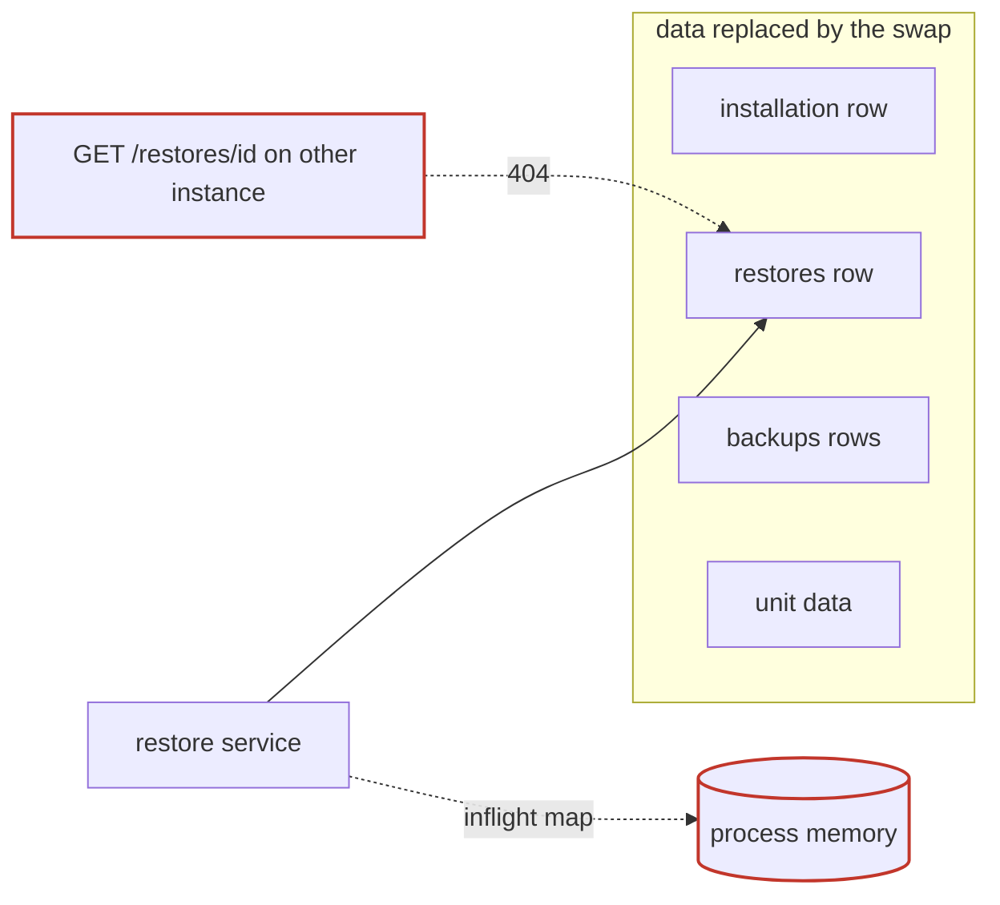

After:

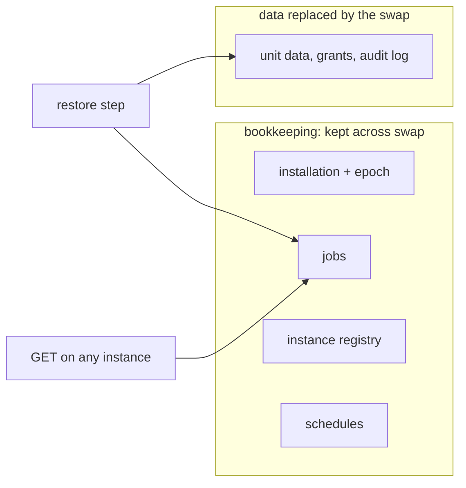

**Files**

- `pkg/backup/backup.go:60-95 (backups, restores, installation, audit_sink_leases are in Tables)`
- `pkg/store/postgres/backup_stage_portable.go:60-95 (staging deletes the seeded installation row and loads the backup's)`
- `pkg/store/postgres/restore.go:255-333 (finishSwap keeps only the audit chain state)`
- `pkg/store/sqlite/restore.go:217-312 (fenceStagedFile does the same)`
- `pkg/backup/restore_service.go:114-123, 244-259, 437-486, 870-926 (inflight, createFinishedRow, afterSwap, recreateAfterSwap)`
- `pkg/store/sqlite/backup.go:258-266, postgres/backup.go:1152-1157 (hand-written exclusion lists)`

- **Problem:** The record of the restore and the maintenance flag are part of the data the restore replaces. Consequences: only the running instance can answer GET /restores/{id} during the swap (#669); a crash between swap and recreateAfterSwap loses the row and the pre-restore backup from the list; running rows from the backup come back and need "superseded"; and, read from the code, maintenance mode probably ends when the swap commits, because the restored installation row is the backup's (state normal), while AfterApply assumes maintenance still holds (restore_service.go:82-86). Each new coordination table (registry, jobs, schedules) would need the same hand-written keep-or-clear code in four places.
- **Deletion test:** Move the control tables to a store the swap never touches: inflight, trackRestore, recreateAfterSwap, createFinishedRow, PreserveAfterRestore and the superseded sweep (about 250 lines) disappear. The complexity existed only because the rows are in the wrong place.
- **Deepening:** A declarative list: backup.Bookkeeping = [{Name, AcrossSwap: Keep|Clear}] for installation, backups, restores, audit_chain_state, sink cursors and leases, and the new registry, jobs and schedules tables. PostgreSQL keeps them in a schema the swap never renames; SQLite copies them into the staged file in the fence transaction (a generalization of today's chain-state copy). A coverage test fails when a migration adds a table that is in neither list. The backup list becomes the installation's history, which matches ADR 30's "the backups this installation made".
- **Tests:** First, a test that checks the installation state right after the swap (confirms the probable bug). Then a conformance case: control rows after the swap equal the rows before it.
- **Risk and size:** M–L. Migrations in both dialects; older backups that contain these tables are ignored on load.
- **Horizontal scaling:** Prerequisite for a durable restore and for answering status from any instance.
- **ADR:** ADR 30 d9 (the backups table) stays but leaves the backup scope; ADR 42 d2 (one file per table in backup.Tables). A small new ADR, not a reopening.

### B2

**Make the staging area a durable handle, and stage once**

*Strong* · ports & adapters · size M (300–500 lines)

Before: stagingSchema field · stage for check · stage again  →  After: **staging handle** [stage once, stored on job, drop by name]

**Files**

- `pkg/store/postgres/backup.go:613, 640-662, 728-745 (s.stagingSchema = in.staging)`
- `pkg/store/postgres/restore.go:194-211, restore_access.go:22-32 (ApplyStaging reads the hidden field)`
- `pkg/store/sqlite/restore.go:194-230 (stagingPath)`
- `pkg/store/postgres/postgres.go:46-48`
- `pkg/backup/restore_service.go:852-860, 1099-1131 (stages for the check, discards, stages again)`

- **Problem:** Staging and apply communicate through a mutable field of a shared Store, so they must run in one process. A crash leaks restore_stage_* schemas or files that nothing finds. The check stages the whole backup, throws it away, and the apply stages it again: two full imports, and ADR 42 measured import at 6–7× slower than the native format.
- **Deletion test:** Delete the field and pass a handle: the time ordering becomes explicit and an orphan-schema sweep becomes possible.
- **Deepening:** StagePortable(…) (StageHandle, Summary, error), Apply(ctx, StageHandle, plan), DropStaging(StageHandle). The handle lives on the A2 job row.
- **Tests:** Staging conformance tests take handles; restore tests drop the "staged twice" expectations.
- **Risk and size:** M.
- **Horizontal scaling:** Required before another instance can resume a restore. Roughly halves the time in maintenance mode.
- **ADR:** None. ADR 42 d8 allows it.

### B3

**Maintenance epoch confirmed through the database instead of calls between instances**

*Strong* · ports & adapters · size M (400–600 lines with the registry)

Before:

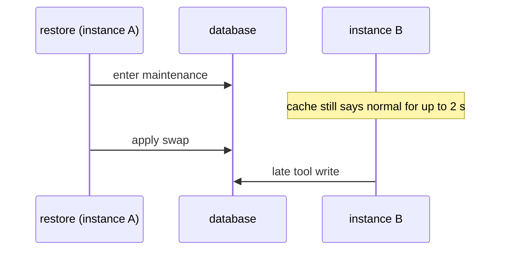

After:

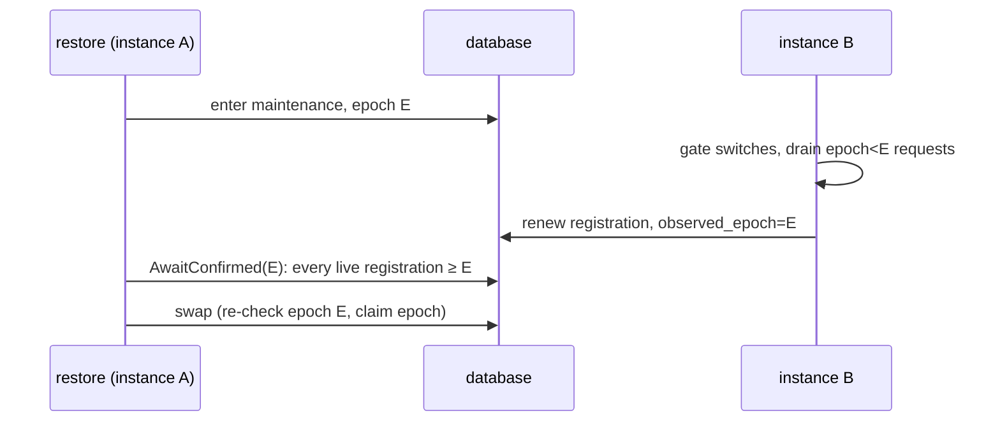

**Files**

- `pkg/maintenance/maintenance.go:42-48 (comment still cites the RFC 60 fixed wait), 602-654`
- `pkg/backup/restore_service.go:801-835 (no wait between Enter and apply)`
- `pkg/dustpan/maintenance.go (withMaintenance gates only the tool adapters)`
- `pkg/dustpan/auditchain.go:806, 826 (the chain sleeps 2× the cache limit instead)`

- **Problem:** The apply step does not wait for other instances at all. It is covered only because the pre-backup happens to take longer than 2 s. Neither the ADR 48 network wait nor any database alternative exists. ADR 48 d5 as written also does not guarantee that requests admitted before maintenance have finished.
- **Deletion test:** With an epoch confirmed in the database, the planned inter-instance route, its action, the credential between instances and --advertise-address discovery never need to exist for this purpose. The chain migration's fixed sleeps go too.
- **Deepening:** The installation control row gets an epoch. Each instance writes the epoch its gate uses into its registry row on renewal, only after its in-flight tool requests from older epochs have drained (a per-epoch in-flight counter in withMaintenance). AwaitConfirmed(ctx, E) polls the live registrations, skips expired ones plus skew, and fails when a live one does not report (keeps ADR 48 d8). The swap transaction re-checks epoch E and the claim epoch. Costs one renewal period of latency.
- **Tests:** Deterministic tests with fake registry rows; no HTTP between instances in tests.
- **Risk and size:** M.
- **Horizontal scaling:** The missing safety piece of a multi-instance restore (#669).
- **ADR:** Contradicts ADR 48 d5 and d6 (network calls through the public API). Worth reopening: the owner chose the network because of the cache; a recorded confirmation gives the same guarantee and fits "the database is the only coordination point". Decisions 1–4 and 7–13 stay.

### B4

**Fence installation-scope writes, not only namespace writes**

*Strong* · ports & adapters · size M

Before: namespace writes: fenced · server writes: unguarded  →  After: **scoped write** [namespace fence, installation epoch]

**Files**

- `pkg/store/postgres/access.go:923, 962 ("the zero fence for the installation")`
- `pkg/store/postgres/audit.go:87 (inAuditedTx: advisory lock only, used 17× per dialect)`
- `pkg/store/postgres/restore.go:213-300 (restore fences namespaces only)`

- **Problem:** A token, session, principal or policy write in flight on another instance can commit into the restored data after the swap, or commit before it and be lost. The installation API stays open during maintenance. ADR 48 d13 says the fence refuses late writes; that holds only for namespace writes.
- **Deletion test:** Not a module; a missing guard.
- **Deepening:** One write entry point that takes a scope: Namespace(fence) or Installation(epoch). The restore bumps the installation epoch in the swap transaction; server-scope writes carry it like a fence. Or have the gate refuse installation-scope writes between confirmation and swap.
- **Tests:** Fence suite gains server-scope cases.
- **Risk and size:** M.
- **Horizontal scaling:** Makes the restore safe without depending on cache timing.
- **ADR:** A consequence of ADR 48 d13 that the ADR does not state; ADR 4 fences namespaces only. RFC.

### B5

**Move DROP SCHEMA out of the swap transaction and add a lock timeout**

*Strong* · local-substitutable · size S–M (100–200 lines)

Before: rename + fence + DROP in one tx  →  After: **swap step** [rename + fence, drop as next step, lock_timeout]

**Files**

- `pkg/store/postgres/restore.go:223-299 (DROP SCHEMA … CASCADE at :269 inside the swap tx, no lock_timeout)`

- **Problem:** Dropping the previous schema needs an exclusive lock on every table. It waits for every open transaction on every instance (a backup's export, a sink claim, a job claim), and every new query on those tables queues behind it, so the whole installation stalls.
- **Deletion test:** Not a module.
- **Deepening:** The swap transaction only renames and fences (and advances the job row). The drop becomes a separate job step that can run again by name. SET LOCAL lock_timeout plus retry. A2 makes restore and backup exclude each other.
- **Tests:** A two-connection lock-timeout test in the PostgreSQL adapter.
- **Risk and size:** S–M.
- **Horizontal scaling:** Contention that mostly cannot happen on one instance.
- **ADR:** ADR 38 d6 ("a schema swap in one transaction"): the swap stays atomic; only cleanup moves.

### B6

**Purges must not delete blobs a running backup still needs; background workers must pause in maintenance**

*Strong* · in-process · size S–M (150–250 lines)

Before: purge sweep · running backup · (no check)  →  After: **purge horizon** [min live backup start, pause in maintenance]

**Files**

- `pkg/dustpan/sweep.go:134-168 (purge sweep checks only chainChangeWaits)`
- `pkg/dustpan/maintenance.go (withMaintenance wraps only the tool adapters)`
- `docs/adr/0030-backups-and-restore.md d2`

- **Problem:** ADR 30 d2 says retention must not delete a blob that a running backup can still copy. No code checks for a running backup, even on one instance: a purge that commits after the backup's snapshot deletes blobs the snapshot names, and the backup fails at copyBlob. During a restore, sweeps and shipping keep running on every instance across the swap.
- **Deletion test:** Not a module; a missing rule.
- **Deepening:** The purge deletes blobs only for purges older than the start of every non-terminal backup job whose owner is live (needs A2 so a dead row cannot block purges forever). Every background worker checks the maintenance snapshot and pauses.
- **Tests:** Sweep against a running backup.
- **Risk and size:** S–M.
- **Horizontal scaling:** Several instances make the race likely.
- **ADR:** Implements ADR 30 d2.

### B7

**Enforce one running backup and one running restore with partial unique indexes now**

*Strong* · local-substitutable · size S (about 100 lines + migrations)

Before: list · insert · yield by StartedAt  →  After: **unique index** [409 from the DB]

**Files**

- `pkg/backup/restore_service.go:366-411 (runningElsewhere, yieldToEarlierRunner)`
- `pkg/backup/service.go:390-410 (running bool)`

- **Problem:** The restore singleton is a list-then-insert race resolved by each instance's clock. Backups have no cross-instance check at all.
- **Deletion test:** yieldToEarlierRunner and the clock-dependent race go away.
- **Deepening:** Partial unique index on restores WHERE state IN ('checking','applying') and on backups WHERE state = 'running', mapped to the existing 409 errors. Interim until A2.
- **Tests:** Two concurrent starts on two handles.
- **Risk and size:** S.
- **Horizontal scaling:** Restores ADR 30's rule across instances.
- **ADR:** None.

### B8

**The maintenance Watcher fails open**

*Strong* · in-process · size S (about 30 lines)

Before: error → normal  →  After: **fail closed** [unknown → 503]

**Files**

- `pkg/maintenance/maintenance.go:634-654`

- **Problem:** A read error before the first successful read answers StateNormal; later errors keep the old state indefinitely. A new instance that starts during a restore while the database hiccups serves tool traffic.
- **Deletion test:** Not a module.
- **Deepening:** Fail closed: answer 503 when the state is unknown or older than a bound. Never report a confirmation (B3) without a fresh read.
- **Tests:** Failing-store tests.
- **Risk and size:** S.
- **Horizontal scaling:** A new instance during a restore is the normal rolling-deploy case.
- **ADR:** None.

### B9

**Backup retries need attempt-scoped keys; the export transaction should not span the upload**

*Worth exploring* · local-substitutable · size S–M (150 lines) + M for a spool

Before: fixed keys · tx open during upload  →  After: **backup attempt** [attempt keys, spool then upload]

**Files**

- `pkg/backup/service.go:474-515, 582-596, 954-984 (table files under backups/<id>/sql, manifest last)`
- `pkg/store/postgres/backup_portable.go:31-59 (export streams through the sink inside REPEATABLE READ)`
- `pkg/backup/restore_service.go:815-820`

- **Problem:** A durable backup must restart under the same ID, but a dead attempt left write-once table files, so Put answers ErrExists with different content. The export transaction stays open for as long as the upload to the target takes, holding back vacuum cluster-wide and blocking the swap (B5).
- **Deletion test:** Not a module.
- **Deepening:** Key table files by attempt (backups/<id>/a<n>/sql/…); the manifest names the attempt; a cleanup step removes dead attempts. Export to a local spool inside the transaction, upload after commit, or cap the step.
- **Tests:** Retry tests in the backup service.
- **Risk and size:** S–M; the spool needs local disk the size of the SQL part.
- **Horizontal scaling:** Through A2.
- **ADR:** ADR 42 d2 fixes the layout; ADR 30 d4 and ADR 42 d6 require one consistent read (a spool keeps it). Record in the new ADR.

### B10

**Maintenance has two owners of one flag; make it a set of holds**

*Worth exploring* · in-process · size M (about 300 lines)

Before: one flag · Hold callback · entered_maintenance  →  After: **maintenance holds** [acquire, release own]

**Files**

- `pkg/maintenance/maintenance.go:121-129, 222-247 (hold callback, Leave writes normal unconditionally)`
- `pkg/backup/restore_service.go:807-809 (best-effort Leave)`
- `pkg/dustpan/auditchain.go:420, 846`
- `pkg/store/postgres/restore.go:301-308 (entered_maintenance reset across the swap)`

- **Problem:** The restore and the chain migration share one boolean. Ownership is approximated by a Hold callback and an entered_maintenance column in another table. Neither Leave is conditional on who entered.
- **Deletion test:** With holds (holder kind, ID, epoch; maintenance means at least one hold), Hold, ErrHeld and entered_maintenance disappear.
- **Deepening:** Acquire(holder) (epoch), Release(holder, epoch). A restore releases only its own hold; a forced release by an operator writes an audit entry.
- **Tests:** Holder ownership tests.
- **Risk and size:** M.
- **Horizontal scaling:** Needed for repeatable compensation after a claim moves to another instance.
- **ADR:** ADR 38 d4 (normal|maintenance): the public state can stay; not worth reopening.

### B11

**Maintenance's active-work listing is N+1 and imports both tool domains**

*Worth exploring* · ports & adapters · size M (300–400 lines)

Before: namespaces · stacks · Active per stack · workspaces  →  After: **active work** [one query per tool]

**Files**

- `pkg/maintenance/maintenance.go:24-27, 435-535 (imports stack and workspace; strings "pulumi" and "opentofu")`

- **Problem:** Each Enter lists namespaces, then stacks, then Active per stack, then workspaces: O(units) queries, three times per enter. A shared core package depends on both tool packages.
- **Deletion test:** A tool-neutral ActiveWork port answered from inventory removes the stack and workspace imports except for canceling.
- **Deepening:** One query per tool, or an inventory column active. Cancel through a small port per tool.
- **Tests:** Maintenance tests use one fake port instead of four services.
- **Risk and size:** M.
- **Horizontal scaling:** Minor (once per restore).
- **ADR:** Aligns with ADR 12/13; the current code bends them.

### B12

**The swap port is shallow and finds optional capabilities by type assertion**

*Worth exploring* · ports & adapters · size M (about 300 lines)

Before: RestoreLive · Fencer · AppendServer? · AccessKeepingApplier?  →  After: **Swap(plan)** [fence, keep access, audit, advance job]

**Files**

- `pkg/backup/restore_service.go:29-33 (RestoreLive), 950-955 (AppendServer assertion), 1011-1014 (AccessKeepingApplier assertion)`
- `pkg/backup/restore_record.go:100-134 (three one-method ports)`

- **Problem:** The orchestrator assembles the swap, fence, access-table keep and audit entry from pieces discovered at run time. The audit entry after the swap is best effort in a separate transaction and is lost on a crash.
- **Deletion test:** One Swap(ctx, handle, plan{KeepAccess, JobID, ClaimEpoch, AuditEntry}) removes both assertions and the Fencer port, which the adapters already fold into the swap.
- **Deepening:** As above; the job row advance happens in the same transaction.
- **Tests:** Fewer fakes; one atomic contract in the conformance suite.
- **Risk and size:** M.
- **Horizontal scaling:** Needed for the atomic job advance at the swap step.
- **ADR:** None.

### B13

**Split internal/api/server into sub-handlers with small ports**

*Worth exploring* · in-process · size M–L (mechanical)

Before: one Handler, 25+ deps  →  After: **route table** [backups, access, sign-in, audit, …]

**Files**

- `internal/api/server/server.go:36-118 (Config with 25+ dependencies), 141-167`
- `internal/api/server/restores_test.go:36-100 (full SQLite stacks for route tests)`

- **Problem:** The top git hot spot is a catch-all adapter: backups, restores, maintenance, metrics, principals, access, tokens, sessions, sign-in, IP allowlists, audit chain, sinks, deleted units, namespaces, review, upgrade. Handlers depend on concrete *backup.Service and *backup.RestoreService.
- **Deletion test:** The shared route table and route test are the real interface; the Handler struct is a bag of dependencies.
- **Deepening:** Sub-handlers per concern, each with its own small ports, mounted into one route table (ADR 17).
- **Tests:** Faster, focused route tests.
- **Risk and size:** M–L, mechanical.
- **Horizontal scaling:** GET of a restore must read only the database (B1).
- **ADR:** ADR 30 d9 names the package api/server; sub-packages keep it.

### B14

**Move restore error sanitizing into its own module**

*Speculative* · in-process · size S

Before: orchestrator + redaction  →  After: **restore errors** [Text, Log]

**Files**

- `pkg/backup/restore_service.go:498-771 (about 270 lines, regex-based redaction)`

- **Problem:** Stable error text and log redaction are mixed into the orchestrator.
- **Deletion test:** It moves as a block and has its own interface (Text(err), Log(err)).
- **Deepening:** Own file or package so the step functions in A2 stay readable.
- **Tests:** Table tests on the sanitizer.
- **Risk and size:** S.
- **Horizontal scaling:** None.
- **ADR:** None.

### B15

**Reset cached query plans on other instances after a schema swap**

*Speculative* · in-process · size S

Before: stale plans  →  After: **pool reset on epoch**

**Files**

- `pkg/store/postgres/restore.go:249-269`

- **Problem:** pgx's statement cache on other instances holds plans for the old relations. A restore that changes column types (a forward migration of an older backup) could raise a one-time "cached plan must not change result type" error.
- **Deletion test:** Not a module.
- **Deepening:** When an instance sees the epoch change (B3), reset its pool or DEALLOCATE ALL.
- **Tests:** A two-pool test across a type-changing restore.
- **Risk and size:** S.
- **Horizontal scaling:** Only with several instances.
- **ADR:** None.


## Section C. Audit log

Appends lock the wrong row, the chain check is a full walk on every instance, and the verifier keeps its memory per process.

### C1

**Append through a head row per scope, as the last statement, not through the namespace row**

*Strong* · local-substitutable · size M (300–500 lines)

Before:

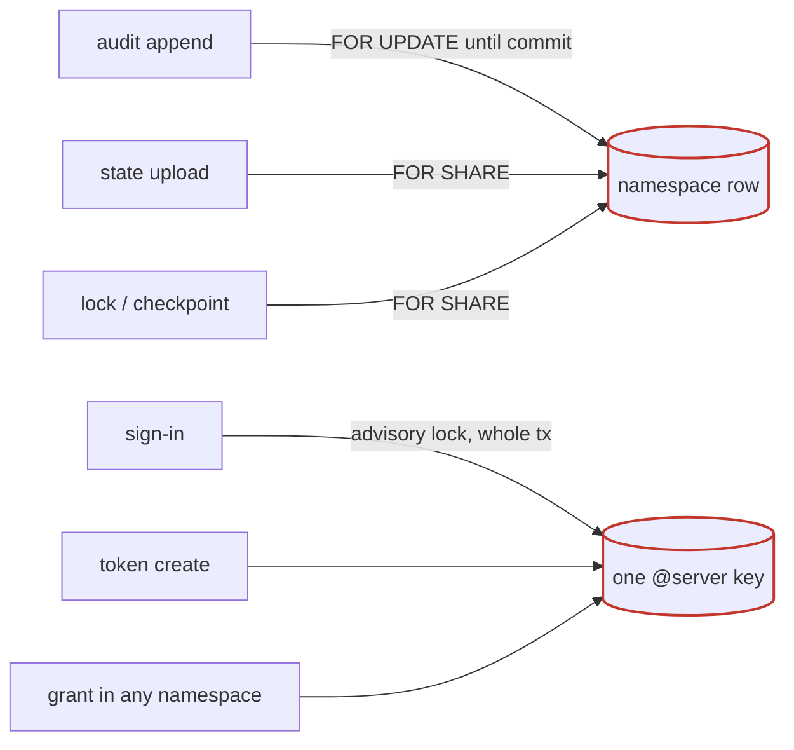

After:

```mermaid
flowchart LR
  A1[audit append, last statement] -->|UPDATE … RETURNING| H[(audit_heads row)]
  W1[state upload] -->|FOR SHARE| NS[(namespace row)]
  W2[lock / checkpoint] -->|FOR SHARE| NS
  S1[sign-in append] --> H2[(@server head row)]
  G[grant] -->|row lock| SUB[(subject / role row)]
```

**Files**

- `pkg/store/postgres/audit.go:26-50, 206-297, 365-402, 408-423`
- `pkg/store/postgres/queries.sql:64-78, 751-760 (GetFailoverVersionForUpdate)`
- `pkg/store/sqlite/audit.go:155-250`
- `docs/rfc/0022 (lines 49, 110-112, 134: measured 1,200 appends/s per namespace with the chain)`

- **Problem:** The append takes the namespace row FOR UPDATE until commit, which blocks every FOR SHARE fenced write in that namespace (state versions, locks, checkpoints, journal). Under the lock it re-reads the namespace, the chain state and the unit, and finds the head with ORDER BY sequence DESC LIMIT 1. More instances add waiters, not throughput.
- **Deletion test:** Remove the lock and appends collide on (namespace, sequence). The lock has a real job; it is on the wrong object.
- **Deepening:** audit_heads(scope PK, seq, hash, at_ms, chain_open). UPDATE … RETURNING on the head row, then INSERT, as the last statement of the business transaction. The fence row goes back to FOR SHARE. Return failover_version from the fence read; carry the object ID from the handler. The same row later holds the verified watermark (C5) and the retention anchor (C14).
- **Tests:** Keep the audittest concurrent appends (audittest.go:775). Add a migration test, a restore coverage test (heads rebuilt after a swap), and a PostgreSQL benchmark like lease_bench_test.go.
- **Risk and size:** M. Backfill heads; keep them consistent after a restore.
- **Horizontal scaling:** Lowers contention between instances per namespace. Does not raise the single-scope ceiling.
- **ADR:** None; aligned with RFC 22. ADR 41 d5 (fence on the audit write) is kept.

### C2

**Separate the @server audit lock from the access-domain mutex it also serves as**

*Strong* · local-substitutable · size M (200–400 lines)

Before: advisory lock first · whole tx · also grant mutex  →  After: **@server head row** [append last, subject row lock for grants]

**Files**

- `pkg/store/postgres/audit.go:82-107, 141-178`
- `pkg/store/postgres/queries.sql:1037-1040 (pg_advisory_xact_lock(418581342580))`
- `pkg/store/postgres/access.go:922-940 ("Each grant write takes the advisory lock of @server first … so a delete that commits first wins")`
- `pkg/store/postgres/sessions.go:31, 171; accesstokens.go:22, 153, 169; principals.go (8 sites)`

- **Problem:** One fixed advisory lock, taken first and held for the whole business transaction, orders every sign-in, sign-out, token change, principal change and every grant in any namespace across all instances. It also is the mechanism that orders a grant against the delete of its subject or role, so the audit module carries an access invariant.
- **Deletion test:** Remove the lock and a domain invariant (grant vs subject delete) disappears. Poor locality.
- **Deepening:** Order @server appends through its C1 head row, appended last. Give the grant/delete race its own lock on the subject or role row.
- **Tests:** accesstest and principaltest races still pass; a grant-vs-delete concurrency test that does not depend on the audit lock.
- **Risk and size:** M. A correctness regression would leave a dangling grant.
- **Horizontal scaling:** Removes the single installation-wide serialization point on identity writes. Sign-in throughput does not grow with instances today.
- **ADR:** None fixes the mechanism; ADR 60 d7 (@server has its own chain) is kept.

### C3

**One placement and hash policy in pkg/audit instead of a copy per dialect**

*Strong* · in-process · size M (about 400 moved, 300 deleted)

Before: postgres placement · sqlite placement  →  After: **audit.Place** [sequence, time order, hash mode, markers]

**Files**

- `pkg/store/postgres/audit.go:195-363 and pkg/store/sqlite/audit.go:145-330 (appendAuditEntry, placeAuditEntry, insertPlacedEntry, hashMode)`
- `both audit_chain.go (appendChainMarker, walkScope, readChainRecord)`
- `pkg/audit/chain.go:233-297, 464-600 (MigrateChain and ChainWalk already show the pattern)`

- **Problem:** Sequence = last + 1, time never goes back along a scope (audit.go:282-288), the hash mode from ChainRecord and LastAgrees, start and end markers, and the check from sequence 1 are domain policy copied line for line into both adapters (about 2,180 lines of audit adapter code). C1 and C7 would each have to be built twice.
- **Deletion test:** Two adapters make the seam real, but it sits too low: the policy is duplicated, not deep.
- **Deepening:** audit.Place(last *Entry, rec ChainRecord, e Entry, mode) Entry, plus a narrow transaction port: Head, Insert, ChainState, FenceVersion, ObjectID.
- **Tests:** Unit tests of the policy without a database. Conformance suites unchanged.
- **Risk and size:** M, low.
- **Horizontal scaling:** Enabler: C1, C7 and C14 change one place.
- **ADR:** None; ADR 3 still holds for the SQL.

### C4

**One audit actor middleware (ADR 60 d3) instead of seven entry builders that have drifted**

*Strong* · in-process · size M–L (600–900 lines)

Before: pulumi builder · tfe builder · tofuhttp builder · server builder · inventory builder  →  After: **audit actor** [who, where, channel, session]

**Files**

- `internal/api/{pulumi/secrets.go:24, 471; tfe/audit.go:17, 113; server/audit.go:18, 163; inventory/deleted.go:26, 461; tofuhttp/audit.go:19, 118} (channelHeader and truncateUserAgent ×5–6)`
- `internal/api/tfe/audit.go:48, 79, 88; tfe/reveal.go:271`
- `internal/api/pulumi/change_audit.go:28-34`
- `internal/api/server/audit.go:46, 65-76`
- `internal/api/inventory/collections.go:413, 502-510 (sourceIP from r.RemoteAddr)`

- **Problem:** Concrete drift: the TFE change entry drops TokenID while Pulumi keeps it; only the server adapter records the session ID; TFE and tofuhttp record a console session as channel api; collection audit entries record r.RemoteAddr instead of clientip.String(r), so behind a load balancer every entry names the balancer. No denied or failed entries for unit routes, no audit-read kind (ADR 60 d4).
- **Deletion test:** Each builder is a shallow helper; deleting one breaks only its handler.
- **Deepening:** Middleware at the route table (F1) puts an audit.Actor (who, from where, channel, session, request ID) in the context; services ask audit.FromContext(ctx).Entry(action, object, kind); truncation moves into audit.Entry. Fix the collections source IP now.
- **Tests:** One table test over all routes: every mutating route yields an entry with the same actor fields.
- **Risk and size:** M–L. Once every update and lock writes an entry, C1 contention becomes acute; land C1 first.
- **Horizontal scaling:** The source-IP bug appears exactly when a load balancer is added.
- **ADR:** Implements ADR 60 d3 and d4.

### C5

**Incremental chain check as per-scope work items with a stored result**

*Strong* · ports & adapters · size M–L (500–800 lines)

Before: hourly full walk ×N · one long snapshot · gauge per instance  →  After: **scope verify item** [watermark, short chunks, stored result]

**Files**

- `pkg/dustpan/auditchain.go:26, 905-1083 (hourly ticker on every instance)`
- `pkg/store/postgres/audit.go:475-560 (CheckEach in one REPEATABLE READ tx, pages of 100 from sequence 1)`
- `pkg/store/postgres/postgres.go:725-739`

- **Problem:** Every hour every instance reads every row of a log kept forever by default (ADR 68) in one REPEATABLE READ transaction, holding back the xmin horizon; with staggered instances, for most of the hour. The invalid gauge differs per instance (#670). A scale-out event triggers N fresh full walks.
- **Deletion test:** Delete the scheduler and nothing else breaks. ChainWalk is deep and good; the scheduler is shallow and has no shared state.
- **Deepening:** audit_scope_state(scope, verified_seq, verified_hash, result, bad_seq, checked_at, due_at). Instances claim due scopes with FOR UPDATE SKIP LOCKED LIMIT k, continue ChainWalk from the watermark for a bounded number of pages, commit. The gauge becomes a count of result = invalid, the same everywhere. Keep a slower full re-walk or rely on checkpoints for old ranges: a watermark in the database is trusted data in the database the chain protects.
- **Tests:** ChainWalk resume constructor tests; claim and resume tests replace the scheduler tests; two instances report the same metric.
- **Risk and size:** M–L. Resume correctness around start and end entries (ADR 64 d9); a restore invalidates watermarks.
- **Horizontal scaling:** Removes N× full scans, the long snapshot and the metric divergence.
- **ADR:** ADR 64 Consequences say "a check costs one read of the log"; record the change.

### C6

**Persist the checkpoint verifier's memory outside the process**

*Strong* · ports & adapters · size M (300–400 lines)

Before: good map · bad map · per process  →  After: **verifier state** [signed blob, chain entry on mismatch]

**Files**

- `pkg/audit/checkpoint.go:43-46, 395-410 (good and bad maps), 603-670 (lastGood for missing checkpoints), 877-915 (sticky mismatch)`

- **Problem:** A restart or another instance forgets a mismatch, so one instance alerts and another does not, and a rolling restart clears the alarm. The "missing checkpoints below the last good one" detection works only on the instance that saw good; an attacker who deletes the newest checkpoint objects is caught only by an instance that remembers.
- **Deletion test:** Remove the maps and the detection is lost. The state matters; it is in the wrong place.
- **Deepening:** A signed, forward-only state object in the blob store per epoch and scope (fits the ADR 60 d18 threat model better than a database row an attacker can clear), plus a @server entry on mismatch so the finding enters the chain and the sinks. Driven by C5's work item.
- **Tests:** Two Checkpoints over one blob store: the second sees the first's sticky mismatch. A restart test.
- **Risk and size:** M. Epoch rollover semantics.
- **Horizontal scaling:** Makes the result the same on every instance.
- **ADR:** None; relies on ADR 48's write-once keys.

### C7

**Ship audit sinks from cursor rows claimed with SKIP LOCKED; delete the sink lease**

*Strong* · ports & adapters · size M–L (−600 / +300 lines)

Before: lease per sink · walk all namespaces · renew per namespace  →  After: **cursor work item** [SKIP LOCKED, dirty scopes only, parallel]

**Files**

- `pkg/audit/ship.go:143-148, 291-860 (Run, loop, stepLeased, round, renewLease per namespace at :747, :803)`
- `pkg/audit/sink_lease.go; lag.go:37-157`
- `pkg/store/postgres/audit_sink_lease.go, audit_feed.go; queries.sql:1633-1654`

- **Problem:** Each round, every 5 s per sink, lists all namespaces and reads a cursor, runs After and renews the lease for each, busy or idle; observeLag repeats it. 1,000 namespaces means thousands of queries per sink every 5 s on one instance, and only the lease holder ships, so instances add no delivery capacity. About 350 lines handle lease, round deadlines and error classification.
- **Deletion test:** Delete sink_lease.go, the lease table and the leased loop: delivery stays correct (at least once, monotonic cursor). Only exclusivity is lost, and that is what SKIP LOCKED provides. Strong pass.
- **Deepening:** The cursor row is the work item: select cursors joined to C1 heads WHERE cursor < head FOR UPDATE SKIP LOCKED LIMIT n, deliver one batch, advance, commit. Idle cost becomes O(dirty scopes); instances share scopes. Bound the network call by the sink timeout while the row is held. Keep a dense serialized sequence: shipping by cursor is correct only because sequences commit in order.
- **Tests:** Most of ship_test.go (about 1,870 lines) is lease and round tests that go away; add two shippers over one store.
- **Risk and size:** M–L. Needs C1 or a max(sequence) subquery.
- **Horizontal scaling:** Parallel shipping; no cost for idle scopes.
- **ADR:** None; ADR 60 d13 asks for cursors in the database and does not mention leases. The sink lease has no ADR (#599).

### C8

**Keep sink status (last error, lag) in the database**

*Strong* · local-substitutable · size S–M (about 150 lines + migration)

Before: lastErr map · lag on holder only  →  After: **cursor row status**

**Files**

- `pkg/audit/ship.go:427-430, 563-588 (lastErr map)`
- `pkg/audit/lag.go:48-70`
- `pkg/dustpan/auditsinks.go:83-85`

- **Problem:** The sinks status route answers a different last error depending on the instance; the lag gauge is real only on the lease holder, others report 0 or stale.
- **Deletion test:** Not a module.
- **Deepening:** last_error_class, last_attempt_at, last_success_at on the cursor row; lag computed from head time vs cursor time.
- **Tests:** A two-instance status test.
- **Risk and size:** S–M.
- **Horizontal scaling:** One operator view.
- **ADR:** None.

### C9

**Sink configuration is per process while cursors are shared**

*Worth exploring* · in-process · size S (100 lines) / L for sinks in the API

Before: flags per instance · shared cursor  →  After: **sink identity** [fingerprint, refuse mismatch]

**Files**

- `cmd/opendustpan/auditsinks.go:36-42, 89-118`
- `pkg/dustpan/auditsinks.go:21-89`

- **Problem:** The sink name keys the shared cursor; the target (path, URL, HMAC secret) comes from each instance's flags. Same name with different targets silently splits one cursor across destinations; a sink configured on some instances ships only while those run; a file: sink writes to whichever host holds the claim.
- **Deletion test:** Not a module.
- **Deepening:** Store a fingerprint of the non-secret target with the cursor and refuse on mismatch; warn on file: with more than one live instance; long term, sinks as an installation setting through the API (ADR 60 d15 allows it).
- **Tests:** Mismatch refusal test.
- **Risk and size:** S / L.
- **Horizontal scaling:** External copy integrity depends on identical config today.
- **ADR:** ADR 60 d12, d15: a refusal needs an RFC.

### C10

**Chain migration as one work item per scope on the database clock**

*Worth exploring* · ports & adapters · size M (about 400 lines)

Before: chan on one instance · 15-min claim · app clock  →  After: **migration items** [per scope, any instance, DB clock]

**Files**

- `pkg/dustpan/auditchain.go:61-90, 677-862 (queue chan of size 1, sleepContext(2×limit))`
- `pkg/audit/chain.go:116-118, 233-277`
- `pkg/store/postgres/queries.sql:1492-1502`

- **Problem:** The approval runs only on the instance that received it; if it crashes, the change stays pending and a person must approve again after 15 minutes. The claim uses the instance clock while sink leases use the database clock.
- **Deletion test:** The claim and renew logic is a hand-made work queue.
- **Deepening:** An approval inserts one item per scope in the same transaction as the server:set-audit-chain entry; any instance claims, resumes and finishes; the state flips when no items remain. Folds into A2.
- **Tests:** Crash-mid-migration test.
- **Risk and size:** M.
- **Horizontal scaling:** Removes a single-instance dependency.
- **ADR:** ADR 64 d6 and d7. RFC.

### C11

**Audit inbox plus an asynchronous sequencer**

*Worth exploring* · ports & adapters · size L–XL (1,000+ lines)

Before: hash in request tx  →  After: **sequencer** [inbox, batch hash, SKIP LOCKED per scope]

**Files**

- `pkg/audit/audit.go:397-443 (Store.Append returns sequence and hash; every production caller discards them)`
- `every in*AuditedTx helper`

- **Problem:** Sequencing and hashing run in the request transaction, so every request pays the per-scope serialization. RFC 22 measured 1,200 appends/s per namespace with the chain vs 4,000–4,900 without.
- **Deletion test:** The in*AuditedTx locking helpers and the chain-state read per append move into one sequencer module.
- **Deepening:** The business transaction inserts an unsequenced row into audit_inbox (still atomic and fail-closed). A sequencer claims dirty scopes with SKIP LOCKED and assigns sequence and hash in batches. Readers see entries after a lag.
- **Tests:** Conformance changes: Append returns no sequence, or readers wait for the sequencer.
- **Risk and size:** L–XL.
- **Horizontal scaling:** Removes audit contention from the request path.
- **ADR:** ADR 64 d4, d7; ADR 60 d1; ADR 41 d13 as the Append contract states them. RFC first. Try C1 before this.

### C12

**Separate check errors from proven tampering**

*Worth exploring* · in-process · size S (about 50 lines)

Before: error = invalid  →  After: **check outcome** [invalid, error]

**Files**

- `pkg/audit/chain.go:672-676 (one failed call counts every scope invalid)`
- `pkg/dustpan/auditchain.go:986-1011 (checkpoint write error → invalid++)`

- **Problem:** A transient database or blob error drives dustpan_audit_chain_invalid to the number of scopes on one instance: a false tamper alarm.
- **Deletion test:** Not a module.
- **Deepening:** A separate errors counter; invalid only for a proven mismatch.
- **Tests:** Failing fake store; invalid gauge unchanged.
- **Risk and size:** S.
- **Horizontal scaling:** Per-instance false alarms multiply with N.
- **ADR:** ADR 60 d17 defines the gauge; note the meaning.

### C13

**Checkpoint blob I/O grows with epochs × scopes × history**

*Worth exploring* · ports & adapters · size S–M (about 150 lines)

Before: list ×2 · read epochs ×3  →  After: **checkpoint reader** [one listing, epoch cache]

**Files**

- `pkg/audit/checkpoint.go:472-512 (Epoch lists, gets and verifies every epoch object; called at :580, :606, storeNew :831)`
- `checkpoint.go:782-804 (checkHead lists the whole scope directory)`

- **Problem:** About 8,760 checkpoint objects per scope per year, listed twice per check; every epoch object read about three times per scope, per instance, every hour.
- **Deletion test:** Not a module.
- **Deepening:** Cache verified epoch objects by key (immutable, fits the caching rule); list once per check; start-after listing from the last good sequence.
- **Tests:** Counting fake blob.Store asserting reads per check.
- **Risk and size:** S–M.
- **Horizontal scaling:** Multiplied by N until C5.
- **ADR:** None.

### C14

**GET /api/audit/check runs a synchronous full walk per request**

*Worth exploring* · in-process · size S–M

Before: walk per request  →  After: **stored result**

**Files**

- `internal/api/audit/audit.go:267-298`
- `internal/api/audit/routes.go:79-90`

- **Problem:** Any holder of namespace:read-audit can start an O(log) walk in a REPEATABLE READ transaction, unbounded, on any instance.
- **Deletion test:** Not a module.
- **Deepening:** Answer from C5's stored result with checkedAt; optionally enqueue a check item. Keep the response fields.
- **Tests:** Route test on the stored result.
- **Risk and size:** S–M.
- **Horizontal scaling:** Load from a public route.
- **ADR:** API contract: keep entriesChecked, entriesUnchained, badSequence, valid.

### C15

**Retention will break a check that starts at sequence 1**

*Speculative* · local-substitutable · size Shapes C1/C5 table design

Before: walk from 1  →  After: **anchor on head row**

**Files**

- `pkg/store/postgres/audit.go:513-521 (MinAuditSequence < 1 fails)`
- `pkg/audit/chain.go:474-517`
- `docs/adr ADR 68 d2`

- **Problem:** ADR 68 retention is not built. Once it deletes old entries, every scope with deletions fails the check unless a per-scope anchor exists.
- **Deletion test:** Not a module.
- **Deepening:** Put the anchor on the C1/C5 head row; design that table once.
- **Tests:** Check after retention.
- **Risk and size:** Low now.
- **Horizontal scaling:** None.
- **ADR:** ADR 68 d2 and ADR 64 leave it open.

### C16

**One canonical wire encoder for an audit entry**

*Speculative* · in-process · size S

Before: ToRecord · toAuditEntry  →  After: **audit encoder**

**Files**

- `pkg/audit/ship.go:887-972 (ToRecord)`
- `internal/api/audit/audit.go:137-211 (toAuditEntry)`

- **Problem:** Two encodings; ADR 60 d13 requires shipped keys to match the list API; export is not built yet.
- **Deletion test:** One encoder concentrates the rule.
- **Deepening:** One encoder in pkg/audit for list, sinks and export; golden test.
- **Tests:** Golden test.
- **Risk and size:** S.
- **Horizontal scaling:** None.
- **ADR:** None.

### C17

**Move the audit chain switch out of the composition root, with a clock and a barrier**

*Strong* · in-process · size M–L

Before: dustpan/auditchain.go · sleeps · chan · 2 s cache  →  After: **auditchain module** [clock, barrier, operations]

**Files**

- `pkg/dustpan/auditchain.go (1,193 lines, about 45 functions)`
- `auditchain.go:1085-1102 (two-phase init, c.maint == nil in 5 places), 806, 826 (fixed real-time sleeps)`
- `pkg/dustpan/auditchain_test.go:23 (chainWait = 30s), about 1,600 lines of internal tests`

- **Problem:** Domain logic (approval, claim, migration, maintenance enter and leave, restored-log compare, checkpoint signing, the gate cache) lives in the composition root, testable only from inside the package, with real-time sleeps of about 8 s per migration test.
- **Deletion test:** Moving the file alone only relocates code. The deepening is the barrier (B3) and running migration as a durable operation (A2); then the sleeps and the queue go.
- **Deepening:** internal/auditchain taking a Clock, a Barrier and an Operations port.
- **Tests:** Real-time waits go; gate tests stop setting chain.limit by hand.
- **Risk and size:** M–L. ADR 66: moved lines that cite an ADR must lose the citation.
- **Horizontal scaling:** #670 (per-instance check and metric).
- **ADR:** ADR 64 states the fixed two-cache-limit waits; replacing them needs an amendment.


## Section D. Composition root (pkg/dustpan, cmd/opendustpan)

One 2,668-line file wires 42 options, 8 start-up steps and 4 ticker loops, and finds about 40 ports by type assertion.

### D1

**One aggregate store dependency instead of 11 pass-through options and about 30 type assertions**

*Strong* · ports & adapters · size M (about −300 lines; touches every NewServer caller)

Before: WithNamespaceStore · WithStackStore · …×11 · .(audit.Store)? · .(principal.Store)? · …×30  →  After: **Store aggregate** [compile-time check, explicit features]

**Files**

- `pkg/dustpan/dustpan.go:208-265 (options)`
- `assertions: dustpan.go:714, 719, 891, 917, 956, 1203, 1644, 1680, 1899, 1967, 1992, 2034, 2093, 2098, 2190, 2195, 2241, 2246; auditchain.go:120-134, 183, 1092; auditsinks.go:42, 47; signin.go:73, 168`
- `cmd/opendustpan/main.go:1504-1517 (store interface lists 11 ports; the server needs about 40)`
- `pkg/stack/journal_build.go:284-290 (BuiltCheckpointStore asserted at run time)`

- **Problem:** All four callers pass the same value to all 11 options. The real dependency is about 40 interfaces found at run time. Some missing ones fail loudly; others turn features off without an error: tokens become 501, the authorizer quietly becomes identity.AdminOnly (dustpan.go:1966-1970), principals, collections, session policy and audit chain switch off. A tracing or fault decorator over namespace.Store therefore removes features silently (storefault.Inner lacks the access, audit and backup ports, so fault tests run a different server). New required ports (registry, jobs, schedules) would be skipped the same way.
- **Deletion test:** Delete the 11 options and the assertions: no complexity returns, because every caller already passes one value. Pass-through.
- **Deepening:** A dustpan.Store aggregate (or a pkg/store port set) with var _ dustpan.Store = (*postgres.Store)(nil) in each adapter. Optional features become explicit options, not sniffed capabilities. Keep small domain interfaces as views.
- **Tests:** 29 test call sites shrink to one helper; "requires maintenance store" tests become compile checks.
- **Risk and size:** M. An SDK change.
- **Horizontal scaling:** Makes the new coordination ports impossible to skip.
- **ADR:** ADR 2 and ADR 35 d1 ("functional options for every replaceable port"). RFC. Alternative that keeps the ADR: keep per-port options, add the compile-checked aggregate and refuse silent fallbacks.

### D2

**Separate settings from the wiring output; build each service once**

*Strong* · in-process · size S–M (about 200 lines move)

Before: cfg mutated ×6 · services built 2–3×  →  After: **components graph** [built once, typed]

**Files**

- `pkg/dustpan/dustpan.go:580-641 (wireTokens rewrites cfg.authenticator and cfg.authorizer), 701, 1744, 2145`
- `pkg/dustpan/signin.go:134 (cfg.sessionCookies)`
- `copies: newAccessService at :1726 and :2072; newCollectionService at :609, :2016, :2041; a second access.Authorizer at :2048`
- `pkg/dustpan/lifecycle.go:228-234`
- `pkg/dustpan/lifecycle_internal_test.go:126-170`

- **Problem:** Six wiring steps write back into the shared settings, and order matters without being stated: reorder newConsoleSignIn and newPulumiHandler and Pulumi session cookies turn off silently. Confirmed by reading: wireTokens (line 619) wraps the authorizer in identity.SelfAllowed (and ipallow.Gate) before newInventoryHandler passes it to deletedReadScope (line 1744); the *access.Authorizer assertion at lifecycle.go:231 therefore always fails, so a non-admin with unit:read sees no deleted units. The internal test passes a bare authorizer and cannot see it.
- **Deletion test:** A locality fix more than a deepening: input settings never change; a typed components graph is built once.
- **Deepening:** settings (input) and components (output, each built once). The deleted-units read scope goes through the widened Authorizer port (F4).
- **Tests:** Wiring becomes testable: "the inventory read scope gets the access authorizer". Add the NewServer-level test for deleted units now.
- **Risk and size:** S–M.
- **Horizontal scaling:** None.
- **ADR:** None.

### D3

**A component lifecycle for Run, and Start/Shutdown for embedders**

*Worth exploring* · in-process · size M (about 300 lines)

Before: Run hard-coded · WithBeforeServe · cmd goroutines · Handler() without lifecycle  →  After: **component lifecycle** [start, stop in reverse, embedder Start]

**Files**

- `pkg/dustpan/dustpan.go:343-345 (WithBeforeServe), 1258-1324`
- `cmd/opendustpan/main.go:996-1031 (reloadMetrics and startedReloader mutable cells)`
- `cmd/opendustpan/reload.go:52-61, 91-153; cmd/opendustpan/auditsinks.go:387-417 (a second SIGHUP subscription)`
- `e2e/harness.go:597-603, 642; e2e/faults/server_test.go:75-96; load/main.go:479-498`

- **Problem:** Run hard-codes start and stop order. Background work that cmd owns runs outside Run through a hook and mutable cells. Handler() returns a server with no lifecycle, so every embedder outside cmd (e2e, faults, load) skips every start-up step and loop; e2e re-implements CheckWrapper by hand and never runs recovery or the loops.
- **Deletion test:** WithBeforeServe, the mutable cells and the e2e key-check copy go once components register with the server.
- **Deepening:** A Component {Start, Stop} registered through an option (RFC 7: modules register their background work). Server.Start/Shutdown for embedders. Run = admission checks → start components → serve → stop in reverse.
- **Tests:** Ordering tests with fake components; e2e and load gain start-up coverage.
- **Risk and size:** M.
- **Horizontal scaling:** Prerequisite for running the registry heartbeat and jobs the same way on every instance.
- **ADR:** Matches RFC 7 (draft); keep ADR 63 d10 by ordering.

### D4

**One adapter descriptor table for prefixes, labels, gates and error writers**

*Worth exploring* · in-process · size S (about 150 lines)

Before: adapterForRequest · chainGateShape · routes() · error bodies in root  →  After: **adapter table**

**Files**

- `pkg/dustpan/dustpan.go:2366-2410 (adapterForRequest), 2591-2651 (routes)`
- `pkg/dustpan/maintenance.go:127-233 (chainGateShape and copies of each adapter's error body)`

- **Problem:** Prefix-to-adapter knowledge lives in 3–4 places. Confirmed drift: adapterForRequest has no /tofu/ case, so OpenTofu http-backend requests are labeled adapter="server" in metrics and logs, while chainGateShape handles /tofu/ correctly. No test covers it.
- **Deletion test:** Collapses into one table {prefix, label, maintenance gated, chain gated, CORS, error writer from the adapter}.
- **Deepening:** As above; refusal writers move into the adapters.
- **Tests:** One table test.
- **Risk and size:** S.
- **Horizontal scaling:** None.
- **ADR:** ADR 12: adapters own their wire shapes, which fits better.

### D5

**Group adapter tunables and share validation between cmd and the server**

*Worth exploring* · in-process · size S–M

Before: checkTLSFlags · checkTLSAndAllowlist · checkProxyFlags · newClientIPResolver  →  After: **Validate**

**Files**

- `pkg/dustpan/dustpan.go:385-424, 1648-1667, 1102, 2656`
- `cmd/opendustpan/main.go:338, 359, 1122, 1432 (checkTLSFlags, checkProxyFlags, minRetention, ParseChainSetting twice)`

- **Problem:** About half of the 42 options are tunables, not ports. Validation is copied because a config reload must validate without building a server.
- **Deletion test:** Copies concentrate in one exported Validate.
- **Deepening:** Per-adapter config groups and dustpan.Validate(opts…), or validation owned by the setting schema.
- **Tests:** One validation table.
- **Risk and size:** S–M.
- **Horizontal scaling:** None.
- **ADR:** Pre-1.0 SDK surface (ADR 35).

### D6

**Server has test-only public accessors and a fat struct**

*Speculative* · in-process · size S (fold into D3)

Before: 25 fields · test accessors  →  After: **handler + components**

**Files**

- `pkg/dustpan/dustpan.go:470-506, 1221-1243 (Workspaces(), Backups(), Restores())`

- **Problem:** Public SDK methods used only by pkg/dustpan tests; about 11 of 25 fields exist only to feed start-up and loops; internal tests build 25-field literals because of exhaustruct.
- **Deletion test:** With D3 the struct shrinks to a handler plus components.
- **Deepening:** Fold into D3.
- **Tests:** Struct-literal helpers go.
- **Risk and size:** S.
- **Horizontal scaling:** None.
- **ADR:** ADR 35.

### D7

**Move the request-log middleware out of dustpan.go**

*Speculative* · in-process · size S

Before: dustpan.go 2,668 lines  →  After: **requestlog**

**Files**

- `pkg/dustpan/dustpan.go:2322-2589 (about 260 lines)`

- **Problem:** Locality only: dustpan.go is 2,668 lines.
- **Deletion test:** Relocation, not deepening.
- **Deepening:** internal/requestlog; pairs with F2 (authenticate once).
- **Tests:** Moves with the code.
- **Risk and size:** S.
- **Horizontal scaling:** None.
- **ADR:** None.

### D8

**Remove the "store with no grants" mode and its nil fallbacks**

*Worth exploring* · in-process · size M

Before: authz == nil · grants == nil · 501 routes  →  After: **access required**

**Files**

- `pkg/accesstoken/scope.go:212-230, 245-259`
- `internal/api/server/namespaces.go:345-351`
- `pkg/dustpan/lifecycle.go:231-233`
- `pkg/access/service.go:543, 631, 1159, 1336`
- `pkg/dustpan/dustpan.go (several //nolint:nilnil … routes answer 501)`

- **Problem:** Both SQL adapters implement every access port; the nil paths serve only a hypothetical third-party store. Each is a fail-closed branch with its own tests. Admin means both "bootstrap" and "everything when no grants exist".
- **Deletion test:** Require the access ports and about 10 branches with their tests go. One adapter shape = hypothetical seam.
- **Deepening:** Require them in NewServer (with D1).
- **Tests:** Fewer branches.
- **Risk and size:** M, SDK behavior change.
- **Horizontal scaling:** None.
- **ADR:** ADR 35; ask the owner whether stores without grants are an SDK feature.


## Section E. SQL persistence (pkg/store)

Two adapters that are 75% identical after normalization. Every coordination feature costs two copies.

### E1

**A dialect-neutral store core over per-dialect queries and a lock policy**

*Strong* · local-substitutable · size XL (about −5,000 net lines, incremental per port group)

Before:

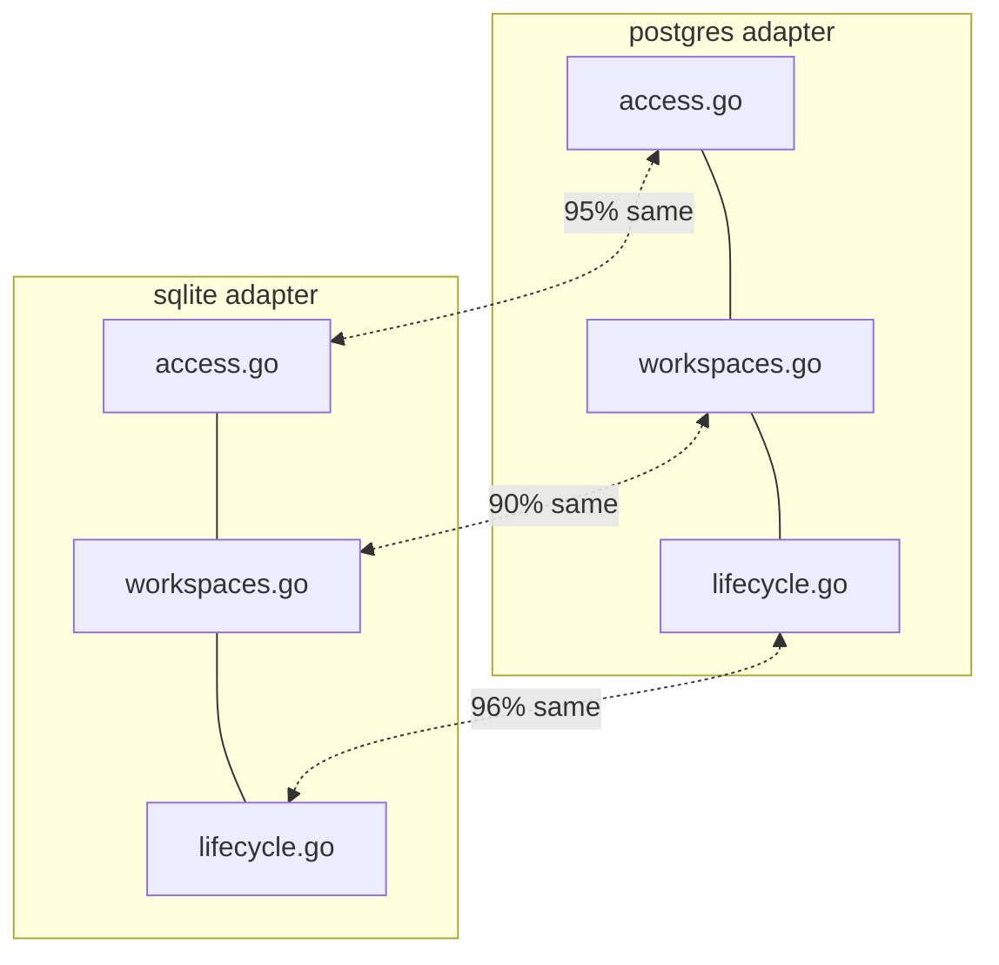

After:

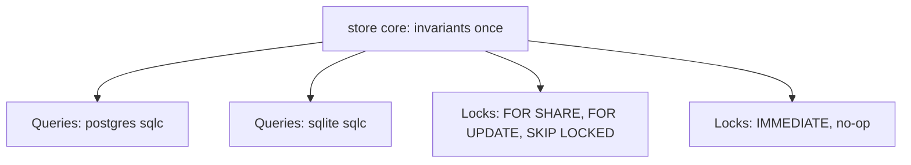

**Files**

- `every same-named pair in pkg/store/{sqlite,postgres}: access.go (835/806 lines, 95% identical), workspaces.go (1,031/970, 90%), lifecycle.go (96%), principals.go (92%), units (98%), reach (100%)`
- `pkg/store/internal/codec (1,000 lines: precedent for shared Go)`
- `postgres/workspaces.go:1060 and sqlite/workspaces.go:1142 (checkFenceCurrent twice)`

- **Problem:** After normalizing error types, package names and dialect words, 6,988 lines (75%) are identical across the adapters, and 1,199 of about 1,500 queries.sql lines too. The real differences are row-lock clauses, null types and backup/staging code. Every invariant (pending cap, serial and lineage checks, soft-delete moves, inventory projection, audit appends) is written twice, so every coordination feature (registry, jobs, schedules, claims) also costs two copies.
- **Deletion test:** Delete one adapter's access.go: its complexity reappears as a near copy. Duplication, not depth.
- **Deepening:** Orchestration in pkg/store/internal/core, written once, against (a) a per-dialect Queries interface (sqlc emit_interface, with null types aligned through overrides) and (b) a small Locks policy: FenceShared, FenceExclusive, RowForUpdate, ServerScope, Claim. PostgreSQL implements it with FOR SHARE / FOR UPDATE / SKIP LOCKED; SQLite with no-ops under IMMEDIATE. Dialects shrink to migrations, queries.sql, Locks, error translation, backup/staging.
- **Tests:** Suites unchanged. Lock behavior becomes one tested seam.
- **Risk and size:** XL. Main risk: sqlc type alignment.
- **Horizontal scaling:** SKIP LOCKED becomes one Claim method per dialect instead of a fork of the job logic. This is what makes the dual-dialect cost of the direction small.
- **ADR:** ADR 3 forbids shared SQL, not shared Go; it holds. Switching PostgreSQL to database/sql would conflict with ADR 3's "pgx directly"; use sqlc overrides instead.

### E2

**Test PostgreSQL lock correctness: a concurrency matrix and a two-handle factory**

*Strong* · local-substitutable · size M (600–1,000 lines of suites)

Before: Factory → one handle · 27 race cases · PG skipped locally  →  After: **shared suites** [two handles, race matrix]

**Files**

- `pkg/store/storetest/storetest.go:42 and 10 other *Factory types; blobtest.go:33`
- `lock-order prose: postgres/updates.go:21-31, workspaces.go:20-22, lifecycle.go:22-27`
- `about 27 goroutine cases across all suites (storetest/workspaces.go:83, 158, 211 …)`
- `process-local state the suites cannot see: postgres.go:48 (stagingMu), sqlite.go:191, 205, workspace/service.go:281, inventory/sweep.go:100-134`
- `.github/workflows/ci.yml:46-66, 113-117 (PostgreSQL only in CI)`

- **Problem:** SQLite serializes every writer, so any case passes on SQLite whether or not the PostgreSQL row lock exists. About 27 concurrency cases cover roughly 100 write methods. Every suite takes one handle, so none can express two instances. Locally, every PostgreSQL test skips without a message, so make check passes with no multi-instance coverage.
- **Deletion test:** Not a module.
- **Deepening:** For each write method, N goroutines on one key with invariant checks. A SharedFactory func(t) (a, b Store): SQLite opens one file twice, PostgreSQL one schema URL twice. RunShared… suites for leases, locks, fences, maintenance, sweeps, backup registry, and every new A-section port. Consider a visible skip message, or a container in make check (ask first).
- **Tests:** Suites grow by 1–2k lines; bugs surface earlier.
- **Risk and size:** M. SQLite with two handles may expose SQLITE_BUSY.
- **Horizontal scaling:** The test harness for the direction. Without it, "the database is the only coordination point" is unverified.
- **ADR:** Supported by CLAUDE.md: a new port method gets conformance tests before any adapter.

### E3

**One column spec for the backup format instead of three lists**

*Strong* · in-process · size S–M (about −700 lines)

Before: portableSpec · sqliteBackupTables · pgCopyTables  →  After: **portable spec** [rename map per dialect]

**Files**

- `pkg/backup/portable_tables.go (portableSpec, about 400 lines)`
- `pkg/store/sqlite/backup_columns.go (521 lines)`
- `pkg/store/postgres/backup.go:30-420 (pgCopyTables, pgCol* constants)`
- `pkg/backup/backup.go:60-95`

- **Problem:** One new column touches about 8 places (migration ×2, queries ×2, backup.Tables, portableSpec, the two adapter lists, often codec). The adapter lists mirror portableSpec except one rename (features_json vs features).
- **Deletion test:** Delete both adapter lists and derive them from portableSpec plus a per-dialect rename map: nothing is lost.
- **Deepening:** One spec in pkg/backup; each adapter supplies a rename map. Table classification (data vs bookkeeping) is B1.
- **Tests:** Coverage tests shrink to one.
- **Risk and size:** S–M.
- **Horizontal scaling:** Coordination tables must never round-trip through backups; decide before adding them.
- **ADR:** ADR 42 d5 ("each dialect keeps a constant column list"); amend through an RFC.

### E4

**Unit of work: a transaction the domain can open**

*Speculative* · ports & adapters · size XL

Before: fat ports ×37 · invariants in adapters  →  After: **Tx(Repos)**

**Files**

- `domain invariants coded in the adapters ×2 (see E1)`
- `pkg/workspace/service.go:1608-1690 (copyState as a saga across port calls)`
- `postgres/access.go:275, sqlite/access.go:300 (CreateNamespaceWithGrant: atomicity reached by merging ports)`

- **Problem:** The domain cannot open a transaction, so atomicity across ports is reached by merging ports and invariants live in the adapters.
- **Deletion test:** Fat transactional ports would shrink to small per-table repos.
- **Deepening:** store.Tx(ctx, scope, func(Repos) error); the domain owns invariants once. E1 gets most of the benefit with less change.
- **Tests:** Domain tests over a fake Repos.
- **Risk and size:** XL.
- **Horizontal scaling:** Would make claim-and-advance one domain transaction.
- **ADR:** ADR 2 and ADR 35 ("ports small"); depguard allows only interfaces in the domain.

### E5

**storefault: 74 hand-written forwarding methods**

*Worth exploring* · mock · size S–M

Before: 74 forwarders  →  After: **tx-seam faults** [checked names]

**Files**

- `pkg/store/storefault/storefault.go (964 lines, var _ Inner), :93-110, :124 (fault names are unchecked strings)`

- **Problem:** A shallow decorator: every new port method needs a forwarder; it lacks the access, audit and backup ports (see D1); a typo in a fault name means the fault never fires.
- **Deletion test:** Inject faults at the tx seam or a Locks/Queries wrapper (E1) and the forwarders disappear.
- **Deepening:** Fault injection keyed by operation name at the transaction seam, or a generated wrapper; validate names in New.
- **Tests:** Fault tests run the same server as production.
- **Risk and size:** S–M.
- **Horizontal scaling:** Fault-injected instance in a two-instance test must be the same server as its peer.
- **ADR:** None.

### E6

**Delete the 2,832-line whole-store fake in storetest**

*Worth exploring* · mock · size S (about −2,800 lines)

Before: 96-method fake  →  After: **SQLite + break knobs**

**Files**

- `pkg/store/storetest/backup_test.go:1-8 ("until then this fake runs it")`
- `pkg/store/storetest/backup.go:33 (BackupStore union with //nolint:interfacebloat)`

- **Problem:** Both adapters now implement the ports; the fake must grow with every port in a 96-method union.
- **Deletion test:** Delete it: suite strength can be shown with break knobs on a SQLite store (keepAccessHook, CountNullifier exist).
- **Deepening:** Break knobs on the real adapter.
- **Tests:** −2,800 lines.
- **Risk and size:** S.
- **Horizontal scaling:** One less place to extend for each coordination port.
- **ADR:** None.

### E7

**Make every hand-written fake pass its port's suite, or use SQLite**

*Worth exploring* · mock · size S–M

Before: memUpdateStore · memUpdates · memAuditStore ×3 · …  →  After: **checked fake or SQLite**

**Files**

- `internal/api/pulumi/updates_test.go:62 (memUpdateStore ignores fences, runs no suite)`
- `pkg/stack/updates_test.go:50 (memUpdates)`
- `pkg/backup/service_test.go:33; pkg/maintenance/maintenance_test.go:43`
- `3× memNamespaceStore, 3× memAuditStore, 2× memBlob; 43 mem*/fake* types`
- `pkg/workspace/workspace_test.go:1175 (the good model: memStore runs RunWorkspace)`

- **Problem:** Fakes drift from real semantics, especially fences and leases, and duplicate each other.
- **Deletion test:** Duplicated fakes fail the deletion test; one checked fake or SQLite on a temp file replaces them (pkg/stack/crash_test.go:201 already does).
- **Deepening:** Each fake runs its suite, or tests use SQLite.
- **Tests:** Cross-instance domain tests run on checked fakes.
- **Risk and size:** S–M.
- **Horizontal scaling:** Domain-level cross-instance tests depend on fake fidelity.
- **ADR:** None.

### E8

**Put each domain's conformance suite next to its domain**

*Worth exploring* · in-process · size M (moves)

Before: storetest union  →  After: **suite per domain**

**Files**

- `pkg/store/storetest (21,578 lines, 11 Run* entry points, 241 cases)`
- `accesstest, principaltest, sessiontest, accesstokentest (next to their domains)`

- **Problem:** Stack, workspace, namespace, inventory and maintenance suites live in storetest with giant unions; access, principal, session and token suites live with their domains. Poor locality for SDK users.
- **Deletion test:** Moves.
- **Deepening:** stacktest, workspacetest, …; storetest keeps cross-port suites (backup, restore, schema, portable).
- **Tests:** Moves.
- **Risk and size:** M.
- **Horizontal scaling:** New coordination ports get their own *test packages.
- **ADR:** None.

### E9

**SQLite: take the swap RLock inside the transaction helpers; read without IMMEDIATE**

*Worth exploring* · in-process · size S (about −500 lines)

Before: RLock ×173  →  After: **inTx/inReadTx**

**Files**

- `pkg/store/sqlite/sqlite.go:202-205 (s.mu guards the file swap; RLock pasted at the top of 173 methods)`
- `pkg/store/sqlite/review.go:34, 131 (reads through IMMEDIATE inTx) vs postgres/review.go:49, 97`

- **Problem:** 173 repeated lock lines; read-only review paths take the write lock.
- **Deletion test:** The repeated RLock concentrates in inTx/inReadTx.
- **Deepening:** RLock inside the helpers; a read transaction for read paths.
- **Tests:** Unchanged suites.
- **Risk and size:** S.
- **Horizontal scaling:** SQLite stays single-node.
- **ADR:** None.

### E10

**Decide what SQLite is: a full adapter of every coordination port, plus a single-node guard**

*Worth exploring* · local-substitutable · size S (decision + guard)

Before: no guard  →  After: **single-node guard**

**Files**

- `pkg/store/sqlite/sqlite.go:140-205, 293 (WAL guard assumes one process)`
- `pkg/store/sqlite/audit_sink_lease.go (parity pattern for claims)`
- `e2e/binary.go:1064-1095 (the harness already opens the binary's file as a second writer)`

- **Problem:** SQLite means one instance, but nothing refuses a second process on the same file.
- **Deletion test:** Not a module.
- **Deepening:** Keep SQLite a full adapter of jobs, schedules and the registry (durable jobs help single-node crash recovery too; the claim is one query per dialect). Add a guard (registry or file lock) that refuses a second instance. Do not give SQLite in-process coordination: a second semantics to test.
- **Tests:** Second-instance refusal test.
- **Risk and size:** S.
- **Horizontal scaling:** Keeps one code path for recovery.
- **ADR:** None.

### E11

**Blob intent ledger instead of List plus ModifiedAt sweeps**

*Worth exploring* · ports & adapters · size M–L

Before: LIST prefix · ModifiedAt vs clock  →  After: **intent ledger**

**Files**

- `pkg/workspace/service.go:1855-1925 (grace on the object store's ModifiedAt; RecordUploadAttempt for workspaces only)`
- `pkg/stack/updates.go:1123-1275 (sweepStackOnStart lists the whole stack prefix on every update start)`
- `ReferencedCheckpointKeys, JournalKeys, blob_purges (per-tool variants)`

- **Problem:** Safety depends on the object store's LastModified compared with each instance's clock (for S3 multipart, possibly the request start). Every update start or declare costs an O(history) LIST, repeated on every instance, on the request latency path.
- **Deletion test:** Folded into G1 (the staged-blob module); listed separately because it is the store-side table.
- **Deepening:** blob_intents written in a fenced transaction before each Put; GC = intents older than the grace with no reference, claimed as work items.
- **Tests:** Crash tests assert on intents.
- **Risk and size:** M–L.
- **Horizontal scaling:** Removes List and clock dependence across instances.
- **ADR:** ADR 26 d8, ADR 37 d3 ("sweep" wording).


## Section F. Identity and authorization

Six copies of route enforcement, a two-pass authentication, and 6 to 9 sequential round trips for each authorized request.

### F1

**One shared route-enforcement module for every HTTP adapter**

*Strong* · in-process · size L (−600 to −900 / +400 lines; route tests −1,000 to −1,500)

Before: pulumi enforce · tfe enforce · server enforce · inventory enforce · audit enforce · tofuhttp variant  →  After: **route enforcer** [credential schemes, authorize, hide policy, policy hook]

**Files**

- `internal/api/audit/routes.go:13-57, 180-250`
- `internal/api/inventory/routes.go:13-55, 140-176, 197-254`
- `internal/api/pulumi/routes.go:17-70, 606-739`
- `internal/api/server/routes.go:11-75, 326-412`
- `internal/api/tfe/routes.go:17-70, 400-435, 506-638`
- `internal/api/tofuhttp/tofuhttp.go:86-211 (bare ServeMux, no TestNoMuxBypass)`
- `authenticate copies: audit.go:331, inventory.go:285, pulumi.go:847, server.go:324, tfe.go:428, tofuhttp.go:213, dustpan.go:2441`

- **Problem:** Route, Scope, ObjectResolver, enforce*, patternMux and three route tests are copied five or six times and have drifted: object-dependent actions declared two ways; empty action lists refused at run time in one adapter only; only TFE hides existence with 404 (Pulumi and inventory answer 403 and leak it); session marking three ways (audit discards it); credential parsing differs per adapter. ADR 17's "a test lists every route the server registers" is not met: tests are per adapter, and root-mux routes are on no list. No seam exists for the ADR 17 policy check.
- **Deletion test:** Delete one adapter's enforce: nothing changes, the same logic is in five other places. Copied, not deep.
- **Deepening:** internal/api/route: Route{Method, Path, Scope, Actions(obj), Resolve, Serve}; one Enforcer configured per adapter with its credential schemes, its error writer (each wire shape stays as its tool expects, ADR 12), a hide policy, capability scopes, an address gate and a PolicyCheck hook (no-op default). routetest.Check(t, routes, publicList). One server-level test joins every adapter's Routes() with the root mux.
- **Tests:** One shared suite plus a short table per adapter; tofuhttp gains the bypass test.
- **Risk and size:** L. Status codes the CLIs depend on must match exactly: make e2e.
- **Horizontal scaling:** One place for a per-request check later (policy, fence-aware read, audit actor C4).
- **ADR:** None; closes the gap against ADR 17. A shared internal package is not an adapter (ADR 12), though a reviewer may ask.

### F2

**Authenticate once at the edge and pass the caller in the context**

*Strong* · in-process · size M (200–300 lines)

Before: request log auth · authgate memo · adapter auth ×6  →  After: **edge authentication** [Caller in context]

**Files**

- `pkg/dustpan/dustpan.go:2441-2467, 2491-2520 (request log authenticates with its own parser)`
- `internal/authgate/authgate.go:16-19, 165-245 (per-request memo so log and adapter resolve once)`

- **Problem:** Authentication runs twice per request, tied together by a memo inside the rate limiter, so authgate has two unrelated jobs. The request log never sees cookies or Basic auth. A wrong token on a public route is still looked up and charged.
- **Deletion test:** Delete the memo and each token request costs two lookups and two touches: a workaround, not depth.
- **Deepening:** Root middleware runs Credentials.FromRequest(r, accepted) → Caller (or the error) into the context; adapters check the scheme fits; authgate keeps only the budget.
- **Tests:** Memo tests go; adapter tests seed a Caller.
- **Risk and size:** M. An adapter must not accept a scheme it should refuse; table test per adapter.
- **Horizontal scaling:** Fewer reads per request.
- **ADR:** None.

### F3

**A fuller Caller: principal ID, credential kind and auth time in the interface**

*Strong* · ports & adapters · size L (SDK break, many mechanical test edits)

Before: Principal (5 fields) · WithSession · sessionKey · freshnessKey · TokenID == ""  →  After: **Caller** [principal ID, credential kind, auth time]

**Files**

- `pkg/identity/identity.go:43-58 (Subject, DisplayName, Admin, TokenID, TokenExpiresAt)`
- `side channels: internal/sessionauth/sessionauth.go:144-158; internal/api/server/signin.go:610-616; server/routes.go:360; server/freshness.go:40-57`
- `guesses: pkg/accesstoken/scope.go:58-64 (TokenID == "" means signed in; bootstrap passes); pkg/ipallow/gate.go:89-91 (subject-name check)`
- `re-lookups by subject: access/authorizer.go:627; accesstoken/scope.go:74; access/service.go:540; dustpan/auditchain.go:270`

- **Problem:** Credential-dependent rules (a session cannot start an update, freshness, an access token cannot make tokens) are spread over adapters and inferred from the struct's shape. The authenticator had the principal ID and dropped it, so four places look it up again. AuthenticateToken(ctx, string) cannot express a cookie, CSRF or an mTLS certificate; sessions already go around it. ADR 52 d9 attribute conditions have nothing to read.
- **Deletion test:** Not a module; missing information in the interface that every consumer pays for.
- **Deepening:** Caller{PrincipalID, Subject, Credential{Kind: bootstrap|token|session|workload, ID, ExpiresAt, AuthTime}, Groups (lazy)}. Authenticator takes a request credential. Bootstrap becomes a credential kind.
- **Tests:** Every identity.Principal literal changes (exhaustruct).
- **Risk and size:** L.
- **Horizontal scaling:** Saves a lookup by subject per request.
- **ADR:** ADR 6 ("token to principal"), ADR 55 d2, ADR 54 d4 (mTLS cannot fit a string). RFC first.

### F4

**Widen the Authorizer port so lists cannot skip decorators**

*Strong* · ports & adapters · size M (150–250 lines, SDK port)

Before: Authorize only · .(*access.Authorizer) · Authorizer().ListObjects  →  After: **Authorizer** [Authorize, Scope]

**Files**

- `pkg/identity/identity.go (Authorize only)`
- `pkg/access/authorizer.go:154, 218 (Explain, ListObjects only on the concrete type)`
- `pkg/dustpan/lifecycle.go:226-234; dustpan.go:2039; internal/api/server/namespaces.go:346-353`

- **Problem:** List filtering goes around the port by type assertion or by reaching into the service. In production the assertion at lifecycle.go:231 always fails (see D2), and visibleNamespaces calls the concrete ListObjects so the IP-allowlist decorator never runs on lists: a namespace whose allowlist excludes the client still shows its name.
- **Deletion test:** Delete the assertions and the list features have no seam; the port is too narrow for ADR 17's "a list returns only the objects the caller can read".
- **Deepening:** Authorizer{Authorize(ctx, Caller, Action, Object); Scope(ctx, Caller, Action) (Scope, error)}; every decorator implements both.
- **Tests:** Decorators get list tests; a NewServer-level deleted-units test shows the bug now.
- **Risk and size:** M.
- **Horizontal scaling:** None.
- **ADR:** Current behavior falls short of ADR 17 (list rule) and ADR 55 d8.

### F5

**One query for an authorization decision instead of 4 to 9 sequential round trips**

*Strong* · local-substitutable · size M–L (about 300 lines SQL + Go ×2 dialects)

Before:

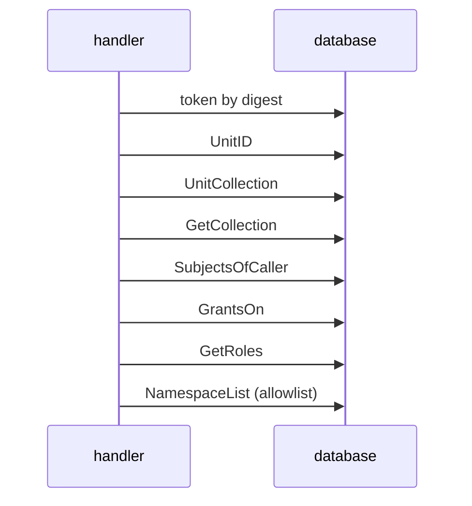

After:

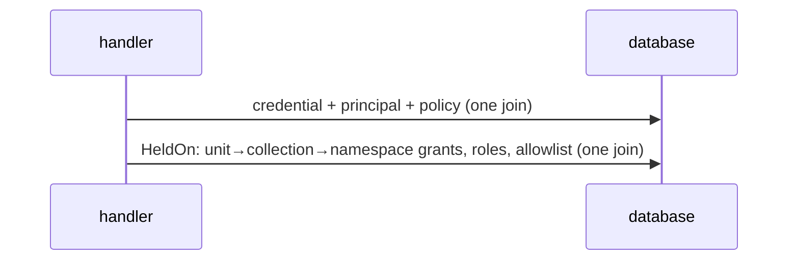

**Files**

- `pkg/access/authorizer.go:419-447 (heldActions), 643-701 (chainObjects), 726-752 (collectionOfUnitObject, not cached), 754, 859-888`
- `pkg/collection/service.go:135, 166`
- `pkg/store/postgres/queries.sql:1110 (GrantsOn), 1149 (SubjectsOfCaller)`
- `pkg/ipallow/gate.go:63-80 (NamespaceList per action, outside the request cache)`

- **Problem:** Each Authorize on a unit runs UnitID, UnitCollection, GetCollection, SubjectsOfCaller, GrantsOn, GetRoles in sequence, plus NamespaceList for the allowlist; each extra action adds 3–4 trips. A token request totals about 6–9 round trips before the handler; a console session adds GetSessionByDigest, GetSessionPolicy and an UPDATE.
- **Deletion test:** The authorizer is deep in rules (families, namespace principals, live grants), but much of its depth is code that sequences round trips. Move the joins into the store and Go keeps only the rules.
- **Deepening:** A store method HeldOn(ctx, principalID, objectRef, action) → (grants, roles) as one fixed sqlc query per dialect: units → collections by stable ID, caller and live memberships, grants on the chain, custom roles, and the namespace allowlist when on. Keep heldFromGrants in Go.
- **Tests:** An accesstest case for the new method; existing authorizer tests unchanged.
- **Risk and size:** M–L. SQL and Go meanings of a live grant must not drift; existing cases (testUnitTarget) guard it.
- **Horizontal scaling:** Highest leverage: with the database as the only coordination point, round trips per request are the unit of scale. It also removes any reason for a cross-request authorization cache.
- **ADR:** None; ADR 13 foresaw moving filtering into queries.

### F6

**Sessions and access tokens are twin modules; account inactivity lives in the token package**

*Worth exploring* · in-process · size M (about 300 lines)

Before: session Secret · token Secret · internal/token · tokenInactivity  →  After: **credential** [generate, parse, digest, compare]

**Files**

- `pkg/session/session.go:176-184, 385-480`
- `pkg/accesstoken/accesstoken.go:195-203, 225-315`
- `internal/token/token.go (third copy of the secret code)`
- `pkg/dustpan/signin.go:205-220 (tokenInactivity adapter)`
- `pkg/accesstoken/service.go:647-668`
- `pkg/store/postgres/queries.sql:1351-1355, 1775-1779 (copied activity subqueries)`

- **Problem:** Secret, Digest, Owner, lookup SQL and the inactivity rule are copied; inactivity is a property of the principal but lives in accesstoken and reaches sessions through a pass-through adapter in dustpan.
- **Deletion test:** A credential module concentrates about 150 lines copied three times; tokenInactivity is a pure pass-through.
- **Deepening:** Secret and Digest in one credential package; AccountInactive and the activity SQL in principal; one principal.Owner.
- **Tests:** Secret and digest tests merge.
- **Risk and size:** M; depguard import rules.
- **Horizontal scaling:** With A9, one query per lookup.
- **ADR:** None.

### F7

**One delegation module for "does A cover B"; delete tokengrants**

*Strong* · in-process · size L (S for the agreement test first)

Before: checkEscalation · Guard · GrantCheck · tokengrants · ReachOf (unused)  →  After: **delegation** [Covers]

**Files**

- `pkg/access/service.go:617-660 (CheckGroupGrants, CheckPrincipalGrants), 1148-1180 (checkEscalation)`
- `pkg/principal/store.go:147 (Guard)`
- `internal/tokengrants/tokengrants.go (70 lines)`
- `pkg/access/reach.go (ReachOf, Covers: no production caller; accesstest/reach.go:179, 735-755)`
- `pkg/accesstoken/scope.go:44-54 (GrantCheck for ScopePersonal, which ADR 70 d5 removes)`

- **Problem:** The escalation check is built four times; principal reaches back into access through Guard; ReachOf has zero production adapters (hypothetical seam); no test checks that Reach agrees with Authorize. ScopePersonal create and rotate routes still exist against ADR 70 d5.
- **Deletion test:** tokengrants: delete, and its two checks move with no loss. GrantCheck becomes dead when the route goes.
- **Deepening:** access.Delegation with Covers(ctx, caller, target), used by token, grant, membership and trust-rule services. First land the property test: Reach.Has(a, o) == (Authorize(a, o) == nil) over the accesstest fixtures.
- **Tests:** Delegation tests in storetest get stronger; tokengrants tests go.
- **Risk and size:** L; subtle security semantics.
- **Horizontal scaling:** Reach walks the graph with many queries; fine on writes, not per request.
- **ADR:** Today's code falls short of ADR 70 d2, d3, d5.

### F8

**One authorizer stack: drop SelfAllowed duplication and WithAuthorizer's second truth**

*Worth exploring* · in-process · size S–M

Before: SelfAllowed · ipallow.Gate · second access.Authorizer  →  After: **one authorizer stack**

**Files**

- `pkg/identity/identity.go:829-845 (SelfAllowed)`
- `pkg/access/access.go:84-86, 157-159 (FamilySelf already allows token:manage-own, caller:read, role:read)`
- `pkg/dustpan/dustpan.go:636-638, 2039-2053, 2100-2105`

- **Problem:** With the access store wired, SelfAllowed changes no decision, but it hides the concrete type (cause of the D2 bug). With a custom SDK authorizer, routes use one model while escalation builds its own access.Authorizer. accesstoken receives the undecorated authorizer, so its internal checks skip the IP allowlist.
- **Deletion test:** SelfAllowed passes deletion in the default setup.
- **Deepening:** One place builds the stack; every consumer gets the same value; F4 lets escalation use the port.
- **Tests:** Wiring test.
- **Risk and size:** S–M; SDK break if WithAuthorizer goes.
- **Horizontal scaling:** None.
- **ADR:** ADR 35.

### F9

**Freshness: a port with no adapter while the real rule lives in one HTTP adapter**

*Worth exploring* · ports & adapters · size S–M

Before: Freshness port (unused) · freshnessKey closure  →  After: **freshness** [AuthTime from Caller]

**Files**

- `pkg/accesstoken/service.go:45-62 (Freshness port, nothing wired)`
- `internal/api/server/freshness.go:40-125 (the ADR 71 check as a context closure)`
- `internal/api/pulumi/reveal.go, tfe/reveal.go (ADR 56 needs the same rule)`

- **Problem:** A hypothetical seam with zero adapters, while the enforced rule lives only in the server adapter; other clients of accesstoken.Service.Create skip it, and reveal in other adapters will need more copies.
- **Deletion test:** Delete the port and nothing changes, or make it the one seam backed by Caller.Credential.AuthTime (F3).
- **Deepening:** A session-backed freshness adapter reading the Caller.
- **Tests:** One freshness suite.
- **Risk and size:** S–M.
- **Horizontal scaling:** None.
- **ADR:** ADR 56 and ADR 71 rules sit in an adapter.

### F10

**IP allowlist gate: one read per action, an SDK package importing internal**

*Speculative* · in-process · size S–M

Before: Gate per action · internal/clientip  →  After: **allowlist in enforcer**

**Files**

- `pkg/ipallow/gate.go:34-91`
- `pkg/ipallow imports internal/clientip for FromContext`

- **Problem:** NamespaceList on each Authorize call outside the request cache; an SDK user outside the module cannot set the client address; only namespace lists exist although ADR 55 d8 names installation and per-token lists.
- **Deletion test:** The check is real; its home is odd (a property of the request run as an authorization decorator).
- **Deepening:** Run once per request in the F1 enforcer after the object resolves, or fold into F5's query; move the address key into pkg/identity or the Caller.
- **Tests:** Enforcer tests.
- **Risk and size:** S–M.
- **Horizontal scaling:** Fewer reads.
- **ADR:** ADR 35 (pkg must not depend on internal for what it exposes), ADR 55 d8.

### F11

**Escalation checks read, then write, outside the write transaction**

*Speculative* · local-substitutable · size M

Before: check · (window) · write  →  After: **check in write tx**

**Files**

- `pkg/access/service.go:662-676, 1148-1180`
- `principal.Service (Guard, then store)`

- **Problem:** A granter whose own grant is revoked between check and write still writes the grant. Exists on one instance already; N instances make it more frequent.
- **Deletion test:** Not a module.
- **Deepening:** Run the held-actions query inside the write transaction (needs F5's store method), or bump an access_version row the write checks.
- **Tests:** Concurrency test.
- **Risk and size:** M.
- **Horizontal scaling:** More concurrency, more often.
- **ADR:** None; the owner may accept the window.

### F12

**OIDC discovery is cached forever per instance**

*Speculative* · in-process · size S

Before: discovery once  →  After: **refresh on error**

**Files**

- `internal/oauth/lazy.go:22`

- **Problem:** A provider endpoint change needs a restart of every instance. JWKS by key ID is fine.
- **Deletion test:** Not a module.
- **Deepening:** Refresh on a provider error.
- **Tests:** Refresh test.
- **Risk and size:** S.
- **Horizontal scaling:** N restarts.
- **ADR:** None.


## Section G. Tool domains and HTTP adapters

Handlers are mostly thin. Two write protocols for blobs, and several rules that live in the wrong module.

### G1

**One staged-blob module for "write content, then publish a row"**

*Strong* · ports & adapters · size L–XL (800–1,500 lines + migrations)

Before: checkpoint adopt · built adopt · journal append · fence blob · seal blob · upload attempt · copyState  →  After: **staged blob** [intent row, Put, commit clears, reclaim]

**Files**

- `blob first: pkg/stack/updates.go:836-1000 (storeNewCheckpoint, adoptCheckpointBlob, checkpointCollision); pkg/stack/journal_build.go:198-330 (a near copy); pkg/stack/journal_entries.go:399-450; pkg/workspace/fence.go:28-75; pkg/workspace/seal.go:88-133, 258-300`
- `intent first: pkg/workspace/service.go:843-910 (Upload with noteAttempt), 1609-1690 (copyState)`
- `sweeps: pkg/stack/updates.go:1123-1275; journal_entries.go:348-390; workspace/service.go:1802-1900; seal.go:331-362 (no grace)`

- **Problem:** At least 7 write sites use 2 protocols with 3 grace constants and per-site rules (adopt on ErrExists, delete on refusal, keep on unknown outcome). A reviewer must re-derive the safety argument at each site; #668 is the result: the seal's sweep has no grace, so instance B deletes the sealed blob instance A wrote but has not committed, and the same applies to a force-unlock fence blob, which records nothing before its Put.
- **Deletion test:** No module exists, so the complexity is spread over 7 callers; each would drop 40–120 lines. It earns its keep.
- **Deepening:** Stage(ctx, owner UnitRef, key, r) writes a durable intent row, then Puts; the domain's commit removes the intent; Abandon on a known refusal; adopt-on-ErrExists as one function; orphan reclaim reads intents older than the grace (E11), claimed as work items. One conformance suite. Short-term #668 fix: record the seal key and the fence key on the row before the Put; delete the no-grace sweep.
- **Tests:** One crash-and-interleave suite replaces about 5 per-site suites; add two services on one store interleaving Put, sweep and commit.
- **Risk and size:** L–XL; every write path is e2e-sensitive.
- **Horizontal scaling:** Removes List and clock dependence; one place to reason about two instances; fixes #668.
- **ADR:** ADR 37 d3 and ADR 26 d5, d7, d8 prescribe blob first plus a sweep; ADR 45 d3 relies on it; ADR 41 d11 (seal job). RFC first.

### G2

**Move workspace restore idempotency into the store; delete the striped mutexes**

*Strong* · local-substitutable · size S–M (100–300 lines + migration if indexed)

Before: 64 stripes · restore guard in process  →  After: **finalize in store** [idempotent restore]

**Files**

- `pkg/workspace/service.go:262-308 (stripes), 721-731, 843-847, 1310-1345 (restore stripe), 1588-1606 (mapRestoreLockError), 1937-1954 (lockKey)`
- `pkg/workspace/write_state.go:319-347`
- `pkg/store/postgres/workspaces.go:20, 534, 689 (Finalize already holds the row FOR UPDATE)`

- **Problem:** The declare and upload stripes only reduce contention; the store decides. The restore stripe carries correctness: the code says that without it two concurrent restores both write a restored version. Across instances there is no stripe, so a retry on another instance writes a duplicate history version, or fails non-idempotently.
- **Deletion test:** Deleting the declare and upload stripes changes nothing observable (shallow). Deleting the restore stripe reproduces the bug, so the stripe is the only guard and it is per process.
- **Deepening:** FinalizeStateVersion with RestoredFrom set returns the existing version when the current one already has the same RestoredFrom under the same lock ID; or a partial unique index (workspace, restored_from, lock_id). Then delete all stripes (about 40 lines).
- **Tests:** A storetest case: two services restore concurrently, one version results.
- **Risk and size:** S–M.
- **Horizontal scaling:** Removes the last correctness dependency on an in-process lock in a request path (#670).
- **ADR:** None; ADR 26 d7 already puts finalize checks in one transaction.

### G3

**Make the journaled checkpoint build deterministic**

*Strong* · in-process · size S (30–80 lines)

Before: manifest time = now() · digest mismatch on retry  →  After: **deterministic build** [time from update]

**Files**

- `internal/pulumijournal/replay.go:88-89, 921, 948 (newManifest(r.now(), …))`
- `pkg/dustpan/dustpan.go:1091 (NewReplayer(clockOf(cfg), ""))`
- `pkg/stack/journal_build.go:198-282, 403-474`
- `pkg/stack/updates.go:1493-1505 (sequence 0 key is always …/0)`
- `journal_build_test.go:476 (fixed fake clock hides it)`

- **Problem:** Confirmed by reading: the built deployment embeds the manifest time from now(), so two builds of one journal have different digests. After a crash between the blob Put and PutBuiltCheckpoint, the retry meets ErrExists on the same key with a digest mismatch and returns 409 every time; no sweep frees the key while the update runs. Behind a load balancer the retry on another instance is the normal case. Separately, journaled reads replay the whole journal on every Export.
- **Deletion test:** Not a module; a bug.
- **Deepening:** Build as a pure function of (base, batches, update): take the manifest time and CLI version from the update. The result becomes cacheable by (update ID, high-water sequence).
- **Tests:** A crash test with an advancing clock: Put, fail commit, retry.
- **Risk and size:** S. Check ADR 43 d7 for a rule on manifest time.
- **Horizontal scaling:** Retries across instances.
- **ADR:** Possibly ADR 43 d7.

### G4

**One classifier for core errors; fix the status-code drift**

*Strong* · in-process · size S–M (150–250 lines)

Before: pulumi map · tfe map · tofuhttp map · inventory map  →  After: **core error classifier**

**Files**

- `internal/api/pulumi/pulumi.go:912-978`
- `internal/api/tfe/errors.go:156-205`
- `internal/api/tofuhttp/tofuhttp.go:269-329`
- `internal/api/inventory/inventory.go:~320-390`

- **Problem:** namespace.ErrNotHome is 421 in pulumi and inventory, 500 in tfe and tofuhttp; ErrFenced is 409 in pulumi and tfe, 500 in tofuhttp; ErrUnavailable is 500 everywhere and should be 503 with Retry-After, which matters during rolling restarts; each adapter copies the rate-limit message.
- **Deletion test:** Not a module yet; copies.
- **Deepening:** A tool-neutral classifier → (status, kind, safe text, retry-after) called first; each adapter renders in its own shape. Sits in F1's module.
- **Tests:** One table test for the core mapping.
- **Risk and size:** S–M; status changes must pass make e2e.
- **Horizontal scaling:** 503 on unavailability, 421 across regions.
- **ADR:** CLAUDE.md: never change a status code a CLI uses; 500 → 409/503 is probably safe but e2e decides.

### G5

**Generalize the blob purge record into the durable work queue; move lifecycle out of inventory**

*Strong* · ports & adapters · size L (600–1,000 lines + migrations)

Before: inventory sweeper · TryLock · inline deletes  →  After: **work items** [purge, superseded, orphan, seal]

**Files**

- `pkg/inventory/sweep.go:112-161, 262-330 (TryLock, finishBlobPurges; 474 lines)`
- `inventory.BlobPurges (pkg/workspace/service.go:85-104 documents it)`
- `pkg/dustpan/sweep.go:130-175`
- `inline superseded deletes: pkg/stack/updates.go:1026-1041; pkg/workspace/service.go:1902-1925`

- **Problem:** The repository already has one durable work item, the blob purge record written in the domain transaction, but it lives in pkg/inventory, which ADR 13 defines as a projection nothing else writes. Every other background deletion is per process; N instances run each N times (correct, because the database arbitrates, but redundant; ErrSweepRunning and metrics are per instance).
- **Deletion test:** Delete the TryLock and correctness stays; only duplicated work grows. The TryLock is a shallow guard; the record table is the real seam.
- **Deepening:** Kinds of A2 work item: blob purge, superseded blob, seal version, expired pending, orphan reclaim, journal blob removal. The retention sweep claims expired units. Inventory keeps Entry, DeletedEntry and readers.
- **Tests:** Claim-semantics conformance; sweeper tests become queue tests.
- **Risk and size:** L.
- **Horizontal scaling:** RFC 36's open question for deletions.
- **ADR:** ADR 13 (sweep in inventory), ADR 47 (purge record design).

### G6

**Move Pulumi state-view orchestration from the adapter into pkg/stack**

*Worth exploring* · in-process · size S–M (150–250 lines moved)

Before: adapter decides predecessor  →  After: **stack read model**

**Files**

- `internal/api/pulumi/state.go:183-247 (stateCurrent, statePrevious), 291-343, 382-421`
- `pkg/workspace/service.go:1184-1290 (the OpenTofu equivalent lives in the domain)`

- **Problem:** Which checkpoint is the predecessor and how latest resolves is decided in the HTTP adapter for Pulumi and in the domain for OpenTofu; the use case cannot be reused or cached without HTTP.
- **Deletion test:** Remove the adapter code and the domain must provide it: it belongs there.
- **Deepening:** stack.Updates.ReadResources, ReadResource, Diff mirroring workspace.
- **Tests:** Domain tests replace part of state_test.go.
- **Risk and size:** S–M.
- **Horizontal scaling:** Enables derived-view caching.
- **ADR:** None.

### G7

**The override allowance (ADR 44 d6) is implemented twice in adapters**

*Worth exploring* · in-process · size S (80–120 lines)

Before: tfe allowance · tofuhttp allowance  →  After: **workspace.Allowance**

**Files**

- `internal/api/tfe/overrides.go:74-140`
- `internal/api/tofuhttp/audit.go:20-110`

- **Problem:** A domain rule (namespace switch AND unit switch AND action) is copied in two adapters, each with an extra namespaces.Get; the override audit entry is copied too.
- **Deletion test:** Each copy is shallow.
- **Deepening:** workspace.Allowance(ns, w, can) in the domain; one override audit helper (C4).
- **Tests:** One domain table test.
- **Risk and size:** S.
- **Horizontal scaling:** None.
- **ADR:** None.

### G8

**Split pkg/workspace into the transactional service and a pure OpenTofu state reader**

*Worth exploring* · in-process · size M (6–8k lines moved, low behavior risk)

Before: workspace: service + reader  →  After: **tofustate** [resources, diff, reveal, meta]

**Files**

- `pkg/workspace/tofu_state.go (1,828), reveal.go (1,121), reveal_target.go (640), reveal_locate.go, reveal_pointers.go, reveal_digest.go, state_scan.go, state_meta.go`
- `pkg/workspace/service.go (2,357 lines, 32 exported methods), :105 (StateStore with //nolint:interfacebloat)`
- `duplicated stream helpers: pkg/stack/reveal.go:239-330 and pkg/workspace/reveal.go:625-700`

- **Problem:** One package holds two modules with different change drivers: protocol and transactions (about 3.5k lines) versus the state format (about 5.6k lines of pure functions). pkg/stack has the same shape at about 2k lines. Token-level stream helpers are copied between the two tools.
- **Deletion test:** The state reader is deep (small interface over complex JSON walking); keep it, in its own package. The service is deep too: do not split it by verb.
- **Deepening:** pkg/workspace/tofustate and pkg/stack/deployment (pure, no ports); internal/jsonstream for shared token helpers (no tool model shared, ADR 13 holds).
- **Tests:** About 6k lines of tests move with the code.
- **Risk and size:** M, mechanical.
- **Horizontal scaling:** Makes cacheable derived views easy to place.
- **ADR:** ADR 35: new pkg packages are SDK surface; consider internal/.

### G9

**Inventory projection rules live in each SQL dialect; ADR 13's core port is hypothetical**

*Worth exploring* · ports & adapters · size M (300–500 lines)

Before: postgres publish rules · sqlite publish rules  →  After: **domain inventory delta**

**Files**

- `pkg/store/postgres/inventory.go:26-190`
- `pkg/store/postgres/workspaces.go:1003-1020`
- `pkg/store/sqlite/inventory.go:37, 112; sqlite/workspaces.go:1060, 1096`

- **Problem:** Publishing is in the same transaction on every traced write path (ADR 13 consistency holds), but domain rules (a preview holds no lock; operation = update kind or lock reason) are written once per dialect. Status and ResourceCount are always unknown though the server reads state now. Storetest covers ListUnits lightly.
- **Deletion test:** The helpers are pass-throughs plus domain rules that belong in the domain.
- **Deepening:** The domain computes an inventory.Entry or Lock delta (stack.Update.InventoryLock(), workspace.Workspace.InventoryEntry()); adapters only persist. A projection conformance suite checks the entry after every tool write.
- **Tests:** New suite; fewer per-dialect tests.
- **Risk and size:** M.
- **Horizontal scaling:** None directly.
- **ADR:** ADR 13 ("through a core port"): the code drifts from it.

### G10

**ADR 45 d4–d7 are not implemented for Pulumi checkpoints**

*Worth exploring* · in-process · size L to implement; S for a superseding ADR

Before: whole body in memory ×3  →  After: **streamed checkpoint** [byte range in row]

**Files**

- `pkg/stack/update.go:356, 386 (Deployment []byte)`
- `internal/api/pulumi/limits.go:58-123 (decodes the whole body)`
- `pkg/stack/updates.go:714-737, 1065-1100`
- `pkg/stack/journal_build.go:64-98 (buffers base, batches and output; the streaming Replayer has one caller fed from memory)`

- **Problem:** Memory per checkpoint still grows with state size at about 2–3 copies; no offset or length columns exist; the streaming replayer seam is unused.
- **Deletion test:** Not a module; drift from an accepted ADR.
- **Deepening:** Implement the ADR (stream to the blob, byte range in the row), or supersede d4–d7 with what the code does.
- **Tests:** The comparison tests ADR 45 lists.
- **Risk and size:** L / S.
- **Horizontal scaling:** Per-instance memory limits how many large bodies the gate admits.
- **ADR:** ADR 45, ADR 37 d1.

### G11

**Unit listings: in-memory filtering and different authorization semantics per adapter**

*Worth exploring* · local-substitutable · size S helper; M–L query-side

Before: list all · authorize each · page in memory  →  After: **readable-units query**

**Files**

- `internal/api/tfe/workspaces.go:305-400`
- `internal/api/inventory/inventory.go:229-274`
- `internal/api/pulumi/pulumi.go:416-484 (namespace-level unit:read; N+1 over namespaces; no pagination)`

- **Problem:** A per-unit grant (ADR 52) shows a unit in TFE and inventory listings but not in pulumi stack ls. Every listing is O(units) per request with a read each.
- **Deletion test:** Not a module.
- **Deepening:** identity.FilterReadable now; a store query that joins grants later (F5); decide the Pulumi semantics explicitly.
- **Tests:** Cross-adapter consistency tests for per-unit grants.
- **Risk and size:** S / M–L.
- **Horizontal scaling:** Database load per request.
- **ADR:** ADR 13, ADR 52.

### G12

**Small domain cleanups: built-checkpoint port, OpenStateBlob copy, required body gate**

*Worth exploring* · in-process · size S (100–150 lines)

Before: run-time port · two open paths · optional gate  →  After: **validated config**

**Files**

- `pkg/stack/journal_build.go:284-290 (BuiltCheckpointStore asserted at run time)`
- `pkg/workspace/service.go:1076-1157 (Open and OpenStateBlob near copies)`
- `internal/api/tofuhttp/tofuhttp.go:143; internal/api/pulumi/pulumi.go:190 (build their own gate when nil)`

- **Problem:** A port checked at run time fails at Complete, not at wiring; two near-copy open paths; an adapter that builds its own body gate can break ADR 45 d2's single budget.
- **Deletion test:** Each is a hypothetical seam or a copy.
- **Deepening:** BuiltCheckpointStore in UpdatesConfig, validated in NewUpdates; OpenStateBlob calls Open; Gate required.
- **Tests:** Small.
- **Risk and size:** S.
- **Horizontal scaling:** None.
- **ADR:** ADR 45 d2.

### G13

**A short-TTL cache of unwrapped data keys in secret.Service**

*Speculative* · in-process · size S

Before: Unwrap per request  →  After: **data-key cache**

**Files**

- `pkg/secret/secret.go:312-347`
- `pkg/store/postgres/secrets.go:16-50 (first creation already safe across instances)`

- **Problem:** Every encrypt and decrypt does GetKey plus Unwrap; with an external KMS, each is a round trip. A wrapped data key is immutable per scope until rotation.
- **Deletion test:** Not a module.
- **Deepening:** Per-instance cache of unwrapped AEADs per scope, cleared on wrapper change, never shared.
- **Tests:** TTL tests.
- **Risk and size:** S; a security trade-off.
- **Horizontal scaling:** KMS load per instance.
- **ADR:** ADR 23 (keys in memory): the owner decides.


## Section H. Test architecture

No test can run two servers on one database today. The fixtures and the e2e harness assume one instance.

### H1

**A shared server fixture with StartCluster, used by tests, e2e, faults and load**

*Strong* · local-substitutable · size L (1,500–2,500 lines changed, mostly deletions)

Before:

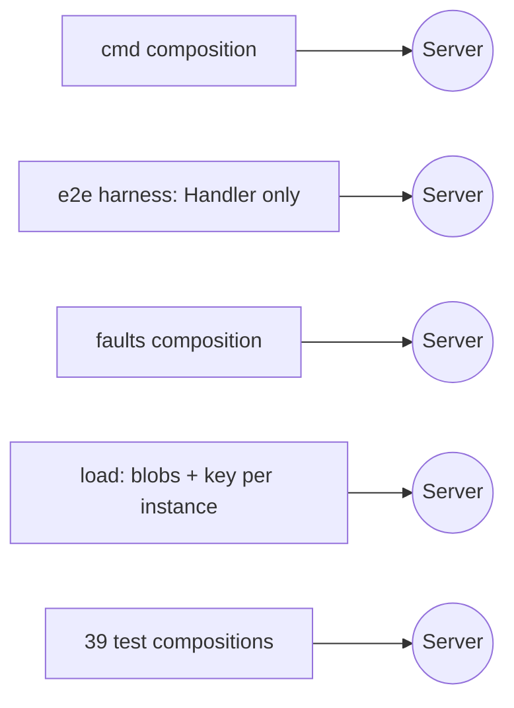

After:

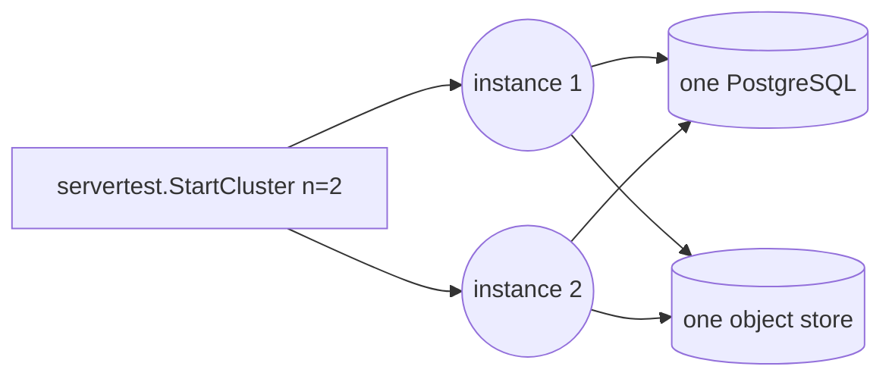

**Files**

- `cmd/opendustpan/main.go:1013`
- `e2e/harness.go:572-647; e2e/faults/server_test.go:37; e2e/audit_sinks_test.go; load/main.go:479`
- `39 NewServer calls in 20 pkg/dustpan test files (31 sqlite.Open, 29 inline keys)`
- `3 isolated-schema helpers: pkg/store/postgres isolatedURL, e2e/store.go:125-185, load openPostgresSchema`

- **Problem:** At least five independent compositions of the server; 16 options appear only in cmd; the in-process e2e calls only Handler(), never Run(), so CI never runs start-up recovery, sweepers, the chain checker or the shipper; the harness re-implements CheckWrapper.
- **Deletion test:** Deleting any one composition loses nothing unique: a shallow pattern repeated 5+ times.
- **Deepening:** internal/servertest: Start(t, Backing{DB, Blobs, KEK}, …Option) *Instance running Run on a listener; StartCluster(t, n, Backing); Instance.Kill(), Restart(). SQLite or PostgreSQL from the environment with one isolated-schema helper.
- **Tests:** Multi-instance tests become about 20 lines each.
- **Risk and size:** L.
- **Horizontal scaling:** The main enabler for every "Done when" in #667–#669.
- **ADR:** ADR 35 if public; internal/ avoids it.

### H2

**Put a Backend interface behind the e2e Env, with a cluster backend**

*Strong* · local-substitutable · size L (1,000–1,500 lines)

Before: Env (35 fields) · 8 constructors · binary-only methods  →  After: **Env + Backend** [in-process, binary, cluster]

**Files**

- `e2e/harness.go:148-207 (about 35 fields), 255, 311, 345`
- `85 exported (*Env) methods`
- `8 constructors (NewEnv, …JournalingOff, …IPAllowlists, …JournalRefuser, …DeltaCutoff, …SignIn, …Binary, NewPair)`
- `e2e/binary.go:502, 548-700, 612-669, 819, 1077; e2e/crash.go:27; e2e/pair.go:14-79`

- **Problem:** Env holds one backendCmd and one port; binary-only methods fail at run time with "needs E2E_SERVER=binary"; constructors copy the input literal instead of using the default. Pair is two servers on two databases, not two instances on one. The building block (launchBinaryBackend on the same dbURL) already exists.
- **Deletion test:** The constructor variants are pass-throughs.
- **Deepening:** One NewEnv with options; a Backend interface with in-process, binary and cluster implementations (N binaries behind the recording proxy, which can balance, drain or kill one); binary-only operations become methods of the binary backend.
- **Tests:** Rolling-deploy and kill-one-of-two e2e tests.
- **Risk and size:** L.
- **Horizontal scaling:** Real CLIs against several instances.
- **ADR:** None.

### H3

**Derive the e2e route coverage list from the real composition; close the tofuhttp gap**

*Strong* · in-process · size M (−800 / +150 lines)

Before: 800 lines of stubs · 5 adapter configs  →  After: **served routes** [from the real mux]

**Files**

- `e2e/coverage.go:62-875 (stub stores and full NewHandler configs only to call Routes()), 880-1720 (allowlist), 1621-1690`
- `internal/api/tofuhttp/tofuhttp.go:161 (buildRoutes, no exported Routes())`
- `pkg/dustpan/dustpan.go:2590, 2613`

- **Problem:** About 800 lines duplicate the wiring to list routes, and every Config change in any adapter forces an edit (8 of the last 50 commits). /tofu/state/… is never in ServedRoutes, so the "every endpoint lands with its e2e step" gate does not cover that adapter at all.
- **Deletion test:** Delete the stubs: if the server reported its mounted routes, nothing would reappear. Pure duplication.
- **Deepening:** A route list from the real composition (unexported Server.routes behind a test shim), read from a server started by H1.
- **Tests:** −800 lines; the gap closes.
- **Risk and size:** M.
- **Horizontal scaling:** None.
- **ADR:** ADR 35 if public.

### H4

**Covering tests must actually run in CI; run binary-mode e2e at least nightly**

*Strong* · in-process · size S–M (100–200 lines + CI minutes)

Before: free-text covering test · skipped in CI  →  After: **checked coverage** [binary e2e nightly]

**Files**

- `e2e/coverage.go:908-1718 (CoveringTest is free text)`
- `e2e/coverage_test.go:15-32 (only non-empty)`
- `e2e/e2e_test.go:8989, 11839, 12607; e2e/audit_chain_test.go:35 (skip without E2E_SERVER=binary)`
- `Makefile:136, 147, 150`

- **Problem:** CI's make e2e runs in-process, and only TestUpgrade and TestBinaryCrash run the binary. Restore, audit chain and backup-check routes are excused by tests that never run in CI. Any cluster e2e test would be binary-only and fall into the same hole.
- **Deletion test:** Not a module.
- **Deepening:** CoveringTest checked: go test -list must find it and it must not have been skipped. A binary-mode run of the full suite in CI or nightly.
- **Tests:** Gate becomes truthful.
- **Risk and size:** S–M.
- **Horizontal scaling:** Multi-instance e2e will be binary-only.
- **ADR:** ADR 40 d6 (nightly).

### H5

**Fix report-directory races and the pair report name collision**

*Strong* · in-process · size S (about 50 lines)

Before: clear in a parallel test  →  After: **TestMain owns reports**

**Files**

- `e2e/e2e_test.go:88-105 (TestCLIs: t.Parallel, ClearReports, coverage in Cleanup)`
- `parallel writers: :9177, :9301, :9743, :10383, :10539; config_secrets_test.go:104`
- `e2e/report.go:110-115 (NewPairRun name)`

- **Problem:** ClearReports can delete a report another test wrote; coverage reads whatever exists when TestCLIs ends, so the result depends on timing; two tests write the same pulumi-<label>-pair-<store>-v<ver>.json.
- **Deletion test:** Not a module.
- **Deepening:** Clear in TestMain; names from t.Name(); coverage after m.Run().
- **Tests:** Deterministic gate.
- **Risk and size:** S.
- **Horizontal scaling:** None.
- **ADR:** None.

### H6

**Wire the load harness's two-instance mode like the target topology**

*Strong* · local-substitutable · size S (50–100 lines)

Before: shared DB · blobs per instance · key per instance  →  After: **shared backing** [one blob store, one KEK]

**Files**

- `load/main.go:228-266, 292 (blobs-<i>: a blob store per instance), 445-464 (a new random KEK per instance)`
- `load/measure.go:1066-1100 (only update-start latency touches instance 1)`
- `load/harness_internal_test.go:89-95`

- **Problem:** The only existing multi-instance test shares the database but not the object store or the key: a checkpoint written through instance 0 cannot be read through instance 1. ADR 40 d8's sizing table for several instances would come from this setup.
- **Deletion test:** Not a module.
- **Deepening:** One blob store and one key; round-robin every measurement; build instances through H1.
- **Tests:** A cross-instance read check.
- **Risk and size:** S.
- **Horizontal scaling:** Gives the first honest multi-instance numbers.
- **ADR:** Under-delivers ADR 40 d3 and d8.

### H7

**ADR 40's nightly load and budgets are missing**

*Strong* · in-process · size M

Before: smoke only  →  After: **nightly load + budgets**

**Files**

- `.github/workflows/ci.yml (the only workflow; toxiproxy faults at :213-220 on every PR)`
- `docs/adr/0040-load-fault-and-crash-testing.md d6, d7`

- **Problem:** No nightly job and no budget file; load runs only as a smoke test, so there is no regression signal for multi-instance load (A8, C1, F5 all need measurements).
- **Deletion test:** Not a module.
- **Deepening:** A nightly workflow with budgets, including a two-instance PostgreSQL run via H6.
- **Tests:** Budget checks.
- **Risk and size:** M (CI minutes).
- **Horizontal scaling:** The measurement loop for every scaling change.
- **ADR:** Implements ADR 40.

### H8

**Split e2e_test.go (14,429 lines) by feature, then into independent chapters**

*Worth exploring* · in-process · size S split; L chapters

Before: one 14k-line file  →  After: **files per feature**

**Files**

- `e2e/e2e_test.go (446 functions, 12 Test functions)`
- `:1096 pulumiScenario (269 lines), :3992 tofuScenario`
- `e2e/harness.go:1849-1851 (a failing step does not stop later steps)`
- `route_coverage_test.go:47`

- **Problem:** Order-dependent scenario chains make one failure cascade into noise; every endpoint lands in one file.
- **Deletion test:** Moves.
- **Deepening:** One file per feature (pure moves), then chapters with their own Env where state allows.
- **Tests:** Clearer failures.
- **Risk and size:** S / L.
- **Horizontal scaling:** None.
- **ADR:** None.

### H9

**An e2e Matrix helper for tool, version and store**

*Worth exploring* · in-process · size M (about −1,000 lines)

Before: install ×84 · loops ×35 · skips ×37  →  After: **Matrix**

**Files**

- `84 fetcher.Install calls, 35 e2e.Databases() loops, 37 PostgresURL()=="" skips across 56 Test functions`

- **Problem:** Matrix boilerplate in every test; a multi-instance axis would be added 56 times.
- **Deletion test:** Copies.
- **Deepening:** e2e.Matrix(t, tool, func(t, cli, store)) owns install, skip and report; instances become one more axis.
- **Tests:** −1,000 lines.
- **Risk and size:** M.
- **Horizontal scaling:** One place to add the cluster axis.
- **ADR:** None.

### H10

**Route full Config literals in tests through one constructor per package**

*Worth exploring* · in-process · size M

Before: 130 Config literals  →  After: **one constructor per package**

**Files**

- `pulumi.Config 20 sites, tfe.Config 27, server.Config 34, stack.UpdatesConfig 21, workspace.Config 28`
- `internal/api/*/routes_test.go (newTestHandler exists; most tests skip it)`

- **Problem:** exhaustruct means a new dependency (a registry or claim port) touches 20–35 test sites per package plus coverage.go.
- **Deletion test:** Copies.
- **Deepening:** One newTestHandler per package used everywhere; keep the linter strict.
- **Tests:** Fewer edits per dependency.
- **Risk and size:** M.
- **Horizontal scaling:** Every new coordination port is a new dependency.
- **ADR:** ADR 7: keep the lint, change the tests.

### H11

**The binary-mode harness writes to the database behind the API**

*Worth exploring* · in-process · size S–M

Before: harness writes DB  →  After: **seed via API**

**Files**

- `e2e/binary.go:1064-1095 (opens the binary's database, builds its own workspace.Service)`
- `e2e/harness.go:857-912 (SeedTofuState), 928 (ListInventory reads the store)`

- **Problem:** Tests go past the interface, and on SQLite this is a second process on one file: a second instance by accident.
- **Deletion test:** Not a module.
- **Deepening:** Seed and read through the API (ADR 50).
- **Tests:** Tests use the public surface.
- **Risk and size:** S–M.
- **Horizontal scaling:** Removes an accidental second writer.
- **ADR:** ADR 50.

### H12

**Flakiness risks in e2e and slow packages**

*Worth exploring* · in-process · size S each

Before: latest · port reuse · log polling  →  After: **pinned + probes**

**Files**

- `e2e/tool.go:93, 122 (latest in default matrices)`
- `e2e/binary.go:819 (restart on the same port under -parallel 16)`
- `cmd/opendustpan/main_test.go:311-340 (log polling for "listening")`
- `pkg/audit takes 33 s`

- **Problem:** Upstream releases change PR results; port reuse races; log-substring waits; an unprofiled slow package.
- **Deletion test:** Not a module.
- **Deepening:** Pin versions in PR runs; readiness via the health probe; profile pkg/audit.
- **Tests:** Fewer flakes.
- **Risk and size:** S.
- **Horizontal scaling:** Cluster tests will restart processes often.
- **ADR:** None.

### H13

**Run the harness's own unit tests outside the e2e tag**

*Speculative* · in-process · size S

Before: behind e2e tag  →  After: **untagged**

**Files**

- `e2e/coverage_test.go, report_test.go, tool_test.go, fetch_test.go, dbproxy_internal_test.go`

- **Problem:** They need no CLI but run only in the e2e job; go test ./... reports e2e [no test files].
- **Deletion test:** Not a module.
- **Deepening:** Move to an untagged package.
- **Tests:** Faster feedback.
- **Risk and size:** S.
- **Horizontal scaling:** None.
- **ADR:** None.

## Top recommendation

**Durable operations on an instance registry: A2 on A1, starting with B1.** This is the candidate with the most leverage. It deletes the most code that is unsafe with several instances: two slots, the inflight map, the clock-based race resolver, start-up recovery for the whole installation, and the chain migration queue. It is also the one place where the owner's direction becomes concrete. B1 comes first because the job rows cannot live inside the data the restore swaps, and doing B1 confirms or rules out the probable maintenance bug. Write it as one RFC that answers RFC 36. Build it test-first on E2 and H1, so that the "Done when" lines of #667, #668 and #669 become tests with two instances.

## Suggested order

1. Fix the small correctness bugs first, each with a failing test: B8 (the Watcher fails open), D2/F4 (deleted units hidden from non-admins), C4's collection source IP, D4 (/tofu label), G3 (deterministic build), G2 (restore idempotency), B7 (unique indexes for one backup and one restore at a time).
2. Interim #667 guard: skip installation-wide recovery when another instance looks live (A3). Interim #668: record the seal key and the fence key before the Put, and delete the sweep that has no grace (G1).
3. Build the test harness for several instances before the design work: E2 (two-handle suites), H1 (servertest.StartCluster), H6 (load wiring).
4. One RFC that answers RFC 36 and supersedes the parts of ADRs 30, 38, 48 and 64 that change: A5 (the honest lease model), A1 (registry), B1 (bookkeeping tables), B3 (epoch confirmation), A2 + A4 (operations and schedules), A6 (one claim primitive).
5. Then build in this order: B1 → A1 → B2 → B3 → A2 → A3 → A4. C7, C5 and C6 follow on the same primitives.
6. In parallel, when it suits: E1 (store core) lowers the cost of everything above, and F5/A9 cut round trips per request.
