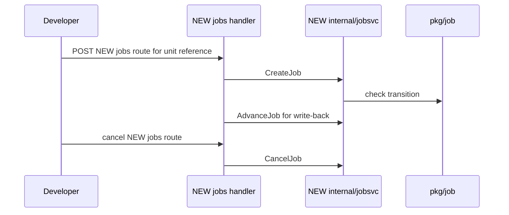
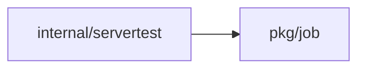
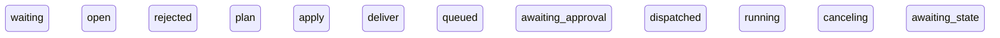
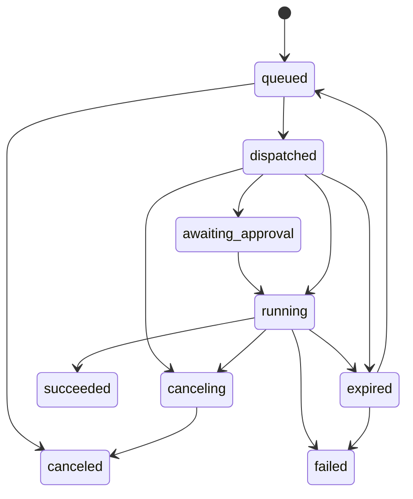
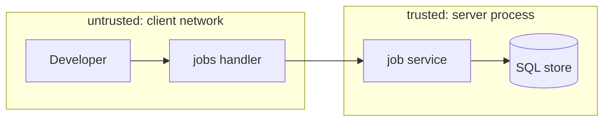

## Context

Ports and conformance suites exist in pkg/job with no SQL adapter, HTTP handler, or wiring. This change adds the storage adapter, the tool-neutral jobs routes, and write-back execution. Runner claim transport, lease renewal, and claim tokens stay in 130-138.

## Decisions

1. **Stable IDs and active-job index.** Store job rows by stable job ID, never by unit name. Unit reference holds tool, namespace ID, and unit stable ID. A partial unique index on unit ID where state is queued, dispatched, awaiting_approval, running, or canceling enforces the one-change rule in the store. Remove and re-make of a unit mints a new unit ID, so old jobs never block the new unit.
2. **Inputs, executors, and pool purpose.** Job create takes executor write-back or runners, one unit reference, one pool of purpose jobs for runners jobs, at most 32 phases per job, and at most 64 inputs per job. Unknown executor or unknown phase is rejected with the NEW error code `job.invalid`. Pool of purpose sweeps, deleted pool, or pool moved to purpose sweeps is rejected with the NEW error code `job.invalid`. Errors repeat no secret and no input value.
3. **Domain scope and actions.** This change owns the ClaimJob and AdvanceJob domain operations, their SQL adapters, and the fence. Runner claim transport, 60 second lease renewal, and claim tokens are owned by 130-138 and are not wired here. NEW POST and GET jobs routes require the NEW action `unit:run-job` on the unit object for create and cancel and `namespace:read` then `unit:read` for read and list. Write-back jobs advance under the server executor identity, never under a runner claim.

## Structure

Unexported type jobRecord with constructor checkJobRecord that checks invariants; only the constructor can make a value, callers cannot build an invalid job.

## Risks

- Phase skip or rewind by a faulty caller.
- Secret values in job inputs leak to logs.
- Second active job created by concurrent create.

## Layers (defense in depth)

| Layer | Guard | Hostile test |
| --- | --- | --- |
| authorize at point of use | Handler checks bearer credential kind and required action on the unit reference before any service call. | Call the NEW jobs route with an access token without the NEW action `unit:run-job` and prove denial with audit entry. |
| boundary check | Service allowlists executor values write-back and runners and phase names from pkg/job, rejects unknown values. | Post a job with executor shell and prove rejection with NEW error code `job.invalid`. |
| limit | Partial unique index on unit ID for active states makes a second active create impossible in the store. | Race two creates for one unit ID and prove one wins with NEW error code `job.busy`. |
| fail closed | State machine encoded in unexported jobState type, only constructor and Advance method change state, terminal states have no outgoing edge. | Attempt queued to succeeded skip and prove rejection. |

## Diagrams

After this change:

Modules that the change touches, and their imports on main:

New imports of this change (each one allowed by the module rules):

- `internal/jobsvc` imports `pkg/job`
- `internal/api/server` imports `internal/jobsvc`

States on main in the touched packages:

States and transitions after this change:

## Quality attributes

| Attribute | Target | Unit | Scope |
| --- | --- | --- | --- |
| latency | 500 | ms p95 | NEW POST jobs route create to queued read in internal/servertest |
| storage growth | 64 | KiB max | one job record with phases and gate facts |

## Threat model

Data flow and trust boundaries:

| Boundary | STRIDE | Threat | Layer | Guard | Hostile test |
| --- | --- | --- | --- | --- | --- |
| Client network to jobs handler | S | Spoofed caller creates a job for a unit of another namespace. | boundary check | Allowlist executor and phase names, bound inputs, reject unknown. | Post executor shell and unknown phase, prove rejection. |
| Client network to jobs handler | S | Spoofed caller creates a job for a unit of another namespace. | encode or contain | Mask secret inputs in logs, store sealed values only. | Create job with secret input, prove plain text absent from logs. |
| Client network to jobs handler | S | Spoofed caller creates a job for a unit of another namespace. | limit | Bound phase list to 32 phases per job and 64 inputs per job. | Post 33 phases, prove rejection. |
| Client network to jobs handler | S | Spoofed caller creates a job for a unit of another namespace. | authorize at point of use | Check the NEW action unit:run-job at create and at cancel on the unit object. | Create without grant, prove denial with audit entry. |
| Client network to jobs handler | S | Spoofed caller creates a job for a unit of another namespace. | fail closed | Unknown executor or phase fails closed with job invalid error. | Send unknown phase, prove denial and unchanged state. |
| Client network to jobs handler | T | Tampered caller tampers with phase history of a job. | boundary check | Allowlist phase transitions in service, reject skip and rewind. | Send rewind to prior phase, prove rejection. |
| Client network to jobs handler | T | Tampered caller tampers with phase history of a job. | encode or contain | Store phase as enum, never eval caller text as code. | Send phase with script text, prove stored as rejected value only. |
| Client network to jobs handler | T | Tampered caller tampers with phase history of a job. | limit | Bound inputs to 64 per job and sealed storage. | Post oversize inputs, prove rejection. |
| Client network to jobs handler | T | Tampered caller tampers with phase history of a job. | authorize at point of use | Check claim ownership on each AdvanceJob call. | Advance from a second claim, prove denial with audit entry. |
| Client network to jobs handler | T | Tampered caller tampers with phase history of a job. | fail closed | Illegal transition fails closed with no state change. | Send queued to succeeded, prove unchanged state. |
| Jobs handler to SQL store | I | Disclosure of secret inputs or jobs across namespaces. | boundary check | Fence check on each write in the same transaction. | Write with wrong namespace fence, prove refusal. |
| Jobs handler to SQL store | I | Disclosure of secret inputs or jobs across namespaces. | encode or contain | Sealed secrets only reach the store, plain text stays out. | Read job row, prove no plain secret present. |
| Jobs handler to SQL store | I | Disclosure of secret inputs or jobs across namespaces. | limit | One active job per unit ID through partial unique index. | Race two creates, prove one wins with job.busy. |
| Jobs handler to SQL store | I | Disclosure of secret inputs or jobs across namespaces. | authorize at point of use | Check unit read grant on each job read by unit. | Read job of another namespace, prove denial. |
| Jobs handler to SQL store | I | Disclosure of secret inputs or jobs across namespaces. | fail closed | Unknown unit ID fails closed with not found. | Read unknown unit, prove denial. |

## Contracts

**job**

- Invariant: One job belongs to one unit reference with tool, namespace ID, and unit stable ID.
- Invariant: One job has one executor and one ordered phase list of at most 32 phases.
- Invariant: At most one active job exists for each unit ID.
- Invariant: A claimed runners job has at most one active claim.
- `CreateJob`: pre: Caller holds the NEW action `unit:run-job` on the unit reference.. Post: A job record exists in queued state with a stable ID..
- `ClaimJob`: pre: Caller passes the pool purpose jobs check at claim time.. Post: The job is dispatched to one claim record..
- `AdvanceJob`: pre: Caller holds the active claim for a runners job or the server executor identity for a write-back job.. Post: The job phase moves forward only and terminal states do not move..
- `CancelJob`: pre: Caller holds the NEW action `unit:run-job` on the unit reference.. Post: A queued job becomes canceled and a running job becomes canceling then canceled..

## Failure modes

| Step | Failure | Retry | State after |
| --- | --- | --- | --- |
| Create job durable write. | Instance stops after job created but before dispatch. | Durable operation replay on restart redelivers queued job. | queued, no duplicate phase entry. |
| Advance phase report. | Write-back caller reports phase twice due to retry. | Idempotent advance with claim key ignores duplicate. | Same phase, one history entry. |
| Create job race. | Two creates race for one unit. | Store unique index denies the loser with job.busy; no retry without cancel of the winner. | One queued job, one denied create. |
| Cancel of a running job. | Cancel arrives while write-back phase still reports. | Cancel moves running to canceling; late reports are denied once canceling starts. | canceling then canceled. |
