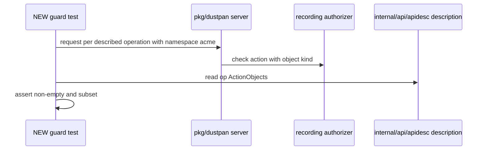
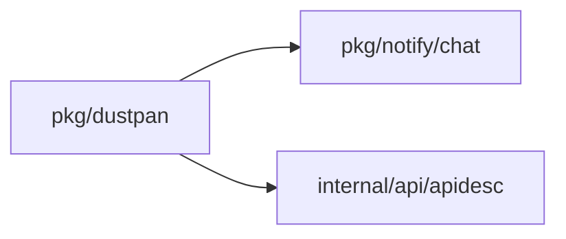
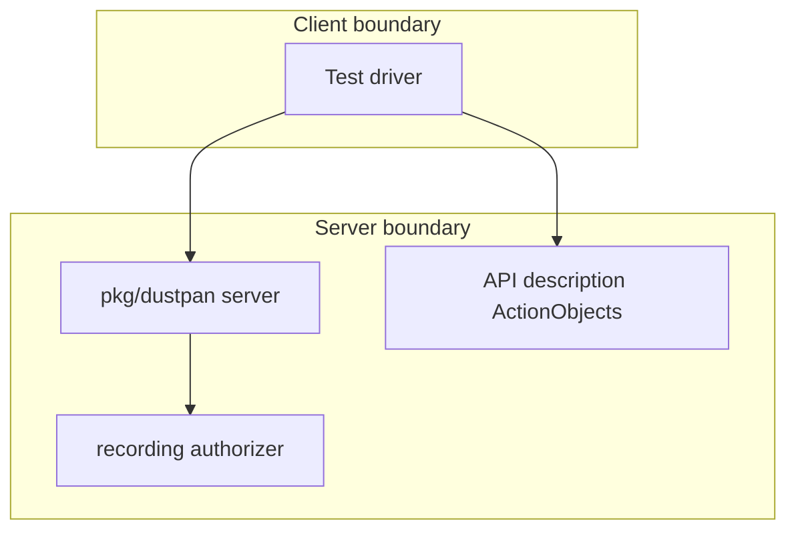

## Context

Issues 1328, 1343, 1347 and 1353 hold small follow-ups from reviews of RFC 102, typed schemas and the chat sender, plus one latent drift risk between authorizer calls and x-dustpan-actions. The text of the 8 RFC 102 nits and of N1 to N5 lives only in the linked reviews. This change applies each nit as written there, fixes N6 and N7 and the three chat nits, and adds one subset guard test in pkg/dustpan.

## Decisions

1. **Closed nit options with one guard test.** Keep IdempotencyKey in the chat Sender interface and pass it as the retry deduplication key. Keep NewLoopback exported in pkg/notify/chat with test-only docs. Rename the gov-slack host test. Apply the 8 RFC 102 nits and N1 to N5 as written in the linked reviews. Make the dustpan required tag on an embedded-pointer promotion raise a field error. Deduplicate kindsOf into one shared test helper keyed by action. Add one NEW guard test with a public-operation exempt allowlist.

## Structure

No new unexported type. The guard is a test only in NEW pkg/dustpan/authorizer_subset_test.go, built on the wiring behind pkg/dustpan/apidesc_gate_test.go:96.

## Risks

- Operations with required bodies can fail validation before the authorizer runs; the guard task supplies a valid sample body so the non-empty assertion holds.
- The text of the RFC 102 nits and N1 to N5 is only in the linked reviews, so the implementer copies each nit from there and ticks each issue thread.

## Layers (defense in depth)

| Layer | Guard | Hostile test |
| --- | --- | --- |
| authorize at point of use | Guard test asserts recorded authorizer pairs are a subset of ActionObjects and fails on extras. | Add one extra authorizer check in a handler and show the NEW guard test fails. |

## Diagrams

After this change:

Modules that the change touches, and their imports on main:

## Quality attributes

| Attribute | Target | Unit | Scope |
| --- | --- | --- | --- |
| none affected | Nits and one guard test with no latency or storage change |  |  |

## Threat model

Data flow and trust boundaries:

| Boundary | STRIDE | Threat | Layer | Guard | Hostile test |
| --- | --- | --- | --- | --- | --- |
| Server boundary | T | A handler checks an action whose kind is missing or wrong in ActionObjects, so generated clients or audits use the wrong object. | boundary check | Allowlisted sample path values and namespace acme; reject other inputs. | Send a path traversal sample value directly to the guard harness and show it is rejected. |
| Server boundary | T | A handler checks an action whose kind is missing or wrong in ActionObjects, so generated clients or audits use the wrong object. | encode or contain | Placeholders for path values; no string-built queries in the harness. | Remove placeholder use and show the semgrep query check fails. |
| Server boundary | T | A handler checks an action whose kind is missing or wrong in ActionObjects, so generated clients or audits use the wrong object. | limit | One request per operation with a fixed small body; no retries. | Send an oversized sample body and show the harness refuses it before the authorizer. |
| Server boundary | T | A handler checks an action whose kind is missing or wrong in ActionObjects, so generated clients or audits use the wrong object. | authorize at point of use | Subset assertion of recorded pairs against ActionObjects plus non-empty check. | Add one extra authorizer check and show the guard test fails naming the pair. |
| Server boundary | T | A handler checks an action whose kind is missing or wrong in ActionObjects, so generated clients or audits use the wrong object. | fail closed | Unknown action or kind fails the test; exempt allowlist is explicit with reasons. | Record an unknown action kind and show the test fails closed. |
