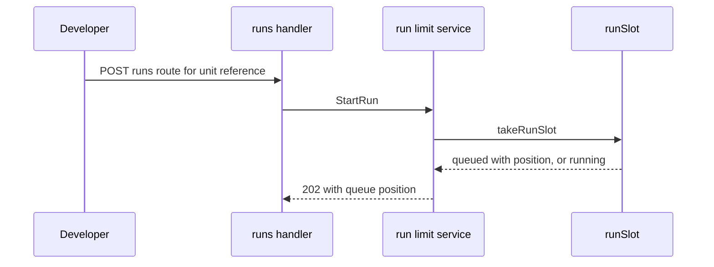
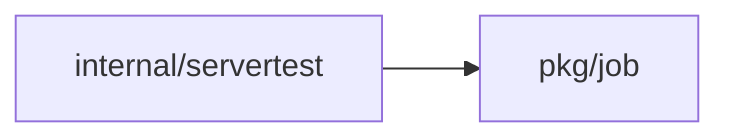
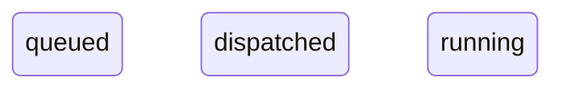
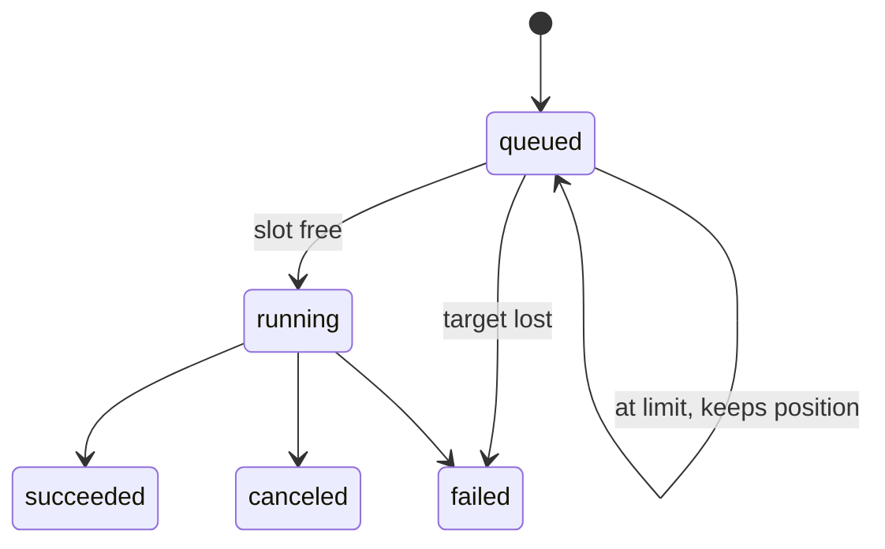
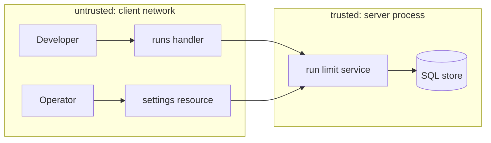

## Context

The run model of milestone 5 owns runs: their states, their routes and their
records. This change adds only two things on top of it: stored run limits and
a visible run queue. It adds no run state, no run route and no run record of
its own.

What main already does, and what this change does not change:

- A job start queues when its unit is held. That is a hold queue, not a run
  limit.
- The durable scheduler waits a first delay before its first claim. That is
  timing, not queue order.

## Decisions

1. **Two limits, two scopes.** The installation holds one cap and each
   namespace holds one limit. A run starts only when both counts allow it:
   the count of running runs of the installation stays below the cap, and
   the count of running runs of the namespace stays below the limit of the
   namespace. A high value disables queueing. The built-in default is 64 for
   the installation cap and 8 for a namespace limit. Each answer shows the
   effective value with its origin.
2. **Strict FIFO per namespace.** Queue order is the creation time of the run
   within its namespace. The first queued run starts first. There are no
   lanes and no priority in this change. A namespace administrator starts one
   queued run by hand as the escape hatch.
3. **Limits live on the settings resource.** Each limit is a setting of its
   scope: the installation setting and the namespace setting share the key
   `runs-max-running`. A raise of either limit needs a fresh authentication.
   A lower needs none and applies at once. Each change writes an audit entry
   with the old value, the new value and the principal.
4. **A slot is a live lease.** A running run holds a slot only while its
   lease is live on the database clock. The claim of the last free slot runs
   in one transaction: count the live slots, check the fencing token, and
   write the claim. Two starters cannot take the same slot. Lease expiry
   frees the slot. A lowered limit stops new starts and leaves running runs
   alone.
5. **Fail closed on a lost target, wait through a hold.** A queued run whose
   unit was deleted, whose namespace was suspended, or whose installation
   restores fails with a named error. A queued run whose unit is held by a
   manual lock, or whose namespace is frozen, waits with its queue position.
6. **Primary installation only.** Queue writes carry the fence and run on the
   primary installation, in the same transaction as the fence check and the
   maintenance check. Slot counts read live leases only.

## Structure

Unexported type `runSlot` with constructor `takeRunSlot` that checks the
invariants; only the constructor can make a value, and callers cannot build a
claim that skips a check. The constructor checks, in order: the fence is
current, the installation is not in maintenance mode, the target still
exists, both live counts stay below their limits, and the fencing token
matches. No added check and no new tool: the type makes an unchecked claim
impossible to build.

## Risks

- Two starters claim the last slot at the same time.
- A limit raise without a fresh authentication weakens the installation.
- A stuck lease blocks the queue past its expiry.
- A stale read shows a wrong queue position.

## Layers (defense in depth)

| Layer | Guard | Hostile test |
| --- | --- | --- |
| authorize at point of use | Settings write checks the grant on the scope before any read of the limit. | Write the installation limit with a token that holds only a namespace grant and prove denial with an audit entry. |
| boundary check | Fresh authentication is required for a raise; a lower passes without it. | Raise the namespace limit on a stale session and prove denial. |
| limit | Live-slot count plus one unique claim per run in a single transaction. | Race two starts for the last slot and prove one wins and one stays queued. |
| fail closed | Unknown target state and expired lease fail closed with a named error. | Start a queued run after its unit was deleted and prove the named error with no dispatch. |

## Diagrams

After this change:

Modules that the change touches, and their imports on main:

New imports of this change (each one allowed by the module rules):

- `internal/runlimitsvc` imports `pkg/job`
- `internal/api/server` imports `internal/runlimitsvc`

States on main in the touched packages:

States and transitions after this change:

## Quality attributes

| Attribute | Target | Unit | Scope |
| --- | --- | --- | --- |
| latency | 500 | ms p95 | start call to queued answer with position in internal/servertest |
| storage growth | 1 | KiB max | one limit record per scope |

## Threat model

Data flow and trust boundaries:

| Boundary | STRIDE | Threat | Layer | Guard | Hostile test |
| --- | --- | --- | --- | --- | --- |
| Client network to settings resource | S | Spoofed caller raises the limit of another namespace. | authorize at point of use | Check the grant on the scope of the setting at write time. | Raise the limit of another namespace, prove denial with audit entry. |
| Client network to settings resource | S | Spoofed caller raises the limit of another namespace. | boundary check | Demand a fresh authentication for each raise. | Raise on a stale session, prove denial. |
| Client network to settings resource | S | Spoofed caller raises the limit of another namespace. | limit | Bound the value to a non-negative integer. | Write a negative limit, prove rejection. |
| Client network to settings resource | S | Spoofed caller raises the limit of another namespace. | fail closed | Unknown scope fails closed with not found. | Write the limit of an unknown namespace, prove denial. |
| Client network to runs handler | T | Tampered caller forges a queue position to jump the queue. | boundary check | Position is derived from creation time, never read from the request. | Send a position in the start call, prove the server ignores it. |
| Client network to runs handler | T | Tampered caller forges a queue position to jump the queue. | encode or contain | Count live leases only, on the database clock. | Hold an expired lease, prove the slot counts as free. |
| Client network to runs handler | T | Tampered caller forges a queue position to jump the queue. | limit | Claim the last slot in one transaction with the fencing token. | Race two claims, prove one wins. |
| Client network to runs handler | T | Tampered caller forges a queue position to jump the queue. | authorize at point of use | Check the start grant on the unit reference at claim time. | Claim without the grant, prove denial with audit entry. |
| Client network to runs handler | T | Tampered caller forges a queue position to jump the queue. | fail closed | Lost target fails closed with the named error. | Start after the delete of the unit, prove the named error. |
| Runs handler to SQL store | I | Disclosure of runs across namespaces. | boundary check | Fence check on each queue write in the same transaction. | Write with a stale fence, prove refusal. |
| Runs handler to SQL store | I | Disclosure of runs across namespaces. | encode or contain | Queue reads filter by namespace ID of the caller. | Read the queue of another namespace, prove denial. |
| Runs handler to SQL store | I | Disclosure of runs across namespaces. | limit | One queue entry per run, one active claim per run. | Double-claim one run, prove the second is denied. |
| Runs handler to SQL store | I | Disclosure of runs across namespaces. | authorize at point of use | Check the read grant on each queue read. | Read the queue without the grant, prove denial. |
| Runs handler to SQL store | I | Disclosure of runs across namespaces. | fail closed | Unknown run ID fails closed with not found. | Read an unknown run, prove denial. |

## Contracts

**run limits**

- Invariant: One installation holds one cap. One namespace holds one limit.
  Both share the key `runs-max-running` on the settings resource of their
  scope.
- Invariant: Each value is a non-negative integer. Zero stops new starts and
  leaves running runs alone.
- Invariant: A run starts only when the live count of the installation stays
  below the cap and the live count of the namespace stays below its limit.
- `SetLimit`: pre: Caller holds the settings write grant on the scope, and a
  raise carries a fresh authentication. Post: The new value is stored, an
  audit entry names the old value, the new value and the principal, and the
  next read shows the effective value with its origin.
- `TakeSlot`: pre: Caller passes the fence, the maintenance and the target
  checks. Post: The run is running with one live lease, or queued with a
  1-based `queuePosition` and wait reason `limit`.

**run queue**

- Invariant: Queue order within a namespace is the creation time of the run.
- Invariant: `queuePosition` is 1-based and counts only queued runs of the
  same namespace.
- `ReadQueue`: pre: Caller holds the read grant on the namespace. Post: Each
  queued run shows its `queuePosition` and its wait reason.

## Failure modes

| Step | Failure | Retry | State after |
| --- | --- | --- | --- |
| Claim the last slot. | Two starters race for one slot. | Loser stays queued with a new position; no retry without a free slot. | One running run, one queued run. |
| Raise the limit. | Process stops after the settings write but before the audit entry. | Settings write and audit entry commit in one transaction. | New value with its audit entry, or the old value. |
| Lower the limit. | Lower arrives while queued runs wait. | No retry: queued runs keep their order under the new limit. | Same queue, fewer starts. |
| Lease expiry. | Runner dies with a live lease. | Expiry frees the slot; the next queued run claims it. | Slot free, queue moves one step. |
| Target lost. | Unit deleted while its run waits. | No retry: the run fails with the named error. | Failed run with the named error. |
