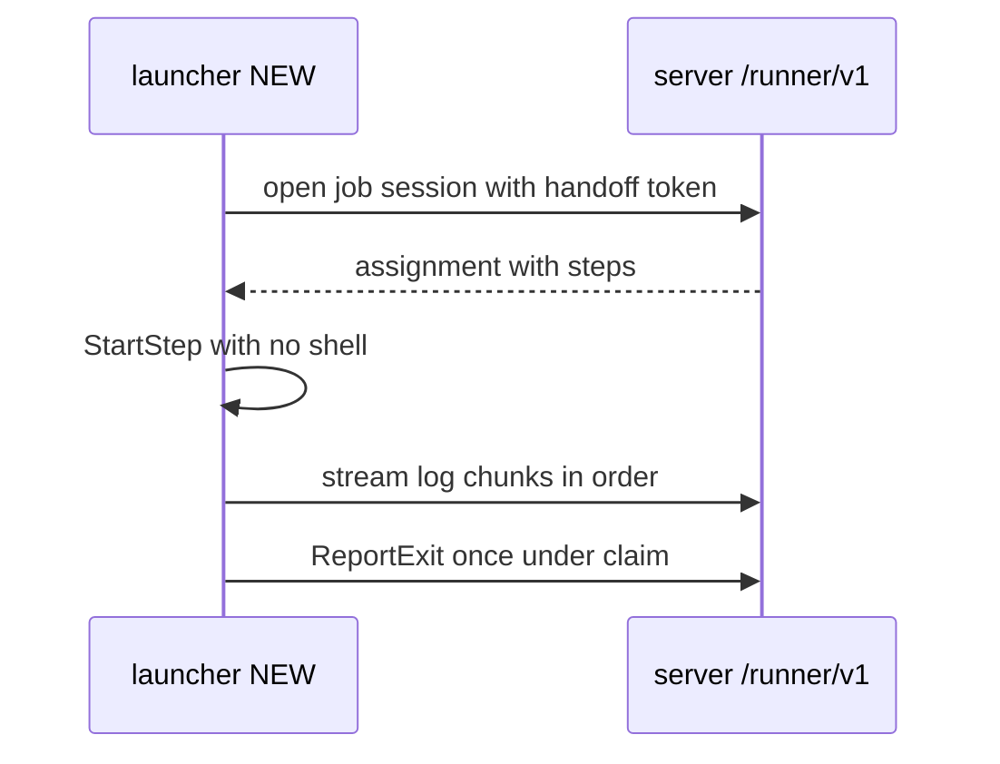
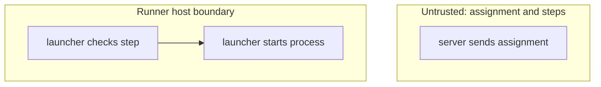

## Context

The launcher starts untrusted step commands on runner hosts and streams output under a claim. A shell would add parsing and injection faults.

## Decisions

1. **Check command before start.** Parse and check the step argument list in the launcher before start, with one constructor for a checked command. The constructor checks 1 to 256 arguments, 131072 bytes total, no NUL byte, and program as bare name or clean absolute path. A bare name such as sh passes the program check; shell text inside one argument stays one argument because no shell runs.
2. **Durable local step state for resume.** Keep one local step state file per step with state starting, running, done plus exit code and next log sequence number. After a restart the launcher reads the file, kills no orphan twice, never starts the same step twice, and reports the stored exit once.

## Structure

Unexported type checkedCommand with constructor CheckCommand that checks bounds and program form; only the constructor makes a value.

## Risks

- Shell injection through step text.
- Lost exit code after launcher restart.

## Layers (defense in depth)

| Layer | Guard | Hostile test |
| --- | --- | --- |
| boundary check | Allowlist check of program and arguments at intake. | Send a step with zero args and see a refusal. |
| contain step process | Start with argument list and no shell. | Send semicolon text as one argument and see one argument with no shell run. |

## Diagrams

After this change:

Modules that the change touches, and their imports on main:

## Quality attributes

| Attribute | Target | Unit | Scope |
| --- | --- | --- | --- |
| log streaming lag | 2 | s | per launcher step |
| step start overhead | 500 | ms | per step start |

## Threat model

Data flow and trust boundaries:

| Boundary | STRIDE | Threat | Layer | Guard | Hostile test |
| --- | --- | --- | --- | --- | --- |
| Runner host boundary | E | Evil step text runs a shell command on the runner host. | boundary check | Allowlist check: 1 to 256 args, 131072 bytes max, no NUL, bare name or clean absolute path. | Send a step with zero args and expect refusal with launcher.step-invalid. |
| Runner host boundary | E | Evil step text runs a shell command on the runner host. | encode or contain | Start with argument list and no shell; bare name sh is allowed and `a; rm` stays one argument. | Send semicolon text as one argument and see one argument with no shell run. |
| Runner host boundary | E | Evil step text runs a shell command on the runner host. | limit | Cap each chunk at 65536 bytes and each step at 100 chunks per second. | Send a 65537 byte chunk and see refusal with runner.limit. |
| Runner host boundary | E | Evil step text runs a shell command on the runner host. | authorize at point of use | Check handoff token owns the claim at open, stream, and exit. | Use a token from another claim and see denial with runner.retired. |
| Runner host boundary | E | Evil step text runs a shell command on the runner host. | fail closed | Deny on unknown program form or check error and write audit entry with claim and step. | Send a program that is neither bare nor clean absolute path and see denial plus audit entry. |

## Contracts

**launcher step**

- Invariant: A step starts with no shell.
- Invariant: A step has one argument list checked at intake.
- Invariant: A step has one exit report under one claim.
- `StartStep`: pre: Assignment holds a checked step.; Handoff token owns the claim.. Post: Step process runs with the checked argument list.; Step output streams in ordered chunks..
- `ReportExit`: pre: Step process ended.; Handoff token owns the claim.. Post: Step has one exit code.; Resume reads the same exit code with no second start..

## Failure modes

| Step | Failure | Retry | State after |
| --- | --- | --- | --- |
| Run step | Launcher host stops before exit report. | Launcher reads the local step state file, ends any orphan step process, and reports the stored exit once without a second start. | Step ends with one exit code. |
| Stream output | Log stream breaks mid-step. | Launcher resumes stream from stored next sequence number. | Log holds ordered chunks with no gap. |
