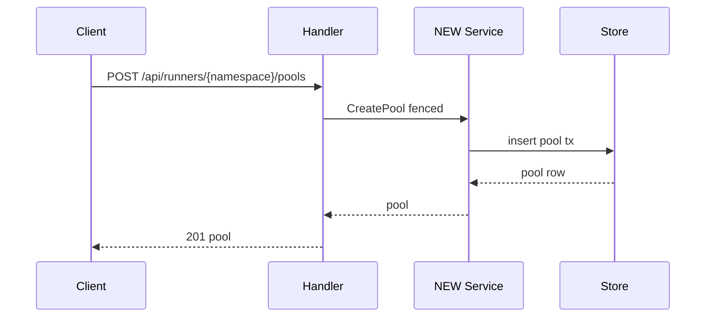
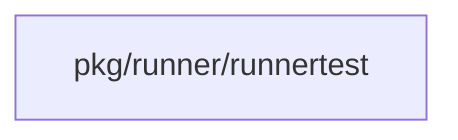
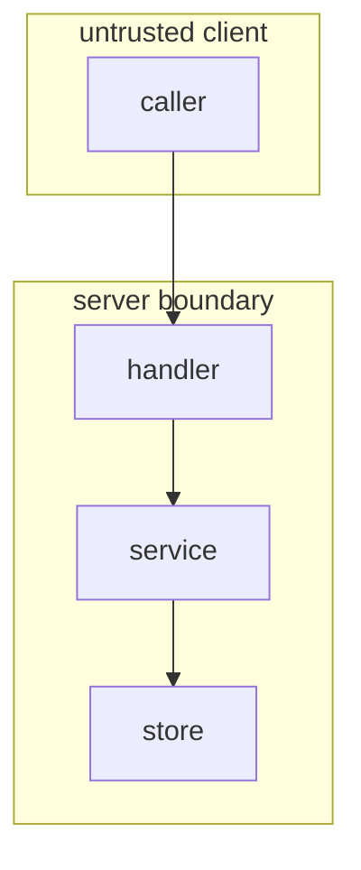

## Context

Wire existing runner management routes to the NEW service in internal/runnersvc over SQL pool, member, and join token stores, without claim polling or launcher work.

## Decisions

1. **Single service for pool management.** Add the NEW service in internal/runnersvc as the only writer of pools, runners, and join tokens; the HTTP handler maps errors and writes audit entries in the same transaction.
2. **Transaction holds the hard rules.** Enforce single active use of a join token and pool-in-use delete check inside one fenced store transaction with row locks; job create and sweep target create hold the pool row lock so a job cannot name a pool during its delete.
3. **Purpose set is immutable.** A pool holds a purpose set of jobs or sweeps or both per ADR 343; the set never changes after create and a change fails with runner.immutable.

## Structure

Unexported poolService type in the NEW service in internal/runnersvc with constructor NewService(poolStore, memberStore, audit) that checks invariants; only its methods can write pools, join tokens, and retire runners.

## Risks

- Concurrent double join with one token must not make two runners.
- Pool delete must not strand jobs or sweep targets.

## Layers (defense in depth)

| Layer | Guard | Hostile test |
| --- | --- | --- |
| authorize at point of use | Handler checks namespace:manage-runners or namespace:read-runners for the namespace object before any read or write. | Call POST pools and POST join-tokens with a token that lacks manage-runners; server answers 403 and writes no row. |
| boundary check | Service checks allowlist for purpose jobs or sweeps, kind kubernetes or machine, isolation set, concurrency 1 to 64, TTL at most 7 days. | Send purpose admin and concurrency 0; server answers runner.invalid with no row written. |
| encode or contain | Join secret is 128-bit random with dpj_ prefix shown once; only SHA-256 stored; compare in constant time inside the join transaction. | Replay a used join token twice at once; one join wins and the other fails with runner.token-used. |
| limit | Pool create, token create, delete, and retire run in one fenced transaction with row locks; delete fails with runner.pool-in-use while named; token create fails with runner.limit past 100 open tokens. | Delete a pool while a live job names it; delete fails and pool still lists. |
| fail closed | Unknown purpose, kind, or isolation fails closed with runner.invalid; retired runner fails with runner.retired; no default allow. | Join with a revoked token and call with a retired runner key; both fail closed. |

## Diagrams

After this change:

Modules that the change touches, and their imports on main:

New imports of this change (each one allowed by the module rules):

- `internal/api/runnerapi` imports `pkg/runner`
- `internal/api/runnerapi` imports `pkg/store`

## Quality attributes

| Attribute | Target | Unit | Scope |
| --- | --- | --- | --- |
| latency | 300 | ms | POST pool, POST join-token, POST retire at p95 on sqlite |
| storage growth | 64 | KiB | per pool row with runners and tokens |

## Threat model

Data flow and trust boundaries:

| Boundary | STRIDE | Threat | Layer | Guard | Hostile test |
| --- | --- | --- | --- | --- | --- |
| server boundary | S | Forged join joins a hostile runner to the pool. | boundary check | Handler checks namespace:manage-runners or namespace:read-runners on the namespace object. | Call manage route with read-only token; expect 403. |
| server boundary | S | Forged join joins a hostile runner to the pool. | encode or contain | Secrets kept as SHA-256; dpj_ prefix; constant-time compare. | Steal database row and try to join; fails without secret. |
| server boundary | S | Forged join joins a hostile runner to the pool. | limit | TTL at most 7 days; at most 100 open tokens; 50 pools; 1000 runners; concurrency 1 to 64. | Create 101st open token; expect runner.limit. |
| server boundary | S | Forged join joins a hostile runner to the pool. | authorize at point of use | Join, revoke, retire rechecked in fenced store transaction with row lock. | Race two joins on one token; one wins. |
| server boundary | S | Forged join joins a hostile runner to the pool. | fail closed | Unknown values fail with runner.invalid; retired fails with runner.retired; audit each change. | Use revoked token; fails closed with audit entry. |
| server boundary | T | Pool delete or retire tampers with live work or audit trail. | boundary check | Drain and retire need manage-runners; retired key authenticates nothing. | Retired runner polls; server refuses. |
| server boundary | T | Pool delete or retire tampers with live work or audit trail. | encode or contain | Retire expires claims in same transaction; sessions of runner end. | Retire during live claim; claim moves to takeover. |
| server boundary | T | Pool delete or retire tampers with live work or audit trail. | limit | Pool delete refused while named by live job or target. | Delete pool in use; expect pool-in-use. |
| server boundary | T | Pool delete or retire tampers with live work or audit trail. | authorize at point of use | Store checks fence and pool belongs to namespace in same transaction. | Delete pool of another namespace; refused. |
| server boundary | T | Pool delete or retire tampers with live work or audit trail. | fail closed | Delete removes runners and tokens only when not in use; record stays for retired runners. | Retired runner record still lists after pool delete refused. |

## Contracts

**Pool**

- Invariant: Pool purpose set never changes after create.
- Invariant: Pool delete refused while a job that is not terminal or a sweep target names it.
- Invariant: Namespace holds at most 50 pools.
- `CreatePool`: pre: Caller holds namespace:manage-runners on the namespace.. Post: Pool stored with stable ID and purpose set..
- `DeletePool`: pre: Caller holds namespace:manage-runners; no live job or sweep target names the pool.. Post: Pool with its runners and join tokens removed iff not in use..

**JoinToken**

- Invariant: Secret shown once; server keeps only SHA-256.
- Invariant: Token good for one join; second use fails with runner.token-used.
- Invariant: At most 100 open join tokens per pool.
- `CreateJoinToken`: pre: Caller holds namespace:manage-runners; open token count below limit.. Post: Unused token stored with expiry at most 7 days..
- `RevokeJoinToken`: pre: Caller holds namespace:manage-runners; token unused.. Post: Unused token revoked; join with it fails..

**Runner**

- Invariant: Retired runner authenticates nothing; record stays for audit.
- Invariant: Retire marks retired and expires claims in the same transaction.
- `RetireRunner`: pre: Caller holds namespace:manage-runners; runner not retired.. Post: Runner marked retired; claims expired; sessions ended..

## Failure modes

| Step | Failure | Retry | State after |
| --- | --- | --- | --- |
| DeletePool transaction | Crash after pool row delete but before runner and token rows delete. | Retry DeletePool in a new transaction; row locks make the second delete idempotent. | Pool still present or fully removed with runners and tokens removed. |
| Join with CreateJoinToken secret | Two joins race on one join token. | No retry of the same token; call CreateJoinToken again for the second runner. | One runner joined; token marked used; second join fails with runner.token-used. |
| RetireRunner transaction | Crash after runner marked retired but before claims expired. | RetireRunner is one transaction; on restart the runner is either fully retired or not retired. | Runner retired with claims expired, or runner not retired with claims live. |

## Change impact (computed from main)

Tests:

- `e2e/drift_api_test.go` names `runner.Purpose`
- `pkg/store/internal/jobstore/body_test.go` names `runner.Purpose`
- `pkg/store/internal/jobstore/updatetime_paths_test.go` names `runner.Purpose`
- `pkg/runner/runnertest/mem_test.go` names `runner.ClaimKinds`
- `pkg/runner/runner_test.go` names `runner.ClaimKinds`
- `pkg/runner/runnertest/mem_test.go` names `runner.ErrPoolInUse`
- `internal/api/runnerapi/wrapped_copy_internal_test.go` names `runner.ErrPoolInUse`
- `internal/api/runnerapi/errcode_test.go` names `runner.ErrPoolInUse`

ADRs:

- `docs/adr/0130-runner-pools-runners-and-coordinators.md` names `runner.Purpose`
- `docs/adr/0130-runner-pools-runners-and-coordinators.md` names `runner.ClaimKinds`
- `docs/adr/0130-runner-pools-runners-and-coordinators.md` names `runner.ErrPoolInUse`
