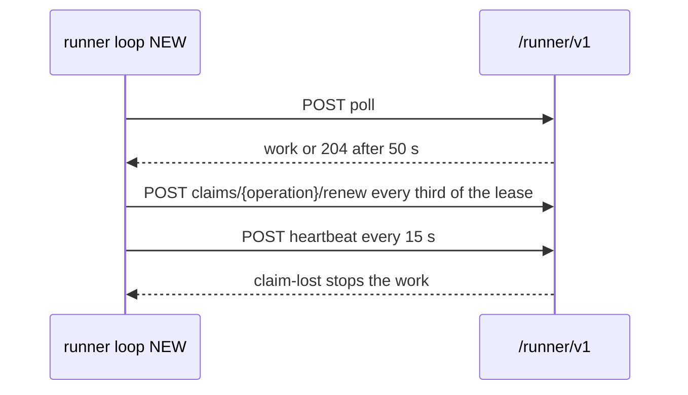

## Context

Main has the server side of the runner protocol: poll, heartbeat and claim renew, with the short protocol codes and the lease of the pool. It has no runner-side loop that uses them. This change adds that loop and its docs page. It adds no route, no error code and no lease value.

## Decisions

1. **Reuse the routes of main.** The loop calls `POST /runner/v1/poll`, `POST /runner/v1/heartbeat` and `POST /runner/v1/claims/{operation}/renew`. The earlier draft added `POST /runner/v1/claims` and `POST /runner/v1/claims/heartbeat`. They repeat poll and renew, so the change drops them. One code path serves each action.
2. **The lease is the lease of the pool.** The server sets each claim to `pool.EffectiveLease()` (default 90 s, from `runner.MinLease` to `runner.MaxLease`). The loop renews every `runner.RenewEvery(lease)` and takes the lease from the join answer (`JoinResponse.Lease`) or the claim. The change has no fixed lease and no constant. This keeps the default visible in the API (the pool shows its effective lease).
3. **Short protocol codes.** `/runner/v1` keeps `bad-proof` 401, `retired` 403, `rate-limited` 429, `not-found` 404 and `claim-lost` 409. The loop maps each code to the action of the table in ADR 131 decision 12. There is no second error shape.
4. **A runner of another pool gets no work of this pool.** The claim query uses the pool of the runner. The test polls with a runner of pool B while work waits in pool A and gets 204.
5. **No upload here.** The report upload and the end of a claim by report are not in this change. The change `130-138-runner-staged-report-port` owns them.

## ADR check

- ADR 131 decision 5 (owner): "A poll waits for work for at most 50 seconds (`protocol.MaxPollWait`), below the idle timeout of common proxies."
- ADR 131 decision 7: "The holder renews after a third of the lease of the pool (ADR 130 decision 7)."
- ADR 131 decision 8: "A runner sends a heartbeat every 15 seconds, also while it polls."
- ADR 131 decision 12: "Each answer with a status of 400 or more has the body `{"code": "...", "message": "..."}` (`protocol.Error`)."
- No-magic rule of `CLAUDE.md`: "Each default shows its effective value in the API." The pool lease default of 90 s shows in the pool.

## Structure

Package `pkg/runner/client` (NEW) with an unexported `loop` type and the constructor `New(cfg)`. The constructor rejects an empty runner key, a lease below `runner.MinLease` and a base URL that is not http or https. No field holds an expiry that the server did not send. The command `opendustpan runner poll` calls `New` and `Run`.

## Risks

- Lost heartbeat strands work until expiry. The pool lease bounds it.
- A runner that polls too often gets `rate-limited`. The loop waits for `Retry-After`.

## Layers (defense in depth)

| Layer | Guard | Hostile test |
| --- | --- | --- |
| authorize at point of use | Server checks the runner proof, the pool and retirement on each poll and renew (main). | Poll with a retired runner gets `retired` and no work. |
| fail closed | The loop stops its work on `claim-lost`, `retired` and `bad-proof`. | Renew answer `claim-lost` stops the step at once. |
| constructor | `New` rejects an empty key, a short lease and a bad URL. | `TestNewRejectsHostileConfig` calls `New` with each bad input. |

## Diagrams

## Quality attributes

| Attribute | Target | Unit | Scope |
| --- | --- | --- | --- |
| renew margin | 3 | renewals per lease | per claim |
| heartbeat | 15 | s | per runner |

## Threat model

| Boundary | STRIDE | Threat | Layer | Guard | Hostile test |
| --- | --- | --- | --- | --- | --- |
| Runner to server | S | A spoofed runner claims work. | authorize at point of use | The server checks the proof and the pool on each request (main). | A runner of another pool polls and gets 204. |
| Runner to server | R | A replayed poll. | boundary check | The nonce of a poll is single-use (`NoncePaths`, main). | Replay a poll proof; the server answers `bad-proof`. |
| Runner to server | D | Many polls. | limit | The server answers `rate-limited` with `Retry-After`; the loop waits. | A loop that gets 429 waits for the delay. |
| Server to runner | T | A hostile answer body. | fail closed | The loop decodes the answer with a size limit and stops on an unknown code. | A 200 body above the limit stops the loop. |

## Contracts

- Invariant: One holder holds one claim at one time (main).
- `Run`: pre: the key is valid for the pool. Post: the loop returns when the context ends, the runner retires or the key expires.
- Renew: after `runner.RenewEvery(lease)`; on `claim-lost` the loop stops the work.

## Failure modes

| Step | Failure | Retry | State after |
| --- | --- | --- | --- |
| Poll | Network error or 5xx. | Backoff from 1 s to 30 s with jitter (ADR 131 decision 12). | queued |
| Renew | One renew lost. | The next renew comes within the lease (three per lease). | claimed |
| Renew | `claim-lost`. | None. The loop stops the work. | queued or claimed by another runner |
