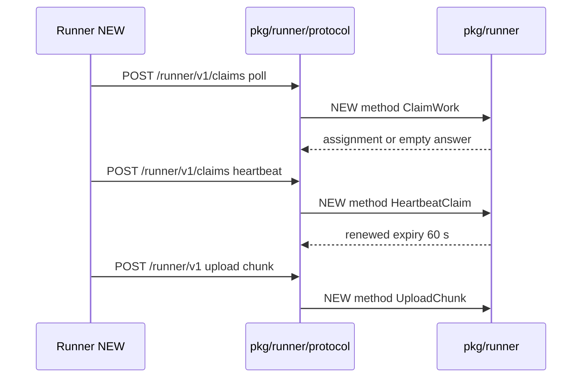
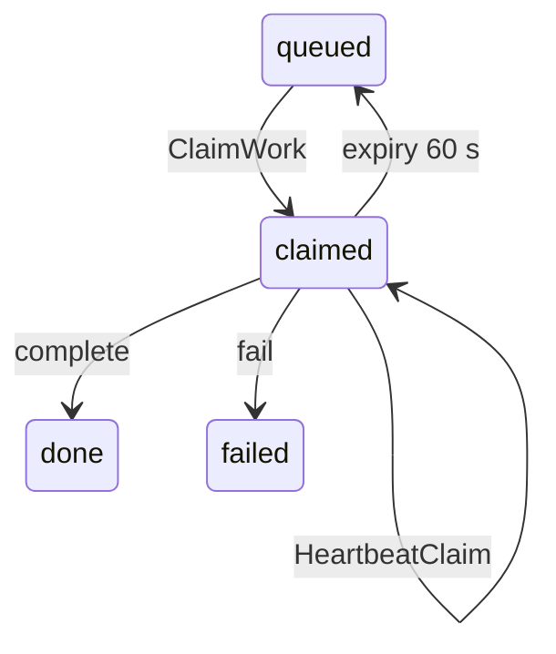
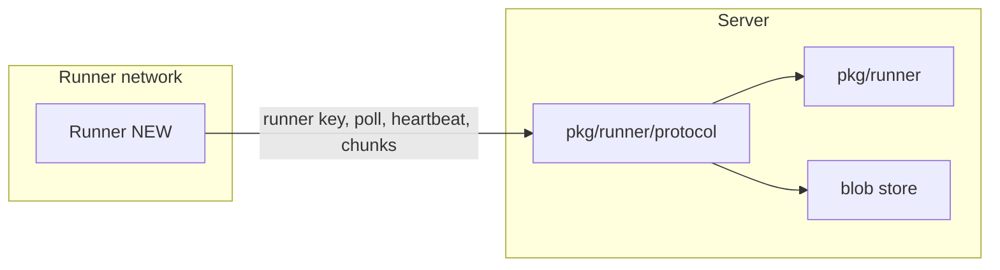

## Context

Runner claims are leases on durable operations for jobs and sweeps. Poll returns work, heartbeat renews the lease every 60 s, and upload streams the sweep report under the claim.

## Decisions

1. **Lease as a type, not as fields.** Put claim state in an unexported `claimLease` type with constructor `newClaimLease(holder, fence, expiry)` that rejects an empty holder, a stale fence, or a non-positive expiry. Handlers hold no separate expiry field. Expiry moves only through `HeartbeatClaim`. This makes a claim without a holder or without a fence impossible. Staged report bytes are written encrypted with the data key of the namespace and deleted on expiry without completion, so a large upload cannot fill the store.

## Structure

Unexported type `claimLease` with constructor `newClaimLease`; no public fields for holder, fence, or expiry.

## Risks

- Lost heartbeat strands work until expiry.
- Large upload fills the blob store.

## Layers (defense in depth)

| Layer | Guard | Hostile test |
| --- | --- | --- |
| authorize at point of use | Handler checks runner key, pool membership, purpose, and retirement before `ClaimWork`. | Poll with a retired runner key gets `runner.retired` and no work. |
| fail closed | Store checks the fence in the same transaction for claim, heartbeat, upload, complete, and fail. | Heartbeat with a moved fence gets a fence error and keeps the old holder. |
| claim lease constructor | `newClaimLease` rejects an empty holder, a stale fence and a non-positive expiry. | `TestNewClaimLeaseRejectsHostileInput` calls `newClaimLease` with each bad input. |

## Diagrams

After this change:

States and transitions after this change:

## Quality attributes

| Attribute | Target | Unit | Scope |
| --- | --- | --- | --- |
| latency | 250 | ms p95 | per poll request on same installation |
| latency | 150 | ms p95 | per heartbeat request |
| rate limits | 8 | requests per minute | per runner heartbeat and poll |

## Threat model

Data flow and trust boundaries:

| Boundary | STRIDE | Threat | Layer | Guard | Hostile test |
| --- | --- | --- | --- | --- | --- |
| Runner network to server | S | Spoofed runner claims work or renews another holder lease. | boundary check | Allowlist runner key, pool id, claim id, chunk size; reject unknown fields. | Send poll with extra privilege field; server ignores it and returns only assignment or empty answer. |
| Runner network to server | S | Spoofed runner claims work or renews another holder lease. | encode or contain | Parameterized store queries; sealed runner keys; no key echo in errors or logs. | Send key with SQL text; server treats it as opaque and answers `runner.invalid`. |
| Runner network to server | S | Spoofed runner claims work or renews another holder lease. | limit | 60 s lease, 1 GiB and 64 KiB upload caps, per-runner poll rate cap. | Stream 2 GiB; server stops at the cap with `runner.limit`. |
| Runner network to server | S | Spoofed runner claims work or renews another holder lease. | authorize at point of use | Check pool membership and claim holdership at each poll, heartbeat, and chunk. | Upload under another holder claim gets `runner.not-found`. |
| Runner network to server | S | Spoofed runner claims work or renews another holder lease. | fail closed | Deny on bad key, stale fence, or oversize chunk; write audit entry. | Heartbeat with moved fence fails closed and keeps stored holder. |
| Runner network to server | T | Tampered report bytes or replayed chunks corrupt the staged report. | boundary check | Check claim id, offset, and holdership on each chunk; reject replayed bytes. | Replay an old chunk with a stale offset; server rejects it. |
| Runner network to server | T | Tampered report bytes or replayed chunks corrupt the staged report. | encode or contain | Store upload as opaque bytes encrypted with the namespace data key. | Upload report with script text; server stores it without execution. |
| Runner network to server | T | Tampered report bytes or replayed chunks corrupt the staged report. | limit | Cap report size, records, tags, and poll rate per runner. | Flood polls from many keys; server rate-limits and keeps p95 poll latency. |
| Runner network to server | T | Tampered report bytes or replayed chunks corrupt the staged report. | authorize at point of use | Check runner key and pool purpose before serving sweep versus job work. | Job runner polls sweep work of another pool and gets an empty answer. |
| Runner network to server | T | Tampered report bytes or replayed chunks corrupt the staged report. | fail closed | Fail closed on expiry and delete staged bytes; audit poll, heartbeat, and upload. | Holder keeps writing after expiry; server denies and deletes staged bytes. |
| Runner network to server | R | Runner repudiates its poll or heartbeat history. | boundary check | Require signed runner key on each request; short 60 s lease bounds replay. | Replay a past heartbeat; server denies with `runner.not-found`. |
| Runner network to server | R | Runner repudiates its poll or heartbeat history. | encode or contain | Append-only audit entries for poll, heartbeat, and upload outcomes. | Deny a heartbeat and check that the audit entry names the claim and holder. |
| Runner network to server | R | Runner repudiates its poll or heartbeat history. | limit | Bound log and audit growth per claim. | Send many heartbeats; server caps at 8 per minute with `runner.limit`. |
| Runner network to server | R | Runner repudiates its poll or heartbeat history. | authorize at point of use | Authorize each heartbeat against the current holder, not the requester name. | Past holder heartbeats after rotation and gets `runner.not-found`. |
| Runner network to server | R | Runner repudiates its poll or heartbeat history. | fail closed | Deny on unknown claim id without leaking holder identity. | Guess a claim id; server answers `runner.not-found` with no holder detail. |
| Runner network to server | D | Many runners flood polls or uploads and deny service to other pools. | boundary check | Allowlist poll parameters and enforce 50 s long-poll timeout. | Hold many polls open; server times out at 50 s and frees handlers. |
| Runner network to server | D | Many runners flood polls or uploads and deny service to other pools. | encode or contain | Stream upload directly to the blob store without buffering whole reports. | Upload 1 GiB; server memory stays flat. |
| Runner network to server | D | Many runners flood polls or uploads and deny service to other pools. | limit | Enforce per-runner poll and heartbeat rate caps plus global queue bound. | Flood polls; server rate-limits with `runner.limit`. |
| Runner network to server | D | Many runners flood polls or uploads and deny service to other pools. | authorize at point of use | Serve polls only to members of the pool with a valid runner key. | Poll with a key of another pool and get `runner.invalid`. |
| Runner network to server | D | Many runners flood polls or uploads and deny service to other pools. | fail closed | Fail closed on overload and return empty answer with retry delay. | Overload the poll path; server returns retry delay instead of hanging. |

## Contracts

**Claim**

- Invariant: One holder holds one claim at one time.
- Invariant: Each claim write carries the fence of the namespace.
- Invariant: Expiry returns the work to queued without loss of the durable operation.
- Invariant: Staged report bytes are encrypted with the data key of the namespace and deleted when the lease expires without completion.
- `ClaimWork`: pre: Runner key is valid for the pool.; Runner is not retired.. Post: Claim has one holder and one expiry time 60 s after poll.; Durable operation state is claimed..
- `HeartbeatClaim`: pre: Caller holds the claim.; Fence version equals the stored fence version.. Post: Expiry time moves 60 s forward from heartbeat.; Heartbeat by a past holder fails closed..
- `UploadChunk`: pre: Caller holds the claim.; Total size stays within 1 GiB and line stays within 64 KiB.. Post: Chunk appends to the staged report of the claim.; Size counters increase by chunk length..
- `CompleteClaim`: pre: Caller holds the claim.. Post: Claim reaches done and staged report is kept.; Work does not return to queued..
- `FailClaim`: pre: Caller holds the claim.. Post: Claim reaches failed and staged bytes are deleted or kept per failure kind..

## Failure modes

| Step | Failure | Retry | State after |
| --- | --- | --- | --- |
| Poll and claim | Instance stops after poll and before store commit. | Runner polls again; store commit is atomic so work stays queued or claimed once. | queued or claimed by one holder |
| Heartbeat renew | Heartbeat lost; lease reaches 60 s expiry. | Holder stops work and re-polls; another runner can claim the work after expiry. | queued |
| Report upload | Upload stops mid-stream. | Holder resumes upload under the same claim from the returned byte offset while the lease holds; repeated chunks are idempotent by offset. | claimed with partial staged report |
