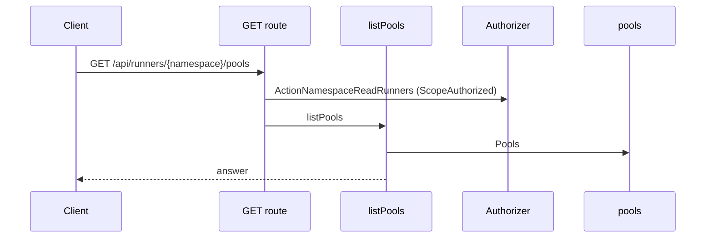
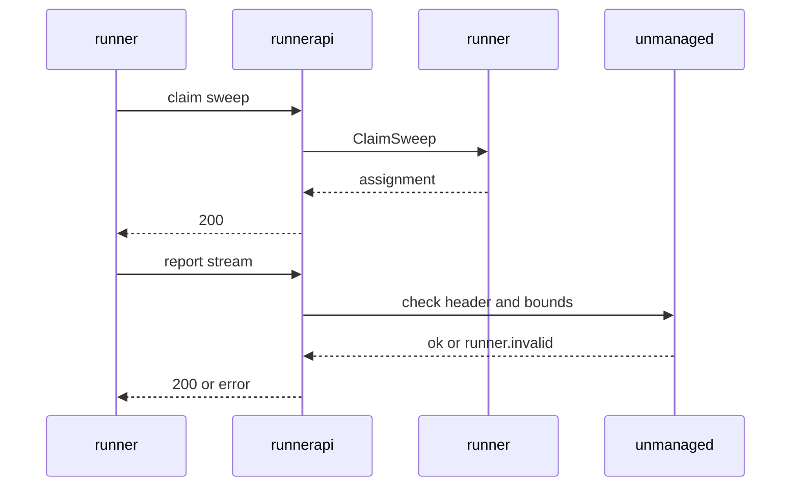
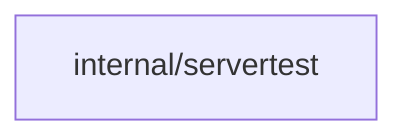
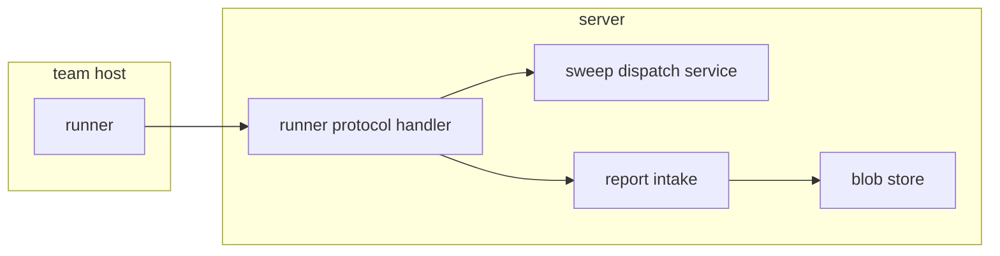

## Context

Runners on team hosts send reports that the server cannot trust. The services enforce the limits, so the handler is not the only guard.

## Decisions

1. **Service enforcement.** The job service checks the stored source.Filter with the NEW method source.Filter.CheckSource at create and at claim. The sweep dispatch checks the pool at claim. The intake checks the header against the target before any blob is created.
2. **Statuses.** source.filter-invalid is 403. A pool that cannot run sweeps is 409 runner.invalid. A header outside the target, a wrong format or an unknown version is 422 runner.invalid. A bound breach is 413 runner.limit. Each error repeats nothing of the input.
3. **Failed end state.** Any header refusal, truncation or bound breach moves the sweep to failed with an audit entry. It never reaches matching.

## Structure

An unexported checkedSweepHeader type is built only by its constructor, which checks format, version, scope count and the subset of the target. Matching accepts only this type.

## Risks

- An oversize report uses memory when the stream is not bounded.
- A source bypass when only the handler checks the filter.

## Layers (defense in depth)

| Layer | Guard | Hostile test |
| --- | --- | --- |
| boundary check | The job service refuses a source outside the filter. The header constructor refuses a wrong format, version or scope. | TestJobCreateRefusesSourceOutsideFilter |
| encode or contain | The intake reads JSON Lines with caps. | TestReportLineOver64KiBStops |
| limit | 1 GiB, 5,000,000 records, 64 KiB per line, 50 tags, key 128 bytes, value 256 bytes, 1,000 scopes. | TestReportBounds |
| authorize at point of use | The store checks the claim of the runner and the pool at each chunk. | TestChunkOfAnotherClaimIsRefused |
| fail closed | An unknown version or a scope outside the target fails the sweep and writes an audit entry. | TestUnknownReportVersionFailsTheSweep |

## Diagrams

Today: `GET /api/runners/{namespace}/pools` on main (from the route table and the handler body, route row internal/api/runnerapi/routes.go:97, handler internal/api/runnerapi/admin.go:102).

After this change:

Modules that the change touches, and their imports on main:

## Quality attributes

| Attribute | Target | Unit | Scope |
| --- | --- | --- | --- |
| latency | 50 | ms p95 | job create source check |
| latency | 100 | ms p95 | sweep claim dispatch |
| round trips | 2 | requests | sweep claim flow in internal/servertest |

## Threat model

Data flow and trust boundaries:

| Boundary | STRIDE | Threat | Layer | Guard | Hostile test |
| --- | --- | --- | --- | --- | --- |
| Runner to server report stream | T | A runner sends a scope outside the target to close findings it does not own. | boundary check | The header constructor checks format, version and the subset of the target. | TestSweepHeaderRefusals |
| Runner to server report stream | T | A runner sends a scope outside the target to close findings it does not own. | encode or contain | JSON Lines decode with caps. The blob is written as an encrypted stream. | TestReportLineOver64KiBStops |
| Runner to server report stream | T | A runner sends a scope outside the target to close findings it does not own. | limit | The bounds of ADR 164 decision 11. | TestReportBounds |
| Runner to server report stream | T | A runner sends a scope outside the target to close findings it does not own. | authorize at point of use | The store checks the claim and the pool at each chunk. | TestChunkOfAnotherClaimIsRefused |
| Runner to server report stream | T | A runner sends a scope outside the target to close findings it does not own. | fail closed | Any refusal ends the sweep failed with an audit entry. | TestSweepFailureWritesAudit |
| Report blob write | I | A runner puts secrets in tags to leak them across namespaces. | boundary check | The header is checked before any blob is created. | TestBadHeaderCreatesNoBlob |
| Report blob write | I | A runner puts secrets in tags to leak them across namespaces. | encode or contain | The blob is encrypted with the data key of the namespace. | TestReportBlobIsEncrypted |
| Report blob write | I | A runner puts secrets in tags to leak them across namespaces. | limit | 1 GiB and 64 KiB per line. | TestReportBounds |
| Report blob write | I | A runner puts secrets in tags to leak them across namespaces. | authorize at point of use | The write needs a live claim of the same namespace. | TestExpiredClaimWriteRefused |
| Report blob write | I | A runner puts secrets in tags to leak them across namespaces. | fail closed | A cut stream ends the sweep failed. | TestCutStreamFailsSweep |

## Contracts

**source.Filter**

- Invariant: The stored value is the enforced value of the namespace.
- `CheckSource`: pre: The filter is the stored filter of the job namespace.. Post: It returns nil when the source passes.; It returns source.filter-invalid when the source fails..

**sweep claim**

- Invariant: One active sweep for each target.
- Invariant: A claim binds one runner to the scopes of the target.
- `ClaimSweep`: pre: The sweep is queued.; The pool is an operator pool with the sweep purpose.. Post: It returns the assignment only when the pool and the start action allow it..

## Failure modes

| Step | Failure | Retry | State after |
| --- | --- | --- | --- |
| Sweep dispatch | The runner stops after the claim. | The lease expires and a runner of the same pool claims the sweep again. | queued |
| Report intake | The stream breaks or breaks a bound. | The operator starts a new sweep. The server keeps no prefix for matching. | failed |

## Change impact (computed from main)

Tests:

- `pkg/backup/run_before_restore_test.go` names `source.Filter`
- `pkg/backup/restore_pre_backup_takeover_test.go` names `source.Filter`
- `pkg/backup/service_test.go` names `source.Filter`

Docs pages:

- `docs/guides/access-review.md:117` names `source.Filter`
- `docs/guides/saved-views.md:20` names `source.Filter`

ADRs:

- `docs/adr/0200-profiles-config-secrets-and-credentials-for-every-tool.md` names `source.Filter`
- `docs/adr/0226-facts-typed-versioned-fact-documents.md` names `source.Filter`
- `docs/adr/0196-change-order-ports-errors-fences-and-conformance.md` names `source.Filter`
