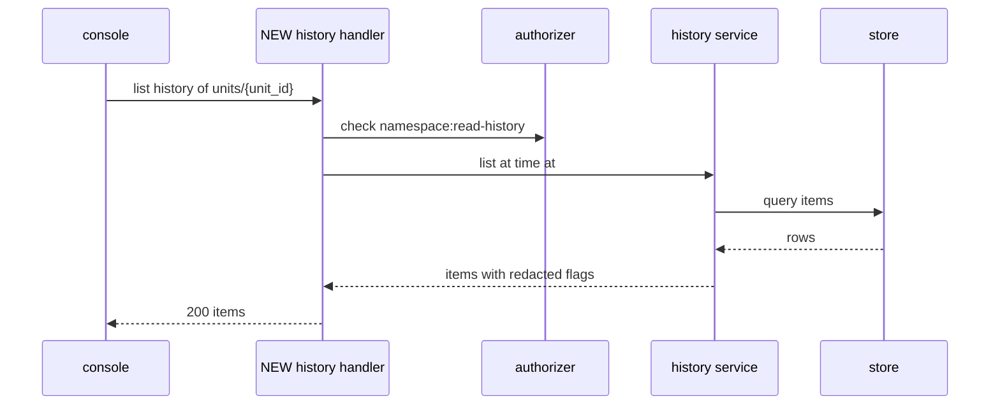
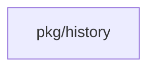
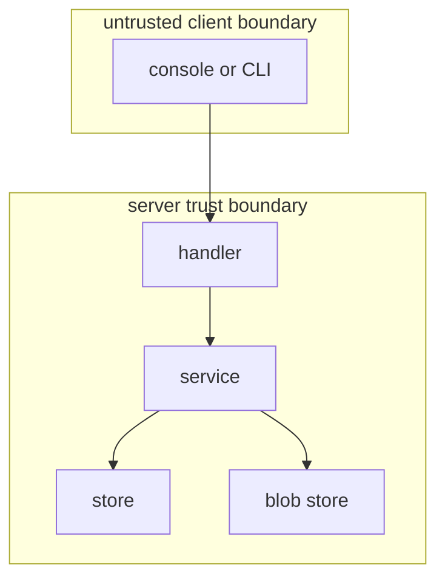

## Context

The ports and suites exist in pkg/history. Main has the deleted-units routes, the job artifact sweep schedule and a retention guard at start. No SQL adapter or history route exists.

## Decisions

1. **Adapters follow the existing port.** The SQL adapters implement pkg/history with hand-written queries in name order in queries.sql and baseline objects in name order. No numbered migration. Adapters translate driver errors to domain sentinels.
2. **Redaction destroys content and keeps metadata.** Redact marks the row. The service deletes each blob copy before it marks the row redacted. Each job artifact retention tick runs a repair pass that deletes orphan copies and writes one audit entry per copy. List and point-in-time reads return 200 with redacted true. A direct read returns 410.
3. **Artifact expiry and tombstone expiry stay separate.** Job artifacts expire 30 days after write through the existing job artifact schedule, not through the deleted-units sweep. Tombstones last 30 days after delete through the existing deleted-units sweep. Restore uses the existing deleted-units restore route with its existing action. The sweep is idempotent and rechecks the tombstone in its delete transaction. A Restore that starts first wins. A second Redact gets 409. No sweep deletes history metadata.

## Structure

The unexported type historyItem has a private content field. Only newHistoryItem makes a value and checks the invariants. Redact moves the item to redactedHistoryItem, which has no content field.

## Risks

- History reads leak secret values without the redaction guard.
- The retention sweep deletes metadata that blame needs.

## Layers (defense in depth)

| Layer | Guard | Hostile test |
| --- | --- | --- |
| authorize at point of use | The handler checks the NEW actions on the namespace before each read or redact. | TestHistoryReadDeniedWithoutGrant sends a read with no grant and expects 403. |
| boundary check | The service allowlists the tool values pulumi and tofu and the reasons secret-exposure, personal-data, other. | TestHistoryRejectsUnknownTool sends tool admin to the service and expects an error. |
| limit | The store binds placeholders and returns at most 100 rows per page. | TestHistoryPageLimit stores 1000 items and expects 100. |
| encode or contain | The response encodes redacted content as null and repeats no secret value. | TestRedactedItemHasNullContent reads a redacted item and expects null. |
| fail closed | A store or blob error returns 5xx history.unavailable with an audit entry and no partial content. | TestHistoryUnavailableFailsClosed forces a blob error. |

## Diagrams

After this change:

Modules that the change touches, and their imports on main:

## Quality attributes

| Attribute | Target | Unit | Scope |
| --- | --- | --- | --- |
| latency | 800 | ms p95 | history list per namespace |
| rate limit | 60 | requests per minute | history reads per principal |
| storage growth | 30 | days of job artifacts | per namespace |

## Threat model

Data flow and trust boundaries:

| Boundary | STRIDE | Threat | Layer | Guard | Hostile test |
| --- | --- | --- | --- | --- | --- |
| console or CLI to handler | I | A caller reads history of another namespace or reads redacted content. | boundary check | Allowlist the tool values and reasons. | TestHandlerRejectsUnknownTool expects 400. |
| console or CLI to handler | I | A caller reads history of another namespace or reads redacted content. | encode or contain | Errors repeat no secret content. | TestRedactErrorHasNoValue checks the body. |
| console or CLI to handler | I | A caller reads history of another namespace or reads redacted content. | limit | 100 items per page, 1 MiB body, 60 reads per minute. | TestHistoryPageLimit expects 100. |
| console or CLI to handler | I | A caller reads history of another namespace or reads redacted content. | authorize at point of use | The authorizer checks the grant on the namespace. | TestHistoryOtherNamespaceToken expects 403. |
| console or CLI to handler | I | A caller reads history of another namespace or reads redacted content. | fail closed | An auth or store error denies and writes an audit entry. | TestHistoryAuthErrorDenies expects denial and audit. |

## Contracts

**history item**

- Invariant: Items are append only in one namespace.
- Invariant: Each item carries the stable unit reference and the stable actor identity.
- Invariant: Redact destroys content and keeps metadata.
- `Append`: pre: the fence matches the namespace and failover version. Post: the item is stored with the next sequence number.
- `Redact`: pre: the caller holds namespace:redact-history and the item is not redacted. Post: content and blob copies are destroyed and metadata remains.

**deleted unit**

- Invariant: The tombstone keeps the stable unit reference.
- Invariant: Restore works only inside 30 days.
- Invariant: The sweep never deletes history metadata.
- `Restore`: pre: the tombstone exists and is inside 30 days. Post: the unit is present again with its history.
