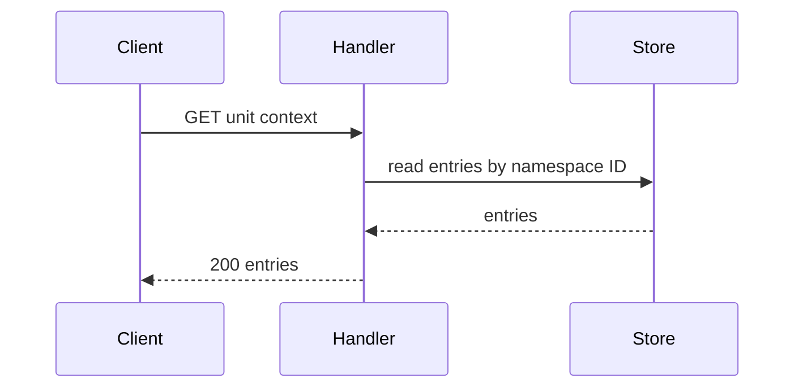
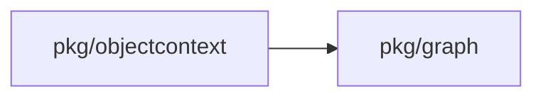

## Context

Context read and write by stable ID and the unit focus view on top of accepted ports in pkg/objectcontext and pkg/graph, with SQL adapters and tool-neutral routes.

## Decisions

1. **Adapters implement ports, handlers map stable IDs.** The SQL adapters implement the existing ports without new write paths in pkg/graph. Context writes go through pkg/objectcontext only. The NEW focus handler maps tool plus stable IDs to graph.Focus and enforces limits before any store read. Edge reads go through dependency.Store.Edges with per-hop cap 5000 and truncated flag. Namespace purge deletes object_context rows and a recreated namespace gets a new ID with no carryover.

## Structure

Unexported sqlContextStore with constructor checkContextStore that enforces namespace ID keying and entry primary key; unexported sqlEdgeReader with constructor checkEdgeReader that enforces window ordering and per-hop edge cap of 5000. No new tool.

## Risks

- Stale focus when edges change between hops.
- Large namespaces exceed edge read budgets.

## Diagrams

After this change:

Modules that the change touches, and their imports on main:

New imports of this change (each one allowed by the module rules):

- `internal/api/inventory` imports `pkg/graph`
- `internal/api/inventory` imports `pkg/objectcontext`

## Quality attributes

| Attribute | Target | Unit | Scope |
| --- | --- | --- | --- |
| latency | 800 | ms p95 | GET unit context and GET unit focus on a namespace with 1000 units |
| storage growth | 1 | row per entry, no duplicate rows per owner | object_context rows per namespace |

## Contracts

**objectcontext entry**

- Invariant: One row per namespace, object kind, object ID, resource key and source.
- Invariant: Every row carries the stable namespace ID, never the namespace name.
- Invariant: A soft-deleted unit keeps its entries with a deleted mark until purge.
- `Read namespace and unit context`: pre: Caller holds read on the namespace or the unit.. Post: Caller receives the resolved entries with provenance..
- `Patch and delete context entries`: pre: Caller holds write on the namespace or the unit and the object exists and is not soft-deleted.. Post: Entries change only for the named stable object ID..

**graph focus view**

- Invariant: Focus names one start unit by tool, namespace ID and stable unit ID.
- Invariant: A walk never passes through a hidden unit; hidden units count in hidden.
- Invariant: Each answer carries complete, truncated, hidden and since.
- `Focus for one unit`: pre: Caller can read the start unit; else 404.. Post: Answer holds the focus unit, bounded neighbors, folds and completeness metadata..

## Change impact (computed from main)

Tests:

- `pkg/manuallock/manuallock_test.go` names `graph.Unit`
- `internal/cost/cost_test.go` names `graph.Unit`
- `pkg/outputshare/outputsharetest/mem_test.go` names `graph.Unit`
- `internal/graph/graphtest/memory_test.go` names `graph.EdgeReader`
- `internal/graph/graphtest/memory_test.go` names `graphtest.RunEdgeReader`
- `pkg/graph/graph_test.go` names `graph.Focus`

Docs pages:

- `docs/reference/blob-write-benchmark-record.md:23` names `graph.Unit`
- `docs/reference/blob-write-benchmark-record.md:66` names `graph.Unit`
- `docs/reference/blob-write-benchmark-record.md:176` names `graph.Unit`

ADRs:

- `docs/adr/0243-the-source-port-its-adapters-and-conformance.md` names `graph.Unit`
- `docs/adr/0154-history-gaps-found-before-the-implementation.md` names `graph.Unit`
- `docs/adr/0114-the-policy-port-and-its-default-adapters.md` names `graph.Unit`
- `docs/adr/0166-context-and-graph-gaps-found-before-the-implementation.md` names `graph.EdgeReader`
- `docs/adr/0162-the-unit-graph-queries-and-focus-view.md` names `graph.EdgeReader`
- `docs/adr/0162-the-unit-graph-queries-and-focus-view.md` names `graphtest.RunEdgeReader`
- `docs/adr/0166-context-and-graph-gaps-found-before-the-implementation.md` names `graphtest.RunEdgeReader`
- `docs/adr/0162-the-unit-graph-queries-and-focus-view.md` names `graph.Focus`
- `docs/adr/0180-console-themes-color-schemes-and-preferences.md` names `graph.Focus`
