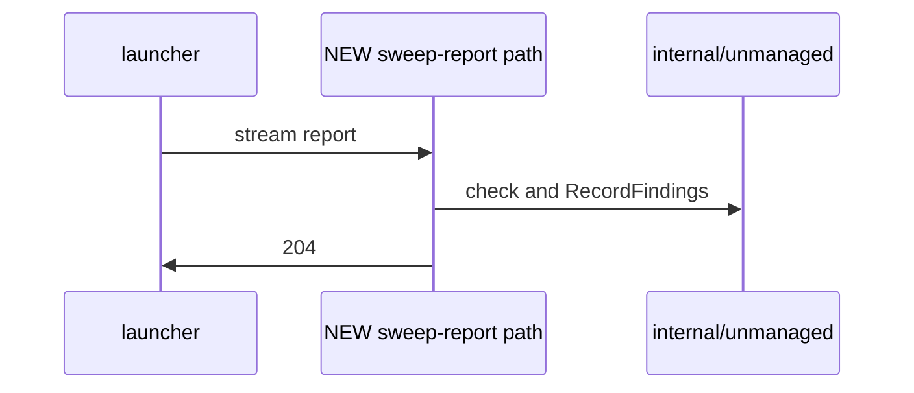
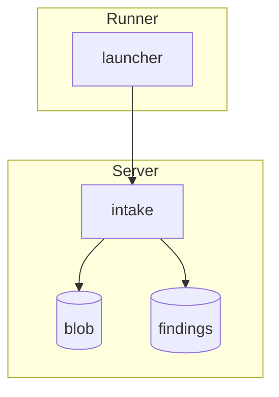

## Context

Streaming intake of an untrusted report and triage of findings.

## Decisions

1. **Stage then commit.** The handler checks while it reads and writes the encrypted blob under a staging key. After the hash matches, one transaction records findings and moves the sweep to matching. Any error deletes the staged blob and fails the sweep once. A runner restart before the end leaves the claim live, so a new upload under the same claim replaces the staged blob.
2. **One upload.** A second upload for a sweep that has a committed report answers 409 and changes nothing. A replayed nonce answers bad-proof.
3. **Deduplicate findings.** A finding is unique by namespace ID and resource key. Triage states are open, acknowledged, resolved and ignored. Moves go forward only, with a reason of at most 500 characters.

## Structure

Unexported type reportReader, built only by newReportReader with limits, target scopes and the namespace ID. A record whose scope or region is outside the header is refused. A scope with complete false closes no finding.

## Risks

- Large report: the reader holds one line at a time, at most 64 KiB.
- Replay of an old report: the nonce and the one-upload rule refuse it.

## Layers (defense in depth)

| Layer | Guard | Hostile test |
| --- | --- | --- |
| boundary check | Header, version, tag limits and subset match. | TestReportRefusesBadVersionAndForeignScope |
| limit | 1 GiB, 5,000,000 records, 64 KiB lines. | TestReportRefusesLongLine |
| authorize at point of use | Session proof and live sweep claim on upload. The namespace:manage-sweeps action on list and triage. | TestSweepReportRefusesJobClaimAndBadProof |
| fail closed | Any error deletes the staged blob and fails the sweep. | TestSweepReportFailsClosedOnCutStream |

## Diagrams

After this change:

## Quality attributes

| Attribute | Target | Unit | Scope |
| --- | --- | --- | --- |
| storage growth | at most 1 GiB per report | bytes | one sweep report blob |

## Threat model

Data flow and trust boundaries:

| Boundary | STRIDE | Threat | Layer | Guard | Hostile test |
| --- | --- | --- | --- | --- | --- |
| Runner to server | T | A hostile runner sends a false report. | boundary check | Header and subset checks. | Foreign scope refused. |
| Runner to server | T | A hostile runner sends a false report. | encode or contain | Key normal form and tag text checks. | NUL tag refused. |
| Runner to server | T | A hostile runner sends a false report. | limit | Stated bounds. | Long line gets 413. |
| Runner to server | T | A hostile runner sends a false report. | authorize at point of use | Session proof and live sweep claim. | Job claim denied. |
| Runner to server | T | A hostile runner sends a false report. | fail closed | Any error deletes the staged blob and fails the sweep. | Cut stream stores no findings. |

## Contracts

**Finding**

- Invariant: One finding for each namespace ID and resource key.
- Invariant: Triage moves forward only.
- `RecordFindings`: pre: The report passed all checks.. Post: Findings exist once for each key..
- `SetTriage`: pre: The caller holds namespace:manage-sweeps.. Post: The finding holds the new triage, actor, reason and time..

## Failure modes

| Step | Failure | Retry | State after |
| --- | --- | --- | --- |
| Stream | The stream is cut or the runner restarts | The runner uploads again under the live claim; the staged blob is replaced | running, no findings |
| Commit | The transaction fails | The upload is repeated under the live claim | no findings, staged blob deleted |
