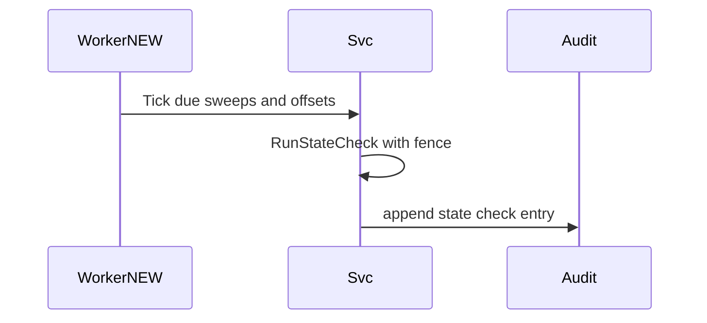

## Context

The schedule worker wakes every 15 minutes. It starts due cloud sweeps from earlier parts and the daily state check of each namespace at its spread offset. The state check reads the resource index only as a sweep record of kind state.

## Decisions

1. **Loop over stored rows with idempotent starts.** The worker is a small loop over stored schedule rows, not a new daemon framework. It lists due sweep targets and due namespace offsets, then calls ScanStore StartScan with kind state and the namespace fence. One busy guard ErrScanBusy covers both sweeps and state checks. Idempotent start keys make a repeat tick safe.
2. **Computed per-namespace offset spreads load.** StateCheckOffset computes the spread from the hash of the namespace ID over 24 hours. No column is stored and no schema changes. The tick skips a namespace with no unit, a deleted namespace, or one already checked in the current day window. A state check expires after 10 minutes under the sweep expiry owner so a crash cannot block the namespace.

## Structure

The unexported type scheduleWorker with constructor newScheduleWorker(store, clock, batchSize) makes untracked starts impossible: all starts go through Tick, which checks the fence and the StartScan busy guard before any write.

## Risks

- A tick that starts too much work at once delays checks.
- A long state check blocks the next tick.

## Diagrams

After this change:

## Quality attributes

| Attribute | Target | Unit | Scope |
| --- | --- | --- | --- |
| latency | Complete one tick in under 60 seconds for 1000 namespaces | seconds | 15-minute schedule tick per installation |
| latency | Classify 100000 index entries in under 300 seconds | seconds | daily state check per namespace |

## Contracts

**StateCheck**

- Invariant: One open state check per namespace at a time.
- Invariant: A state check reads only committed index rows of its fence.
- `RunStateCheck`: pre: Caller holds the fence of the namespace.; No open sweep of kind state exists for the namespace.. Post: A finished sweep record of kind state exists with counts.; An audit entry exists with namespace ID and counts..

**ScheduleTick**

- Invariant: A tick starts each due item at most once.
- `Tick`: pre: Schedule row exists and tick time reached.. Post: Due sweep targets started and due state checks recorded..

## Failure modes

| Step | Failure | Retry | State after |
| --- | --- | --- | --- |
| Schedule tick | Process stops mid-tick after some starts. | Next 15-minute tick resumes; started items carry idempotent keys so repeats skip. | Started items run; unstarted due items stay due. |
| State check run | Process stops mid-state-check. | Sweep expiry marks the record failed after 10 minutes; next tick or manual start retries from committed index. | State check stays running until 10-minute expiry, then failed. |

## Change impact (computed from main)

Tests:

- `internal/unmanaged/unmanagedtest/mem_test.go` names `ErrScanBusy`

ADRs:

- `docs/adr/0164-cloud-sweeps-on-the-teams-runner.md` names `ErrScanBusy`
- `docs/adr/0166-context-and-graph-gaps-found-before-the-implementation.md` names `ErrScanBusy`
