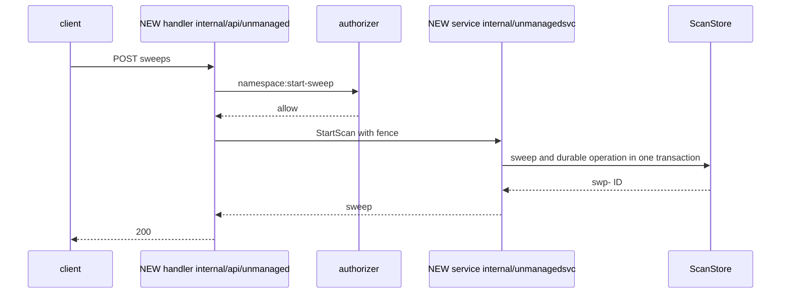
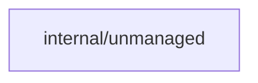
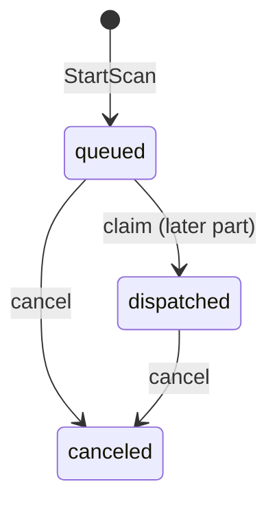
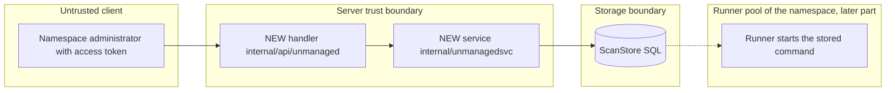

## Context

Runners of sweep pools of the namespace claim the work in a later part. This part stores targets and queued sweeps and cancels them.

## Decisions

1. **Stable IDs.** Rows hold the namespace ID and the pool ID, never names. Target ID prefix trg-, sweep ID prefix swp-. The name is a label.
2. **One open sweep in SQL.** A partial unique index on the target ID for sweeps with status queued, dispatched, running or matching makes two open sweeps impossible. The loser of a race gets ErrScanBusy from the constraint.
3. **Start and cancel.** StartScan inserts the sweep and the durable operation in one transaction. Cancel moves queued and dispatched sweeps to canceled and stops the durable operation in the same transaction. A sweep in running or matching is refused with 409 unmanaged.scan-not-cancelable in this part.
4. **Pool check.** The store checks in its transaction that the pool belongs to the namespace and has the sweeps purpose. A pool delete is refused while a target names it.
5. **Backup class.** The target table goes in backup.Tables. The sweep tables are rebuildable and a backup leaves them out. A purge deletes all rows of the namespace ID.
6. **Limits.** A command has at most 256 arguments and 131072 bytes. A namespace has at most 100 targets. A list answer has at most 200 sweeps for each page.

## Structure

Unexported type target with the constructor NewTarget; only it makes a value. It checks the command with the rules of ADR 164 decision 8 and each scope against the provider allowlist. Status is written only by AdvanceScan along unmanaged.NextScan.

## Risks

- Two starts race: answered by the unique index.
- Hostile command: refused by NewTarget and by the store.
- Restore with a queued sweep: sweep tables are emptied.

## Layers (defense in depth)

| Layer | Guard | Hostile test |
| --- | --- | --- |
| boundary check | NewTarget allowlist for command and scopes | TestNewTargetRefusesHostileCommand |
| authorize at point of use | namespace:manage-sweeps and namespace:start-sweep on the namespace | TestSweepRoutesRefuseWithoutGrant |
| limit | unique index for one open sweep | TestConcurrentStartsOneWins |

## Diagrams

After this change:

Modules that the change touches, and their imports on main:

New imports of this change (each one allowed by the module rules):

- `internal/api/unmanaged (NEW)` imports `internal/unmanagedsvc (NEW)`
- `internal/unmanagedsvc (NEW)` imports `internal/unmanaged`

States and transitions after this change:

## Quality attributes

| Attribute | Target | Unit | Scope |
| --- | --- | --- | --- |
| latency | 300 | ms | p95 of POST target and POST sweep start on sqlite |
| storage growth | 4 | KiB | per sweep row plus its durable operation row |

## Threat model

Data flow and trust boundaries:

| Boundary | STRIDE | Threat | Layer | Guard | Hostile test |
| --- | --- | --- | --- | --- | --- |
| Client to server | T | A hostile command or scope is stored and a runner later starts it. | boundary check | NewTarget allowlist for command and scopes | TestNewTargetRefusesHostileCommand |
| Client to server | T | A hostile command or scope is stored and a runner later starts it. | encode or contain | SQL placeholders only; the command is stored as an argument list, never as a shell string | TestTargetCommandStoredAsArgumentList |
| Client to server | T | A hostile command or scope is stored and a runner later starts it. | limit | 256 arguments, 131072 bytes, 100 targets for each namespace | TestTargetLimitsRefuseOverflow |
| Client to server | T | A hostile command or scope is stored and a runner later starts it. | authorize at point of use | namespace:manage-sweeps on the namespace in the service | TestSweepRoutesRefuseWithoutGrant |
| Client to server | T | A hostile command or scope is stored and a runner later starts it. | fail closed | an unknown pool, purpose or provider is refused and the refusal is audited | TestUnknownPoolRefusedAndAudited |
| Client to server | E | A caller names a pool without the sweeps purpose or a pool of another namespace for a sweep. | boundary check | the pool ID must match the pool ID allowlist form | TestPoolIDFormRefused |
| Client to server | E | A caller names a pool without the sweeps purpose or a pool of another namespace for a sweep. | encode or contain | the store joins the pool by its stable ID, its namespace ID and its purpose | TestStoreRefusesPoolWithoutSweepPurpose |
| Client to server | E | A caller names a pool without the sweeps purpose or a pool of another namespace for a sweep. | limit | purpose is fixed and never changes | TestPurposeChangeRefused |
| Client to server | E | A caller names a pool without the sweeps purpose or a pool of another namespace for a sweep. | authorize at point of use | the store checks the pool in the transaction of the write | TestRacingPoolSwapRefused |
| Client to server | E | A caller names a pool without the sweeps purpose or a pool of another namespace for a sweep. | fail closed | 422 unmanaged.pool-not-sweeps on any doubt | TestPoolWithoutSweepPurposeRefused |
| Client to server | D | Many starts or cancels flood the durable operation table. | boundary check | start accepts only a stored target ID | TestStartUnknownTargetRefused |
| Client to server | D | Many starts or cancels flood the durable operation table. | encode or contain | a partial unique index keeps one open sweep for each target | TestConcurrentStartsOneWins |
| Client to server | D | Many starts or cancels flood the durable operation table. | limit | one open sweep for each target and 200 rows for each list page | TestListPageLimit |
| Client to server | D | Many starts or cancels flood the durable operation table. | authorize at point of use | namespace:start-sweep on the namespace | TestStartRefusedWithoutGrant |
| Client to server | D | Many starts or cancels flood the durable operation table. | fail closed | a lost race answers 409 unmanaged.scan-busy and stores nothing | TestBusyStoresNothing |
| Server to storage | R | A target change happens with no record of the command. | boundary check | the service writes the audit entry from the validated target only | TestAuditHoldsValidatedCommand |
| Server to storage | R | A target change happens with no record of the command. | encode or contain | the audit entry and the write use one transaction | TestAuditAndWriteAtomic |
| Server to storage | R | A target change happens with no record of the command. | limit | the entry holds the changed fields only | TestAuditEntrySizeBound |
| Server to storage | R | A target change happens with no record of the command. | authorize at point of use | the fence is checked in the transaction | TestStaleFenceRefusesWrite |
| Server to storage | R | A target change happens with no record of the command. | fail closed | a failed audit append rolls back the write | TestAuditFailureRollsBack |
| Server to storage | R | A write with a stale fence is refused and leaves no record. | fail closed | the service audits a refusal where the store returns namespace.ErrFenced: one denied entry; the SQL adapters write no audit entry | TestFencedRefusalAudited |

## Contracts

**unmanaged target and sweep**

- Invariant: The key is the stable ID. The name is a label.
- Invariant: A target names a pool of the namespace with the sweeps purpose.
- Invariant: The command has 1 to 256 arguments, at most 131072 bytes, no NUL byte.
- Invariant: One open sweep for each target.
- `CreateTarget`: pre: The fence holds.; The pool belongs to the namespace and has the sweeps purpose.. Post: A target row exists with a trg- ID..
- `UpdateTarget`: pre: The fence holds.; The target exists.. Post: The row holds the new fields and an audit entry exists..
- `DeleteTarget`: pre: The fence holds.; No open sweep.. Post: The row is gone..
- `StartScan`: pre: The target is enabled.; No open sweep.. Post: A queued sweep and a durable operation exist..
- `AdvanceScan`: pre: The event is valid for the status in NextScan.. Post: The status moves along NextScan. A terminal status stops the durable operation..

## Failure modes

| Step | Failure | Retry | State after |
| --- | --- | --- | --- |
| Start transaction | The process stops before commit. | The caller sends the start again. | No sweep and no durable operation. |
| Cancel | The process stops before commit. | The caller sends cancel again. | The sweep stays queued or dispatched with its operation. |
| Restore | A restore runs with a queued sweep. | The administrator starts a new sweep. | Targets stay. Sweep rows are empty. |

## Change impact (computed from main)

Tests:

- `internal/unmanaged/unmanagedtest/mem_test.go` names `ErrScanBusy`
- `pkg/runner/runnertest/mem_test.go` names `runner.ErrPoolInUse`
- `internal/api/runnerapi/wrapped_copy_internal_test.go` names `runner.ErrPoolInUse`
- `internal/api/runnerapi/errcode_test.go` names `runner.ErrPoolInUse`

ADRs:

- `docs/adr/0164-cloud-sweeps-on-the-teams-runner.md` names `ErrScanBusy`
- `docs/adr/0166-context-and-graph-gaps-found-before-the-implementation.md` names `ErrScanBusy`
- `docs/adr/0130-runner-pools-runners-and-coordinators.md` names `runner.ErrPoolInUse`
