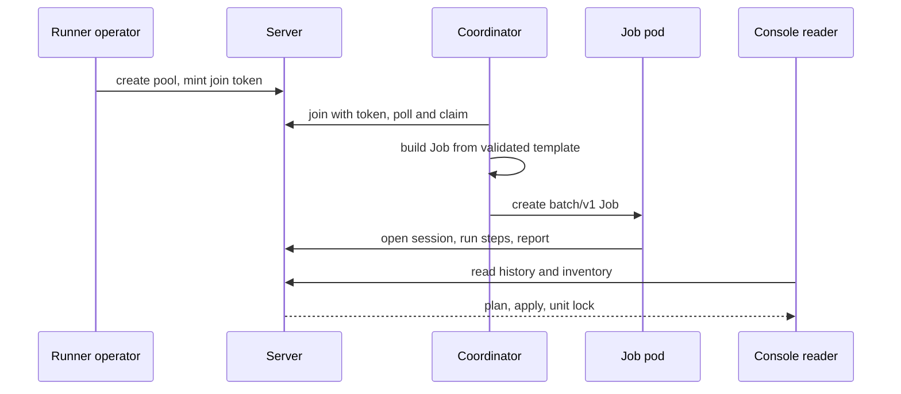
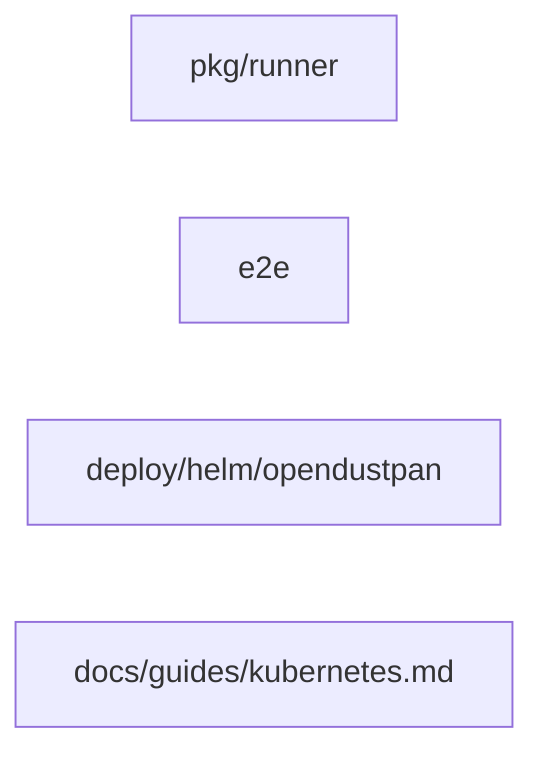
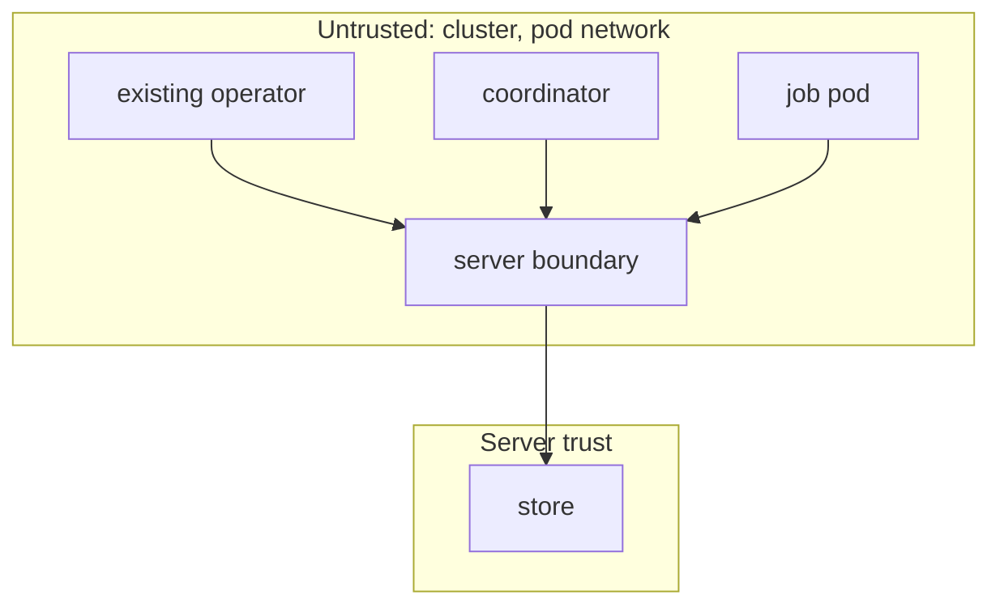

## Context

This change refines RFC 31 phases 1 and 2 for implementation, after runners land. Phase 1 runs the existing operators (the Pulumi Kubernetes Operator, tofu-controller, Burrito) against OpenDustpan as their backend. Phase 2 gives the runner operator a supported path to run runner pools on Kubernetes: the coordinator from the Helm chart with the runner binary, installed from the docs page. The operator resources of phases 3 and 4 stay with change 305-kubernetes-operator-31-phases. No new API surface, no schema change, and no new CLI output ships in this change: the coordinator and the existing operators act only through the REST API and the runner protocol that main already serves. The ADR check of the proposal holds for this design.

## Decisions

1. **Phase 1 e2e proves interoperation, with no server change.** One e2e flow points each existing operator at OpenDustpan: the `spec.backend` URL of the Pulumi Kubernetes Operator, the `backendConfig` of tofu-controller, and the per-layer backend of Burrito. Each flow writes state through the operator, then reads it back through the OpenDustpan history and inventory. A backend field that refuses the OpenDustpan URL is a finding of the e2e run, not a server fix in this change.
2. **Phase 2 ships the coordinator in its chart and binary.** The coordinator ships with the coordinator Helm chart and the runner binary, with the `client-go` adapter of the `runner.Cluster` port. The chart creates exactly the roles of the coordinator decision: create, get, list, watch and delete on Jobs, get on pods, get on its Secret, and create on `tokenreviews` in the cluster, and nothing else. The docs page extends `docs/guides/kubernetes.md` with the runner-pool install path, and each command on the page runs as written against a clean installation.
3. **No new surface.** This change adds no endpoint, no schema column, no error code, and no CLI output. The coordinator creates units and requests jobs through the REST API, runs no tool, keeps no state, and uses no private endpoint. A script can do everything that the coordinator does.
4. **One principal for each Kubernetes namespace.** The cluster signs in with its projected service account token through the workload-identity trust rules and the token exchange, with one principal for each Kubernetes namespace that the coordinator serves. Each grant is stored, and a person can list and revoke it. There is no default grant.
5. **A bad pod template cannot start a Job.** The coordinator reads the pod template of the team once at start into a validated template value. The constructor rejects `hostNetwork`, `hostPID`, `hostIPC`, a `hostPath` volume, and a privileged container. Only the validated value can build a Job spec, so a forbidden field fails the start of the coordinator and never reaches a Job.

## Structure

The unexported type validatedTemplate in the coordinator adapter holds the checked `corev1.PodTemplateSpec`. The constructor checkTemplate checks the invariants and returns the value or a refusal. Job build methods take a validatedTemplate, so a Job with no check does not compile. The golangci-lint configuration keeps the existing domain rules: the adapter imports the port package, and the server never imports the Kubernetes client library.

## Risks

- A backend field of an existing operator may refuse the OpenDustpan URL shape. The phase 1 e2e run records the exact refusal.
- The time from a claim to the first step includes the schedule of a pod and the pull of an image. The docs page tells the team to keep its images on the nodes.
- A Job that waits for a node holds its claim. The coordinator renews the claim until the session opens, for 30 minutes at most, then releases it.

## Diagrams

After this change:

Modules that the change touches, and their imports on main:

New imports of this change (each one allowed by the module rules):

- `e2e` imports `pkg/runner` (read only, for Job name assertions)

## Quality attributes

| Attribute | Target | Unit | Scope |
| --- | --- | --- | --- |
| reliability | 100 | percent pass on a clean cluster | phase 1 interoperation e2e on k3s in CI |
| reliability | 100 | percent pass on a clean cluster | phase 2 coordinator e2e: plan and apply one OpenTofu unit and one Pulumi unit, cancel a running apply, take over a claim after a delete of the coordinator pod |
| maintainability | 0 | manual steps after the docs page | runner-pool install from docs/guides/kubernetes.md alone |

## Threat model

Data flow and trust boundaries:

| Boundary | STRIDE | Threat | Layer | Guard | Hostile test |
| --- | --- | --- | --- | --- | --- |
| server boundary | S | A hostile tenant service account exchanges a token for a principal outside its namespace. | authorize at point of use | Trust rule names the exact service account and audience; exchange refuses any other presenter. | Exchange a token from a service account that the rule does not name; exchange refuses and writes an audit entry. |
| server boundary | S | A hostile tenant service account exchanges a token for a principal outside its namespace. | boundary check | Token exchange checks issuer, audience `opendustpan-coordinator`, and the 10-minute lifetime at the boundary. | Replay an expired projected token at the handoff; coordinator refuses. |
| server boundary | S | A hostile tenant service account exchanges a token for a principal outside its namespace. | limit | One principal holds grants only on its namespaces or collections; no default grant. | Call a unit route of another namespace with the exchanged token; server answers 403. |
| server boundary | S | A hostile tenant service account exchanges a token for a principal outside its namespace. | encode or contain | Handoff token is single-use; the coordinator keeps no copy and a second request gets nothing. | Ask for the handoff token of one claim twice; the second request gets nothing. |
| server boundary | S | A hostile tenant service account exchanges a token for a principal outside its namespace. | fail closed | Refused handoff appends an audit entry of the event `handoff-refused` with the pod and the reason, and no token. | Send a token whose pod UID does not match the Job labels; handoff refuses with an audit entry. |
| server boundary | T | A unit pod reaches above its role through a picked service account. | authorize at point of use | Coordinator runs the Job only when the allowlist of service accounts in its Helm values names it, and never as its own service account. | Name the coordinator service account in `Work`; coordinator releases the claim and starts no Job. |
| server boundary | T | A unit pod reaches above its role through a picked service account. | boundary check | Validated template constructor rejects `hostNetwork`, `hostPID`, `hostIPC`, `hostPath`, and privileged containers. | Start the coordinator with a template that sets `hostPath`; the start fails and no Job is built. |
| server boundary | T | A unit pod reaches above its role through a picked service account. | limit | Job uses `backoffLimit: 0`, `restartPolicy: Never`, and a read-only service account for sweeps. | Kill a Job pod mid-claim; Kubernetes starts nothing again and the takeover rules decide. |
| server boundary | T | A unit pod reaches above its role through a picked service account. | encode or contain | Pod sets `automountServiceAccountToken: false`, a projected token with the one audience, `runAsNonRoot`, no privilege escalation, dropped capabilities, and the `RuntimeDefault` seccomp profile. | Inspect a built Job spec; each setting is present. |
| server boundary | T | A unit pod reaches above its role through a picked service account. | fail closed | Chart creates exactly the coordinator roles and no wider binding; a refused service account starts no Job and the console shows the reason. | Bind a wider role to the coordinator account in a test cluster; chart-lint reports the extra rule. |

## Contracts

This change adds no endpoint, no port method, no stored column, and no CLI output. It drives only surface that main already serves:

**runner protocol (existing)**

- Invariant: One claim gets at most one Job; a retry of the create after a lost answer names the same Job (`runner.KubernetesJobName`).
- `poll-claim-report`: pre: Runner holds a fresh join of a pool for jobs.. Post: Claimed phase runs in one Job; report lands in history..

**REST API (existing)**

- `pool create`, `join-token mint`, history read, inventory read: unchanged shapes and unchanged authorization actions.

Each time field keeps the unit that its handler writes on main, and each error keeps the sentinel that the conformance suite of its port requires.

## Failure modes

| Step | Failure | Retry | State after |
| --- | --- | --- | --- |
| Phase 1 operator backend write | Operator backend field refuses the OpenDustpan URL. | No retry in this change; record the refusal as an e2e finding. | No state written; e2e reports the exact field and refusal. |
| Coordinator Job create | Image pull error or unschedulable pod before the launcher opens a session. | Coordinator releases the claim; another runner can take it. | Claim released; no session; Job stays readable for one hour. |
| Launcher handoff | Projected token fails the TokenReview check. | No retry of the same token; pod restarts with a fresh projected token. | Audit entry `handoff-refused` with the pod and the reason; no token answered. |
| Running claim | Heartbeat answer lists the claim as lost. | Coordinator deletes its Job in the foreground; takeover rules decide. | Launcher gets `SIGTERM`, then `SIGKILL` after the grace; claim expires for takeover. |
| Coordinator replica stop | Replica loses its claims after one lease. | Takeover rules apply; launchers with a session renew their own claim. | Jobs whose launchers hold a session go on; other claims return to queued. |

## Change impact (computed from main)

Tests:

- `pkg/runner/coordinator_test.go` names `runner.KubernetesJobName`
- `pkg/runner/coordinator_test.go` names `runner.LimitsFor`
- `pkg/runner/handoff_test.go` names `runner.CheckHandoffPod`
- `pkg/durable/scheduler_test.go` names the first-claim delay
- `pkg/durable/runner_claimed_test.go` names the claim handoff

Docs and chart:

- `docs/guides/kubernetes.md` holds the server install path that the runner-pool section extends
- `deploy/helm/opendustpan/` holds the chart that the coordinator chart extends
- `deploy/helm/opendustpan/values.yaml` holds the Helm values that name the service accounts

ADRs:

- `docs/adr/0136-the-kubernetes-coordinator.md` decides one Job for each claim, the pod shape, the TokenReview pull, the coordinator permissions, and the validation matrix
- `docs/adr/0139-runner-dependencies-and-the-runner-module.md` decides `client-go` for the coordinator adapter and the separate runner binary
- `docs/adr/0305-our-own-kubernetes-operator-modeled-on-the-pulumi-kubernetes-operator.md` decides the job path, the order, the shared chart and binary, the phase 1 e2e start, and the workload identity
