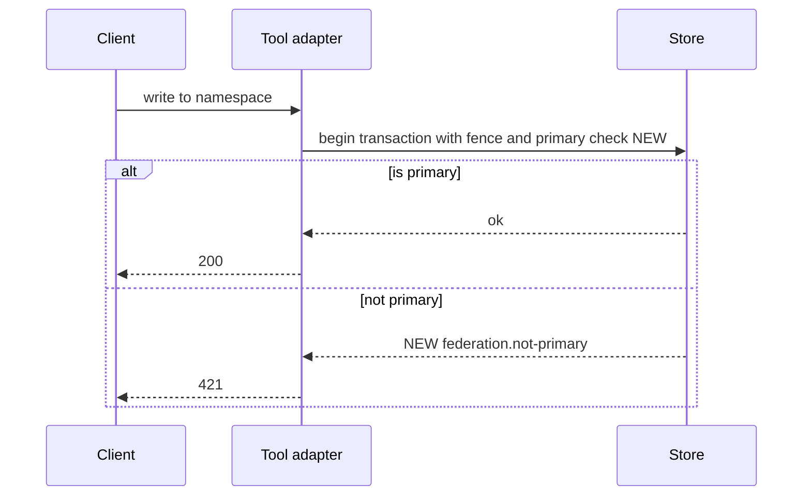
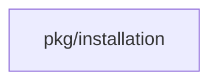

## Context

A request can reach an installation that is not the primary of the namespace. The server must refuse the write plainly and name the primary.

## Decisions

1. **Stored stable ID.** The namespace row holds the primary installation ID, an opaque stable ID. No name is stored. The caller installation ID comes from the installation record of pkg/installation, read at start. If it is missing, every namespace write fails closed with 421.
2. **Check in the write transaction.** The store reads the primary ID in the same transaction and statement as the fence. There is no cache, so a failover or restore cannot race with the check.
3. **What is a write.** A write changes data of the namespace or takes a lock on it. Session, token refresh and audit writes are not namespace writes. A refused write writes an audit entry with the NEW kind `namespace.write-refused`.
4. **Detail of the 421.** The 421 detail holds the primary installation ID only. The 421 comes after authentication and authorization, so a caller with no grant gets 403.

## Structure

The unexported type primaryGuard is made only by the constructor requirePrimaryFor, which checks the invariants. Store write methods take a primaryGuard, so a write with no check does not compile.

## Risks

- Routes of the TFE-compatible API that carry only an ID need a lookup of the namespace before the check.

## Diagrams

After this change:

Modules that the change touches, and their imports on main:

## Quality attributes

| Attribute | Target | Unit | Scope |
| --- | --- | --- | --- |
| latency | The primary check adds 0 extra round trips to a namespace write. | round trips | each namespace write in internal/servertest |

## Contracts

**namespace**

- Invariant: Each namespace has exactly one primary installation ID.
- Invariant: The stored reference uses the stable installation ID.
- `GetPrimary`: pre: The namespace exists.. Post: Returns the stored primary installation ID..
- `RequirePrimary`: pre: The namespace exists.. Post: Returns nil when the caller is the primary, else the NEW error code federation.not-primary. It fails closed when an ID is missing..

## Failure modes

| Step | Failure | Retry | State after |
| --- | --- | --- | --- |
| Check the primary in the write transaction | The primary ID or the caller installation ID is missing. | The caller retries against the primary installation after the Operator fixes the installation record. | The write is rolled back and the namespace data is unchanged. An audit entry records the refusal. |
| Write the audit entry of a refusal | The audit write fails. | The caller retries the write. | The server still answers 421 and the namespace data is unchanged. |

## Change impact (computed from main)

Tests:

- `pkg/manuallock/manuallock_test.go` names `namespace.Fence`
- `pkg/outputshare/outputsharetest/mem_test.go` names `namespace.Fence`
- `pkg/backup/service_test.go` names `namespace.Fence`

ADRs:

- `docs/adr/0239-force-unlock-needs-unit-write-forced-on-every-opentofu-route.md` names `namespace.Fence`
- `docs/adr/0265-a-unit-shows-all-its-states-with-one-fixed-set-of-words.md` names `namespace.Fence`
- `docs/adr/0004-namespaces-regions-and-fencing.md` names `namespace.Fence`
