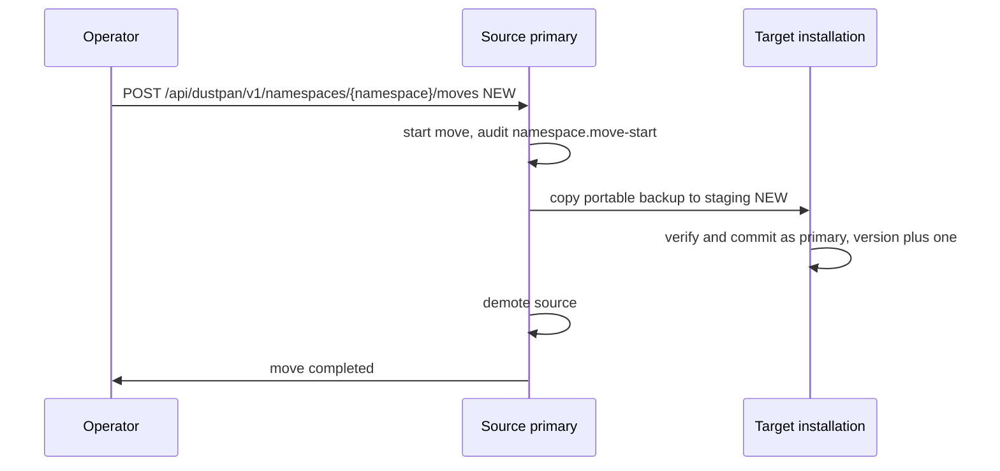
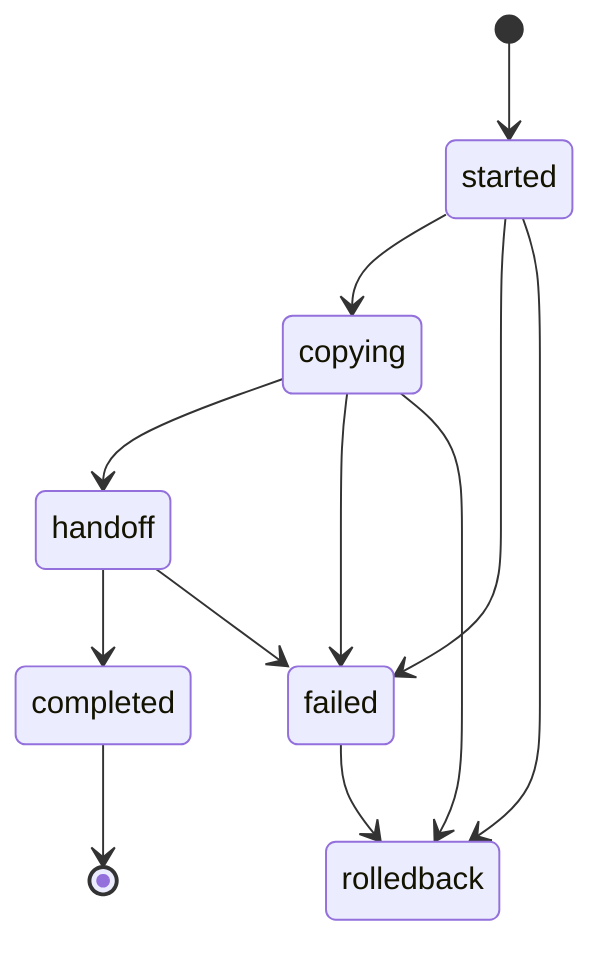
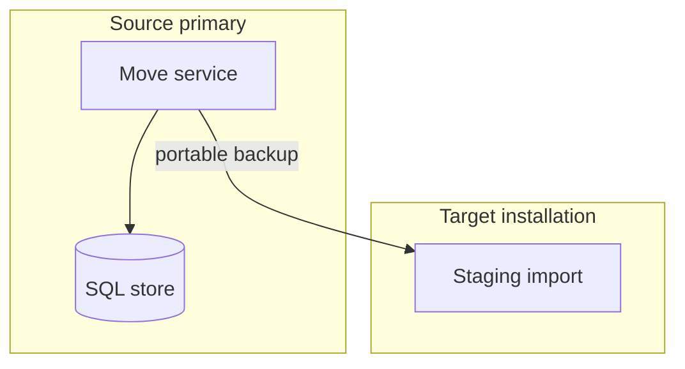

## Context

Without replication, the source stays primary until the target verifies the import. The target then commits as primary and the source demotes. Part 1 provides the placement map, the peer list with stored credentials and the forwarding of requests that reach the old primary.

## Decisions

1. **Move as a durable operation.** The NEW durable operation named namespace.move runs on the source primary. States: started, copying, handoff, completed, failed, rolled-back. A crash retries under the lease and the fencing token.
2. **Target-first handoff.** The target import commit sets the namespace primary to the target and the failover version to source plus one in the target transaction. The source then demotes in its own transaction. A retry after a crash reads the move record and repeats only the missing step.
3. **Bounded write block.** The source answers 423 with the NEW error code namespace.move-in-progress from state started. The maximum is 30 minutes. At the limit the operation fails, rolls back and writes namespace.move-fail.
4. **Carry by stable ID.** Collections and placement rules move with their stable IDs. A same-name collection with another ID on the target refuses the start with the NEW error code collection.name-conflict.
5. **Target allowlist and limits.** The target must be in the peer list of part 1. The staged import has a limit of 512 MiB per move and 10 moves per installation per hour. A larger namespace needs an operator change of the limit setting.
6. **Rollback.** Rollback runs from started, copying, handoff-before-target-commit or failed. It deletes the staged data on the target and keeps the source primary. After completed it answers 409 with the NEW error code namespace.move-not-reversible.

## Structure

The unexported type namespaceMove has a constructor checkMove. It checks one live move per namespace, a target other than the source and the stable IDs of collections and rules. Only that constructor makes a valid move.

## Risks

- Part 1 must give the peer credential store and the forwarding of stale requests. This change stops if part 1 is not done.
- A crash between the target commit and the source demote leaves the target primary; the source refuses writes until it demotes.

## Diagrams

After this change:

States and transitions after this change:

## Quality attributes

| Attribute | Target | Unit | Scope |
| --- | --- | --- | --- |
| latency | 300 | ms p95 | GET move status on the source primary |
| write block | 30 | minutes maximum | one move on the source primary |
| rate limit | 10 | moves per hour | one installation |

## Threat model

Data flow and trust boundaries:

| Boundary | STRIDE | Threat | Layer | Guard | Hostile test |
| --- | --- | --- | --- | --- | --- |
| Source primary and target installation | T | Tampered portable rows reach live tables on the target | boundary check | The target must be in the peer list; the import checks the table list | Post an unlisted target and expect 400 |
| Source primary and target installation | T | Tampered portable rows reach live tables on the target | encode or contain | Import only into the staging area with placeholders | Import a row with quote and path tricks and expect plain data |
| Source primary and target installation | T | Tampered portable rows reach live tables on the target | limit | 512 MiB per move, 10 moves per hour, 30 minutes | Exceed each limit and expect a closed failure |
| Source primary and target installation | T | Tampered portable rows reach live tables on the target | authorize at point of use | Check installation:move-namespace at start, rollback and read | Call rollback with a token without the action and expect denial |
| Source primary and target installation | T | Tampered portable rows reach live tables on the target | fail closed | A verify error rolls back and writes the audit entry | Corrupt one staged row and expect the source to stay primary |

## Contracts

**NamespaceMove**

- Invariant: One namespace has at most one live move.
- Invariant: One namespace has one primary installation at a time.
- Invariant: The target version is the source version plus one.
- `StartMove`: pre: No live move exists.; The caller holds installation:move-namespace and a fresh step.. Post: The move is in state started.; Source writes answer 423..
- `CompleteMove`: pre: The staged import is verified.; The fencing token is live.. Post: The target is primary with version plus one.; The audit entry namespace.move-complete exists..
- `RollbackMove`: pre: The state is started, copying, handoff before the target commit, or failed.. Post: The source is primary with the old version.; The audit entry namespace.move-rollback exists..

## Failure modes

| Step | Failure | Retry | State after |
| --- | --- | --- | --- |
| Copy to the target staging area | The worker crashes | A worker reclaims the lease after expiry and resumes with the same token | copying |
| Copy to the target staging area | The target is down or the network is cut | No retry past 30 minutes; the move fails and rolls back | rolled-back |
| Target commit | The source crashes after the target commit | The source resumes from the move record and demotes | completed |
| Verify the staged import | Verification fails | No retry; rollback | rolled-back |

## Change impact (computed from main)

Tests:

- `internal/removalalertsvc/fakes_test.go` names `namespace.Fence`
- `pkg/manuallock/manuallock_test.go` names `namespace.Fence`
- `internal/cost/costtest/mem_test.go` names `namespace.Fence`

ADRs:

- `docs/adr/0239-force-unlock-needs-unit-write-forced-on-every-opentofu-route.md` names `namespace.Fence`
- `docs/adr/0265-a-unit-shows-all-its-states-with-one-fixed-set-of-words.md` names `namespace.Fence`
- `docs/adr/0004-namespaces-regions-and-fencing.md` names `namespace.Fence`
