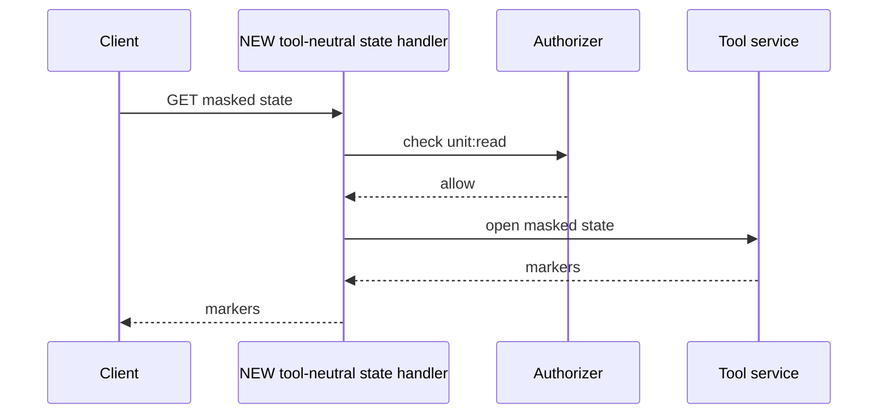
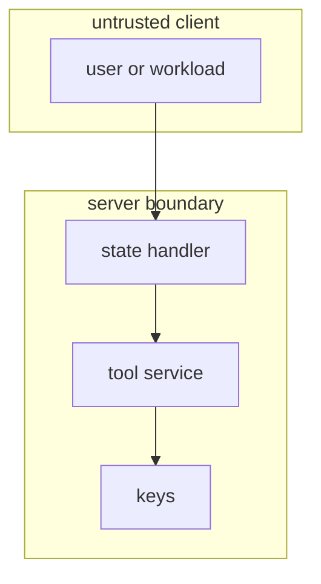

## Context

Tool-neutral masked reads over the separate stack and workspace models. Main serves Pulumi masked reads on the Pulumi routes; this change keeps them and adds one paged tool-neutral read shape with the same masking. Single-path reveal is the change `39-reveal-state-value`.

## Decisions

1. **Keep tool routes, add paged tool-neutral masked read.** Keep the Pulumi state routes unchanged. Add the NEW tool-neutral masked read as a paged list keyed by value path. Statuses: 403 missing grant, 404 unknown version, 400 bad version, bad value path or bad cursor.
2. **Chunked open with bound cursor and defined failures.** The server parses state in 256 KB chunks and holds at most one 5 MB version. Pages hold 200 markers with an opaque cursor that binds unit reference, version, caller subject and offset, carries an HMAC and expires after 10 minutes. A version above 5 MB is refused with 413. A timeout at 30 seconds answers 504 with no bytes.

## Structure

Unexported maskedReader type per tool package with constructor newMaskedReader that binds scope and key; its methods emit markers.

## Risks

- secret value leaks in masked read, logs or errors

## Layers (defense in depth)

| Layer | Guard | Hostile test |
| --- | --- | --- |
| authorize at point of use | handler checks unit:read for the unit | masked read with no grant gives 403 |
| boundary check | allowlist for version, value path and cursor; strict JSON decode | bad version and bad JSON Pointer give 400 with no secret echo |
| encode or contain | markers replace values; error text repeats no secret bytes | read state with secrets and check markers plus value path list |
| limit | 200 markers per page, 30 second timeout | large state gives bounded pages |
| fail closed | deny on open failure or unknown value | break open and check 500 with no content |

## Diagrams

After this change:

## Quality attributes

| Attribute | Target | Unit | Scope |
| --- | --- | --- | --- |
| latency | p95 under 800 | ms | masked state read per unit version under 5 MB |

## Threat model

Data flow and trust boundaries:

| Boundary | STRIDE | Threat | Layer | Guard | Hostile test |
| --- | --- | --- | --- | --- | --- |
| server boundary | I | secret value leaks in masked read, logs or errors | boundary check | handler allowlists version and value path, strict JSON decode | traversal path and oversized body give 400 with no secret echo |
| server boundary | I | secret value leaks in masked read, logs or errors | encode or contain | markers replace values, errors repeat no secret bytes | read secret state and check no plain bytes in body or logs |
| server boundary | I | secret value leaks in masked read, logs or errors | limit | page size and timeout | full dump request gives bounded pages |
| server boundary | I | secret value leaks in masked read, logs or errors | authorize at point of use | check unit:read on the unit | sibling-unit grant gives 403 |
| server boundary | I | secret value leaks in masked read, logs or errors | fail closed | deny on open failure | break open and check 500 with no content |

## Contracts

**stack checkpoint read**

- Invariant: masked read never returns plain secret values
- `ReadMasked`: pre: caller holds unit:read on the unit. Post: secret values replaced by markers with value paths for the pinned version.
