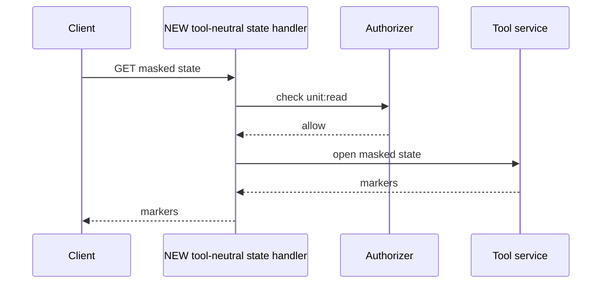
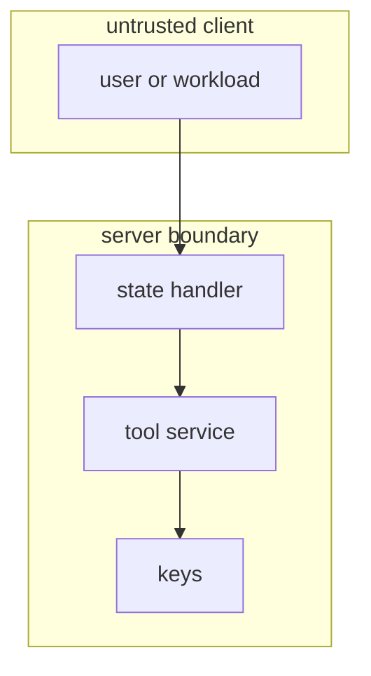

## Context

Tool-neutral masked reads over the separate stack and workspace models. Main serves Pulumi masked reads on the Pulumi routes; this change keeps them and adds one paged tool-neutral read shape with the same masking. Single-path reveal is the change `39-reveal-state-value`.

## Decisions

1. **Keep tool routes, add paged tool-neutral masked read.** Keep the Pulumi state routes unchanged. Add the NEW tool-neutral masked read as a paged list of marker paths. Statuses: 403 missing grant, 404 unknown version, 400 bad version or bad cursor.
2. **Chunked open with bound cursor and defined failures.** The server parses state in 256 KB chunks and holds at most one 5 MB version. Pages hold 200 markers with an opaque cursor that binds unit reference, version, caller subject and offset, carries an HMAC and expires after 10 minutes. A version above 5 MB is refused with 413 before the server loads its content; the size comes from the version record, not from the content. A timeout at 30 seconds answers 504 with the code `state.read-timeout` and no bytes.

## Structure

Unexported maskedReader type per tool package with constructor newMaskedReader that binds scope and key; its methods emit markers.

## Risks

- secret value leaks in masked read, logs or errors

## Layers (defense in depth)

| Layer | Guard | Hostile test |
| --- | --- | --- |
| authorize at point of use | handler checks unit:read for the unit | masked read with no grant gives 403 |
| boundary check | allowlist for version and cursor; strict JSON decode | bad version and bad cursor give 400 with no secret echo |
| encode or contain | markers replace values; error text repeats no secret bytes | read state with secrets and check markers plus value path list |
| limit | 200 markers per page, cursor length cap, 30 second timeout, denial limiter on refusals | large state gives bounded pages; a version above 5 MB gives 413 before the load; a forced deadline gives 504; repeated refusals reach the limiter |
| fail closed | deny on open failure or unknown value | break open and check 500 with no content |

## Diagrams

After this change:

## Quality attributes

| Attribute | Target | Unit | Scope |
| --- | --- | --- | --- |
| latency | p95 under 800 | ms | masked state read per unit version under 5 MB |

## Threat model

Data flow and trust boundaries:

| Boundary | STRIDE | Threat | Layer | Guard | Hostile test |
| --- | --- | --- | --- | --- | --- |
| server boundary | I | secret value leaks in masked read, logs or errors | boundary check | handler allowlists version and cursor, strict JSON decode | forged cursor and oversized body give 400 with no secret echo |
| server boundary | I | secret value leaks in masked read, logs or errors | encode or contain | markers replace values, errors repeat no secret bytes | read secret state and check no plain bytes in body or logs |
| server boundary | I | secret value leaks in masked read, logs or errors | limit | page size and timeout | full dump request gives bounded pages |
| server boundary | I | secret value leaks in masked read, logs or errors | authorize at point of use | check unit:read on the unit | sibling-unit grant gives 403 |
| server boundary | I | secret value leaks in masked read, logs or errors | fail closed | deny on open failure | break open and check 500 with no content |

## Contract

Inputs and outputs of the NEW tool-neutral masked read. The reveal of one value is not part of this change; it belongs to `39-reveal-state-value`.

- Route: NEW `GET /api/dustpan/v1/units/{ref}/state`. Query: `version` (a state version or `latest`), `cursor` (opaque, optional). The existing Pulumi routes `GET /api/stacks/{org}/{project}/{stack}/state/{version}/resources`, `.../resources/{urn}`, `.../outputs` and `GET .../state/diff` stay as they are.
- Output 200: one page of at most 200 markers. Each marker holds the JSON Pointer value path and a masked-value marker, never a plain secret value. A `nextCursor` field names the next page, or is absent on the last page. The marker is its own named schema in the API description.
- Cursor: opaque. It binds the unit reference, the version, the caller subject and the offset, carries an HMAC and expires after 10 minutes.
- Errors: 403 `unit.forbidden` (NEW code; caller has no `unit:read` on this unit; no secret bytes); 400 `state.bad-path` (NEW code; bad version, forged, expired, foreign or too long cursor; the body repeats no secret value); 404 unknown version; 413 for a version above 5 MB, answered before the content loads; 504 `state.read-timeout` (NEW code) after the 30 second timeout, with no bytes; 500 with no content when the open fails. Repeated refusals go to the denial limiter of the server configuration, which counts them and writes one audit entry for each window with the count; the answer of each refusal keeps its own status and none answers 429.
- Authorization: the action `unit:read` on the unit reference (tool, namespace ID, unit stable ID), checked in the handler and again in the tool service at the point of use.
- Limits: 256 KB parse chunks, one version of at most 5 MB held at once, 200 markers per page, a nesting depth of at most 100 (the recursion limit that protobuf JSON parsers use) and at most 10000 markers in one version. The server counts first and builds the path of a marker only for the page it answers, so that a document under 5 MB cannot cost more than the page. A version above a bound is refused with 413. A shape the server cannot read is refused with 500 and no content (fail closed, as the state diff does).
- Out of scope: the strict check of a value path as input (it belongs to `39-reveal-state-value`, which takes the path); single-path reveal, its action `unit:read-secrets` and its audit entry (`39-reveal-state-value`); this change adds no reveal code.

## Contracts

**stack checkpoint read**

- Invariant: masked read never returns plain secret values
- `ReadMasked`: pre: caller holds unit:read on the unit. Post: secret values replaced by markers with value paths for the pinned version.
