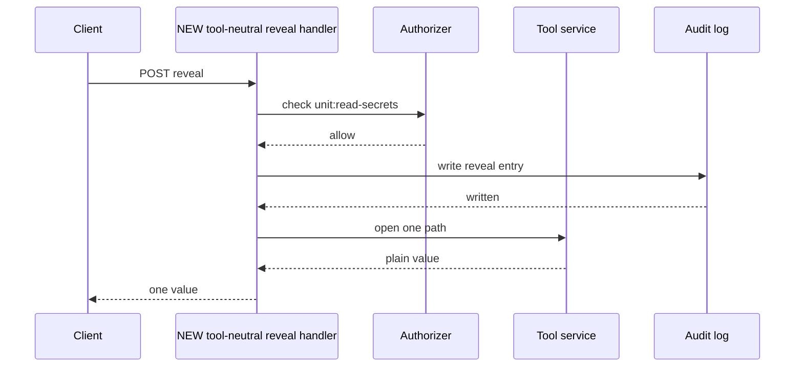
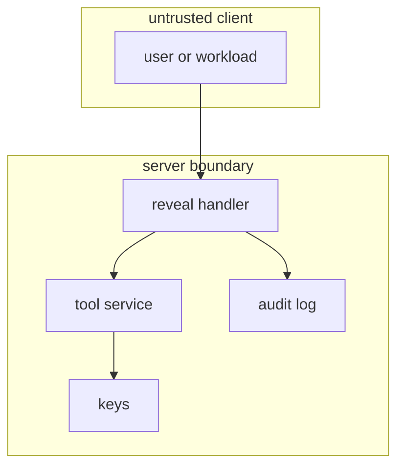

## Context

Single-path reveal over the separate stack and workspace models. Main serves the Pulumi reveal on its Pulumi route; this change keeps it and adds one tool-neutral reveal with the same rules. The masked read is the change `39-reading-state-contents`.

## Decisions

1. **Keep the Pulumi route, add tool-neutral single-path reveal.** Keep the Pulumi reveal route unchanged. Add the NEW tool-neutral reveal. Reveal takes unit reference, version and exactly one value path and writes one reveal entry before the first byte. Statuses: 403 missing grant, 404 unknown version, 400 bad, non-secret or cross-version path, 422 Pulumi other provider, 410 shredded or redacted.
2. **Fail closed with defined failures.** An open or decrypt failure after the audit write answers 500 with no bytes; a timeout at 30 seconds answers 504 with no bytes. A retry writes a second entry. An audit write failure answers 500 with no bytes, for each tool. Each refusal writes one audit entry. A shredded item answers 410 before any blob read.

## Structure

The existing reveal path in `pkg/stack/reveal.go` and `pkg/workspace/reveal.go` stays the one reveal path. The NEW files `reveal_path.go` in each package bind the unit and the version and call it for exactly one path.

## Risks

- reveal without audit entry
- secret value leaks in logs or errors

## Layers (defense in depth)

| Layer | Guard | Hostile test |
| --- | --- | --- |
| authorize at point of use | handler checks unit:read-secrets for the unit | reveal with only unit:read gives 403 |
| boundary check | allowlist for version and value path for each tool; strict JSON decode | two paths and a bad JSON Pointer give 400 with no secret echo, for Pulumi and for OpenTofu |
| encode or contain | errors repeat no secret bytes | failed reveal body and logs hold no plain bytes |
| limit | one-path reveal, 30 second timeout, denial limiter of `39-reading-state-contents` on refusals | two paths give 400; repeated refusals reach the limiter |
| fail closed | deny on audit write failure or open failure | break audit write and check reveal answers 500 with no content |

## Diagrams

After this change:

## Quality attributes

| Attribute | Target | Unit | Scope |
| --- | --- | --- | --- |
| storage growth | 1 entry per reveal, kept per audit retention | entries | reveal audit entries per namespace |

## Threat model

Data flow and trust boundaries:

| Boundary | STRIDE | Threat | Layer | Guard | Hostile test |
| --- | --- | --- | --- | --- | --- |
| server boundary | I | reveal without audit entry | fail closed | deny on audit or open failure | break audit store and check 500 with no content |
| server boundary | I | reveal without audit entry | authorize at point of use | check unit:read-secrets on the unit | sibling-unit grant gives 403 |
| server boundary | I | reveal without audit entry | boundary check | handler allowlists version and value path | traversal path gives 400 with no secret echo |

## Contract

**tool-neutral reveal**

- Endpoint: `POST /api/dustpan/v1/units/{ref}/state/reveal` with the body `{"version": <state version>, "path": "<one JSON Pointer>"}`. It answers `{"path": "<the pointer>", "value": <the plain value>}`. Errors: 400 `state.bad-path`, 403 `unit.forbidden`, 404, 410, 422, 500, 504.

- Invariant: reveal returns one value path with one reveal entry
- `Reveal`: pre: caller holds unit:read-secrets on the unit and names one value path. Post: one plain value returned and one reveal entry written before first byte.

## Change impact (computed from main)

Tests:

- `pkg/secret/secrettest/memsealer_test.go` names `secret.ErrShredded`
- `pkg/secret/secrettest/itemkeys_test.go` names `secret.ErrShredded`
- `pkg/job/jobtest/recorder_mem_test.go` names `secret.ErrShredded`

ADRs:

- `docs/adr/0154-history-gaps-found-before-the-implementation.md` names `secret.ErrShredded`
- `docs/adr/0102-job-plans-and-logs.md` names `secret.ErrShredded`
- `docs/adr/0152-history-policy-for-job-artifacts.md` names `secret.ErrShredded`
