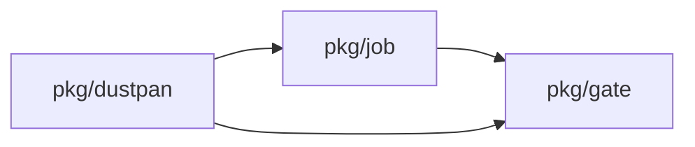
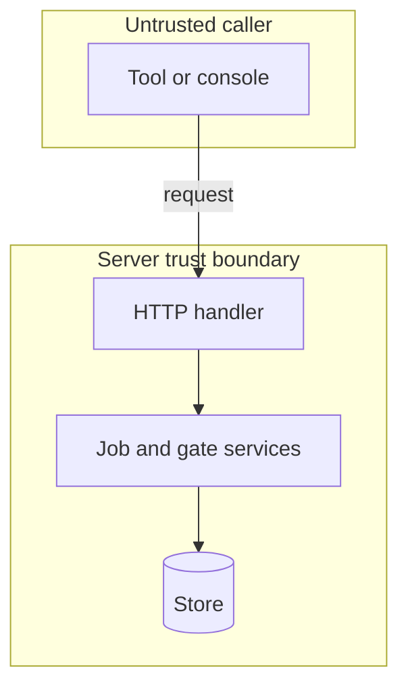

## Context

Error code access.denied tells the caller that a grant helps. Job token, unusable connection, and state guard refusals wrap ErrDenied where a grant does not help, and gate CheckAccess wraps store errors in ErrDenied. Relabeled tool refusals keep HTTP 403; the gate store fault answers 503 like other unavailable answers.

## Decisions

1. **Distinct refusals keep access.denied for missing permission only.** Map only true permission denials to access.denied. Give the other refusals distinct NEW sentinels and NEW codes: job.token-refused, connection.unusable, state.subject-refused with status 403, and gate.store-unavailable with status 503. Each NEW sentinel wraps identity.ErrDenied so errors.Is callers still deny. The errcode mapper matches the NEW sentinels before a bare ErrDenied. Add the NEW codes in the adapter-side mapping after errcode-catalog-imports-domain-packages lands. Each message names the one command that helps and links the code reference page. The reference page lists the old to new mapping for scripts that matched access.denied.

## Structure

Unexported NEW sentinel errors in pkg/job, pkg/dustpan, and pkg/gate with constructors that wrap identity.ErrDenied; the errcode catalog maps only a bare permission denial to access.denied.

## Risks

- Scripts that matched access.denied see the NEW codes; the docs page lists the old to new mapping.

## Diagrams

Modules that the change touches, and their imports on main:

## Quality attributes

| Attribute | Target | Unit | Scope |
| --- | --- | --- | --- |
| none affected | Error label-only change; no latency or storage target changes |  |  |

## Threat model

Data flow and trust boundaries:

| Boundary | STRIDE | Threat | Layer | Guard | Hostile test |
| --- | --- | --- | --- | --- | --- |
| Server trust boundary | I | A caller misreads access.denied and seeks a grant that does not help, or a store fault is hidden as a permission denial. | boundary check | Map only true permission denials to access.denied; other refusals get distinct codes from an allowlist of sentinels. | Send a job token refusal and check the code is job.token-refused, not access.denied. |
| Server trust boundary | I | A caller misreads access.denied and seeks a grant that does not help, or a store fault is hidden as a permission denial. | encode or contain | Encode the code from the sentinel, never from caller input. | Send a hostile code member and check the answer uses the mapped code. |
| Server trust boundary | I | A caller misreads access.denied and seeks a grant that does not help, or a store fault is hidden as a permission denial. | limit | Deny each failed check and bound the store read with a timeout so a fault does not hang the call. | Fail the store inside CheckAccess and check the call is denied within the timeout. |
| Server trust boundary | I | A caller misreads access.denied and seeks a grant that does not help, or a store fault is hidden as a permission denial. | authorize at point of use | Check authorization at the point of use for the object; keep true denials on access.denied. | Call the object without the grant and check access.denied remains. |
| Server trust boundary | I | A caller misreads access.denied and seeks a grant that does not help, or a store fault is hidden as a permission denial. | fail closed | Fail closed on store errors with 503 gate.store-unavailable and write a denial audit entry that records the store error. | Fail the store inside CheckAccess and check the call is denied with 503 and the audit entry exists. |
