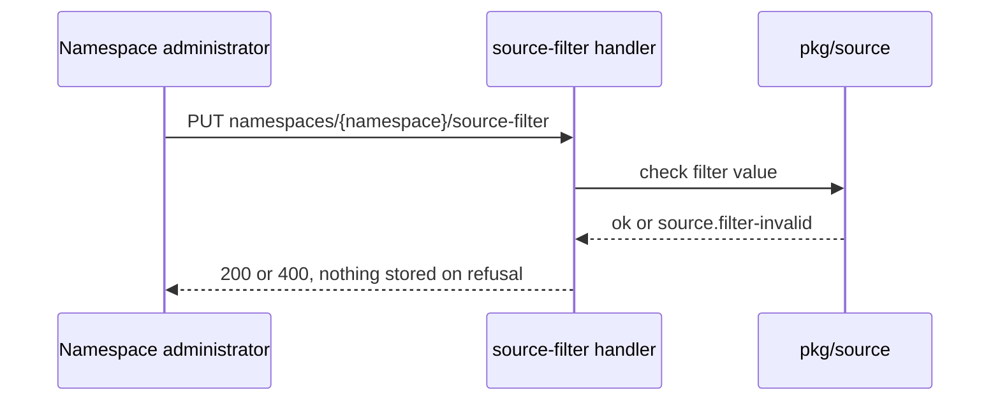
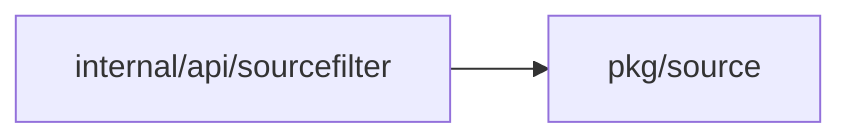

## Context

Main accepts git as the only source of a run. The namespace source-filter
route exists (`PUT /api/dustpan/v1/namespaces/{namespace}/source-filter`,
declared in `internal/api/apidesc/openapi.json:20535`), with the stable
refusal codes `source.filter-invalid` and `source.filter-unreadable`
(`internal/errcode/catalog_source.go:8` and `:11`). RFC 54
(`docs/rfc/0054-sources-beyond-git.md`) is a draft stub that records the gap
and first ideas only. ADR 135 covers git only and lists sources that are not
git as an open question (`docs/adr/0135-the-source-pipeline.md:172`). Runs
land in milestone 5, so this change fixes no run, job, executor or trigger
behavior.

## Decisions

1. **No source kind is fixed.** Git stays the only accepted source. The
   allowlist of sources beyond git is decided in RFC 54 after runs land, with
   no kind fixed by this change.
2. **No route change.** The source-filter route keeps its declaration, its
   request and response shape, its status codes and its error codes. This
   change makes no edit to `internal/api/apidesc/openapi.json`.
3. **No new port and no new error code.** The stored `source.Filter`
   (`pkg/source/filter.go`) and the two stable codes cover every refusal on
   the user path: a filter value outside the allowlist fails with
   `source.filter-invalid` and changes nothing.
4. **No fence change.** This change makes no write-path change, so no fence
   rule changes.

## Structure

No new type is needed because this change adds no code. A later change that
adds a source kind names the unexported type that makes its bug class
impossible. A check alone is not the fix.

## Risks

- A reader mistakes this coarse change for support of a source that is not
  git. The proposal and the docs page state that git is the only accepted
  source until RFC 54 is accepted.
- Run, job, executor or trigger behavior is specified before runs land. The
  out-of-scope list refuses it.

## Layers (defense in depth)

No new input crosses a trust boundary, so no new layer is added. The existing
layers stay as on main:

| Layer | Guard | Hostile test |
| --- | --- | --- |
| boundary check | The handler refuses a filter value outside the allowlist with `source.filter-invalid`. | `internal/api/sourcefilter/handler_test.go` covers the refusal |
| fail closed | The stored filter that fails the checks refuses reads with `source.filter-unreadable`. | `pkg/backup/portable_test.go:489 (TestReadPortableSourceFilter)` covers the corrupt stored value |

## Diagrams

The path is unchanged from main:

Modules that the change touches, and their imports on main:

This change edits neither module. It adds one file,
`openspec/changes/54-sources-other-than-git/design.md`, and ticks one task.
It makes no import change.

## Quality attributes

No target changes: this change adds no request path and moves no bytes.

## Threat model

No new trust boundary and no new data flow. The untrusted input stays the
filter value in the PUT body, and the guards in the Layers table stop it
alone, as on main.

## Contracts

No contract: this change adds no port, no endpoint, no stored schema and no
CLI output. The source-filter route keeps the contract it has on main.

## Failure modes

No new failure mode: every refusal on the user path already has a stable code
and leaves stored state unchanged.

## Change impact (computed from main)

Tests that name `source.Filter`:

- `internal/source/source_test.go`
- `internal/store/postgres/sourcefilter_test.go`
- `internal/store/sqlite/sourcefilter_test.go`
- `pkg/source/sourcetest/mem_test.go`
- `pkg/source/filters_test.go`
- `pkg/source/fuzz_test.go`
- `internal/api/sourcefilter/handler_test.go`
- `internal/api/sourcefilter/helpers_test.go`

Docs pages and ADRs that name `source.Filter`:

- `docs/adr/0226-facts-typed-versioned-fact-documents.md`
