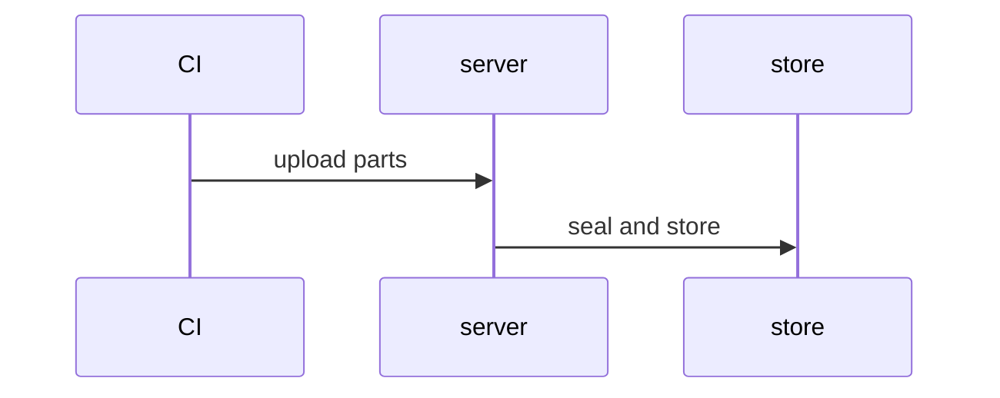
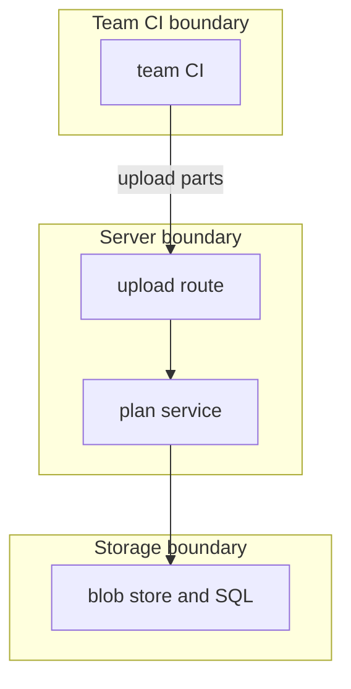

## Context

The server never sees the CI run. The design stores the uploaded bytes as a stored plan, marks the change order weaker, and refuses an apply that does not present the approved hashes.

## Decisions

1. **Upload makes a marked change order.** The upload makes one change order with one unit plan, sealed with one item key. Approvals bind to the plan ID, both hashes and the state version.
2. **Apply checks both hashes at the write.** The write compares both hashes in the write transaction and refuses a mismatch or a missing hash with the change order ID.

## Structure

Unexported type uploadedPlan; only its constructor checkUploadedPlan makes a value and checks part kinds, sizes and hashes.

## Risks

- A team trusts an uploaded plan like a runner plan.
- An old approved hash is replayed after a new upload.

## Layers (defense in depth)

| Layer | Guard | Hostile test |
| --- | --- | --- |
| API boundary | The route checks unit:run-plan and the size limit. | Upload with no grant and with an oversize part; both fail. |
| service | The service checks SHA-256 of each part. | Upload with a wrong claimed hash; refused. |
| store write | The write compares both hashes in the transaction. | Write with an old hash and with none; both fail. |

## Diagrams

After this change:



States and transitions after this change:

```mermaid
stateDiagram-v2
planning --> in-review: upload stored
```

## Quality attributes

| Attribute | Target | Unit | Scope |
| --- | --- | --- | --- |
| integrity | 100 | percent of mismatched hashes refused | state write and update start |

## Threat model

Data flow and trust boundaries:



| Boundary | STRIDE | Threat | Layer | Guard | Hostile test |
| --- | --- | --- | --- | --- | --- |
| team CI to upload route | T | CI claims false hashes to bind approvals to unreviewed bytes. | boundary check | Allowlist part kinds and size limit. | Upload an oversize part; refused. |
| team CI to upload route | T | CI claims false hashes to bind approvals to unreviewed bytes. | encode or contain | Seal parts with one item key. | Upload secrets; logs hold none. |
| team CI to upload route | T | CI claims false hashes to bind approvals to unreviewed bytes. | limit | Bound the total body. | Upload excess bytes; refused. |
| team CI to upload route | T | CI claims false hashes to bind approvals to unreviewed bytes. | authorize at point of use | Check unit:run-plan. | Upload with no grant; refused. |
| team CI to upload route | T | CI claims false hashes to bind approvals to unreviewed bytes. | fail closed | Refuse on hash mismatch. | Wrong hash; refused. |

## Contracts

**uploaded plan**

- Invariant: One unit plan holds two parts.
- Invariant: Approvals bind to both hashes.
- `upload`: pre: caller holds unit:run-plan. Post: stored plan holds both hashes.

## Failure modes

| Step | Failure | Retry | State after |
| --- | --- | --- | --- |
| Upload parts | Crash after blob writes. | Retry the upload. | No stored plan. |
