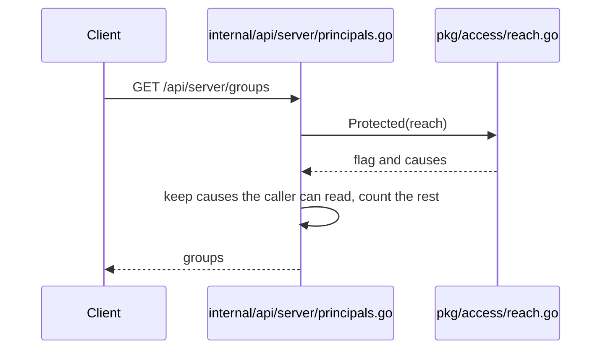

## Context

Reach marks a group protected from the family of an action, written out in pkg/access/reach.go. Data-family actions on the installation fall outside this rule, though a grant there covers every namespace.

## Decisions

1. **One rule.** Reach.protected calls one helper in pkg/access/access.go built on IsSensitive. The helper takes the action and the object. A sensitive action on the installation protects. The same action on one namespace does not. A read-only server action does not protect. Owner decision, 13 Nov 2026 (queue P21).
2. **Cause by stable ID.** The cause names the grant by its stored ID, the action and the object. An act-as cause names the edge by principal IDs. The cause holds no name.
3. **Cause visibility.** The handler checks read access on the object of each cause for the caller. It lists a cause only when the check passes. It adds each other cause to a hidden count and shows nothing else of it. The list holds 20 causes at most.
4. **Existing members.** This change suspends no member. The guide says the limit is not yet enforced.
5. **Page cost.** The walk of a page of groups keeps its current shape. The cost is out of scope.

## Structure

One function holds the sensitive rule. The reach walk calls it, so the copy of the family rule at pkg/access/reach.go:183 goes away.

## Risks

- More groups read protected. Nothing blocks identity-provider sync yet, so the flag is a warning until the limit is enforced.

## Diagrams

After this change:

## Quality attributes

| Attribute | Target | Unit | Scope |
| --- | --- | --- | --- |
| none affected | The group list keeps its current cost. The page walk is out of scope. |  |  |

## Contracts

**Group**

- Invariant: The protected flag comes only from stored grants and act-as edges.
- Invariant: A grant on the installation covers every namespace.
- Invariant: A cause of an object that the caller cannot read never shows its ID, action or object.
- `Protected`: pre: The reach covers the grants of the group on the installation and on each namespace.. Post: True when the reach holds a sensitive action that is not confined to one namespace.; The readable causes are sorted by grant ID, at most 20, with the hidden count..
- `IsSensitive`: pre: The action is any action name.. Post: True for each sensitive action, including access management and principal management. False for an unclassified action..
