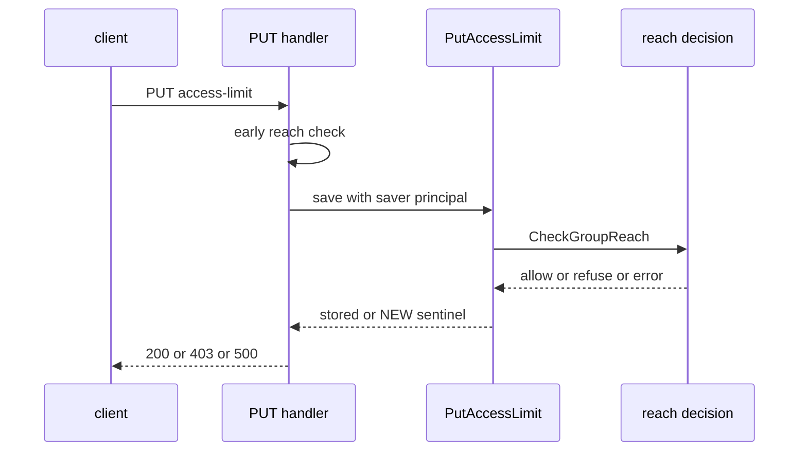
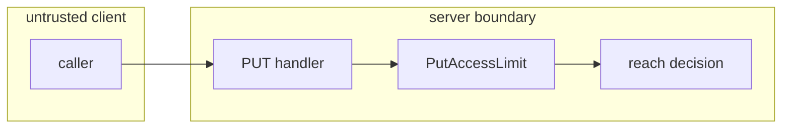

## Context

Access-limit saves run through PUT access-limit routes today, but a later save path that skips the handler would skip the handler-only group reach check.

## Decisions

1. **Service owns the check, handler keeps a second check.** Move the group reach refusal into PutAccessLimit so every save path runs it, using the saver principal passed to the call. A replay passes the principal that started the replay, and a call with no saver fails closed. Keep the handler helper limitGroupReach in the PUT path as defense in depth with a comment that names the service check as authoritative. Both layers read the same saver and candidate limit, so the same inputs give the same verdict.
2. **One audit writer with mapped errors.** The service returns the NEW sentinel ErrAccessLimitGroupReach on refusal and the NEW sentinel ErrAccessLimitDecision on decision error. The handler maps refusal to 403 and decision error to 500 without a second audit entry. Only the service audit helper writes the entry, with reason caller-refused on refusal and the NEW reason access-limit.decision-error on decision error, and the handler early refusal calls the same helper.

## Structure

Unexported reach checker field held by the gate config service and set by its constructor from the existing access reach port, with no change to the constructor signature; only the constructor makes the value.

## Risks

- A concurrent grant change between the reach decision and the store leaves a stale allow.
- A decision error is misreported as a caller refusal.

## Layers (defense in depth)

| Layer | Guard | Hostile test |
| --- | --- | --- |
| authorize at point of use | Service refuses a limit that gives a group more reach than the saver holds. | Save a hostile limit through the service with a direct call that bypasses the handler and show refusal. |
| boundary check | Handler keeps its existing reach helper before it calls the service. | Send a hostile limit to the handler and show 403. |

## Diagrams

After this change:

## Quality attributes

| Attribute | Target | Unit | Scope |
| --- | --- | --- | --- |
| none affected | No latency or storage target changes; same decision on one more path. |  |  |

## Threat model

Data flow and trust boundaries:

| Boundary | STRIDE | Threat | Layer | Guard | Hostile test |
| --- | --- | --- | --- | --- | --- |
| server boundary | E | A saver widens a protected group beyond their own reach through a save path that skips the handler. | boundary check | Handler reach helper check on group and scope before the service call. | Send a hostile group limit to the handler and show 403. |
| server boundary | E | A saver widens a protected group beyond their own reach through a save path that skips the handler. | encode or contain | Store the limit only through the service path with bound parameters and stable scope identity. | Send hostile scope characters and show no extra row written. |
| server boundary | E | A saver widens a protected group beyond their own reach through a save path that skips the handler. | limit | Service evaluates one saver snapshot per save with no widening write. | Save a hostile group limit through a direct service call and show refusal. |
| server boundary | E | A saver widens a protected group beyond their own reach through a save path that skips the handler. | authorize at point of use | Service reach decision against saver reach at point of save for every path. | Call the service directly with a hostile group limit and show the NEW sentinel ErrAccessLimitGroupReach. |
| server boundary | E | A saver widens a protected group beyond their own reach through a save path that skips the handler. | fail closed | Decision errors fail closed and audit the NEW reason access-limit.decision-error. | Force a reach error and show the NEW sentinel ErrAccessLimitDecision plus an internal-error audit entry. |

## Contracts

**gate config service access limit**

- Invariant: A saved access limit never widens the reach of a protected group beyond the saver reach.
- Invariant: A decision error fails closed with no stored limit.
- `PutAccessLimit`: pre: Caller is authorized for the scope.; Candidate limit is valid.; Caller passes the saver principal, including the principal that started a replay; a call with no saver principal fails closed with the NEW sentinel ErrAccessLimitDecision.. Post: If the reach check passes, the limit is stored.; If the reach check fails or errors, no limit is stored and the call returns the NEW sentinel ErrAccessLimitGroupReach or the NEW sentinel ErrAccessLimitDecision..
