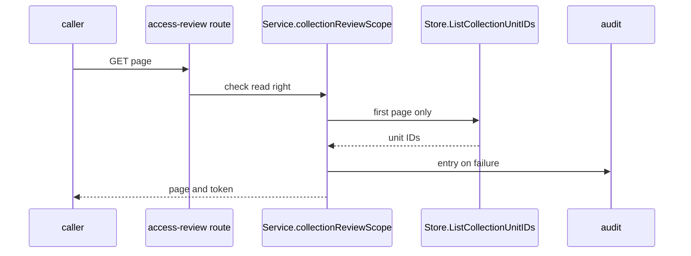
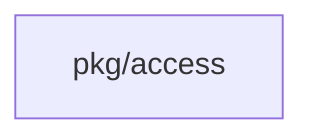
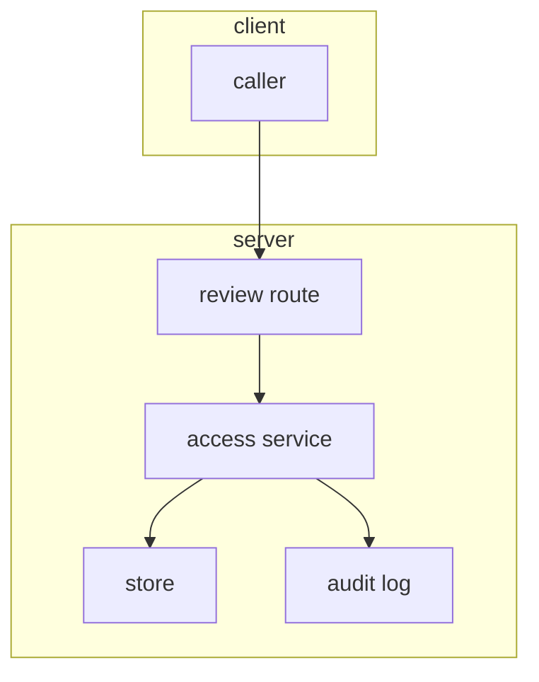

## Context

The export reads the unit list for each page. The review query takes the whole list as one parameter. Both dialects share the access service, so the change sits in pkg/access and needs no store change.

## Decisions

1. **Token snapshot.** The first page reads the unit IDs, orders them by ID and writes them into the signed page token. The token is bound to the collection. Later pages read only the token.
2. **Cap.** The cap is 2000 units for each export. The existing code `access.collection-unit-cap` answers 422. Exactly 2000 passes. The cap is checked at the first page only, because the token holds the list after that.
3. **Refusal text.** The cap refusal text says that the namespace access review covers the whole namespace. It names the route `GET /api/server/namespaces/{namespace}/access-review`. The text repeats nothing of the input.
4. **Audit of failure.** The service writes the audit entry on each failure after the authorization check. If the audit write fails, the request fails closed with 500.

## Structure

The unexported type collectionUnitSnapshot is made only by newCollectionUnitSnapshot in pkg/access/review_service.go. The constructor refuses more than 2000 IDs.

## Risks

- The page token grows with the snapshot, up to 2000 IDs.
- A denied caller writes no audit entry, so an unauthorized caller cannot flood the audit log.

## Layers (defense in depth)

| Layer | Guard | Hostile test |
| --- | --- | --- |
| authorize at point of use | The service checks the read right on the collection before the unit read, on each page. | Request without the grant; expect denial and no unit read. |
| limit | The constructor refuses more than 2000 IDs. | Review a collection of 2001 units; expect the cap code. |

## Diagrams

After this change:

Modules that the change touches, and their imports on main:

## Quality attributes

| Attribute | Target | Unit | Scope |
| --- | --- | --- | --- |
| storage growth | 1 | audit entry for each failed request | collection access review |
| size | 2000 | unit IDs for each export | one page token |

## Threat model

Data flow and trust boundaries:

| Boundary | STRIDE | Threat | Layer | Guard | Hostile test |
| --- | --- | --- | --- | --- | --- |
| client to review route | T | A forged page token injects unit IDs of another collection. | boundary check | The token is signed and bound to the collection; the error repeats nothing of the input. | Send a token of another collection; expect refusal. |
| client to review route | T | A forged page token injects unit IDs of another collection. | encode or contain | The unit IDs go to the query as placeholders. | Send IDs with SQL text; expect no change. |
| client to review route | T | A forged page token injects unit IDs of another collection. | limit | The constructor refuses more than 2000 IDs. | Send a token with 2001 IDs; expect refusal. |
| client to review route | T | A forged page token injects unit IDs of another collection. | authorize at point of use | The service checks the read right on each page. | Use a valid token without the grant; expect denial. |
| client to review route | T | A forged page token injects unit IDs of another collection. | fail closed | A failed audit write fails the request. | Force an audit error; expect 500. |

## Contracts

**Collection access review**

- Invariant: All pages of one export use one unit list.
- Invariant: A list has at most 2000 IDs.
- `collectionReviewScope`: pre: The caller holds the read right on the collection.. Post: On failure one audit entry of kind `access` exists.; Each page uses the unit list of the first page..
