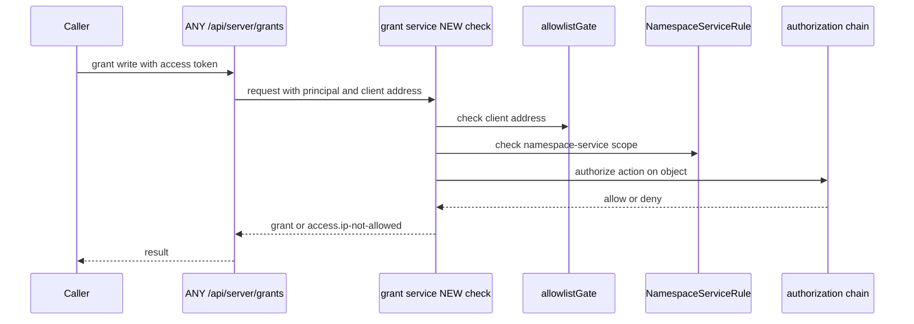
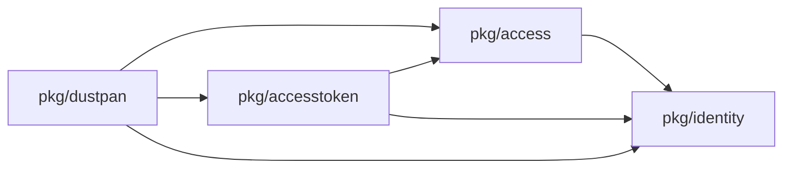
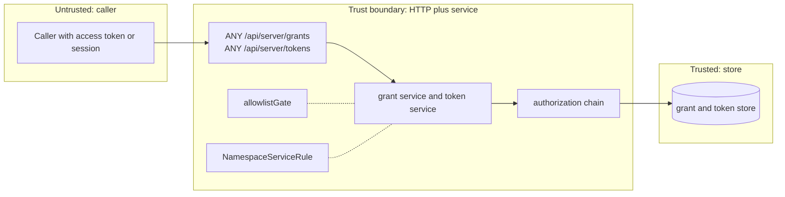

## Context

Grant and token services authorize with the bare port. HTTP routes apply the allowlist gate and namespace-service rule, but the service layer has no gate. Each layer must stop the attack alone.

## Decisions

1. **Chain for request checks, concrete authorizer only for escalation.** Route request checks of the grant service in pkg/access and the token service in pkg/accesstoken through the wrapped authorization chain. Keep the concrete authorizer only as a separate read-only escalation comparator. Allowlist is checked first, then namespace-service scope, then chain action; a request that fails both allowlist and scope returns access.ip-not-allowed. Missing client address fails closed with access.denied. A store read error for the allowlist denies closed with access.denied. Remove the two named exceptions from the NewServer chain test.

## Structure

Unexported requestChecker field on the grant service in pkg/access and on the token service in pkg/accesstoken, set only by constructors that take the authorization chain plus a separate escalation comparator; no direct bare-port field remains for request checks.

## Risks

- Chain double-applies a rule already applied by the route and changes an error code. Mitigation: allowlist first wins with access.ip-not-allowed, then access.denied; covered by refusal scenarios.
- Escalation comparator keeps a write path that skips the fence. Mitigation: comparator is read-only; writes carry namespace.Fence in the same transaction, and the escalation read and the grant write run in that same transaction so a concurrent revoke between check and write fails the write.
- Client address missing on non-HTTP embedder call or stale CIDR store. Mitigation: missing address fails closed with access.denied; store read error denies with access.denied; forwarded-for header is ignored, only the route context address is used.

## Layers (defense in depth)

| Layer | Guard | Hostile test |
| --- | --- | --- |
| authorize at point of use | Service calls the wrapped authorization chain before any grant or token write. | Call grant change from address outside allowlist with allow-all embedder authorizer; service refuses. |
| boundary check | Service applies the stored CIDR allowlist at the service layer and refuses outside addresses. | Send grant request with remote address outside stored allowlist; service returns access.ip-not-allowed. |
| limit | Service applies the namespace-service rule so a namespace-service principal acts only in its own namespace. | Act as namespace-service principal of namespace A to grant in namespace B; service refuses. |
| fail closed | Escalation comparator uses a read-only grant view and grants no reach by itself. | Pass allow-all embedder authorizer; escalation still refuses grant above caller reach. |
| encode or contain | Store writes use placeholders; audit writes single-line fields. | Submit grant with hostile text; stored query stays parameterized and audit stays single line. |

## Diagrams

After this change:

Modules that the change touches, and their imports on main:

New imports of this change (each one allowed by the module rules):

- `pkg/dustpan` imports `pkg/access`
- `pkg/dustpan` imports `pkg/accesstoken`
- `pkg/dustpan` imports `pkg/identity`

## Quality attributes

| Attribute | Target | Unit | Scope |
| --- | --- | --- | --- |
| latency | 5 | ms added p50 | grant and token writes via ANY /api/server/grants and ANY /api/server/tokens |

## Threat model

Data flow and trust boundaries:

| Boundary | STRIDE | Threat | Layer | Guard | Hostile test |
| --- | --- | --- | --- | --- | --- |
| HTTP plus service | S | Spoofed or over-reach caller grants roles or mints tokens outside its reach. | boundary check | allowlistGate allowlist of CIDRs; reject address outside list with access.ip-not-allowed. | Send grant write from blocked address with allow-all authorizer; service refuses. |
| HTTP plus service | S | Spoofed or over-reach caller grants roles or mints tokens outside its reach. | encode or contain | Store writes use placeholders; audit fields stay single line. | Submit Grant with hostile text; query stays parameterized. |
| HTTP plus service | S | Spoofed or over-reach caller grants roles or mints tokens outside its reach. | limit | NamespaceServiceRule confines namespace-service principal to its own namespace; least reach. | Act as namespace-service of A in B; service refuses. |
| HTTP plus service | S | Spoofed or over-reach caller grants roles or mints tokens outside its reach. | authorize at point of use | Authorization chain checked at point of use in service before store write. | Call service directly bypassing route; service still refuses. |
| HTTP plus service | S | Spoofed or over-reach caller grants roles or mints tokens outside its reach. | fail closed | Unknown principal, address, or rule denies with access.denied and writes audit kind access. | Send Grant with no address; service denies closed. |
| HTTP plus service | T | Tampered token or grant request escalates reach across namespaces. | boundary check | Chain verifies access token or session before Grant or Issue write. | Call Issue with no valid credential; chain denies. |
| HTTP plus service | T | Tampered token or grant request escalates reach across namespaces. | encode or contain | Grant and token inputs stored via placeholders; no input echoed raw into audit. | Submit Grant with hostile text; stored row stays parameterized. |
| HTTP plus service | T | Tampered token or grant request escalates reach across namespaces. | limit | Token scope limited to target principal reach; namespace-service confined to its namespace. | Use token outside its namespace; use refused. |
| HTTP plus service | T | Tampered token or grant request escalates reach across namespaces. | authorize at point of use | Service re-checks chain even when route already checked. | Bypass route gate with direct service call; service refuses. |
| HTTP plus service | T | Tampered token or grant request escalates reach across namespaces. | fail closed | Tampered or unknown credential denies closed with access.denied. | Send forged credential value; service denies. |

## Contracts

**access grant**

- Invariant: Grant holder, role, object, creator and time are stored and revocable.
- Invariant: Namespace-service principal holds grants only in its own namespace.
- `Grant`: pre: Caller is authenticated and chain allows the grant action on the object.. Post: Grant stored only after chain allows the request and escalation comparison passes..

**access token**

- Invariant: Token belongs to one principal and carries its reach.
- Invariant: Namespace-service principal mints tokens only for its own namespace.
- `Issue`: pre: Caller is authenticated and chain allows the issue action for the target principal.. Post: Token issued only after chain allows the request..
