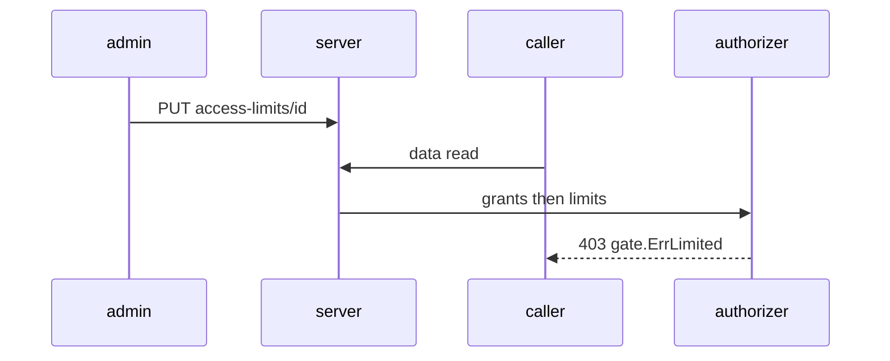
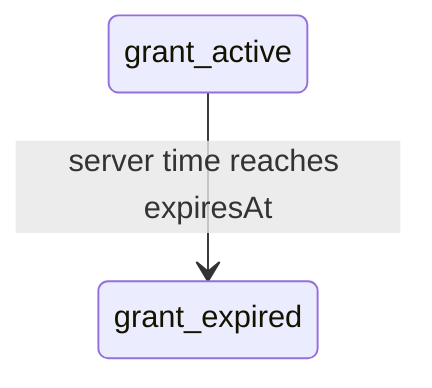
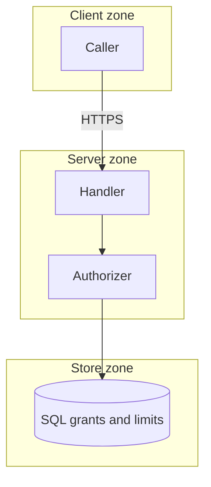

## Context

Grants gain optional expiry; per-scope Cedar forbid limits sit after the grant check in the authorizer.

## Decisions

1. **Expiry as nullable timestamp with leased sweep.** Store expiresAt as nullable Unix milliseconds on the grant row; the authorizer uses server time. One leased sweep marks past rows expired and writes one audit entry per run.
2. **Limits as stored forbid policies.** Store one Cedar forbid policy per limit with stable ID and scope; type-check at save; reference principals and groups by stable ID.

## Structure

Unexported limitSet built only by ParseLimitSet, which type-checks forbid-only policies; unexported grantChecker built only by NewGrantChecker with a clock.

## Risks

- Expired grants linger in listings unless the review marks them.
- A broad forbid with no principal condition refuses every caller in scope.

## Layers (defense in depth)

| Layer | Guard | Hostile test |
| --- | --- | --- |
| service validation | Save refuses permit and both gate lockout patterns. | Save permit, a namespace limit matching installation:manage-gates, and an unconditional namespace:manage-gates limit; each gets gate.ErrInvalid. |
| authorizer check | Grants first, then in-scope forbid limits; expired grants give no allow. | Call with an expired grant and with a matching collection forbid; each is refused. |
| HTTP route | Each mutating route declares its scope action and needs a fresh step. | Call set and delete without the action or fresh step; each gets 403 and no write. |

## Diagrams

After this change:

States and transitions after this change:

## Quality attributes

| Attribute | Target | Unit | Scope |
| --- | --- | --- | --- |
| latency | 50 | ms | limit evaluation after grants per request |

## Threat model

Data flow and trust boundaries:

| Boundary | STRIDE | Threat | Layer | Guard | Hostile test |
| --- | --- | --- | --- | --- | --- |
| Client to server | S | Forged caller changes a limit to widen access. | boundary check | Handler rejects missing identity before any store read. | PUT with forged session; expect 401. |
| Client to server | S | Forged caller changes a limit to widen access. | encode or contain | Strict JSON decode with size cap. | Oversize policy body; expect 413. |
| Client to server | S | Forged caller changes a limit to widen access. | limit | Body size limit on limit routes. | Send a body above the cap; expect 413 and no store write. |
| Client to server | S | Forged caller changes a limit to widen access. | authorize at point of use | Scope action and fresh step before change. | PUT without scope action; expect 403. |
| Client to server | S | Forged caller changes a limit to widen access. | fail closed | Schema error means no write. | PUT a bad policy; expect 400 and nothing stored. |

## Contracts

**grant**

- Invariant: expiresAt is null or a UTC time in milliseconds
- Invariant: expired grant gives no access
- `expired-grant-denies`: pre: grant and server time present. Post: past expiresAt gives no allow.

**access-limit**

- Invariant: policy effect is forbid only
- `forbid-only-save`: pre: policy text and scope present. Post: permit refused with gate.ErrInvalid.

## Failure modes

| Step | Failure | Retry | State after |
| --- | --- | --- | --- |
| limit evaluation | Cedar evaluation error | No retry; fix the policy | call refused with gate.ErrRuleFailed |
| refusal record | decision-record write fails | No retry of the call | call still refused with gate.ErrLimited |

## Change impact (computed from main)

Tests:

- `pkg/tempadmin/tempadmin_test.go` names `gate.ErrInvalid`
- `pkg/outputshare/outputsharetest/mem_test.go` names `gate.ErrInvalid`
- `pkg/outputshare/outputshare_test.go` names `gate.ErrInvalid`
- `pkg/manuallock/manuallock_test.go` names `identity.Authorizer`
- `pkg/outputshare/outputshare_test.go` names `identity.Authorizer`
- `internal/outputsharesvc/outputsharesvc_test.go` names `identity.Authorizer`
- `internal/expr/owned_internal_test.go` names `gate.ErrRuleFailed`
- `internal/expr/hostile_test.go` names `gate.ErrRuleFailed`
- `internal/expr/timeout_internal_test.go` names `gate.ErrRuleFailed`

ADRs:

- `docs/adr/0202-secrets-revisions-tags-drafts-and-rotation.md` names `gate.ErrInvalid`
- `docs/adr/0271-the-forge-port-git-host-connections-and-the-installation-level-github-app.md` names `gate.ErrInvalid`
- `docs/adr/0141-freeze-schedules.md` names `gate.ErrInvalid`
- `docs/adr/0051-collections-of-units.md` names `identity.Authorizer`
- `docs/adr/0273-output-sharing-rules-and-the-read-outputs-action.md` names `identity.Authorizer`
- `docs/adr/0013-separate-tool-models-shared-read-model-and-access.md` names `identity.Authorizer`
- `docs/adr/0114-the-policy-port-and-its-default-adapters.md` names `gate.ErrRuleFailed`
- `docs/adr/0112-blueprints-the-document-versions-and-expr.md` names `gate.ErrRuleFailed`
- `docs/adr/0223-access-limits-cedar-forbid-policies-for-each-scope.md` names `gate.ErrRuleFailed`
