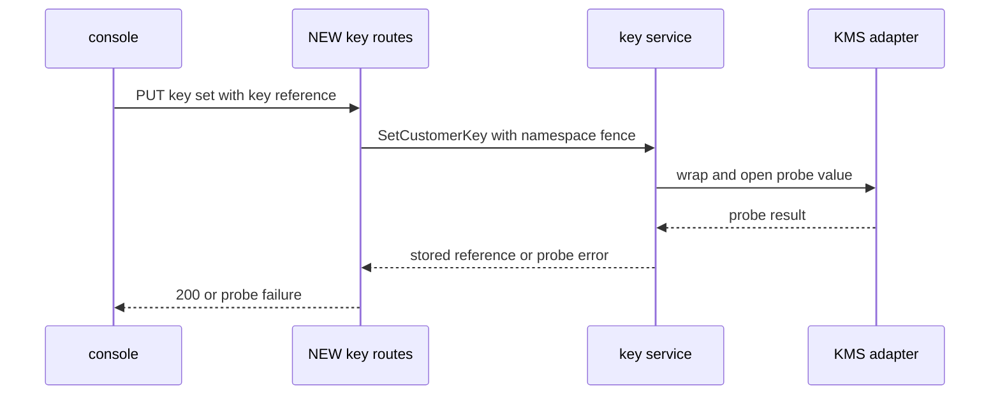
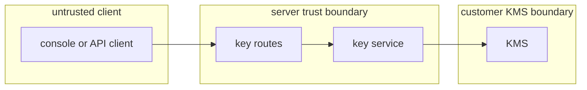

## Context

Namespace administrators set a customer key per namespace. The server must check the key before use, cache open versions for a short time, and fail closed when the KMS is down or revoked.

## Decisions

1. **Probe before store.** Put key reference writes behind one service constructor that runs the probe first and writes the audit entry on success or on probe failure, so no route can store an unchecked key.
2. **Bounded key cache.** Keep open namespace key versions in a bounded in-memory cache governed by the setting keys.namespaceKeyCacheSeconds, and drop entries on clear, change, revoke and failed probe, so outage and revoke paths close fast.
3. **Fence-serialized writes.** Serialize set, change and clear on the namespace fence so two administrators cannot interleave writes, and each write bumps the fence so other instances miss the cache and reopen the key.

## Structure

Unexported type keyManager in the key service with constructor checkKeys that runs the probe and sets the cache bound; only the constructor can store a key reference.

## Risks

- A confused deputy key policy lets one namespace use the key of another namespace.
- A stale cache keeps serving keys after revoke on another instance.

## Layers (defense in depth)

| Layer | Guard | Hostile test |
| --- | --- | --- |
| boundary check | Route rejects unknown key reference shape with 422 before any KMS call. | Send a key reference with path escape and check for 422 with no KMS call. |
| encode or contain | Pass namespace ID, namespace key ID and purpose as KMS context on each call. | Swap the namespace ID in the context and check that the KMS policy denies. |
| limit | Bound KMS call by the server request timeout and cache open versions per the setting with at most 32 entries per instance. | Stall the KMS and check that the server answers 503 within the request bound. |
| authorize at point of use | Route and service check NEW action namespace:manage-key or namespace:read-key on the namespace object before any KMS call. | Call the NEW set route with a grant on another namespace and check for deny. |
| fail closed | Map KMS deny to revoked and timeout or 5xx or rate limit to unavailable, answer 503 with Retry-After or 403, write an audit entry and drop the cache. | Disable the key and check that reads answer 403 and the cache drops. |

## Diagrams

After this change:

## Quality attributes

| Attribute | Target | Unit | Scope |
| --- | --- | --- | --- |
| latency | 5 | ms | key read with warm cache per request |
| latency | 2000 | ms | key set including KMS probe per request |
| availability | 503 with Retry-After within 1 request | response | KMS outage per namespace read path |

## Threat model

Data flow and trust boundaries:

| Boundary | STRIDE | Threat | Layer | Guard | Hostile test |
| --- | --- | --- | --- | --- | --- |
| server to customer KMS | S | A caller uses the key of another namespace at the KMS. | boundary check | Allowlist key reference shape and namespace identity; reject unknown fields without change. | Send a key reference with path escape and check for 422 with no KMS call. |
| server to customer KMS | S | A caller uses the key of another namespace at the KMS. | encode or contain | Pass namespace ID, namespace key ID, and purpose as KMS context on each call. | Swap the namespace ID in the context and check that the KMS policy denies. |
| server to customer KMS | S | A caller uses the key of another namespace at the KMS. | limit | Bound KMS call by the server request timeout and cache open versions per the setting with at most 32 entries. | Stall the KMS and check that the server answers 503 within the bound. |
| server to customer KMS | S | A caller uses the key of another namespace at the KMS. | authorize at point of use | Check NEW action namespace:manage-key on the namespace at the route and at the service. | Replay a valid probe from another namespace and check for deny. |
| server to customer KMS | S | A caller uses the key of another namespace at the KMS. | fail closed | Map KMS deny to revoked and timeout to unavailable; write audit entry and drop cache. | Disable the key and check that reads answer 403 and the cache drops. |

## Contracts

**namespace-key**

- Invariant: One customer key reference per namespace.
- Invariant: Sealed key material never leaves the store in plain text.
- `SetCustomerKey`: pre: Caller holds namespace:manage-key on the namespace.; Probe wrap and open with the namespace identity passes.. Post: Key record stores the new reference after the probe passes.; Audit entry records the set in the namespace scope..
- `ClearCustomerKey`: pre: Caller holds namespace:manage-key on the namespace.. Post: Key record holds no customer reference.; Audit entry records the clear in the namespace scope..
- `ProbeCustomerKey`: pre: Caller holds namespace:manage-key on the namespace.. Post: Result states pass or the failed check.; Failed probe writes an audit entry..
