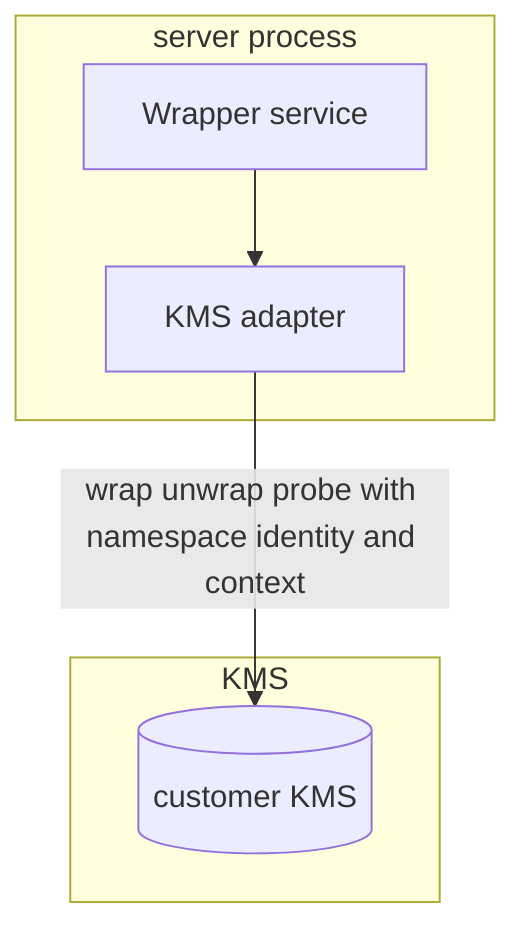

## Context

Part 1 of 3 of the split: stored record and Wrapper port only. No route, no schedule, no rotation, no re-encryption.

## Decisions

1. **One record per version with double wrap.** Store one row per namespace key version: namespace ID, key ID, version number, wrapped bytes, wrapper ID of each level above it, and KMS key version. With a customer key store the double wrap of ADR 217 decision 2; with no customer key store the single key-encryption-key wrap.
2. **Wrapper binds per-namespace identity and probe.** The NEW Wrapper port takes the namespace ID on each call Wrap, Unwrap, and ProbeConfusedDeputy so the adapter uses the identity of that namespace only and sends namespace ID, key ID, and purpose as KMS context. The fresh random 256-bit key plus AES-256-GCM construction exists because KMS services do not all bind associated data; it gives tamper detection, not confused-deputy protection. Confused-deputy protection comes from the per-namespace identity, the KMS context, and the probe.

## Structure

Unexported namespaceKey type with a constructor that checks version order, 32-byte length, and wrapper IDs; only the constructor makes a value.

## Risks

- KMS adapters differ in associated-data binding; contained by the fresh random 256-bit key plus AES-256-GCM seal per ADR 217 decision 3.
- KMS stall or hostile answer; contained by timeout with fail closed to ErrUnavailable or ErrRevoked.

## Layers (defense in depth)

| Layer | Guard | Hostile test |
| --- | --- | --- |
| boundary check | Port checks namespace ID syntax and 32-byte plaintext length before any KMS call. | Call Wrap with empty namespace ID and with 0-byte and 64-byte plaintext; each answers an error with no KMS call. |
| encode or contain | Seal each version under a fresh random 256-bit key with AES-256-GCM; tampering fails authentication. | Flip one byte of wrapped bytes; Unwrap fails authentication. |
| limit | Bound each KMS call with a timeout and one retry. | Stall the KMS; the call aborts within the bound with ErrUnavailable. |
| authorize at point of use | Use the identity of that namespace only with namespace ID, key ID, and purpose as KMS context; run probe before use. | Replay context of namespace A for namespace B and force probe pass for random ID; use is refused. |
| fail closed | Fail closed to ErrUnavailable or ErrRevoked with an audit entry; change nothing until checks pass. | Fail the probe and revoke the key; key is not set and an audit entry is written. |

## Quality attributes

| Attribute | Target | Unit | Scope |
| --- | --- | --- | --- |
| none affected | No user path; port and record only with no route. |  |  |

## Threat model

Data flow and trust boundaries:

| Boundary | STRIDE | Threat | Layer | Guard | Hostile test |
| --- | --- | --- | --- | --- | --- |
| server process to customer KMS | S | Confused deputy uses one namespace KMS key for another namespace. | boundary check | Check namespace ID syntax and 32-byte length at the port before any KMS call. | Send empty namespace ID and 0-byte plaintext; each is refused with no KMS call. |
| server process to customer KMS | S | Confused deputy uses one namespace KMS key for another namespace. | encode or contain | Seal each namespace key version under a fresh random 256-bit key with AES-256-GCM; tampering fails authentication. | Flip one byte of wrapped bytes; Unwrap fails with authentication error. |
| server process to customer KMS | S | Confused deputy uses one namespace KMS key for another namespace. | limit | Bound each KMS call with a timeout and one retry. | Stall the KMS; the call aborts within the bound and answers ErrUnavailable. |
| server process to customer KMS | S | Confused deputy uses one namespace KMS key for another namespace. | authorize at point of use | Use the identity of that namespace only and send namespace ID, key ID, and purpose as KMS context; run the confused-deputy probe before use. | Replay namespace A context for namespace B and force probe pass for random ID; use is refused. |
| server process to customer KMS | S | Confused deputy uses one namespace KMS key for another namespace. | fail closed | Fail closed to ErrUnavailable or ErrRevoked with an audit entry; change nothing until checks pass. | Fail the probe and revoke the key; key is not set and an audit entry is written. |

## Contracts

**namespace key version**

- Invariant: One wrapped value per version with wrapper ID of each level above it and the KMS key version that the KMS answered.
- Invariant: Version numbers increase within one namespace key ID.
- Invariant: An open key never leaves memory except through Wrap and Unwrap.
- `Wrap`: pre: Namespace ID is a valid Namespace ID and plaintext is a 32-byte namespace key version.. Post: Wrapped bytes open only with the same namespace ID and the recorded wrapper IDs..
- `Unwrap`: pre: Namespace ID and wrapped bytes come from a stored namespace key record.. Post: Returns the 32-byte namespace key version or ErrUnavailable or ErrRevoked..
- `ProbeConfusedDeputy`: pre: Called with the namespace ID and identity of the namespace before use.. Post: Returns pass only when the KMS policy binds the per-namespace identity and context..
