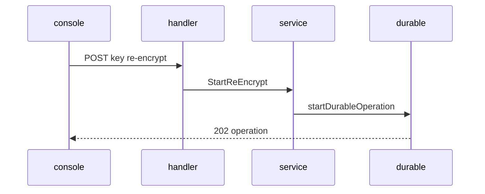
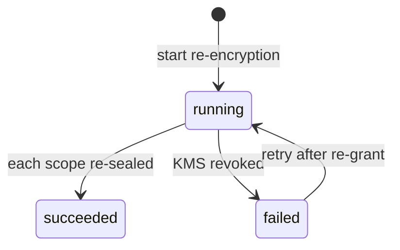
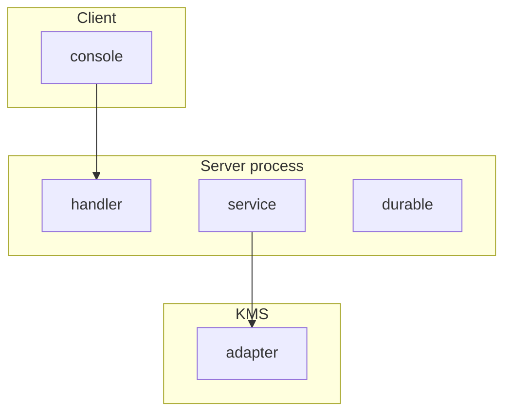

## Context

Rotation by rewrap and full re-encryption on top of the namespace key record and key management routes from parts 1 and 2. All schedules and durable work run only on the primary installation.

## Decisions

1. **Wrap-only rotation.** Rewrap and rotation mutate only the namespace key record. Data key rows and item key blobs keep their bytes. The opener tries the active version first, then old versions in newest-first order up to 10 tries. This shape makes stale-wrap reads impossible by structure: no caller selects a key version.
2. **Re-encryption as durable work.** Full re-encryption runs as a durable operation with one item per unit scope. The worker re-seals the wrap of each data key and each item key under the new namespace key version and never changes Pulumi ciphertexts. A retry resumes from the stored cursor. A second start while one runs answers 409. Rotation during re-encryption queues after the run. Cancel marks the run failed and keeps the old wrap active.
3. **Old versions named by backups.** A backup record names each namespace key version that wraps a key in its backup. The key page lists each named old version with the backup ID and warns that a named version stays readable until the backup expires.

## Structure

Unexported key opener constructed only from the stored namespace key record; callers pass the namespace ID and the sealed bytes, the constructor loads active and old versions.

## Risks

- Re-encryption touches many keys; a partial run must resume without double-seal.
- A KMS outage during rewrap must leave the old wrap readable.

## Layers (defense in depth)

| Layer | Guard | Hostile test |
| --- | --- | --- |
| authorize at point of use | Handler checks namespace:manage-key on the namespace and a fresh MFA step for re-encrypt. | Start re-encrypt with a token without namespace:manage-key and with a stale MFA step, each answers 403. |
| boundary check | Rewrap validates wrapper IDs and KMS key version from the answer, and runs the confused deputy probe again. | Feed a KMS answer with a wrong key version and a probe pass for another namespace ID, the rewrap refuses. |
| fail closed | Worker writes each re-sealed key in the fenced transaction of the namespace and never logs open keys. | Remove the fence check in a test build, the store conformance test fails on a fenced write. |

## Diagrams

After this change:

New imports of this change (each one allowed by the module rules):

- `pkg/durable` imports `pkg/audit`
- `pkg/namespace` imports `pkg/durable`

States and transitions after this change:

## Quality attributes

| Attribute | Target | Unit | Scope |
| --- | --- | --- | --- |
| latency | 500 ms p95 | ms | rewrap of one namespace key version, excluding KMS |
| latency | 50 ms p95 per try | ms | open of an item key blob sealed under an old version, max 10 version tries |

## Threat model

Data flow and trust boundaries:

| Boundary | STRIDE | Threat | Layer | Guard | Hostile test |
| --- | --- | --- | --- | --- | --- |
| API boundary | S | Spoofed namespace administrator starts rotation or re-encryption. | boundary check | Allowlist of key routes and strict JSON body check. | POST unknown fields and oversize body, server answers 400. |
| API boundary | S | Spoofed namespace administrator starts rotation or re-encryption. | encode or contain | Sealed cookies and access token auth, no key in logs. | Send request with key in URL, server refuses and logs no secret. |
| API boundary | S | Spoofed namespace administrator starts rotation or re-encryption. | limit | Rate limit on key routes per namespace. | Flood re-encrypt starts, server throttles with 429. |
| API boundary | S | Spoofed namespace administrator starts rotation or re-encryption. | authorize at point of use | Check namespace:manage-key at point of use plus fresh MFA for re-encrypt. | Call service direct without grant, server denies. |
| API boundary | S | Spoofed namespace administrator starts rotation or re-encryption. | fail closed | Unknown KMS answer maps to deny and audit entry. | Replay unknown KMS version string, server answers 503 and writes audit entry. |
| KMS boundary | T | Tampered wrap or confused deputy across namespaces. | boundary check | Namespace-bound identity and context with namespace ID and purpose. | Use identity of another namespace, KMS policy refuses. |
| KMS boundary | T | Tampered wrap or confused deputy across namespaces. | encode or contain | TLS to KMS and AES-256-GCM seal of namespace key version. | Tamper wrapped bytes, open refuses. |
| KMS boundary | T | Tampered wrap or confused deputy across namespaces. | limit | Timeout and retry with backoff on KMS calls. | Hang KMS, call ends with ErrUnavailable within budget. |
| KMS boundary | T | Tampered wrap or confused deputy across namespaces. | authorize at point of use | Probe before use and at each rewrap. | Revoke grant at KMS, probe fails closed before change. |
| KMS boundary | T | Tampered wrap or confused deputy across namespaces. | fail closed | Revoked maps to ErrRevoked with 403 and audit entry. | Disable key at KMS, server answers 403 and keeps old wrap. |

## Contracts

**NamespaceKey**

- Invariant: Each version keeps its wrap and wrapper IDs.
- Invariant: Old versions stay open while a backup record names them.
- Invariant: Item key blobs sealed under an old version stay readable after a rewrap.
- `Rewrap`: pre: Caller holds namespace:manage-key on the namespace.; Confused deputy probe passed for the customer key where set.. Post: Each namespace key version carries the current wrapper IDs.; An audit entry records the rewrap in the scope of the namespace..
- `RotateNamespaceKey`: pre: Caller holds namespace:manage-key on the namespace.; Checks of ADR 217 decision 10 passed where a customer key is set.. Post: A new namespace key version exists and becomes active.; An audit entry records the rotation in the scope of the namespace..
- `StartReEncrypt`: pre: Caller holds namespace:manage-key on the namespace.; A fresh MFA step passed.. Post: A durable operation exists for the re-encryption.; An audit entry records the start in the scope of the namespace..

## Failure modes

| Step | Failure | Retry | State after |
| --- | --- | --- | --- |
| Re-seal each scope | Worker stops mid-run. | Durable run resumes from the stored cursor on the primary installation. | running |
| Rewrap each version | KMS answers revoked during rewrap. | No automatic retry; operator re-grants at the KMS then retries the same operation ID. | failed |
| Commit re-sealed keys | Fence version changed during write. | Abort the batch and retry with the current fence. | running |
| Start re-encryption | Second start while one re-encryption runs. | No new run; server answers 409 with the running operation ID. | running |

## Change impact (computed from main)

Tests:

- `internal/api/runnerapi/wrapped_copy_internal_test.go` names `ErrNotHome`
- `internal/api/runnerapi/errcode_test.go` names `ErrNotHome`
- `internal/api/runnerapi/precedence_test.go` names `ErrNotHome`

ADRs:

- `docs/adr/0248-federation-model.md` names `ErrNotHome`
