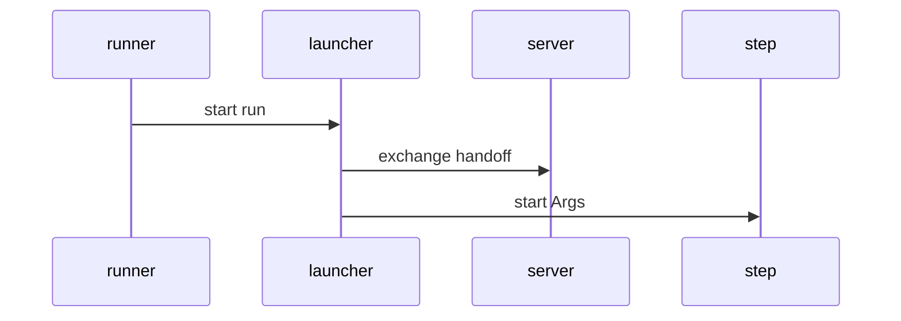
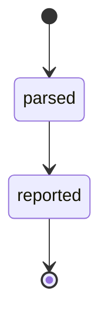
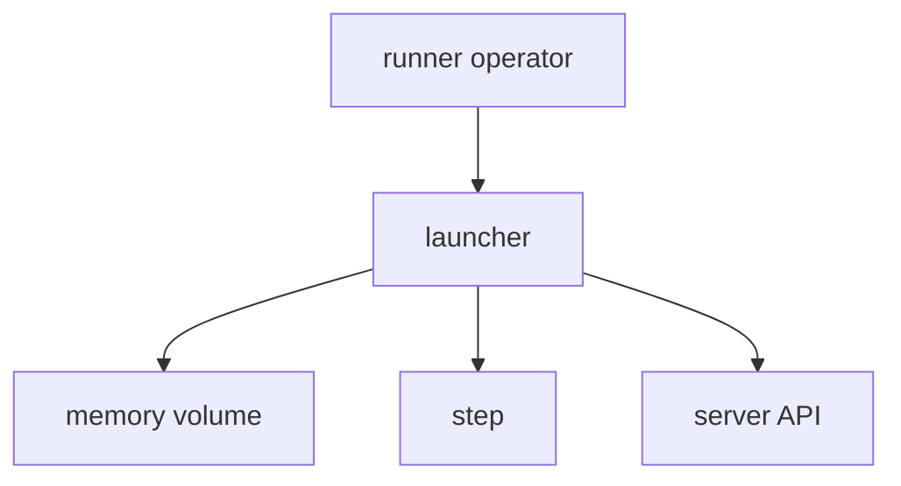

## Context

The runner starts one launcher for one claimed phase or sweep. The launcher stays small, static and free of store and forge code.

## Decisions

1. **Thin binary over pkg/launcher.** Keep run logic in pkg/launcher and keep cmd/dustpan-launcher as a thin main.
2. **Static release build with a dependency check.** Build with CGO_ENABLED=0 for linux amd64 and arm64, check static output, and check go list -deps holds no SQL driver or forge client.

## Structure

Unexported launcherSession built only by Parse plus Open, so no caller makes a run without parsed flags, a checked memory volume and a masker.

## Risks

- A new import pulls a SQL driver through a helper package.
- A helper writes credentials outside the memory-backed directory.

## Layers (defense in depth)

| Layer | Guard | Hostile test |
| --- | --- | --- |
| Binary boundary | Strict flag parser ends with code 64. | Run with unknown, repeated and valueless flags. |
| Credential containment | tmpfs check, 0700 directory, 0600 files. | Point secrets at a non-tmpfs path and check refusal before any step. |
| Log masking | Masker replaces secrets of 4 or more bytes across chunk ends. | Emit a split secret and check the log holds [masked]. |

## Diagrams

After this change:

Modules that the change touches, and their imports on main:

New imports of this change (each one allowed by the module rules):

- `cmd/dustpan-launcher` imports `pkg/launcher`

States and transitions after this change:

## Quality attributes

| Attribute | Target | Unit | Scope |
| --- | --- | --- | --- |
| portability | 2 architectures | architectures | launcher binary |

## Threat model

Data flow and trust boundaries:

| Boundary | STRIDE | Threat | Layer | Guard | Hostile test |
| --- | --- | --- | --- | --- | --- |
| CLI boundary | S | A hostile flag or forged handoff token runs an unintended command. | boundary check | Strict parser ends with code 64. | Pass unknown, repeated and valueless flags. |
| CLI boundary | S | A hostile flag or forged handoff token runs an unintended command. | encode or contain | Handoff is read only from the named channel. | Put a token in the environment and check it is ignored. |
| CLI boundary | S | A hostile flag or forged handoff token runs an unintended command. | limit | https URL with no user, query or fragment. | Pass a URL with user info. |
| CLI boundary | S | A hostile flag or forged handoff token runs an unintended command. | authorize at point of use | Exchange checks the claim for this phase. | Replay a token of another phase. |
| CLI boundary | S | A hostile flag or forged handoff token runs an unintended command. | fail closed | Any error ends the run before a step. | Break the token and check no step starts. |

## Contracts

**launcher-run**

- Invariant: One launcher runs one claimed phase or sweep.
- Invariant: Every step log passes the masker.
- `Parse`: pre: Raw argv without program name.. Post: Mode and flags, or an error that ends with code 64..

## Failure modes

| Step | Failure | Retry | State after |
| --- | --- | --- | --- |
| Prepare place | Secrets directory fails the tmpfs check. | Fix the mount and start a new launcher. | No step starts. |
| Open session | Handoff exchange fails. | The runner releases the claim. | Exit code 65, no step. |
