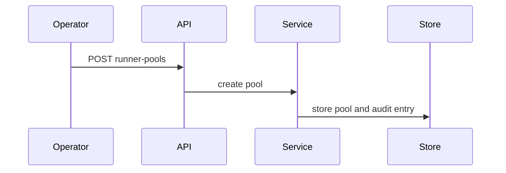
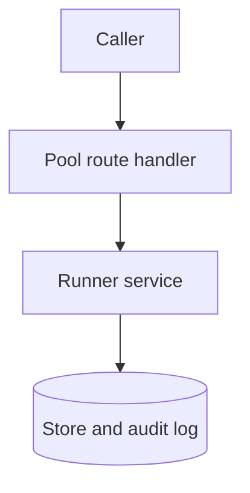

## Context

Runner management moves to resource paths under one namespace. The runner protocol under /runner/v1 does not move.

## Decisions

1. **Move management to resource paths.** Serve pools, runners and join tokens under /api/dustpan/v1/namespaces/{namespace}/runner-pools. Keep namespace:read-runners and namespace:manage-runners and the audit events of ADR 138.
2. **No alias on old pool paths.** Old pool paths answer 404 with no redirect and no shim, for these paths only.
3. **Stable IDs.** Store each pool, runner and join token by its stable ID. A name is a label for people only.

## Structure

Domain types in pkg/runner stay unchanged; a thin HTTP adapter calls the runner service. No new tool and no custom analyzer.

## Risks

- Callers of the old pool paths get 404 and must change paths.

## Layers (defense in depth)

| Layer | Guard | Hostile test |
| --- | --- | --- |
| HTTP handler | Each route declares its action and object; the policy check refuses callers without the grant. | Call each route with a token without the grant and check 403. |
| service | The service checks the grant at the point of use and writes the audit entry in the same transaction. | Call the service with a denied grant and check no change and no audit entry persist. |
| port adapter | The store writes with the namespace fence in the same transaction. | Attempt a cross-namespace pool write and check refusal with no row change. |

## Diagrams

After this change:

Modules that the change touches, and their imports on main:

## Quality attributes

| Attribute | Target | Unit | Scope |
| --- | --- | --- | --- |
| correctness | 0 | secret values in list or read answers | join-token routes |

## Threat model

Data flow and trust boundaries:

| Boundary | STRIDE | Threat | Layer | Guard | Hostile test |
| --- | --- | --- | --- | --- | --- |
| API handler | E | A caller changes a pool without the grant. | boundary check | The handler rejects bad namespace and pool ID shapes. | Send traversal and overlong IDs and check 404. |
| API handler | E | A caller changes a pool without the grant. | encode or contain | The 404 body strips CR and LF from path values. | Request an old path with CRLF and check no raw CR or LF. |
| API handler | E | A caller changes a pool without the grant. | limit | The handler limits body size. | Send an oversize body and check refusal with no row change. |
| API handler | E | A caller changes a pool without the grant. | authorize at point of use | The handler declares the action and refuses callers without the grant. | Send requests with no credential and with no grant; check 401 and 403. |
| API handler | E | A caller changes a pool without the grant. | fail closed | Unknown paths answer 404 with no redirect. | Request old paths and check 404 with no data. |

## Contracts

**runner pool**

- Invariant: A pool belongs to one namespace and each write carries the namespace fence.
- Invariant: The join secret is returned once at create.
- `create-pool`: pre: Caller holds namespace:manage-runners.. Post: Pool and pool-created audit entry stored in one transaction..
- `revoke-join-token`: pre: Caller holds namespace:manage-runners.. Post: Token revoked and audit entry stored in one transaction..

## Failure modes

| Step | Failure | Retry | State after |
| --- | --- | --- | --- |
| Create pool | Audit write fails | Retry the whole request | No pool and no audit entry |
| Revoke join token | Revoke races a join | Retry the join with a live token | One of join or revoke wins |
| Delete pool | Live runners remain | Drain and retire runners, revoke tokens, then retry | Pool stays |

## Change impact (computed from main)

Tests:

- `pkg/access/access_test.go` names `runner.ActionNamespaceReadRunners`
- `pkg/identity/identity_test.go` names `runner.ActionNamespaceReadRunners`
- `internal/api/runnerapi/routes_test.go` names `runner.ActionNamespaceReadRunners`
- `internal/api/runnerapi/routes_test.go` names `runner.ActionRunnerJoin`
- `pkg/access/access_test.go` names `runner.ActionRunnerJoin`
- `pkg/identity/identity_test.go` names `runner.ActionRunnerJoin`
- `pkg/runner/handoff_test.go` names `runner.AuditRules`
- `pkg/runner/coordinator_test.go` names `runner.AuditRules`

ADRs:

- `docs/adr/0138-runner-actions-audit-and-api.md` names `runner.ActionNamespaceReadRunners`
- `docs/adr/0138-runner-actions-audit-and-api.md` names `runner.ActionRunnerJoin`
- `docs/adr/0138-runner-actions-audit-and-api.md` names `runner.AuditRules`
