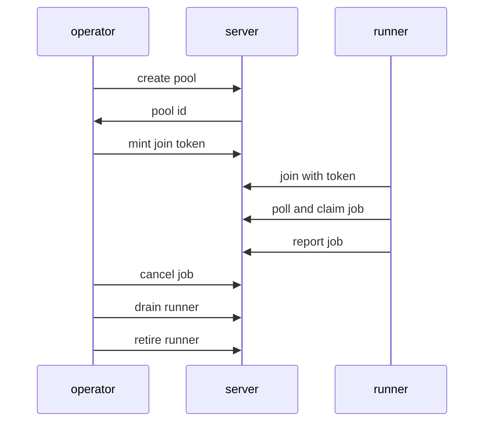
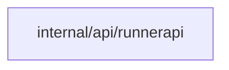
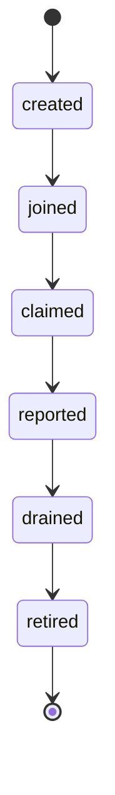
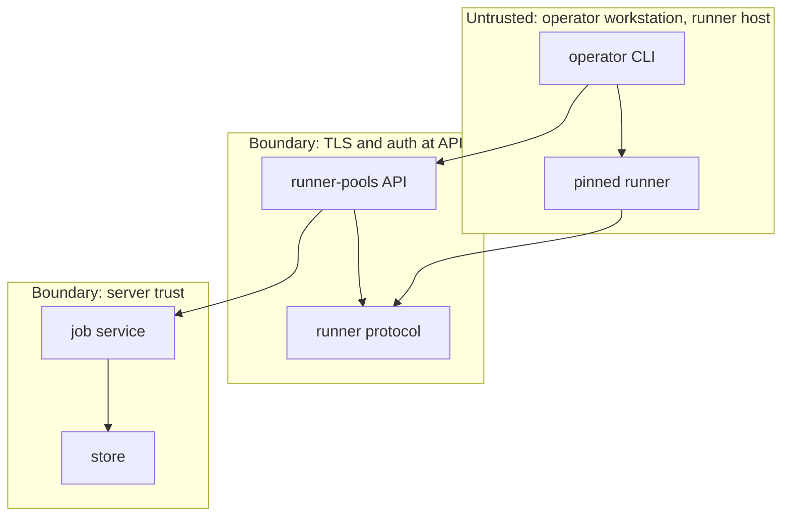

## Context

The e2e suite must drive each runner management route and each runner protocol step with a pinned real runner and a local launcher, with no mock runner and no retry that hides a failure.

## Decisions

1. **One real-runner flow covers all runner behavior.** One e2e flow creates a pool, mints a join token, joins a pinned real runner, runs a plan and an apply, cancels one job, drains and retires the runner, checks each route answer, each refusal, each action refusal, the Idempotency-Key replay on drain and retire, the claim expiry after a crash, the drain race rule and the cleanup, on SQLite and on PostgreSQL over TLS against the real binary.
2. **No retry mask in the e2e flow.** The flow uses the sandboxed process of the machine coordinator and the local launcher only, records each attempt, and fails when a step needs a retry to pass. Teardown deletes the runner and the pool through the management API; when the store is down the flow fails and reports the leftover IDs instead of hiding them.

## Structure

No new structure. The change adds no stored reference and no new guard. It drives the current handlers in internal/api/runnerapi/routes.go through their routes, so a route without e2e cover fails the suite.

## Risks

- The pinned runner artifact can drift from the server and break the suite.
- A failed flow can leave a runner or a pool that blocks later runs.

## Diagrams

After this change:

Modules that the change touches, and their imports on main:

New imports of this change (each one allowed by the module rules):

- `e2e` imports `internal/api/runnerapi`

States and transitions after this change:

## Quality attributes

| Attribute | Target | Unit | Scope |
| --- | --- | --- | --- |
| reliability | 100 | percent pass on a clean installation | e2e real-runner flow on SQLite and PostgreSQL over TLS |
| maintainability | 0 | leftover pools or runners after a failed run | e2e real-runner flow teardown |

## Threat model

Data flow and trust boundaries:

| Boundary | STRIDE | Threat | Layer | Guard | Hostile test |
| --- | --- | --- | --- | --- | --- |
| TLS and auth at API | S | A caller spoofs another team and lists pools or joins a pool with a guessed token. | authorize at point of use | Require TLS and an access token with the pool read or manage action; join needs a one-use join token. | Send a pool list with no token and a join with a revoked token; both fail closed. |
| TLS and auth at API | S | A caller spoofs another team and lists pools or joins a pool with a guessed token. | boundary check | Allow-list pool and token fields and reject unknown values without repair. | Send overlong names and bad token shapes; server answers 400 and stores nothing. |
| TLS and auth at API | S | A caller spoofs another team and lists pools or joins a pool with a guessed token. | limit | Bind join token to one pool and one use; retire refuses while a claim is open. | Replay a used token and retire a busy runner; replay gives 404 and retire gives 409. |
| TLS and auth at API | S | A caller spoofs another team and lists pools or joins a pool with a guessed token. | encode or contain | Store only hashes of join tokens and runner keys; never log a secret. | Dump logs and rows after a join; no secret value shows. |
| TLS and auth at API | S | A caller spoofs another team and lists pools or joins a pool with a guessed token. | fail closed | Deny on store or auth error and write an audit entry. | Break the store call in a test double; call denies and audit holds the denial. |
| server trust | T | A runner tampers with a job report to claim or overwrite the work of another runner. | authorize at point of use | Check the fence and the claim owner at each report and state write. | Send a report for a job owned by another runner; server refuses. |
| server trust | T | A runner tampers with a job report to claim or overwrite the work of another runner. | boundary check | Validate job IDs, sequence numbers and log sizes at the protocol boundary. | Send a huge log chunk and a bad job ID; server rejects both. |
| server trust | T | A runner tampers with a job report to claim or overwrite the work of another runner. | limit | Expire claims at lease end and cap log size per step. | Kill a runner mid-job; claim expires and a second runner takes the job once. |
| server trust | T | A runner tampers with a job report to claim or overwrite the work of another runner. | encode or contain | Run steps in the sandboxed process launcher only, never in the server. | Run a step that reads server files; sandbox denies the read. |
| server trust | T | A runner tampers with a job report to claim or overwrite the work of another runner. | fail closed | Fail the job on launcher or store error and keep the audit trail. | Fail the report write; job marks failed and the audit keeps the attempt. |

## Contracts

**runner-pool**

- Invariant: Pool members are stable IDs of runners, never names alone.
- Invariant: A retired runner holds no claim.
- `join-with-token`: pre: Join token is present and not revoked.. Post: Runner joins pool once per unused join token..
- `drain-retire`: pre: Runner holds no open claim at retire.. Post: Drained runner takes no new claim; retired runner leaves pool..

## Failure modes

| Step | Failure | Retry | State after |
| --- | --- | --- | --- |
| Real runner plan and apply | Runner process is killed during a job. | Wait for claim lease expiry, then let a second runner claim the same job once. | First claim expires; job returns to queued then runs on the second runner. |
| Cancel drain retire | Drain arrives while a claim starts. | Keep the in-flight claim; refuse new claims on the drained runner with no retry. | Open claim finishes; drained runner stays idle. |
| Runner join | Join token is already used or revoked. | Mint a new join token; do not retry the same token. | Join refused with 404; no runner added. |
