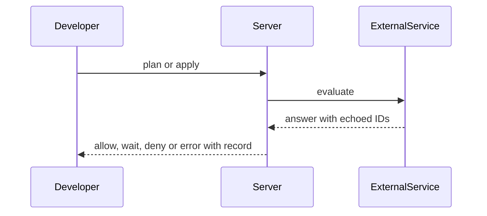
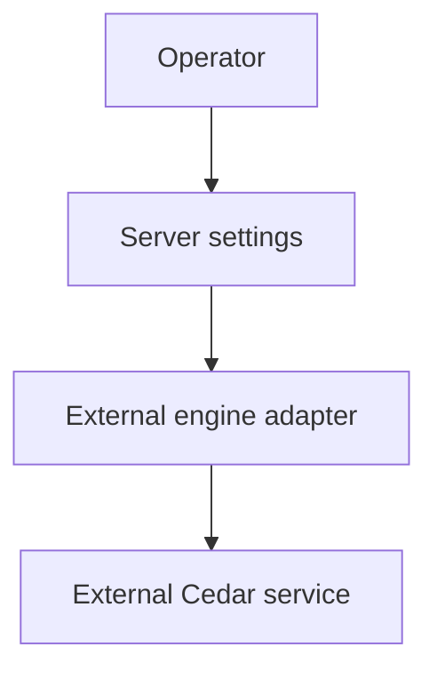

## Context

The adapter turns gate.Engine calls into service calls. Protocol faults give gate.ErrUnavailable. Format, save fallback, access-limit split and CI image wait for the owner. No code lands before those decisions.

## Decisions

1. **Service adapter behind gate.Engine.** Add an unexported externalEngine with a constructor that takes endpoint, CA, credential and timeout and exposes only gate.Engine.
2. **Strict answer check.** Check TLS, credential, no redirect, timeout, answer size, both echoed IDs, unknown and extra policy IDs and unit mismatch. Each fault gives gate.ErrUnavailable.
3. **Outage behavior.** Start when the service is unreachable. Enforce gates fail closed. The save and access-limit rules follow the owner decision.

## Structure

Unexported type externalEngine with constructor NewExternalEngine; only the constructor makes a value and it checks the invariants.

## Risks

- The request and answer format is open.
- The save fallback is open.
- The access-limit split is open.
- The CI image is open.

## Layers (defense in depth)

| Layer | Guard | Hostile test |
| --- | --- | --- |
| transport | https only, no redirect, configured CA, credential, 5 s timeout, 1 MB limit, address check at dial. | Wrong CA, missing credential, redirect, oversize and slow answers each give gate.ErrUnavailable. |
| protocol | Echo of request ID and policy-set version, unknown and extra IDs refused. | Wrong ID, wrong version and extra policy ID each give gate.ErrUnavailable. |
| save | Local parse and type check first; the service check follows the owner decision. | Stop the test service at save; the result follows the decided fallback and the record names the miss. |

## Diagrams

After this change:

## Quality attributes

| Attribute | Target | Unit | Scope |
| --- | --- | --- | --- |
| latency | 5 | s | service evaluate call |
| capacity | 1 | MB | service answer size |

## Threat model

Data flow and trust boundaries:

| Boundary | STRIDE | Threat | Layer | Guard | Hostile test |
| --- | --- | --- | --- | --- | --- |
| Network boundary | S | A hostile answer spoofs policy IDs and allows a refused change. | boundary check | Echo of both IDs and allowlist of policy IDs. | Return a wrong ID; the call gives gate.ErrUnavailable. |
| Network boundary | S | A hostile answer spoofs policy IDs and allows a refused change. | encode or contain | Policy IDs stay opaque; the credential never enters logs. | Read logs; no credential shows. |
| Network boundary | S | A hostile answer spoofs policy IDs and allows a refused change. | limit | 5 s timeout and 1 MB answer limit. | Send an oversize answer; the call gives gate.ErrUnavailable. |
| Network boundary | S | A hostile answer spoofs policy IDs and allows a refused change. | authorize at point of use | The settings write checks the manage action on the installation. | Write settings with no grant; the server refuses. |
| Network boundary | S | A hostile answer spoofs policy IDs and allows a refused change. | fail closed | Any fault gives gate.ErrUnavailable and never an allow. | Drop the service mid-call; the change stops per mode. |

## Contracts

**gate.Engine adapter**

- Invariant: Only gate.Engine methods are reachable.
- `Evaluate`: pre: Compiled policy set, entities and one request for each unit. Post: Matched policy IDs and diagnostics for each unit, or gate.ErrUnavailable.

## Failure modes

| Step | Failure | Retry | State after |
| --- | --- | --- | --- |
| Evaluate through the service | Service unreachable | The caller retries the change after the service recovers. | An enforce gate stops the change with gate.ErrUnavailable. |
| Echo check | Answer fails the echo check | No retry; fix the service configuration. | The evaluation gives gate.ErrUnavailable. |

## Change impact (computed from main)

Tests:

- `e2e/claim_gate_test.go` names `gate.Engine`
- `e2e/jobs_api_test.go` names `gate.Engine`
- `e2e/pulumi_state_write_gate_test.go` names `gate.Engine`
- `internal/expr/owned_internal_test.go` names `gate.ErrRuleFailed`
- `internal/expr/hostile_test.go` names `gate.ErrRuleFailed`
- `internal/expr/timeout_internal_test.go` names `gate.ErrRuleFailed`

ADRs:

- `docs/adr/0114-the-policy-port-and-its-default-adapters.md` names `gate.Engine`
- `docs/adr/0110-the-catalog-a-gateway-of-declarative-requests.md` names `gate.Engine`
- `docs/adr/0335-gate-decisions-deny-gates-held-locks-and-the-engine-port.md` names `gate.Engine`
- `docs/adr/0114-the-policy-port-and-its-default-adapters.md` names `gate.ErrRuleFailed`
- `docs/adr/0223-access-limits-cedar-forbid-policies-for-each-scope.md` names `gate.ErrRuleFailed`
- `docs/adr/0115-quotas-and-reservations.md` names `gate.ErrRuleFailed`
