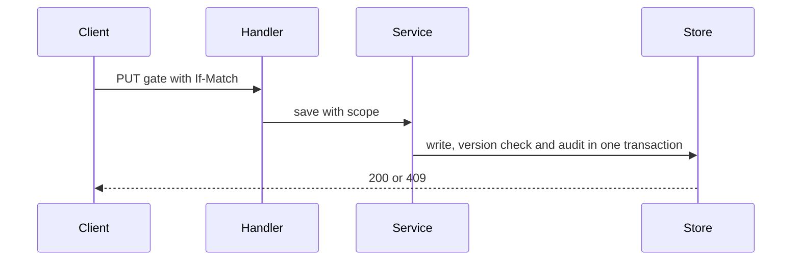
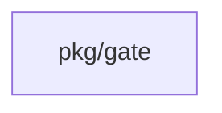
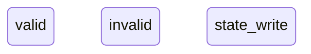
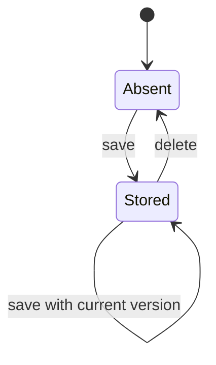
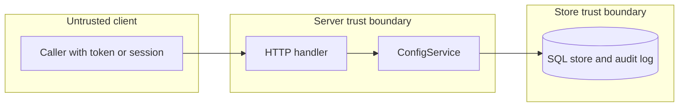

## Context

Gate configuration is security code. A write needs an action check, a scope check, fresh authentication, limits, a version check and an audit entry. The service exists. This change serves it at every scope and keys unit rows on the stable unit ID.

## Decisions

1. **Routes on ConfigService.** Serve gates, approval rules, approval defaults including the reset, and the carry-over setting at four scopes. The unit scope is the by-name path of ADR 355. Each route declares the read or manage action of its scope.
2. **Stable unit key.** Key gate rows of a unit on the stable unit ID by an in-place edit of the baseline of each dialect. A rename or a restore keeps the rows. A new unit that reuses a name starts clean. The by-name path resolves to the ID at the start of each request.
3. **Version check in the transaction.** The adapter compares If-Match with the stored version in the write transaction. A PUT that creates a new object needs no If-Match. A PUT to an existing object without If-Match fails with 428.
4. **Fresh authentication.** A change that needs fresh authentication fails closed with mfa.fresh-step-required for an access token and for a session with an old sign-in.
5. **Final gates and rule IDs.** A narrower scope cannot save a gate or rule with the ID of a wider final object. The server resolves approval:<id> at the gate scope, then at wider scopes.

## Structure

An unexported scopeKey type holds the scope kind, the namespace and the stable unit ID. Only its constructor makes a value, and the constructor rejects an unknown or deleted unit. A write cannot cross scopes or use a name as a key.

## Risks

- A reused name reattaches the policy of a deleted unit.
- Two managers write one row with the same version.
- A weaker final gate changes with no reason in the audit entry.
- A rename races with a write to the same unit.

## Layers (defense in depth)

| Layer | Guard | Hostile test |
| --- | --- | --- |
| HTTP handler | The handler checks the action of the addressed scope and answers 404 for an object of another scope. | A token of another namespace reads a unit gate and gets 404. A write with no manage action gets 403. |
| service | The service checks limits, If-Match, fresh authentication, final gates and the scope key before a write. | Save over the limit, with a stale version, without fresh authentication and over a wider final gate. Each save fails closed. |
| port adapter | The adapter uses placeholders, compares the version, checks the fence and writes the audit entry in the same transaction. | Inject SQL text in an ID. Run two writes with one version. Fail the audit write and check that the row is not stored. |

## Diagrams

After this change:

Modules that the change touches, and their imports on main:

States on main in the touched packages:

States and transitions after this change:

## Quality attributes

| Attribute | Target | Unit | Scope |
| --- | --- | --- | --- |
| Read latency | 200 | ms at the 95th percentile | list of gates at one scope with 256 gates |
| Write limit enforcement | 0 saves above the limit | stored objects over 256 gates or 64 approval rules | each scope |

## Threat model

Data flow and trust boundaries:

| Boundary | STRIDE | Threat | Layer | Guard | Hostile test |
| --- | --- | --- | --- | --- | --- |
| Client to server | E | A caller without the manage action, or from another scope, changes gates. | boundary check | The handler validates the scope path and the ID grammar. | A request with a bad ID or a bad scope segment gets 404 or 422. |
| Client to server | E | A caller without the manage action, or from another scope, changes gates. | encode or contain | The handler percent-decodes each segment once and the service takes the scope key from the resolved unit ID. | A name with an encoded slash or dot segments reaches only the unit with that exact name. |
| Client to server | E | A caller without the manage action, or from another scope, changes gates. | limit | The body reader caps the request size and the service caps the condition at 4 KiB. | A body above the cap is refused before a write. |
| Client to server | E | A caller without the manage action, or from another scope, changes gates. | authorize at point of use | The service checks the manage action on the object of the scope. | A token with only the read action writes a gate and gets 403. |
| Client to server | E | A caller without the manage action, or from another scope, changes gates. | fail closed | An unknown scope or an unreadable grant denies, and the denial is audited. | A grant lookup error gives 403 and an audit entry. |
| Client to server | S | An access token passes as a fresh authentication. | boundary check | The handler reads the kind of credential from the authenticated principal, not from a header the client sets. | A request with a forged fresh-step header and an access token gets mfa.fresh-step-required. |
| Client to server | S | An access token passes as a fresh authentication. | encode or contain | The fresh-step time comes from the sealed session, never from the request. | A session cookie with an edited time fails to open and the request gets 401. |
| Client to server | S | An access token passes as a fresh authentication. | limit | The window of the fresh step is fixed and short. | A session just outside the window gets mfa.fresh-step-required. |
| Client to server | S | An access token passes as a fresh authentication. | authorize at point of use | The service requires a fresh step for each change that needs one. | An access token changes a gate and gets mfa.fresh-step-required. |
| Client to server | S | An access token passes as a fresh authentication. | fail closed | An error in the fresh-step check denies the change. | A failing session read leaves the row unchanged and the answer is a refusal. |
| Server to store | T | Two writers or hostile text change a row wrongly. | boundary check | The service rejects an ID, a scope or a version that is not valid before it calls the store. | A negative version or an ID with control characters gets 422. |
| Server to store | T | Two writers or hostile text change a row wrongly. | encode or contain | Placeholders only and the stable unit ID key. | SQL text in an ID is stored as text and matches no other row. |
| Server to store | T | Two writers or hostile text change a row wrongly. | limit | Counts of 256 gates and 64 approval rules and a 4 KiB condition. | The 257th gate is refused with gate.limit. |
| Server to store | T | Two writers or hostile text change a row wrongly. | authorize at point of use | The store write takes the fence of the namespace and checks it in the transaction. | A write with a stale fence is refused and the row is unchanged. |
| Server to store | T | Two writers or hostile text change a row wrongly. | fail closed | A version mismatch inside the transaction refuses the write. | Two writes with one version give one success and one 409. |
| Server to store | R | A change leaves no record. | boundary check | The service refuses a change that has no actor in the context. | A call with no principal is refused and writes nothing. |
| Server to store | R | A change leaves no record. | encode or contain | The audit entry holds IDs and versions, with CR and LF removed from free text. | A reason with CR and LF is stored as one line. |
| Server to store | R | A change leaves no record. | limit | The reason of a weaker final gate has a length cap. | A reason above the cap is refused. |
| Server to store | R | A change leaves no record. | authorize at point of use | The audit entry names the principal that the grant check approved. | An audit entry of a change names the caller, not another principal. |
| Server to store | R | A change leaves no record. | fail closed | The audit entry is written in the same transaction. | A failed audit write leaves the row unchanged. |

## Failure modes

| Step | Failure | Retry | State after |
| --- | --- | --- | --- |
| Save of a gate | The audit write fails. | The client repeats the save with the same version. | No row changed. |
| Save of a gate | The If-Match version is stale. | The client reads the object and saves with the new version. | The first write stays. |
| Save on a unit | The unit is renamed or deleted while the request runs. | The client reads the unit again and repeats the save. | The row stays with the stable unit ID, or the save gets 404 and no row changed. |

## Change impact (computed from main)

Tests:

- `pkg/tempadmin/tempadmin_test.go` names `gate.ErrNotFound`
- `internal/removalalertsvc/fakes_test.go` names `gate.ErrNotFound`
- `pkg/manuallock/manuallock_test.go` names `gate.ErrNotFound`

Docs pages:

- `docs/guides/s3-blobs.md:89` names `gate.ErrNotFound`

ADRs:

- `docs/adr/0179-conformance-suites-for-provider-wrappers.md` names `gate.ErrNotFound`
- `docs/adr/0206-the-profile-provider-port-rotators-and-conformance.md` names `gate.ErrNotFound`
- `docs/adr/0271-the-forge-port-git-host-connections-and-the-installation-level-github-app.md` names `gate.ErrNotFound`
