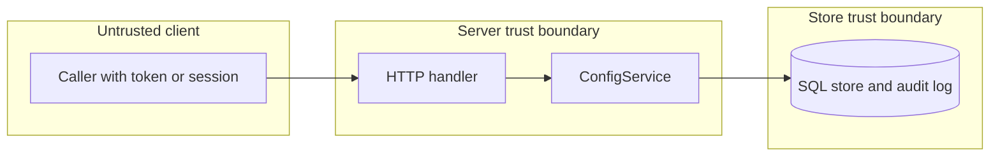

## Context

Gate configuration is security code. A write needs an action check, a scope check, a fresh authentication, limits, a version check and an audit entry. Main has all of these for gates and access limits at three scopes, and for approval rules and approval defaults at the namespace scope. The store already holds every object kind at the installation scope. This change adds the missing routes and the missing scope checks. It adds no new check for a write that main serves already.

The owner decided two points on 20 November 2026. The action `installation:manage-gates` is in the operator family (Q1), so this change builds the write routes of the installation. This change builds no route for the signature carry-over setting, because ADR 299 decision 12 replaces it (Q2). Task 3.4 records Q2 in ADR 230 and ADR 299.

## Decisions

1. **One scope table for gates, access limits and approval rules.** The handlers of the approval rules and the approval default build their scope with `gateScopeOf` (`internal/api/server/gate_objects.go`), not with `gate.NamespaceScope(obj.Namespace())`. The route rows come from the loop over `gateObjectScopes()`, as the rows of gates and access limits do. A new scope level then gets every row at once.
2. **Unit scope by name, stable key below.** The path names the unit by tool and name. The store resolves it to the stable unit ID inside the request. The approval handlers add no resolution of their own. The new route tests show the same four cases through HTTP that the port tests show on main.
3. **Versions as on main.** A PUT without If-Match replaces the stored object or creates it. A stale If-Match gives 409 gate.version-conflict. The first draft said 428 for a missing If-Match. Main does not do this, no decision asks for it, and the reference page says the opposite. This change keeps main.
4. **Fresh authentication as on main.** Each PUT and each DELETE of the new rows runs behind `h.fresh`. It fails closed with 403 mfa.fresh-step-required for an access token and for an old sign-in. The first draft limited this to enforce and final gates. Main requires it for every write.
5. **Final gates and rule IDs as on main.** The service gives `gate.ErrFinal` for a save over a final object of a wider scope. The new scopes reuse this.
6. **The installation scope in the service.** `gate.ConfigService` accepts the installation scope for the reads and the writes of gates, access limits and approval rules. It reads no namespace, takes the zero fence, and writes the audit entry with the scope `@server`. The service still refuses an approval default at the installation, because the installation holds none (`Scope.HoldsApprovalDefault`, `pkg/gate/scope.go:293`), and it still refuses a blueprint, a profile and the empty scope.
8. **`installation:manage-gates` is an operator action (owner, 2026-11-20).** It is in `FamilyOperator`. The installation operator and the site administrator hold it, and the account administrator does not (`pkg/access/access_test.go:668-676`). The reason is the rule of ADR 216 decision 2: an installation gate acts on every namespace. A namespace administrator holds `namespace:manage-gates` only and gets 403 on an installation route.
9. **Audit action names of the installation writes.** The names follow the form of main, `<level>:<verb>-<kind>` (`pkg/gate/config_objects.go:15-18`, `pkg/gate/config.go:114-117`), with the level `installation`: `installation:set-gate`, `installation:delete-gate`, `installation:set-access-limit`, `installation:delete-access-limit`, `installation:set-approval-rule` and `installation:delete-approval-rule`. The service picks the constant from the level of the scope, in one table, so a write at a level has no name of another level. The object of the entry is the scope key `installation` plus the path of the object, as for the other scopes (the key of the scope, then the kind and the ID, as `pkg/gate/config.go:280` builds it for an approval rule). There is no entry for a read.
10. **No carry-over route (owner, 2026-11-20).** The binding level replaces the setting (ADR 299 decision 12). The store port keeps its methods until the pull request that ADR 299 names deletes them.
7. **The installation read routes** declare `installation:read-gates` with the object `@server` (`resolveServer`). A holder of `namespace:read-gates` only gets 403. The list shows the installation objects only.

## Structure

The service takes the scope check out of each method. An unexported type `scopeUse` has three values: read, write and approval default. The function `requireScope(scope, use)` replaces `requireNamespaceScope`. Each method names its use in the call, so a new method cannot skip the choice, and a read at the installation cannot become a write by a missed edit. `.golangci.yml` needs no new rule. No custom analyzer is added.

The route rows of the approval rules, the approval default and the installation reads come from tables, not from copied rows. The route test walks the table and the registered routes, so a row that is missing fails a test.

## Contract

New routes. `{scope}` is `/api/dustpan/v1/namespaces/{namespace}/collections/{collection}` or `/api/dustpan/v1/namespaces/{namespace}/units/by-name/{tool}/{name}`. The unit name is percent-encoded. The operation ID has the infix `Collection` or `Unit`, as the gate operations have.

| Method and path | Operation ID | Action (object) | Request and answer | Errors |
| --- | --- | --- | --- | --- |
| GET `{scope}/approval-rules` | listCollectionApprovalRules, listUnitApprovalRules | namespace:read-gates (namespace) | none / approval rule list body | 403 access.denied |
| GET `{scope}/approval-rules/{id}` | getCollectionApprovalRule, getUnitApprovalRule | namespace:read-gates | none / approval rule body, ETag | 404 gate.not-found |
| PUT `{scope}/approval-rules/{id}` | setCollectionApprovalRule, setUnitApprovalRule | namespace:manage-gates, fresh | approval rule body, If-Match optional / body, ETag | 404 unit.not-found, 409 gate.version-conflict, 409 gate.final, 422 gate.invalid, 422 gate.limit, 403 mfa.fresh-step-required |
| DELETE `{scope}/approval-rules/{id}` | deleteCollectionApprovalRule, deleteUnitApprovalRule | namespace:manage-gates, fresh | If-Match optional / 204 | 404 gate.not-found, 409 gate.version-conflict |
| GET `{scope}/approval-default` | getCollectionApprovalDefault, getUnitApprovalDefault | namespace:read-gates | none / approval default body, ETag | 404 gate.not-found when none is set |
| PUT `{scope}/approval-default` | setCollectionApprovalDefault, setUnitApprovalDefault | namespace:manage-gates, fresh | approval default body / body, ETag | as the approval rule PUT |
| DELETE `{scope}/approval-default` | deleteCollectionApprovalDefault, deleteUnitApprovalDefault | namespace:manage-gates, fresh | If-Match optional / 204 | 409 gate.version-conflict |
| GET `/api/dustpan/v1/gates`, `/access-limits`, `/approval-rules` | listInstallationGates, listInstallationAccessLimits, listInstallationApprovalRules | installation:read-gates (`@server`) | none / list body of the kind | 403 access.denied |
| GET `/api/dustpan/v1/gates/{id}`, `/access-limits/{id}`, `/approval-rules/{id}` | getInstallationGate, getInstallationAccessLimit, getInstallationApprovalRule | installation:read-gates | none / body of the kind, ETag | 404 gate.not-found |

The bodies are the bodies of main. A body names no scope. A request with a field that is not in the body fails with 400. The status codes and error codes are the rows of `classifyGateConfig`. The audit entry of a write at the collection or the unit scope has the namespace of the path and the same action strings as the namespace write, and its object is the scope key of the row.

The port `serverapi.GateConfig` does not change. `gate.ConfigService` keeps its method set. These sentinels change behavior:

- `gate.ErrInvalid`: an approval default at the installation, and a scope of a blueprint, a profile or the empty scope.
- `gate.ErrNotFound`, `gate.ErrUnitNotFound`, `gate.ErrConflict`, `gate.ErrFinal`, `gate.ErrLimit`: as on main for each new scope.

Installation write rows (owner, 2026-11-20). The scope is `/api/dustpan/v1`.

| Method and path | Operation ID | Action (object) | Request and answer | Errors |
| --- | --- | --- | --- | --- |
| PUT `/api/dustpan/v1/gates/{id}` | setInstallationGate | installation:manage-gates (`@server`), fresh | gate body, If-Match optional / body, ETag | 409 gate.version-conflict, 409 gate.final, 422 gate.invalid, 422 gate.limit, 403 mfa.fresh-step-required |
| DELETE `/api/dustpan/v1/gates/{id}` | deleteInstallationGate | installation:manage-gates, fresh | If-Match optional / 204 | 404 gate.not-found, 409 gate.version-conflict |
| PUT `/api/dustpan/v1/access-limits/{id}` | setInstallationAccessLimit | installation:manage-gates, fresh | access limit body / body, ETag | as the gate PUT |
| DELETE `/api/dustpan/v1/access-limits/{id}` | deleteInstallationAccessLimit | installation:manage-gates, fresh | If-Match optional / 204 | as the gate DELETE |
| PUT `/api/dustpan/v1/approval-rules/{id}` | setInstallationApprovalRule | installation:manage-gates, fresh | approval rule body / body, ETag | as the gate PUT |
| DELETE `/api/dustpan/v1/approval-rules/{id}` | deleteInstallationApprovalRule | installation:manage-gates, fresh | If-Match optional / 204 | as the gate DELETE |

There is no route for an approval default at the installation, and no route for the carry-over setting.

## Risks

- A rename races with a write to the same unit. The store reads the stable unit ID in the write transaction. The new tests cover this for approval rules.
- Two managers write one row with the same version. One gets 409.
- A read of the installation list shows rules that a namespace administrator may not see. The route declares `installation:read-gates` on `@server`, and a namespace grant gives no action on `@server`.
- An installation write changes the gates of every namespace at once. The route declares `installation:manage-gates`, which only the operator family holds, and it needs a fresh authentication. A final gate of the installation stays final for each namespace (`gate.ErrFinal`).
- A new action that no family names is held by the administrator only. `installation:manage-gates` is in the operator family on the day it exists, and the test `TestActionsWithoutRoutesAreUnclassified` (`pkg/access/access_test.go:553`) fails for an action that has no route and no family.
- An approval rule at a collection with the ID of a final namespace rule. The service refuses it with `gate.ErrFinal`. The route test shows it for both new scopes.

## Layers (defense in depth)

One table for each layer. Each guard has a test that fails when the guard is removed.

| Layer | Guard | Hostile test |
| --- | --- | --- |
| HTTP handler | The route declares the action of its scope and object, and the policy check runs before the handler. | A principal with only `namespace:read-gates` writes a collection rule and gets 403. A holder of `namespace:read-gates` reads `/api/dustpan/v1/gates` and gets 403. A token of namespace `other` reads a unit rule of `acme` and gets 403. |
| HTTP handler | `gateScopeOf` and the ID check allow only valid collection names, tools, unit names and IDs. | A collection name with a slash, a tool that is not supported, a unit name with a control character, and an ID with a capital letter. Each gets 400 or 422 and no store call. |
| HTTP handler | `h.fresh` runs before each write. | A write with an access token, and with a session outside the window, gets 403 mfa.fresh-step-required and no row changes. |
| HTTP handler | The body reader caps the body and refuses an unknown field. | A body one byte over the cap, and a body with the field `scope`, get 400 and no store call. |
| service | `requireScope(scope, use)` refuses a use that the scope does not allow. | A write at the installation, an approval default at the installation, a blueprint scope and the empty scope give `gate.ErrInvalid` and call no store method. |
| service | The service checks limits, approvers and final objects before the write. | Save the 65th approval rule of a collection (gate.limit). Save a rule over a final namespace rule (gate.final). Each fails closed and stores nothing. |
| service | The service takes the fence of the namespace of the scope. | A namespace that does not exist gives `namespace.ErrNotFound` and stores nothing. A stale fence gives `namespace.ErrFenced`. |
| port adapter | The store uses placeholders, compares the version and checks the fence and the audit entry in one transaction. | SQL text in a collection name or an ID is stored as text and matches no other row. Two writes with one version give one success and one 409. A failing audit write leaves the row unchanged. |
| port adapter | The store reads the stable unit ID in the transaction. | A rename between the route lookup and the write keeps the rule with the unit. A new unit with the name of a deleted unit has no rule. |
| port adapter | The store refuses a scope that holds no configuration, and a fence of another scope. | A fence of `acme` with a scope of `other` gives `gate.ErrInvalid`. |
| HTTP handler | The installation write rows declare `installation:manage-gates` on `@server`, and `h.fresh` wraps them. | A holder of `installation:read-gates` only, a holder of `namespace:manage-gates` only and an account administrator write `/api/dustpan/v1/gates/{id}` and get 403. An access token of a site administrator gets 403 mfa.fresh-step-required. |
| service | `requireScope(scope, use)` allows the installation for gates, access limits and approval rules, and refuses an approval default there. | A save of an approval default at the installation gives `gate.ErrInvalid`. A save of each of the three kinds at the installation reads no namespace and calls the store with the zero fence. |
| service | The audit action comes from the level of the scope, in one table. | A write at the installation writes `installation:set-gate`, never `namespace:set-gate`, and the entry has the scope `@server`. A write at a namespace never writes an `installation:` name. |
| port adapter | The store takes the zero fence for the installation and refuses any other fence. | A write at the installation with the fence of `acme` gives `gate.ErrInvalid` and stores nothing. A namespace write with the zero fence gives `gate.ErrInvalid`. |
| port adapter | The write and its audit entry are one transaction at the installation too. | A failing audit write at the installation leaves the row unchanged. |

## Quality attributes

| Attribute | Target | Unit | Scope |
| --- | --- | --- | --- |
| Read latency | 200 | ms at the 95th percentile | list of 64 approval rules at one scope |
| Write limit enforcement | 0 | stored objects above 64 approval rules | each scope |

## Threat model

| Boundary | STRIDE | Threat | Layer | Guard | Hostile test |
| --- | --- | --- | --- | --- | --- |
| Client to server | E | A caller without the action, or of another scope, reads or changes rules. | boundary check | Each path segment is checked against an allowlist. | A bad collection name, tool, unit name or ID gets 400 or 422 and no store call. |
| Client to server | E | Same. | encode or contain | The unit name is decoded once, and the scope key holds the decoded parts. | A name with an encoded slash reaches only the unit with that exact name. |
| Client to server | E | Same. | limit | The body reader caps the body, and the service caps the counts. | A body above the cap is refused before a write. The 65th rule gets 422 gate.limit. |
| Client to server | E | Same. | authorize at point of use | The route declares the action and the object, and the policy check runs first. | A read-only principal writes and gets 403. A namespace holder reads the installation list and gets 403. |
| Client to server | E | Same. | fail closed | An unknown scope, or an error in the grant lookup, denies. | A failing grant lookup gives an error status and no store call. |
| Client to server | E | A namespace administrator or a reader writes a gate of the installation, which acts on every namespace. | boundary check | The installation write routes name `installation:manage-gates` on `@server`, and the ID segment is checked against an allowlist. | A holder of `namespace:manage-gates` and a holder of `installation:read-gates` write `/api/dustpan/v1/gates/{id}` and get 403. An ID with a capital letter gets 400 or 422 and no store call. |
| Client to server | E | Same. | encode or contain | The path object is the scope key `installation` and the checked ID. | An ID with a slash or SQL text reaches no other object. |
| Client to server | E | Same. | limit | The service caps the count of objects at the installation as at each scope. | The 65th approval rule at the installation gets 422 gate.limit. |
| Client to server | E | Same. | authorize at point of use | The policy check runs on `@server` before the handler, and `h.fresh` wraps the write. | An access token of a site administrator gets mfa.fresh-step-required and no row changes. |
| Client to server | E | Same. | fail closed | A failing grant lookup denies, and the denial is written to the audit log. | A failing grant lookup gives an error status and no store call. |
| Client to server | S | An access token passes as a fresh authentication. | boundary check | The handler reads the kind of credential from the authenticated principal. | A request with an access token and a forged header gets mfa.fresh-step-required. |
| Client to server | S | Same. | encode or contain | The time of the sign-in comes from the sealed session, never from the request. | A session cookie with an edited time fails to open and the request gets 401. |
| Client to server | S | Same. | limit | The window of the fresh step is fixed. | A session just outside the window gets mfa.fresh-step-required. |
| Client to server | S | Same. | authorize at point of use | `h.fresh` wraps each write row. | An access token writes a collection rule and gets mfa.fresh-step-required. |
| Client to server | S | Same. | fail closed | An error in the check of the sign-in time denies the change. | A failing session read leaves the row unchanged. |
| Server to store | T | Two writers or hostile text change a row wrongly. | boundary check | The service refuses a scope use, an ID or a version that is not valid before the store call. | A write at the installation gives `gate.ErrInvalid`. |
| Server to store | T | Same. | encode or contain | Placeholders only, and the stable unit ID as key. | SQL text in an ID is stored as text and matches no other row. |
| Server to store | T | Same. | limit | The service limits the count of objects for each scope. | The 65th rule is refused. |
| Server to store | T | Same. | authorize at point of use | The store checks the fence of the namespace of the scope in the transaction. | A write with a stale fence is refused and the row is unchanged. |
| Server to store | T | Same. | fail closed | A version mismatch in the transaction refuses the write. | Two writes with one version give one success and one 409. |
| Server to store | R | A change leaves no record. | boundary check | The service refuses a change that has no actor. | A call with no principal is refused and writes nothing. |
| Server to store | R | Same. | encode or contain | The audit entry holds IDs and versions, with CR and LF removed from free text. | A reason with CR and LF is stored as one line. |
| Server to store | R | Same. | limit | The reason has a length cap. | A reason above the cap is refused. |
| Server to store | R | Same. | authorize at point of use | The audit entry names the principal that the grant check approved. | The audit entry of a change names the caller. |
| Server to store | R | Same. | fail closed | The audit entry is written in the same transaction. | A failed audit write leaves the row unchanged. |

## Failure modes

| Step | Failure | Retry | State after |
| --- | --- | --- | --- |
| Save of an approval rule | The audit write fails. | The client repeats the save with the same version. | No row changed. |
| Save of an approval rule | The If-Match version is stale. | The client reads the object and saves with the new version. | The first write stays. |
| Save on a unit | The unit is renamed or deleted while the request runs. | The client reads the unit again and repeats the save. | The row stays with the stable unit ID, or the save gets 404 and no row changed. |
| Read of the installation list | The store is not available. | The client repeats the read. | An error status and no partial list. |

## Change impact (computed from main)

Files that name the touched items on main. Each is read or changed by the tasks:

- `internal/api/server/gate_config.go` (the rows and the handlers of the approval default and the approval rules)
- `internal/api/server/gate_objects.go` (the scope table and `gateScopeOf`)
- `internal/api/server/operations.go` (the label tables)
- `pkg/gate/config.go` and `pkg/gate/config_objects.go` (the scope check)
- `e2e/coverage_gate.go`, `e2e/gate_routes_test.go`, `e2e/approval_rules_test.go`
- `docs/reference/gate-config-api.md`, `docs/guides/approval-rules.md`
