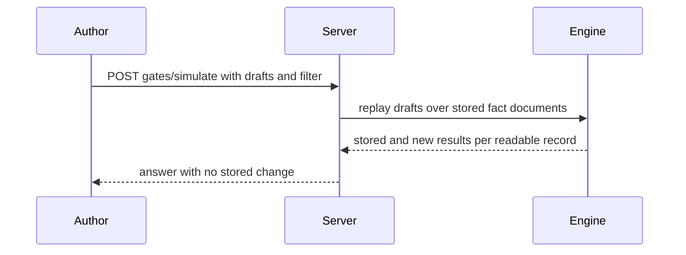
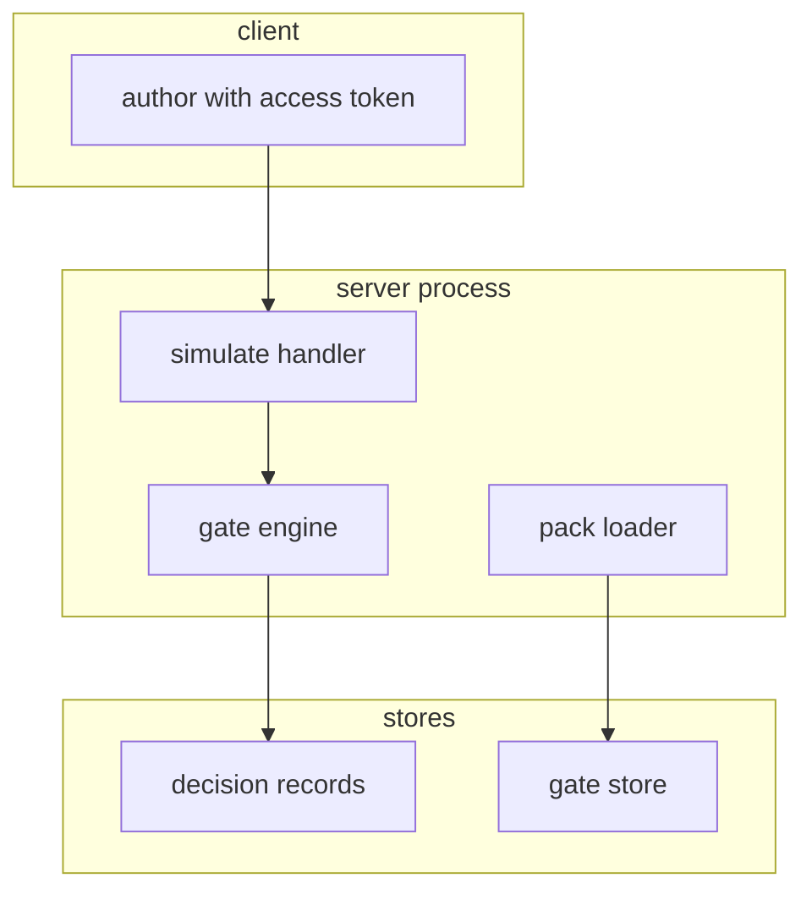

## Context

Simulate replays stored decision records against draft gates and draft approval rules. Starter packs ship as data and install as evaluate mode gates with approval rules.

## Decisions

1. **Replay through the gate engine with no writes.** Simulate loads stored fact documents and runs the draft gates and draft approval rules through the same gate engine with writes disabled, from one snapshot of the drafts with a bounded time. It counts the matched stored records before the readability check and refuses the whole request when the matched count is above 1,000, never truncated. It skips records whose change the caller cannot read, records whose fact schema version the engine cannot read, and records whose fact document SHA-256 does not match, with no row, no ID and no count for skipped records.
2. **Packs as versioned data with all-or-nothing install.** Packs ship as versioned data files with pack ID, pack version, gates, approval rules, and test files. Install runs in one transaction and is all-or-nothing: it copies packs as new gates in evaluate mode and copies pack approval rules as approval rules, and refuses the whole install with no gate made when any pack gate asks for a mode other than evaluate, when any pack text claims compliance, when any gate name already exists, when the same pack ID and version is already installed, or when any gate lacks a test file. A later pack version installs as a new version; edits or deletes of installed gates do not change the recorded pack version.

## Structure

Unexported simulateRequest built only by newSimulateRequest, which checks the decision point, the time range, the 1,000 record limit, and refuses pack gates that ask for a mode other than evaluate.

## Risks

- Replay of many records costs time; the 1,000 record refusal bound on matched records before the readability check, the time range, one snapshot, and a timeout bound it, with no partial writes.

## Layers (defense in depth)

| Layer | Guard | Hostile test |
| --- | --- | --- |
| HTTP handler | Handler checks action namespace:read-gates on the namespace for simulate and pack list, and action namespace:manage-gates on the namespace for pack install, and filters records to changes the caller can read, with no row, no ID and no count for skipped records. | Caller without read rights on one change gets no row, no ID and no count for that change, and cannot tell skipped records exist. |
| service | Service evaluates drafts in a read-only context from one snapshot and blocks store writes during replay, with a timeout and cancel that leaves no partial answer stored. | Draft with a write side effect stores nothing and changes no change order or job, and a concurrent edit of drafts during replay does not change the run. |
| port adapter | Pack loader forces mode evaluate by refusal and rejects framework wording that claims compliance, inside the same transaction as the name and version checks. | Pack with enforce mode or compliant wording is refused at load and in CI text test; two concurrent installs of the same pack leave one install only. |

## Diagrams

After this change:

## Quality attributes

| Attribute | Target | Unit | Scope |
| --- | --- | --- | --- |
| replay bound | 1000 | records | POST gates/simulate per request |
| replay timeout | 30 | seconds | POST gates/simulate per request |
| install atomicity | 0 | partial gates on refusal | starter pack install |

## Threat model

Data flow and trust boundaries:

| Boundary | STRIDE | Threat | Layer | Guard | Hostile test |
| --- | --- | --- | --- | --- | --- |
| client to server | S | Spoofed author replays drafts against changes the author cannot read. | boundary check | Handler rejects unknown decision point, bad time range, invalid draft syntax, and matched counts above 1,000 with 422 before any replay. | Hostile filter with oversized range gets 422 with no evaluation and no readable count. |
| client to server | S | Spoofed author replays drafts against changes the author cannot read. | encode or contain | Handler encodes error text with no CR or LF and returns only stored and new outcomes with no fact content for skipped records. | Draft with CRLF in its name returns clean error text with no header split. |
| client to server | S | Spoofed author replays drafts against changes the author cannot read. | limit | Replay runs read-only from one snapshot with a timeout and cancel, and the 1,000 matched-record bound, with no stored change. | Slow replay stops at timeout and stores nothing. |
| client to server | S | Spoofed author replays drafts against changes the author cannot read. | authorize at point of use | Handler checks namespace:read-gates for simulate and skips each change the caller cannot read with no row, no ID and no count. | Caller without grant on one change gets 403 or a clean answer with no trace of that change. |
| client to server | S | Spoofed author replays drafts against changes the author cannot read. | fail closed | Unknown fact schema version or hash mismatch fails closed by skip with no trace; over-bound range fails closed by 422 refusal. | Tampered fact document is skipped, never replayed. |
| client to server | T | Draft gate tampers with live gates or changes during replay. | boundary check | Handler validates drafts and filter at the boundary and refuses invalid input with 422. | Invalid draft syntax gets 422 with no replay. |
| client to server | T | Draft gate tampers with live gates or changes during replay. | encode or contain | Engine replays drafts in a contained read-only context with no store handle for writes. | Draft that calls a store write gets a denied write and stores nothing. |
| client to server | T | Draft gate tampers with live gates or changes during replay. | limit | Replay holds one snapshot and a timeout so concurrent draft edits cannot change the run and long runs stop with no partial answer. | Concurrent edit of drafts during replay does not change the answer. |
| client to server | T | Draft gate tampers with live gates or changes during replay. | authorize at point of use | Replay uses only the read grants of the caller at request start for each change object. | Caller whose grant is removed before replay still cannot read the change. |
| client to server | T | Draft gate tampers with live gates or changes during replay. | fail closed | Any replay error stops the run with 504 or 422 and stores nothing. | Engine error leaves no partial answer stored. |
| server to stores | I | Hostile pack discloses past facts or installs enforce-mode gates. | boundary check | Pack loader validates pack ID, version, gate names, mode, wording, and test file presence before any write. | Pack with unknown field or bad version is refused with no gate made. |
| server to stores | I | Hostile pack discloses past facts or installs enforce-mode gates. | encode or contain | Pack text is stored as data and never rendered as markup; error text strips CR and LF. | Pack text with markup renders as plain text only. |
| server to stores | I | Hostile pack discloses past facts or installs enforce-mode gates. | limit | Pack install runs in one transaction with unique name and version checks so concurrent installs leave one install only. | Two concurrent installs of one pack leave one install with no duplicate. |
| server to stores | I | Hostile pack discloses past facts or installs enforce-mode gates. | authorize at point of use | Pack list needs namespace:read-gates and pack install needs namespace:manage-gates on the namespace. | Caller without manage grant gets 403 on install with no gate made. |
| server to stores | I | Hostile pack discloses past facts or installs enforce-mode gates. | fail closed | Any pack check failure refuses the whole install with no gate made; unknown pack ID gives 404. | Enforce-mode or compliant pack is refused with no gate made. |

## Contracts

**gate**

- Invariant: Pack gates exist only in evaluate mode.
- Invariant: Simulate stores nothing.
- `Simulate drafts over records`: pre: Caller holds namespace:read-gates on the namespace.; Filter holds decision point and time range.. Post: Answer holds stored and new result per readable record.; No row stored..
- `Starter pack list and install`: pre: Caller holds namespace:manage-gates on the namespace for install.; Pack version not yet installed.. Post: Each made gate has mode evaluate.; Pack ID and version recorded..

## Failure modes

| Step | Failure | Retry | State after |
| --- | --- | --- | --- |
| POST gates/simulate | Replay passes timeout | Narrow the time range and send the request again. | Nothing stored; no change changed. |
| POST pack install | Two installs of one pack at the same time | List gates and keep the one install. | One install made; other refused with no duplicate. |
