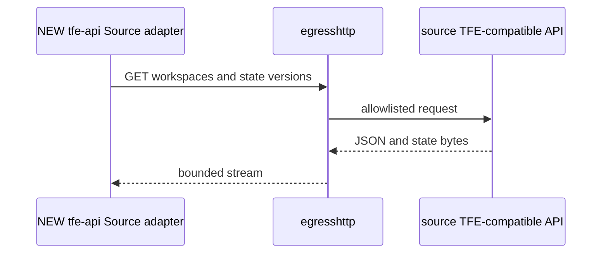
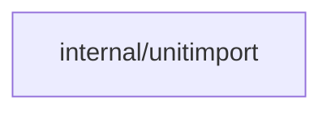
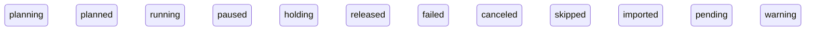
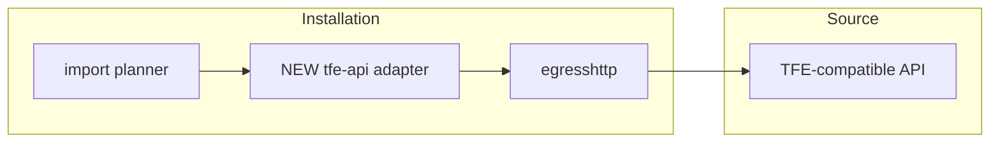

## Context

The server reads a TFE-compatible API as the first import source. No import route or engine lands here. The conformance suite is the only caller until #1001 wires the adapter.

## Decisions

1. **Adapter structure.** One unexported tfeSource type with a constructor that takes an egresshttp client and a NEW credential type with no exported fields whose Format answers [credential]. The adapter ignores Content-Length, counts streamed bytes against the state size limit of 32 megabytes per version, and checks size and MD5 after the stream. A short, oversize or malformed stream returns a typed error and no version.
2. **Origin rule and error map.** The credential origin is scheme, host and port of the import address. Same-host redirects keep the credential, cross-host redirects fail, also for download and json-state document URLs. Retries: 429 with Retry-After or 5xx at most 2 more times with 1 second backoff. Malformed JSON never retries. 401 and 403 give the NEW error code import.source-denied, 404 gives the NEW error code import.source-not-found, 5xx timeout and network failure give the NEW error code import.source-unavailable.

## Structure

One unexported tfeSource type built only by its constructor, which wraps the NEW credential type.

## Risks

- Credential reaches a download host on redirect.
- Oversize state exhausts memory.

## Layers (defense in depth)

| Layer | Guard | Hostile test |
| --- | --- | --- |
| boundary check | Allowlist of address, credential origin and redirect host. | Private address, cross-host download and redirect each fail. |
| encode or contain | Stream bytes with the state size limit; never log bytes. | Oversize state fails; logs hold no state bytes. |
| limit | Page limit, body limit and timeout per request. | Slow source stops at the timeout. |
| authorize at point of use | Credential goes only to the import origin. | Download URL on another host gets no token. |
| fail closed | Typed error and no partial version. | Each failure writes no version. |

## Diagrams

After this change:

Modules that the change touches, and their imports on main:

New imports of this change (each one allowed by the module rules):

- `NEW internal/unitimport/tfeapi` imports `internal/egress/egresshttp`

States on main in the touched packages:

## Quality attributes

| Attribute | Target | Unit | Scope |
| --- | --- | --- | --- |
| latency | 5 | seconds | per source request of the tfe-api adapter |
| peak-memory | 256 | MB | per streamed state version of the tfe-api adapter |

## Threat model

Data flow and trust boundaries:

| Boundary | STRIDE | Threat | Layer | Guard | Hostile test |
| --- | --- | --- | --- | --- | --- |
| Installation to source API | S | The adapter sends the source token to another host. | boundary check | Credential origin and redirect host check. | Redirect to another host fails. |
| Installation to source API | S | The adapter sends the source token to another host. | encode or contain | Credential type prints [credential]. | Formatted credential is [credential]. |
| Installation to source API | S | The adapter sends the source token to another host. | limit | Per-request timeout and body limit. | Slow source times out. |
| Installation to source API | S | The adapter sends the source token to another host. | authorize at point of use | Token goes only to the import origin. | Download host gets no token. |
| Installation to source API | S | The adapter sends the source token to another host. | fail closed | Bad credential gives import.source-denied. | Wrong token fails. |

## Contracts

**NEW tfe-api source adapter**

- Invariant: The adapter holds no source credential after a call returns.
- Invariant: Listed versions stay oldest first.
- `NEW Source.Versions`: pre: Unit names one workspace.. Post: Result lists at most the limit after the version ID, oldest first..
- `NEW Source.Open`: pre: Version ID came from Versions.. Post: Streamed bytes equal the state file..
- `NEW Locker.Lock`: pre: lockSource is true and the workspace is unlocked.. Post: The workspace is locked by the import..

## Failure modes

| Step | Failure | Retry | State after |
| --- | --- | --- | --- |
| Read with lock held | The read fails while the source holds the lock. | Unlock once, then report the read error. | Source unlocked; unit stays at last committed version. |
| Unlock workspace | The unlock call fails. | Retry unlock 1 more time. | Unit failed with lock-held until the team unlocks the source. |
