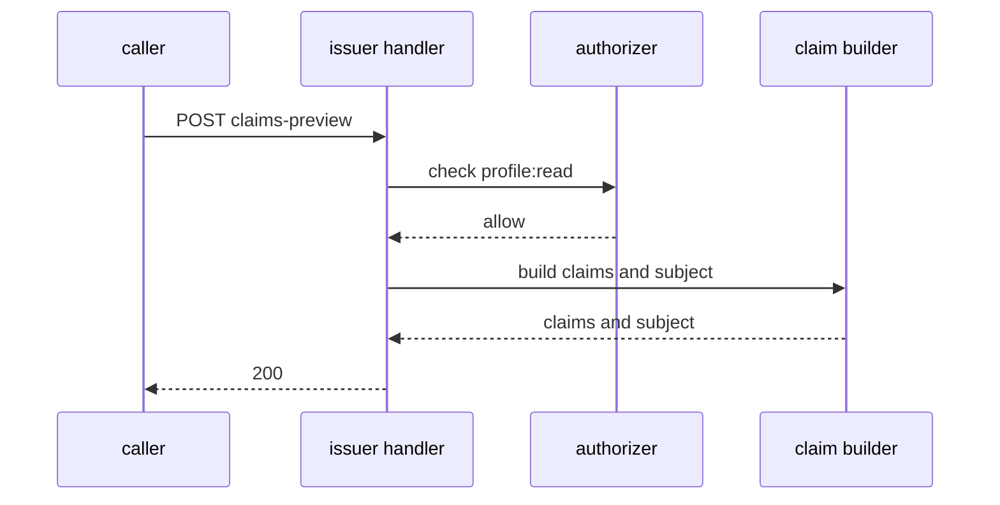
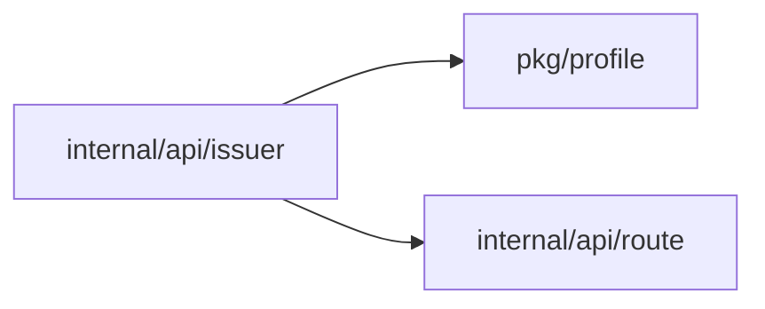

## Context

Issuer settings, keys, export and docs are on main; only claims-preview is missing. Add a read-only route that reuses the claim and subject builders without the signer.

## Decisions

1. **Reuse builders, never sign.** Add the NEW function PreviewClaims in pkg/profile. It reads the profile block, the issuer settings and the caller as actor, and builds claims with the NEW claim table in pkg/profile. It takes no Issuer signer and no adapter. The handler in internal/api/issuer holds no key handle. profile.Issuer stays the only code that signs.

## Structure

The NEW previewer type in pkg/profile is unexported. Its constructor takes the claim table and no signer, so signing is impossible by structure.

## Risks

- Preview drifts from signed claims if the builders fork; a parity test guards it.

## Diagrams

After this change:

Modules that the change touches, and their imports on main:

States on main in the touched packages:

## Quality attributes

| Attribute | Target | Unit | Scope |
| --- | --- | --- | --- |
| none affected | Read-only preview with no signing and no storage write |  |  |
