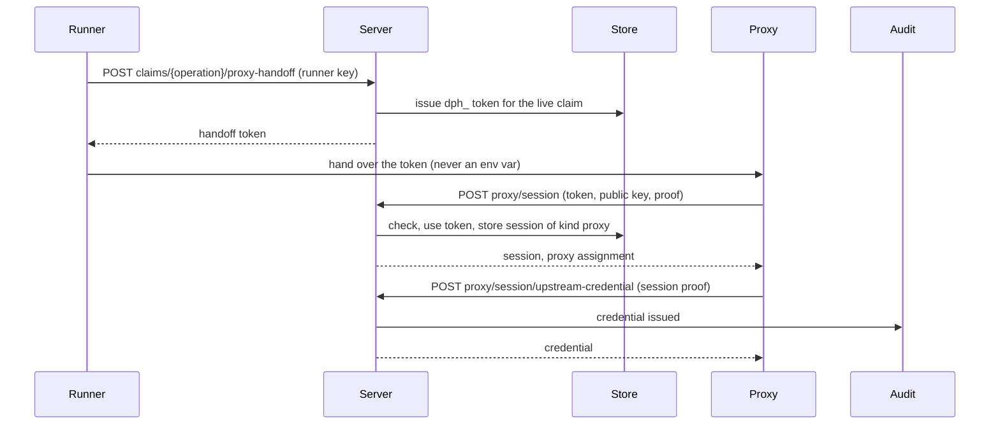
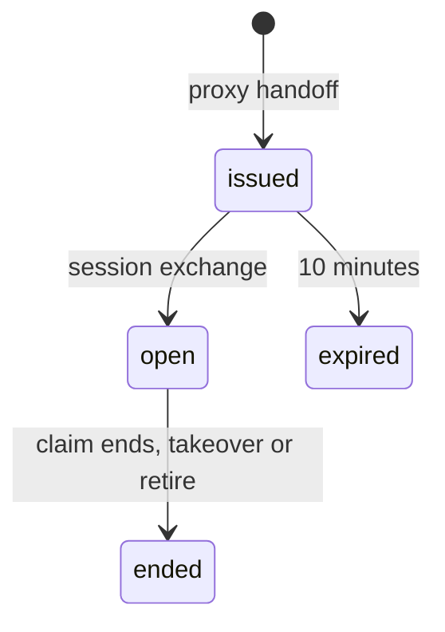
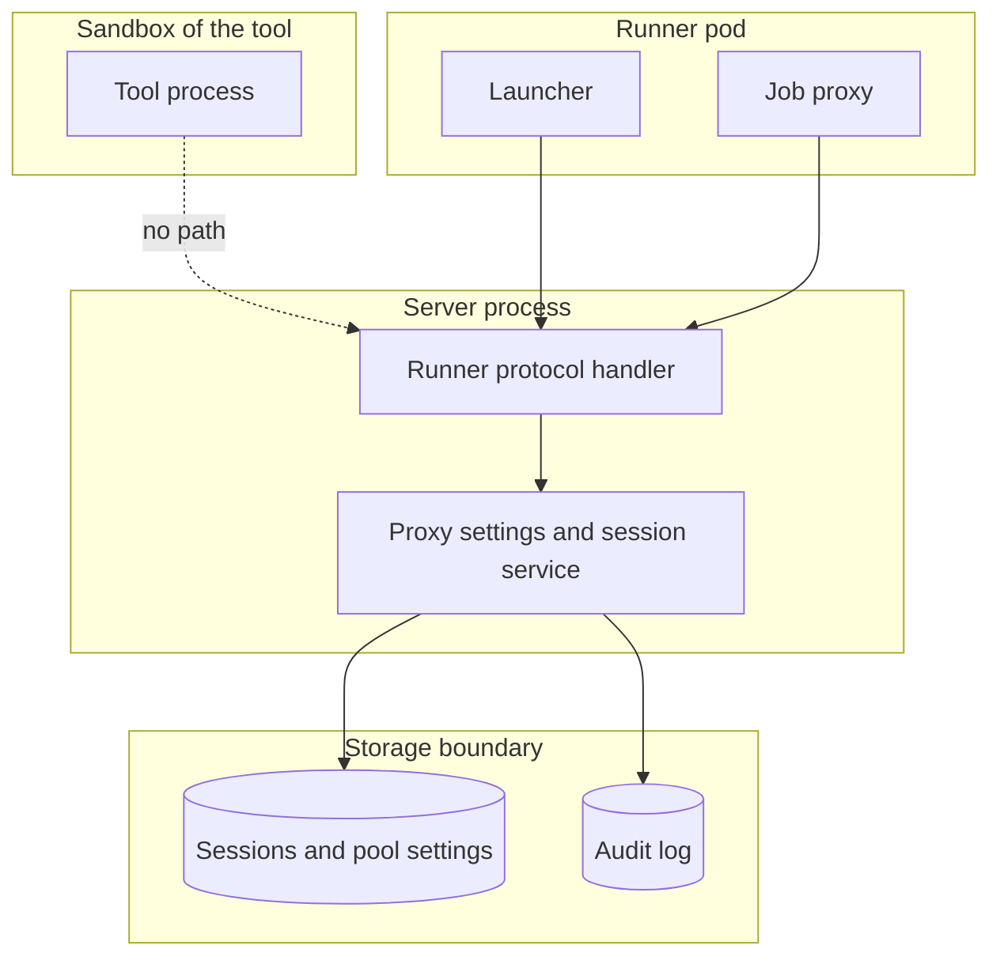

## Context

A job proxy runs next to the launcher of a phase. It needs the rules of its claim, the private ranges of its pool and, when the pool names one, the upstream proxy with its credential. The server gives these only through a proxy session: a second session of the same claim, with its own handoff token and its own key. The launcher session and the proxy session never read each other's paths. The pool settings are stored data with an effective value in the API.

## Decisions

1. **Two kinds of session, one claim.** A claim may have one launcher session and one proxy session. The kind is a column of `runner_handoff_tokens` and `runner_sessions`, set from the route, never from a body or a header. A handoff token and a session of kind `launcher` authenticate only the launcher paths. A handoff token and a session of kind `proxy` authenticate only the proxy paths. A wrong kind answers 403 with the reason `wrong-session-kind` and writes an audit entry.
2. **The proxy handoff copies the launcher handoff.** `POST /runner/v1/claims/{operation}/proxy-handoff` is a runner-key route with `runner:claim` on the pool. The server checks that the runner owns the live claim. The token starts with `dph_` like the launcher handoff token (`runner.HandoffTokenPrefix`); the kind column of the token row says which paths it opens. It lives 10 minutes (`runner.HandoffTokenTTL`), is used once, and the server keeps its SHA-256. A second token for a claim with no proxy session replaces the first.
3. **The proxy session copies the launcher session.** `POST /runner/v1/proxy/session` takes the proxy handoff token, the public key and the proof of the new key. In one transaction the server checks and uses the token, checks that the claim is live and stores the session. The session lives as long as the claim. A takeover or a retire ends it (`claim-lost`, `retired`).
4. **The proxy assignment is its own message.** The answer of the proxy session open holds the rendered joined rules of the unit of the claim (`jobproxy.Render` of `jobproxy.Join`, with the variables of the claim), the digest of the rendered rules, the server host for the tunnel rule, the allowed private ranges of the pool, and the upstream URL of the pool. It holds no secret. A rule whose template needs `inputs.` or `profile.` has no value before job start: the open fails with the fixed reason `rules-not-renderable` and the proxy never starts without rules (fail closed).
5. **The upstream credential has its own path.** `POST /runner/v1/proxy/session/upstream-credential` is a proxy-session-key route. The server unseals the credential with `secret.Service.Decrypt` under the scope (namespace, stable pool ID), which is a data key of the namespace as ADR 330 says ("The pool seals it with the data key of the namespace"; `secret.NewScope`, (read only) `pkg/secret/secret.go` line 86; `OpenKey`, (read only) `pkg/secret/secret.go` line 253), and returns it once for each call. The scope id is the stable pool ID, so the key is still "the data key of the namespace" of ADR 330 decision 8 ("The pool seals it with the data key of the namespace") and a credential of one pool does not unseal under another pool. It writes one audit entry for each call (a reveal). A launcher session cannot reach it. No other answer holds the credential. The upstream credential is never in an error text.
6. **The pool settings are one sub-resource.** One row for each pool in `runner_pool_proxy_settings`. A pool with no row has the default: no allowed range and no upstream proxy, with `source: "default"`. A save replaces the row and raises the version. The credential is write-only: a save with no `upstreamCredential` field keeps the stored one, and `"upstreamCredential": null` removes it. GET shows `credentialSet`.
7. **The assignment version stays 1.** The proxy assignment is read only by a proxy session, a path that no released launcher calls. `protocol.Assignment` gets no field. The first change that adds a proxy field to `Assignment` raises `runner.AssignmentVersion` (ADR 132 decision 7). That change must raise it before a runner starts a job proxy. Reading: ADR 330 decision 12 ("The proxy fields raise the assignment version") applies to a change that adds a proxy field to `Assignment`; this change adds none, and ADR 132 decision 7 raises the version only for a field that changes what a step does.
8. **No new action.** A proxy route declares `runner:claim` on the pool. The pool settings routes declare `namespace:read-runners` and `namespace:manage-runners`. The route test lists every action (Contract).
9. **The dials of the job proxy to the upstream proxy use (read only) `pkg/egress` too.** The save checks the upstream host literal against the never-opened addresses. The job proxy checks the resolved address when it opens the connection (`job-proxy-runtime-guard`). A private upstream address opens only inside the allowed ranges of the pool.

## Structure

The kind is an unexported-field type, so that a caller cannot make a session of no kind:

- `runner.SessionKind` is a string type with the two constants NEW `SessionKindLauncher` and NEW `SessionKindProxy` and the constructor `ParseSessionKind`. `HandoffToken` and `Session` get a `Kind` field that the store sets from the argument, never from the token text.
- NEW `runner.ProxySettings` has unexported fields and the constructor `NewProxySettings`, which checks the ranges (`egress.ParseAllowedRanges`) and the upstream URL. The store adapter takes only a value that the constructor made.
- `runner.PoolProxyStore` is a new small port: `ProxySettings` and `SetProxySettings`. The service in `internal/proxysessionsvc` uses it, together with `secret.Service`.
- The HTTP adapter holds one new scope pair, `ScopeProxyHandoffToken` and `ScopeProxySessionKey`. The route test rejects a route whose scope and path family differ.

The structure makes the bug class "a launcher token on a proxy path" impossible to write by accident: the scope of a route and the kind of a session are checked in one place, the wrapper of the route table.

## Risks

- A launcher or a tool in the sandbox reads the upstream credential.
- A proxy session of one claim reads the rules or the ranges of another claim.
- A proxy session lives after its claim ends.
- A pool range opens a never-opened address.
- The upstream URL or the credential leaks in an error text, a log line or an audit entry.
- A save of a bad range widens the reach of every job of a pool.
- A rule with a template that has no value renders to an empty host and allows too much.

## Layers (defense in depth)

| Layer | Guard | Hostile test |
| --- | --- | --- |
| port adapter | The store stores the kind with the token. `OpenSession` accepts a token only for its own kind. The pool settings store takes only a `ProxySettings` that the constructor made, and checks the fence in the transaction. | Open a launcher token as a proxy session and a proxy token as a launcher session straight on the port. Both fail with `ErrNotFound`. Write settings with a stale fence and fail with `namespace.ErrFenced`. |
| service | The service renders the rules for the claim of the session only. It fails closed on a template without a value. It unseals the credential only for a live proxy session. It seals under the scope of the pool. | Ask for the assignment of a session whose claim ended, and for the credential with a launcher session. Both fail and write an audit entry. Render a rule with an `inputs.` template and get `rules-not-renderable`. |
| HTTP handler | The wrapper checks the scope of the route, the kind of the session, the proof, the nonce and the size limit before the handler runs. The handler returns fixed reasons only. | Send a launcher session proof to each proxy path and a proxy session proof to each launcher path. Each answers 403 with `wrong-session-kind`. Send a body past the limit and a bad range. Each fails closed. |

## Diagrams



New imports of this change (each one allowed by the module rules):

- `internal/api/runnerapi` imports `internal/proxysessionsvc` (NEW)
- `internal/api/runnerpools` imports `internal/proxysessionsvc` (NEW)
- `internal/proxysessionsvc` imports (read only) `pkg/jobproxy` and its rule store package, (read only) `pkg/secret`, `pkg/runner`, (read only) `pkg/egress`

States of a proxy session:



## Quality attributes

| Attribute | Target | Unit | Scope |
| --- | --- | --- | --- |
| session open latency | 300 | ms p95 | POST proxy/session |
| settings read latency | 200 | ms p95 | GET proxy-settings |
| ranges in one save | 64 | count max | PUT proxy-settings |
| request size | 16 | KB max | PUT proxy-settings |

## Threat model



| Boundary | STRIDE | Threat | Layer | Guard | Hostile test |
| --- | --- | --- | --- | --- | --- |
| Runner protocol | S | A launcher session or a runner key calls a proxy path. | boundary check | Scope and kind are checked before the handler. | Send a launcher proof to `proxy/session/upstream-credential`. |
| Runner protocol | S | A proxy session of claim A reads the assignment of claim B. | authorize at point of use | The service reads the claim from the session, never from the request. | Send a request with the operation of claim B in the path. |
| Runner protocol | I | The upstream credential reaches a log, an error or the assignment. | encode or contain | Fixed reasons only. The audit entry holds no credential and no URL. | Make the unseal fail and check each text for the credential. |
| Runner protocol | E | A proxy session outlives its claim. | fail closed | Each request checks the claim. A takeover ends the session. | Use a session after the takeover and get `claim-lost`. |
| Runner protocol | D | A flood of proxy handoff requests. | limit | One token for one claim and the nonce store; the body limit. | Send a second token request and see the first replaced. |
| Pool settings | T | A range opens loopback, link-local or the metadata address. | boundary check | `egress.ParseAllowedRanges` and the minimum prefix. | Save `127.0.0.0/8`, `169.254.0.0/16`, `0.0.0.0/0`. Each fails. |
| Pool settings | T | A save without the grant widens a pool. | authorize at point of use | `namespace:manage-runners` on the namespace of the pool. | Save with read grant only. |
| Pool settings | R | A change of a setting has no record. | fail closed | The audit entry is in the same transaction as the write. | Make the audit write fail and see the save fail. |
| Pool settings | I | A reader of the pool reads the credential. | encode or contain | The credential is sealed in the row and absent from GET. | Read the response and the backup of the row. |
| Storage | T | A restored backup brings a session or a token back. | fail closed | Sessions and tokens are control data and are not in a backup. The settings row is in a backup with the credential sealed. | Restore and check that no proxy session exists. |

## Failure modes

| Step | Failure | Retry | State after |
| --- | --- | --- | --- |
| Proxy handoff | The claim is lost or the runner is not the owner. | None. The runner stops. | No token. |
| Session open | The token is used, expired or of another kind. | Ask for a new handoff token until the session wait limit. | No session. |
| Session open | The rules do not render. | Fix the rule. The reason is `rules-not-renderable`. | Token stays used; the phase fails. |
| Credential read | The unseal fails. | The proxy retries once and then fails the phase. | No credential in any text. |
| Save of settings | The audit write fails. | The caller sends the save again. | The old settings stay. |
| Save of settings | Concurrent saves with If-Match. | The second save gets 412. | The first save is current. |

## Contract

Go ports and types (no body):

```go
// pkg/runner
type SessionKind string

const (
	SessionKindLauncher SessionKind = "launcher"
	SessionKindProxy    SessionKind = "proxy"
)

func ParseSessionKind(s string) (SessionKind, error) // ErrInvalid

// HandoffToken and Session get: Kind SessionKind
// SessionStore changes (a kind argument, for each method that reads or writes a token or a session):
//   IssueHandoffToken(ctx, t HandoffToken, c durable.Claim) error      // t.Kind is required
//   OpenSession(ctx, sha256 string, kind SessionKind, k Key, now time.Time) (Session, error)
// Errors: ErrNotFound for a token of another kind, ErrClaimLost, ErrTokenUsed, ErrTokenExpired, ErrConflict (a session of this kind exists), ErrInvalid.

type ProxySettings struct{ /* unexported */ }

func NewProxySettings(ranges []string, upstreamURL string) (ProxySettings, error) // ErrInvalid
func (s ProxySettings) AllowedRanges() []string
func (s ProxySettings) UpstreamURL() string

type ProxySettingsRecord struct {
	Settings   ProxySettings
	Credential []byte // sealed; empty when none
	Version    int64
	UpdatedBy  string
	UpdatedAt  time.Time
}

type PoolProxyStore interface {
	// ProxySettings returns the record of the pool poolID, or ErrNotFound when the pool has no row.
	ProxySettings(ctx context.Context, poolID string) (ProxySettingsRecord, error)
	// SetProxySettings replaces the row when version is the stored version (0 for no row), checks the fence, and writes the audit entry in the same transaction.
	// Errors: ErrNotFound (no pool), ErrConflict (stale version), namespace.ErrFenced, ErrInvalid.
	SetProxySettings(ctx context.Context, f namespace.Fence, poolID string, rec ProxySettingsRecord, version int64, audit audit.Entry) (ProxySettingsRecord, error)
}
```

The conformance cases go in `pkg/runner/runnertest/runnertest.go` (the kind cases for `SessionStore`, and a new `RunPoolProxyStore`). The suite requires each sentinel above with its file and line when it lands.

Endpoints. Each error body is `{"code": "...", "message": "..."}` (runner protocol errors) or the REST error shape of the pool routes.

| Method and path | Scope | Action and object | Request | Success | Errors |
| --- | --- | --- | --- | --- | --- |
| `POST /runner/v1/claims/{operation}/proxy-handoff` | runner key | `runner:claim` on the pool | none (the operation is the path parameter; the claim token is the stored one) | 200 `{"handoffToken": "dph_...", "expiresAt": "<RFC 3339>"}` | 401 `bad-proof`, 403 `wrong-session-kind` or denied, 409 `claim-lost`, 404 `not-found` |
| `POST /runner/v1/proxy/session` | proxy handoff token | `runner:claim` on the pool of the runner | `{"handoffToken", "publicKey", "proof", "release"}` | 200 `{"session", "expiresAt", "lease", "assignment": {...}}` with the proxy assignment below | 401, 403 `wrong-session-kind`, 409 `claim-lost`, 410 token used or expired, 422 `rules-not-renderable` |
| `POST /runner/v1/proxy/session/upstream-credential` | proxy session key | `runner:claim` on the pool of the runner | none | 200 `{"username": "...", "password": "..."}` | 401, 403 `wrong-session-kind`, 404 `no-upstream`, 409 `claim-lost` |
| `GET /api/dustpan/v1/namespaces/{namespace}/runner-pools/{pool}/proxy-settings` | REST | `namespace:read-runners` on the namespace | none | 200 body below, ETag is the version | 401, 403, 404 |
| `PUT /api/dustpan/v1/namespaces/{namespace}/runner-pools/{pool}/proxy-settings` | REST | `namespace:manage-runners` on the namespace | body below, optional `If-Match` with the version | 200 body below | 400 `invalid-range` or `invalid-upstream`, 401, 403, 404, 412 stale version, 413, 415 |

Proxy assignment (the `assignment` field of the proxy session answer):

```json
{
  "namespace": "<name>",
  "unit": "<unit reference>",
  "operation": "plan",
  "rules": [{"scope": "namespace", "id": "...", "host": "...", "port": 443, "methods": ["GET"], "paths": ["/x/**"]}],
  "rulesDigest": "sha256:<hex>",
  "serverHost": "<host of this server>",
  "allowedRanges": ["10.0.0.0/8"],
  "upstreamURL": "http://proxy.example:3128"
}
```

Pool proxy settings (GET answer, PUT request and answer; the PUT request has no `source`, `updatedBy`, `updatedAt`, `credentialSet` or `version`):

```json
{
  "allowedRanges": ["10.0.0.0/8"],
  "upstreamURL": "http://proxy.example:3128",
  "upstreamCredential": {"username": "u", "password": "p"},
  "credentialSet": true,
  "source": "default",
  "version": 3,
  "updatedBy": "<principal ID>",
  "updatedAt": "<RFC 3339>"
}
```

`upstreamCredential` is write-only: it is in the PUT request only, absent keeps the stored value, `null` removes it. `source` is `default` or `set`. A pool with no row answers 200 with empty ranges, no URL, `credentialSet` false, `source` `default` and version 0.

Stored schema, in both dialects (edited in place in the baseline schema file of each dialect, in name order; timestamps are Unix milliseconds in BIGINT):

- `runner_handoff_tokens` and `runner_sessions`: new column `kind` TEXT NOT NULL (values `launcher`, `proxy`, with a CHECK). The unique key `(operation_id, token)` becomes `(operation_id, token, kind)`.
- NEW table `runner_pool_proxy_settings`: `pool_id` TEXT PRIMARY KEY, a foreign key to `runner_pools(id)` with ON DELETE CASCADE; `namespace_id` TEXT NOT NULL; `allowed_ranges` TEXT NOT NULL (a JSON array of CIDR strings); `upstream_url` TEXT NOT NULL (empty for none); `upstream_credential` BYTEA (PostgreSQL) or BLOB (SQLite), the sealed value, empty for none; `version` BIGINT NOT NULL; `updated_by` TEXT NOT NULL; `updated_at_ms` BIGINT NOT NULL; an index on `namespace_id`.

Audit events (added to `runner.AuditRules`):

| Event | Kind | Action | Holds |
| --- | --- | --- | --- |
| `pool-proxy-settings-changed` (NEW `runner.EventPoolProxySettingsChanged`) | change (`audit.KindChange`) | `namespace:manage-runners` | pool ID, old and new ranges, SHA-256 of the old and new upstream URL, `credentialChanged`, old and new version. Never the URL or the credential. |
| `proxy-session-opened` (NEW `runner.EventProxySessionOpened`) | change (`audit.KindChange`) | `runner:claim` | job, phase, unit ID, claim, rules digest, rule count, whether an upstream proxy is set |
| `proxy-credential-issued` (NEW `runner.EventProxyCredentialIssued`) | reveal (`audit.KindReveal`) | `runner:claim` | job, phase, claim, pool ID, session ID. Never the credential. |
| `handoff-refused` (existing `runner.EventHandoffRefused`) | change (`audit.KindChange`), outcome denied | `runner:claim` | reason `wrong-session-kind`, the path and the kind |
