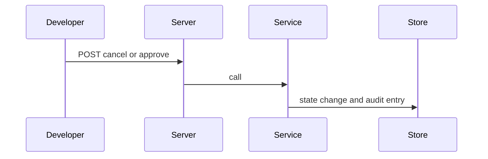
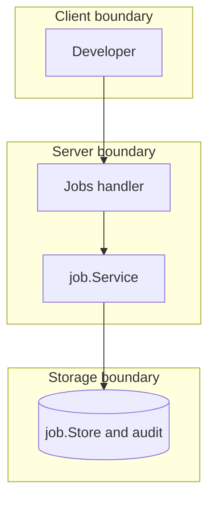

## Context

The service struct in pkg/job/service.go holds Start and Get. The five stubs return ErrUnsupported.

## Decisions

1. **Service owns state changes.** Handlers map the request to the service and translate sentinels to error codes. No handler writes the store.
2. **Approval binds to the plan revision.** The service compares the shown revision with the current one and refuses a stale approval.

## Structure

The service struct stays unexported and job.NewService stays the only constructor.

## Risks

- Approval lands on a stale plan.
- A log redaction leaves a secret across a chunk boundary.

## Layers (defense in depth)

| Layer | Guard | Hostile test |
| --- | --- | --- |
| authorize at point of use | Handler and service check the action on the unit. | Call each route without the action; each gives 403 with no change. |
| boundary check | Reject unknown fields, empty matches and oversize substitution lists. | Send an empty match; the answer is 400 and the log stays unchanged. |
| fail closed | Unknown job or store fault denies with no partial write. | Force a store fault during approve; no approval is recorded. |

## Diagrams

After this change:

## Quality attributes

| Attribute | Target | Unit | Scope |
| --- | --- | --- | --- |
| latency | 300 | ms | cancel and approve routes at p95 |

## Threat model

Data flow and trust boundaries:

| Boundary | STRIDE | Threat | Layer | Guard | Hostile test |
| --- | --- | --- | --- | --- | --- |
| API handler | E | A caller without the action cancels or approves a job, or sends a hostile id or match. | authorize at point of use | Check the action on the unit before the service call. | Call cancel and approve without the action; each gives 403. |
| API handler | E | A caller without the action cancels or approves a job, or sends a hostile id or match. | boundary check | Reject unknown fields and bad job ids. | Send a bad job id; the answer is 400. |
| API handler | E | A caller without the action cancels or approves a job, or sends a hostile id or match. | encode or contain | Treat each redact match as a literal string; the store uses placeholders only. | Send a match with regex and SQL metacharacters; only the literal text is replaced and no query changes. |
| API handler | E | A caller without the action cancels or approves a job, or sends a hostile id or match. | limit | Cap substitution count and match length. | Send an oversize list; the answer is 400. |
| API handler | E | A caller without the action cancels or approves a job, or sends a hostile id or match. | fail closed | Deny on store fault with no partial write. | Force a fault during redact; no change is stored. |

## Contracts

**job**

- Invariant: A final job state never moves to a non-final state.
- `Cancel`: pre: Job is not in a final state.. Post: Job is canceled and an audit entry exists..
- `Approve`: pre: Shown plan revision equals the current revision.. Post: Approval is recorded..

## Failure modes

| Step | Failure | Retry | State after |
| --- | --- | --- | --- |
| Cancel job | Two cancels race. | Read the job with the get route. | Job canceled with one audit entry. |
| Approve job | A new plan arrives first. | Read the new revision and approve again. | No approval for the stale revision. |
