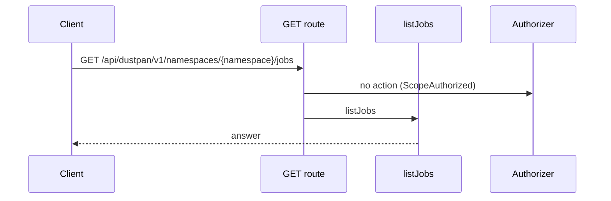
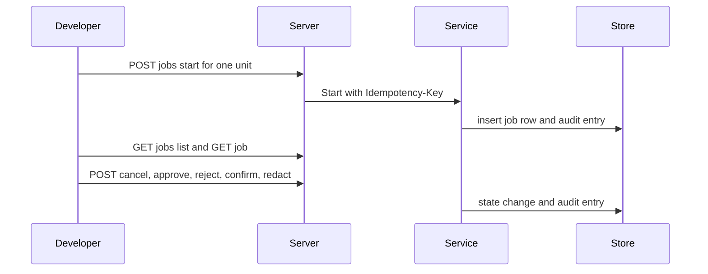
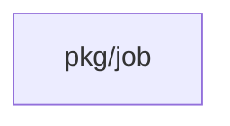
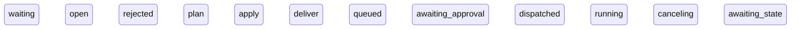
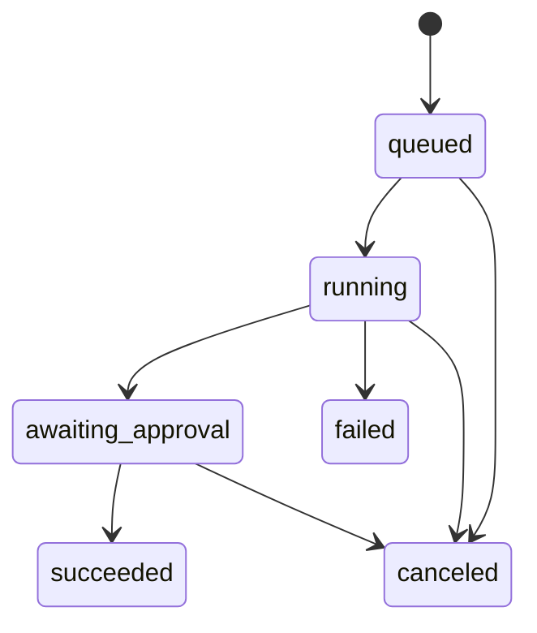
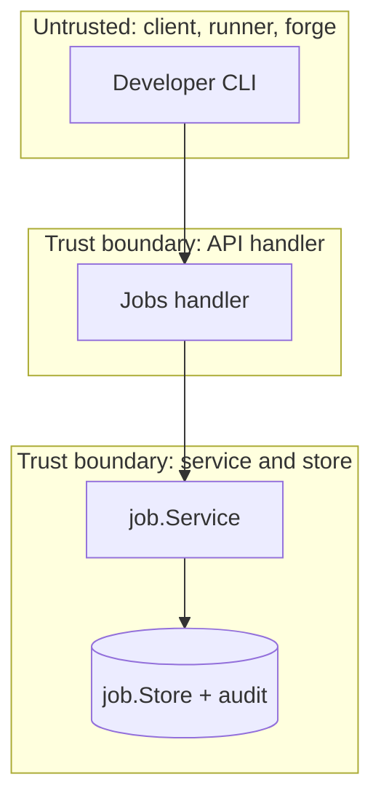

## Context

Job writes go through pkg/job service over job.Store with namespace fence checks. REST routes map to service calls. Audit entries record each state change with actor and reason.

## Decisions

1. **Service owns state changes.** Service owns state changes for start, list, get, cancel, approve, reject, confirm, and redact log. HTTP handlers map request fields to service inputs and translate domain sentinels to error codes. No handler writes the store directly.
2. **Break-glass flag in REST body.** Break-glass start carries a break-glass flag and reason in the REST body. The service still applies the namespace break-freeze rule. When the rule allows the start, the service starts the job and marks the audit entry as break-glass. When the rule blocks the start, the service refuses with 403 job.frozen.
3. **Plan binding and repeat calls.** Approve binds to the shown plan revision. The service compares the shown revision with the current revision and refuses a stale approval. Repeat starts with the same Idempotency-Key return the first job. A different body with a reused key is refused.

## Structure

Unexported job service struct with constructor job.NewService that checks Store, clock, and ID maker invariants; only the constructor makes a service value.

## Risks

- List route leaks jobs across units without unit scoping.
- Approve path binds approval to a stale plan.

## Layers (defense in depth)

| Layer | Guard | Hostile test |
| --- | --- | --- |
| authorize at point of use | Handler checks bearer access token, namespace scope, and action on the unit before the service runs. | Send start, cancel, approve, and redact requests without token, with a token of another namespace, and without the action; each gives 401 or 403 and writes no job row. |
| boundary check | Handler allows only known fields, unit reference shape, plan revision shape, and substitution list limits; service rejects empty matches and treats each match as a literal string. | Send unknown fields, oversize reason, empty match, and oversize substitution list; each gives 400 and leaves state unchanged. |
| encode or contain | Log redact replaces each literal match with a fixed marker and never returns plain secret values in list, get, timeline, or diff reads. | Plant a fake secret in a log, redact it, then read list, get, timeline, and diff; no read holds the plain value. |
| limit | List caps page size with a cursor, redact caps substitution count and match length, and start keys one row per Idempotency-Key per namespace and principal. | Send oversize page, oversize substitution list, and repeated starts with one key under load; the server caps output and makes one job. |
| fail closed | Unknown job, unknown version, failed store write, and failed audit write deny the request and keep the prior job state. | Request an unknown job and force a store fault during approve and redact; each gives 404 or 503 with no partial write. |

## Diagrams

Today: `GET /api/dustpan/v1/namespaces/{namespace}/jobs` on main (from the route table and the handler body, route row internal/api/jobs/routes.go:128, handler internal/api/jobs/list.go:271).

After this change:

Modules that the change touches, and their imports on main:

States on main in the touched packages:

States and transitions after this change:

## Quality attributes

| Attribute | Target | Unit | Scope |
| --- | --- | --- | --- |
| availability | 99.9 | percent | job start, cancel, approve, and redact routes |
| latency | 300 | ms | job list and get routes at p95 |
| correctness | 1 | job row per key | repeat start with one Idempotency-Key |

## Threat model

Data flow and trust boundaries:

| Boundary | STRIDE | Threat | Layer | Guard | Hostile test |
| --- | --- | --- | --- | --- | --- |
| API handler | S | A caller forges another principal or namespace and starts, cancels, or approves a job. | authorize at point of use | Check bearer access token, namespace scope, and unit action before the service call. | Replay start without token and with a token of another namespace; each gives 401 or 403. |
| API handler | S | A caller forges another principal or namespace and starts, cancels, or approves a job. | boundary check | Reject unknown fields, oversize body, and bad unit reference shape. | Send oversize reason and hostile unit name; each gives 400 with no write. |
| API handler | S | A caller forges another principal or namespace and starts, cancels, or approves a job. | encode or contain | Return masked plan diff and timeline with no plain secret values. | Plant a fake secret in a plan and read get, timeline, and diff; no read holds the plain value. |
| API handler | S | A caller forges another principal or namespace and starts, cancels, or approves a job. | limit | Cap list page size and redact substitution count; enforce one row per Idempotency-Key. | Request a huge page and repeat starts with one key; the server caps output and makes one job. |
| API handler | S | A caller forges another principal or namespace and starts, cancels, or approves a job. | fail closed | Deny on unknown job or store fault with no partial write. | Approve an unknown job and force a fault during start; each denies safely with no partial row. |
| API handler | D | A caller floods list or redact inputs and skews job state. | authorize at point of use | Check read, run, approve, and manage actions per route and object before the service call. | Call cancel, approve, and redact without the action; each gives 403 with no state change. |
| API handler | D | A caller floods list or redact inputs and skews job state. | boundary check | Reject unknown fields, bad job id shape, and oversize substitution list. | Send bad job id and oversize substitution list; each gives 400 with no write. |
| API handler | D | A caller floods list or redact inputs and skews job state. | encode or contain | Replace redact matches with a fixed marker and never echo plain secrets in errors. | Redact a fake secret then trigger a validation error; the error holds no plain value. |
| API handler | D | A caller floods list or redact inputs and skews job state. | limit | Cap page size with a cursor and cap substitution count and match length. | Request a huge page and an oversize redact list; the server caps the page and refuses the redact list. |
| API handler | D | A caller floods list or redact inputs and skews job state. | fail closed | Deny on unknown job, unknown log version, or store fault with no partial write. | Redact an unknown version and force a fault during redact; each denies safely. |
| service and store | I | A reader learns a secret from a log, timeline, or plan diff, or an approval lands on a stale plan. | authorize at point of use | Check the caller action at the service point of use for the unit of the job. | Call the service redact and approve paths with a principal without the action; each is refused. |
| service and store | I | A reader learns a secret from a log, timeline, or plan diff, or an approval lands on a stale plan. | boundary check | Validate plan revision shape, log version name, and literal substitution patterns at the service. | Pass a hostile revision and an empty match to the service; each is refused with no write. |
| service and store | I | A reader learns a secret from a log, timeline, or plan diff, or an approval lands on a stale plan. | encode or contain | Mask secret values in timeline and plan diff; redact replaces matches with a fixed marker. | Plant a fake secret in a log and read timeline and diff; no read holds the plain value. |
| service and store | I | A reader learns a secret from a log, timeline, or plan diff, or an approval lands on a stale plan. | limit | Bound diff size and redact work per call with substitution and match limits. | Request a diff over a large plan and an oversize redact list; the server bounds the diff and refuses the list. |
| service and store | I | A reader learns a secret from a log, timeline, or plan diff, or an approval lands on a stale plan. | fail closed | Bind approval to the shown plan revision and refuse stale approvals. | Approve an old revision after a new plan; the server refuses with 409. |

## Contracts

**job**

- Invariant: One job belongs to one namespace and one unit.
- Invariant: A final job state never moves to a non-final state.
- Invariant: Each approval binds to one plan revision.
- `Start`: pre: Caller holds unit run action.; No active freeze blocks the start.. Post: A queued job exists for the unit.; An audit entry records actor and reason..
- `Cancel`: pre: Caller holds unit run action.; Job is not in a final state.. Post: Job moves to canceled.; An audit entry records actor and reason..
- `Approve`: pre: Caller holds unit approve action.; Shown plan revision equals current plan revision.. Post: Approval records actor, time, and plan revision.; An audit entry records actor and reason..

## Failure modes

| Step | Failure | Retry | State after |
| --- | --- | --- | --- |
| Start job | Store write fails during start. | Client repeats POST with the same Idempotency-Key; server returns the first job when it exists else repeats the request. | No job row, or one job row for the key. |
| Cancel job | Two cancels race on one queued job. | Second cancel reads the job with GET job route and sees canceled. | Job canceled with one audit entry. |
| Approve job | Approve arrives after a new plan revision. | Client reads the new revision with GET job route and approves again. | No approval recorded for the stale revision. |
