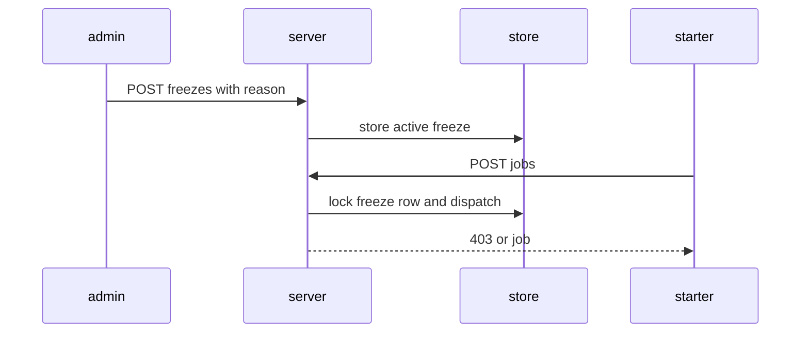
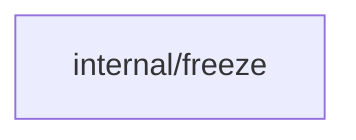
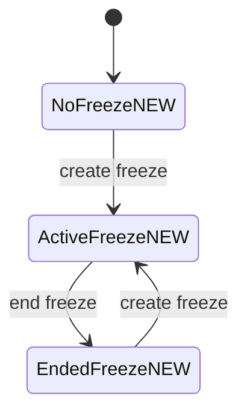
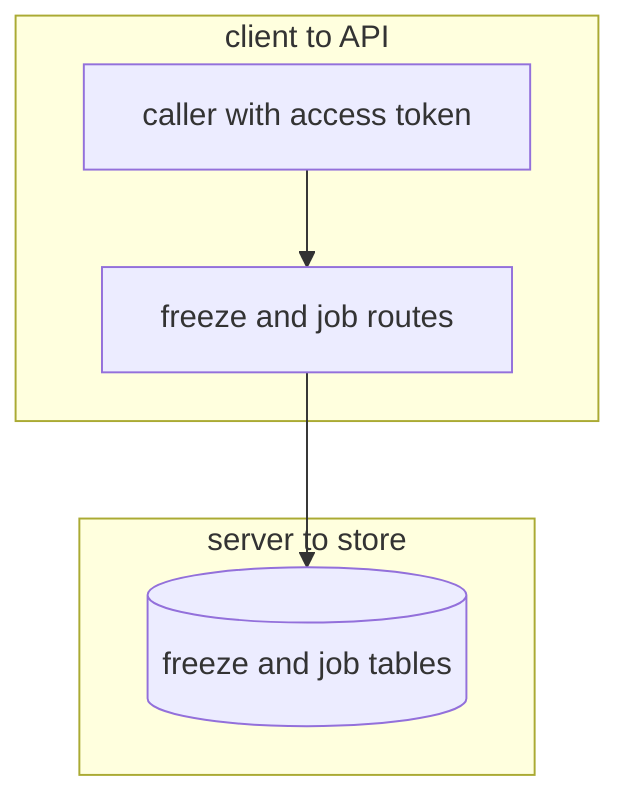

## Context

Job start and other mutating job actions must stop while a namespace freeze is active. Freeze needs create, end, and list routes. Break-glass start during a freeze needs the namespace break-freeze action with a reason.

## Decisions

1. **Freeze as namespace record keyed by stable ID.** Freeze is stored per namespace ID with creator subject ID, reason of 1 to 500 characters, start time, and end record. Job start and dispatch read the active freeze with SELECT FOR UPDATE on PostgreSQL and an equivalent locked read in the same transaction as dispatch on SQLite, so a freeze made between check and dispatch still stops the start on both stores.
2. **Single active freeze per namespace.** Only one active freeze exists per namespace, enforced by a unique partial index on namespace ID where ended time is null. A second create is refused with 409, and an end with no active freeze is refused with 404.

## Structure

Unexported freeze gate type with constructor NewFreezeGate that loads the active freeze for the namespace ID in the start transaction; only the constructor builds the gate, and job start calls Allow before dispatch.

## Risks

- A caller bypasses the route and calls job start directly during a freeze.
- Two ends of one freeze interleave and leave the freeze state unclear.

## Layers (defense in depth)

| Layer | Guard | Hostile test |
| --- | --- | --- |
| API authorization and input check | Route requires the namespace freeze manage action on the namespace for create and end, and the namespace read action on the namespace for list. Reason longer than 500 characters or empty is refused with 400. | Call create, end, and list with a principal that holds no grant and check that each route answers 403 and changes nothing. Send a reason of 501 characters and an empty reason and check that create answers 400. |
| Service guard | Job start and dispatch service checks the active freeze under lock in the same transaction as dispatch and refuses start, cancel, and phase dispatch while a freeze is active unless the caller holds namespace break-freeze on the namespace with a reason of 1 to 500 characters in the break_freeze_reason field. | Start and cancel a job during an active freeze with and without break-freeze, and create a freeze between check and dispatch, and check that only the break-freeze caller starts. |

## Diagrams

After this change:

Modules that the change touches, and their imports on main:

New imports of this change (each one allowed by the module rules):

- `internal/api/runnerapi` imports `internal/freeze`
- `internal/api/route` imports `internal/freeze`

States and transitions after this change:

## Quality attributes

| Attribute | Target | Unit | Scope |
| --- | --- | --- | --- |
| correctness | 400 | status code | freeze create with reason longer than 500 characters |
| correctness | 409 | status code | second freeze create during active freeze |
| reliability | 0 starts without break-freeze | jobs | job start refused during active freeze |

## Threat model

Data flow and trust boundaries:

| Boundary | STRIDE | Threat | Layer | Guard | Hostile test |
| --- | --- | --- | --- | --- | --- |
| client to API | S | A caller without the freeze action creates or ends a freeze, or starts a job during a freeze | authorize at point of use | Route checks freeze manage, break-freeze, and read actions at the point of use | Replay create, end, break-glass start, and list as a caller with no grant and check 403 with no state change |
| client to API | S | A caller without the freeze action creates or ends a freeze, or starts a job during a freeze | boundary check | Reason length 1 to 500 checked at the boundary; overlong or empty input refused with 400 | Send 501-character and empty reasons to create and break-glass start and check 400 with no write |
| client to API | S | A caller without the freeze action creates or ends a freeze, or starts a job during a freeze | encode or contain | Reason is stored as text and returned as JSON text with encoding at render, never run | Store HTML and script text in a reason and check the list read returns it encoded with no execution |
| client to API | S | A caller without the freeze action creates or ends a freeze, or starts a job during a freeze | limit | Reason capped at 500 characters and list capped by page limit | Send a 1 MB reason and a list with a large limit and check 400 and capped pages |
| client to API | S | A caller without the freeze action creates or ends a freeze, or starts a job during a freeze | fail closed | Second create refused with 409 and unknown end refused with 404 | Create twice and end with none active and check status codes and unchanged state |
| server to store | T | A freeze write races a job start or a second freeze write and leaves two active freezes or a missed guard | boundary check | Freeze ID and namespace ID validated against allowlist of known namespaces at the boundary; unknown namespace refused with 404 | Send create and list with unknown and malformed namespace IDs and check 404 with no write |
| server to store | T | A freeze write races a job start or a second freeze write and leaves two active freezes or a missed guard | authorize at point of use | Freeze read and job dispatch run in one transaction with a locked read so a freeze made between check and dispatch still refuses start | Insert a freeze between the guard read and dispatch in a test double and check that start is refused |
| server to store | T | A freeze write races a job start or a second freeze write and leaves two active freezes or a missed guard | encode or contain | Freeze rows bound to namespace ID by placeholder query; no string-built SQL | Send a namespace ID with SQL text and check it matches no row and changes nothing |
| server to store | T | A freeze write races a job start or a second freeze write and leaves two active freezes or a missed guard | limit | Single active freeze per namespace ID enforced by a unique partial index with bounded retry on conflict | Insert two concurrent creates and check that one gets 409 and only one active row remains |
| server to store | T | A freeze write races a job start or a second freeze write and leaves two active freezes or a missed guard | fail closed | Race loser fails closed with 409 and dispatch loser fails closed with 403 | Race two creates and race a start with a concurrent freeze and check one 409, one 403, and a single active freeze |

## Contracts

**freeze**

- Invariant: One active freeze at most per namespace ID
- Invariant: Reason holds 1 to 500 characters
- Invariant: Creator and actor are stored as stable principal subject IDs, not names
- Invariant: End records end time and actor subject
- `Create freeze`: pre: No active freeze for the namespace ID; Reason holds 1 to 500 characters. Post: Active freeze stored for the namespace ID with creator subject, reason, and time.
- `End active freeze`: pre: Active freeze exists for the namespace ID. Post: Active freeze marked ended with end time and actor subject.
- `Refuse job start during freeze`: pre: Active freeze read under lock in the same transaction as dispatch. Post: Job start refused during active freeze without break-freeze; Break-glass start recorded with reason and starter subject.
- `List freezes`: pre: Namespace exists. Post: Active freeze and ended freezes returned in time order with reason, creator subject, and times.

## Failure modes

| Step | Failure | Retry | State after |
| --- | --- | --- | --- |
| Create freeze | Two creates race on one namespace | Retry returns 409 for the loser; keep the first freeze | One active freeze |
| Job start | Freeze created between check and dispatch | Start is refused; starter lists freezes and retries after end | No job started |
| End freeze | Two ends race on one freeze | Second end returns 404; no change | One ended freeze |
