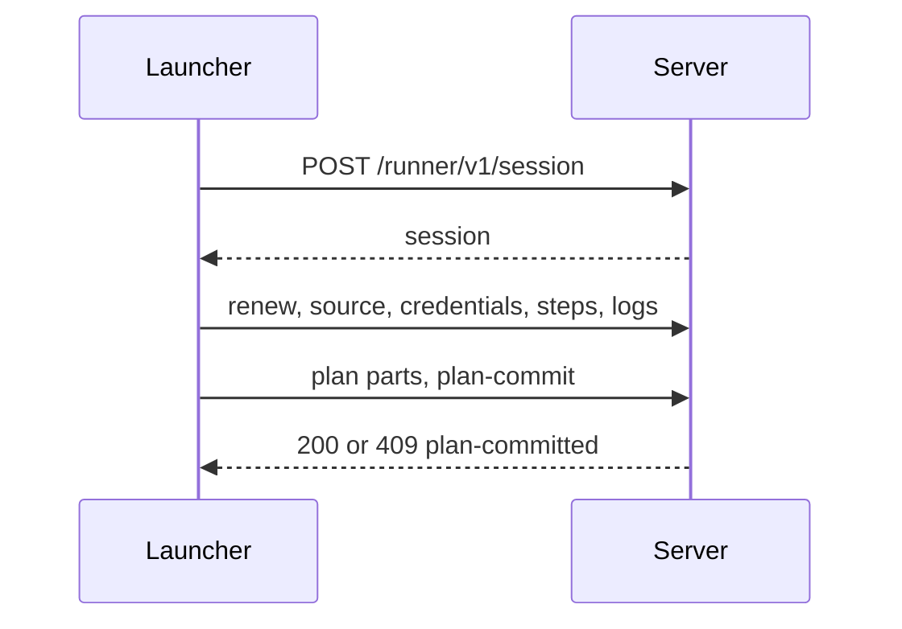
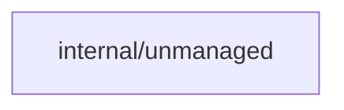
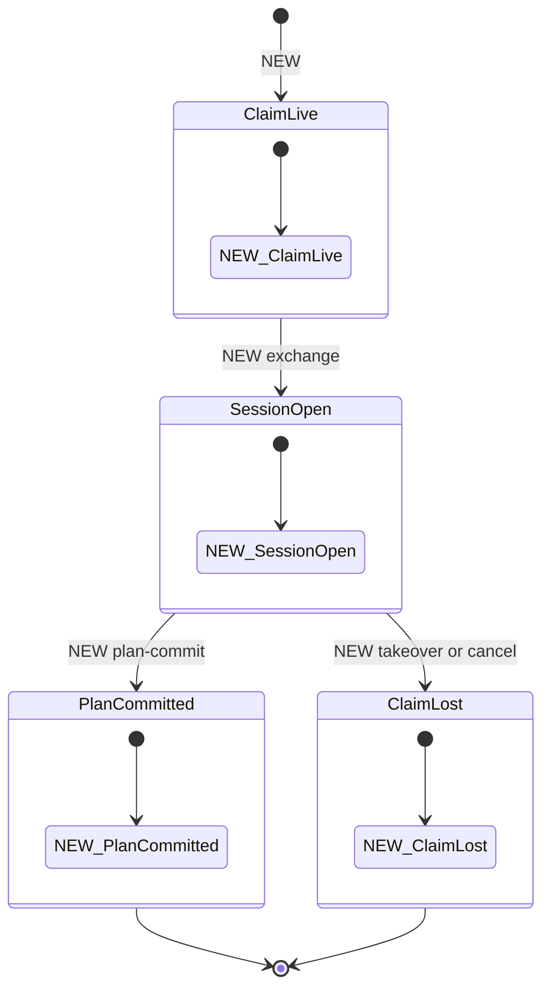
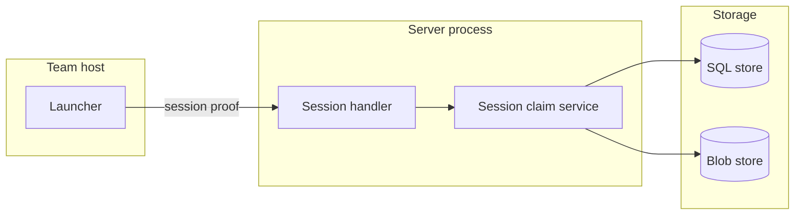

## Context

The session surface for job phases. Sweep report and finish stay in other parts.

## Decisions

1. **One checked session claim.** An unexported sessionClaim is made only by newSessionClaim, which checks the proof, the live claim and the job purpose of the pool.
2. **Fence on each write.** Each write checks the claim again in its own transaction.
3. **Chunk bytes keyed by claim and sequence.** The blob key holds the claim and the sequence, so a lost-claim launcher cannot overwrite a counted chunk of a new claim. The counter moves after the bytes.
4. **One plan commit.** The commit stores the plan hash. A second commit answers 409 plan-committed.

## Structure

Unexported type sessionClaim, made only by newSessionClaim.

## Risks

- A refused chunk must keep no bytes in the count.
- A second plan commit must not replace the first.
- A re-upload of a part number replaces the part and does not count against the 8 parts.

## Layers (defense in depth)

| Layer | Guard | Hostile test |
| --- | --- | --- |
| HTTP handler | The proof check accepts only the session key on session paths. | TestSessionRejectsRunnerKey |
| Service | newSessionClaim checks the live claim and job purpose on each write. | TestSessionWriteAfterTakeover |
| Store adapter | The transaction checks the fence, the sequence and the caps. | TestPlanCommitTwice |

## Diagrams

After this change:

Modules that the change touches, and their imports on main:

New imports of this change (each one allowed by the module rules):

- `internal/api/runnerapi` imports `pkg/runner`
- `internal/api/runnerapi` imports `pkg/job`
- `internal/api/runnerapi` imports `pkg/identity`

States on main in the touched packages:

States and transitions after this change:

## Quality attributes

| Attribute | Target | Unit | Scope |
| --- | --- | --- | --- |
| Log chunk size cap | 1 | MiB per chunk | session logs path |
| Plan part cap | 256 | MiB per part, at most 8 parts | one session |
| JSON body cap | 4 | MiB | each JSON request on a session path |

## Threat model

Data flow and trust boundaries:

| Boundary | STRIDE | Threat | Layer | Guard | Hostile test |
| --- | --- | --- | --- | --- | --- |
| Team host to server | S | A caller forges or replays a session proof, or signs with a runner key. | boundary check | The handler accepts only the session key and a fresh nonce. | TestSessionRejectsRunnerKey |
| Team host to server | S | A caller forges or replays a session proof, or signs with a runner key. | encode or contain | Token and proof text never enter a log line. | TestSessionProofCanary |
| Team host to server | S | A caller forges or replays a session proof, or signs with a runner key. | limit | Failed proofs count against a window. | TestSessionProofFailureWindow |
| Team host to server | S | A caller forges or replays a session proof, or signs with a runner key. | authorize at point of use | newSessionClaim checks the live claim on each write. | TestSessionWriteAfterTakeover |
| Team host to server | S | A caller forges or replays a session proof, or signs with a runner key. | fail closed | An unknown key kind answers 401 and writes an audit entry. | TestSessionUnknownKeyKindDenied |
| Team host to server | T | A chunk body changes in transit or a part passes its cap. | boundary check | The server compares the body hash after the stream. | TestLogChunkWrongHash |
| Team host to server | T | A chunk body changes in transit or a part passes its cap. | encode or contain | The blob key is built from IDs and numbers only. | TestLogKeyNoPathInput |
| Team host to server | T | A chunk body changes in transit or a part passes its cap. | limit | Chunk, part and session caps refuse the excess. | TestPlanPartAboveCap |
| Team host to server | T | A chunk body changes in transit or a part passes its cap. | authorize at point of use | The write checks the claim in its transaction. | TestLogChunkAfterTakeover |
| Team host to server | T | A chunk body changes in transit or a part passes its cap. | fail closed | A hash mismatch keeps no bytes. | TestLogChunkOutOfOrderKeepsNothing |
| Server to storage | E | A launcher of a lost claim or a sweep pool writes data. | boundary check | The pool purpose is read from the pool, not from the request. | TestSessionRefusesSweepPoolClaim |
| Server to storage | E | A launcher of a lost claim or a sweep pool writes data. | encode or contain | The blob key holds the claim. | TestLogKeyHoldsClaim |
| Server to storage | E | A launcher of a lost claim or a sweep pool writes data. | limit | The session holds a bounded lease. | TestSessionLeaseBound |
| Server to storage | E | A launcher of a lost claim or a sweep pool writes data. | authorize at point of use | newSessionClaim checks the live claim and purpose. | TestSessionWriteAfterTakeover |
| Server to storage | E | A launcher of a lost claim or a sweep pool writes data. | fail closed | A lost claim answers claim-lost and stores nothing. | TestClaimLostStoresNothing |
| Team host to server | R | A launcher denies a second plan commit or a credentials issue. | boundary check | The commit names the plan hash. | TestPlanCommitHashChecked |
| Team host to server | R | A launcher denies a second plan commit or a credentials issue. | encode or contain | The audit entry holds IDs, never the token. | TestCredentialsAuditNoToken |
| Team host to server | R | A launcher denies a second plan commit or a credentials issue. | limit | One commit for each phase. | TestPlanCommitTwice |
| Team host to server | R | A launcher denies a second plan commit or a credentials issue. | authorize at point of use | The commit checks the live claim. | TestPlanCommitAfterTakeover |
| Team host to server | R | A launcher denies a second plan commit or a credentials issue. | fail closed | The second commit answers 409 and changes nothing. | TestPlanCommitTwice |
| Server to storage | I | The job token text leaks in a log or an error. | boundary check | The credentials path needs a live session proof. | TestCredentialsNeedsSession |
| Server to storage | I | The job token text leaks in a log or an error. | encode or contain | Token text never enters a log line or error text. | TestCredentialsTokenCanary |
| Server to storage | I | The job token text leaks in a log or an error. | limit | The token expires with the claim. | TestCredentialsTokenExpiry |
| Server to storage | I | The job token text leaks in a log or an error. | authorize at point of use | The token is limited to the unit of the job. | TestCredentialsTokenOtherUnit |
| Server to storage | I | The job token text leaks in a log or an error. | fail closed | With no issuer the path answers 503 and no token. | TestCredentialsNoIssuer |
| Team host to server | D | A launcher floods chunks or parts to fill storage. | boundary check | Size is checked while the body streams. | TestLogChunkStreamCap |
| Team host to server | D | A launcher floods chunks or parts to fill storage. | encode or contain | A refused upload removes its blob. | TestRefusedUploadRemovesBlob |
| Team host to server | D | A launcher floods chunks or parts to fill storage. | limit | Per-step and per-phase caps in the transaction. | TestLogCapsPerStepAndPhase |
| Team host to server | D | A launcher floods chunks or parts to fill storage. | authorize at point of use | Each write checks the live claim. | TestFloodAfterTakeover |
| Team host to server | D | A launcher floods chunks or parts to fill storage. | fail closed | A cap breach answers invalid and stores nothing. | TestCapBreachStoresNothing |

## Failure modes

| Step | Failure | Retry | State after |
| --- | --- | --- | --- |
| Session exchange | The handoff token is used twice or the claim is gone. | The launcher stops; the runner takes a new claim. | One session at most. |
| Log chunk write | The server stops after the bytes and before the counter. | The launcher sends the same chunk; the bytes are overwritten. | The chunk is counted once. |
| Plan part upload | The claim is lost after a part is stored and before the commit. | The new claim plans again. | The uncommitted part is not referenced; orphan cleanup removes it. |
| Plan commit | A second commit arrives, or the first answer is lost. | The launcher repeats once and gets 409 plan-committed. | The first commit stands. |
