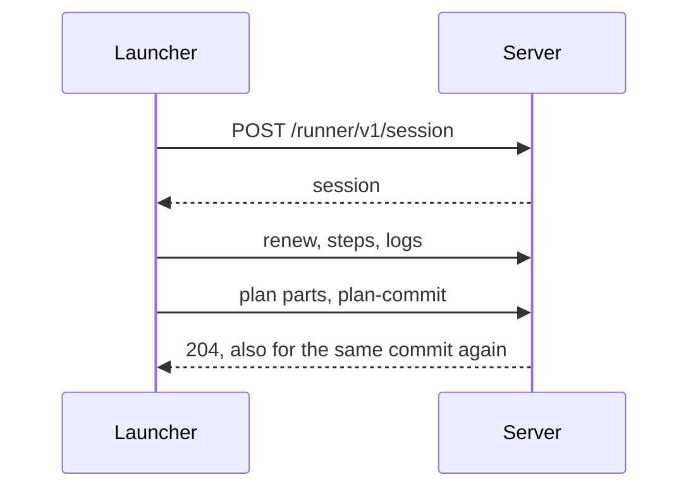
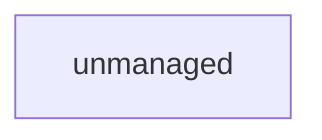
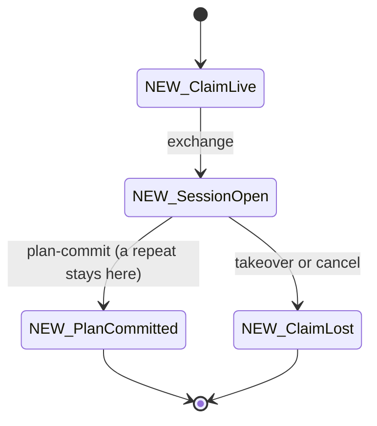
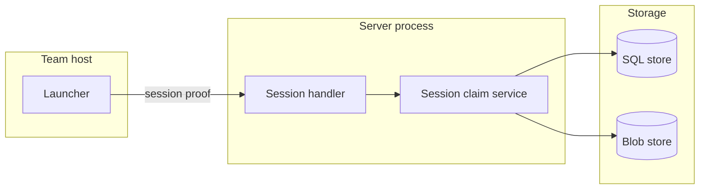

## Context

The session surface for job phases. Sweep report and finish stay in other parts. The source paths wait for the source pipeline and are not part of this change.

## Decisions

1. **One checked session claim.** An unexported sessionClaim is made only by newSessionClaim, which checks the proof, the live claim and the job purpose of the pool.
2. **Fence on each write.** Each write checks the claim again in its own transaction.
3. **Chunk bytes keyed by claim and sequence.** The blob key holds the claim and the sequence, so a lost-claim launcher cannot overwrite a counted chunk of a new claim. The counter moves after the bytes.
4. **Plan commit as ADR 131 decides.** Main keeps this rule and the change does not alter it: a commit with the same parts and hashes under the same claim answers 204 and changes nothing. A commit with other parts after a commit answers `conflict`.
5. **Phase caps in the chunk transaction.** The reserve step of a log chunk checks the chunk count and the byte count of the step and of the phase, with the limits of pkg/runner/protocol/protocol.go:156-162. A breach answers invalid and keeps no bytes.

## Structure

Unexported type sessionClaim, made only by newSessionClaim.

## Contract

No new route and no new error code. The routes of the plan paths are on main (`planRoutes`, internal/api/runnerapi/plan.go:22-47). The source paths are not part of this change.

| Limit | Constant | Answer on a breach |
| --- | --- | --- |
| Chunks of one step | protocol.MaxLogChunksPerStep (20,000) | 400 invalid. Main checks it already. |
| Bytes of one step | protocol.MaxLogBytesPerStep (256 MiB) | 400 invalid. NEW server check. |
| Chunks of one phase | protocol.MaxLogChunksPerPhase (100,000) | 400 invalid. NEW server check. |
| Bytes of one phase | protocol.MaxLogBytesPerPhase (1 GiB) | 400 invalid. NEW server check. |
| One plan part | job.MaxPlanPart (256 MiB) | 400 invalid. Main checks it already. |
| Parts of one commit | protocol.MaxPlanParts (8) | 400 invalid. Main checks it already. |

Error codes: the codes of pkg/runner/protocol/protocol.go (invalid 400, bad-proof 401, claim-lost 409, conflict 409). The caps answer 400 invalid.

Stored data: the count of chunks and bytes of each phase, kept with the log counters that the recorder already stores. The schema work, if any, stays in the store of the job recorder (job.DurableRecorder.AppendLog).

## Risks

- A refused chunk must keep no bytes in the count.
- A commit with other parts must not replace the stored plan (main answers conflict).
- A re-upload of a part number replaces the part and does not count against the 8 parts.

## Layers (defense in depth)

| Layer | Guard | Hostile test |
| --- | --- | --- |
| HTTP handler | The proof check accepts only the session key on session paths. | TestSessionHostileRunnerKeyOnLogAndStep |
| Service | newSessionClaim checks the live claim and job purpose on each write. | TestSessionHostileTakeoverDuringLogWrite |
| Store adapter | The transaction checks the fence, the sequence and the caps. | TestLogPhaseCapStoresNothing |

## Diagrams

After this change:

Modules that the change touches, and their imports on main:

New imports of this change (each one allowed by the module rules):

- `internal/api/runnerapi` imports `pkg/runner`
- `internal/api/runnerapi` imports (read only) `pkg/job`
- `internal/api/runnerapi` imports (read only) `pkg/identity`
- `internal/store/jobstore` imports nothing new: `job.LogCaps` lives in `pkg/job`. `pkg/runner/protocol` gets no import of `pkg/job`, so the launcher and the public SDK do not link the job domain.

Audit of refusals: a log cap refusal is a domain refusal that a caller can repeat, so it writes its audit entry through the shared denial limiter (ADR 382 decision 3; ADR 250 decision 3). This change adds no refusal of the sweep purpose in the pool admin API.

States on main in the touched packages:

States and transitions after this change:

## Quality attributes

| Attribute | Target | Unit | Scope |
| --- | --- | --- | --- |
| Log chunk size cap | 1 | MiB per chunk | session logs path |
| Plan part cap | 256 | MiB per part, at most 8 parts | one session |
| JSON body cap | 4 | MiB | each JSON request on a session path |

## Threat model

Data flow and trust boundaries:

| Boundary | STRIDE | Threat | Layer | Guard | Hostile test |
| --- | --- | --- | --- | --- | --- |
| Team host to server | S | A caller forges or replays a session proof, or signs with a runner key. | boundary check | The handler accepts only the session key and a fresh nonce. | TestSessionHostileRunnerKeyOnLogAndStep |
| Team host to server | S | A caller forges or replays a session proof, or signs with a runner key. | authorize at point of use | newSessionClaim checks the live claim on each write. | TestSessionHostileTakeoverDuringLogWrite |
| Team host to server | T | A chunk body changes in transit or a part passes its cap. | boundary check | The server compares the body hash after the stream. | TestLogChunkHashIsChecked |
| Team host to server | T | A chunk body changes in transit or a part passes its cap. | encode or contain | The blob key is built from IDs and numbers only. | TestChunkBlobKey |
| Team host to server | T | A chunk body changes in transit or a part passes its cap. | limit | Chunk, part and session caps refuse the excess. | TestLogStepChunkCapStoresNothing, TestPlanCommitIsChecked |
| Team host to server | T | A chunk body changes in transit or a part passes its cap. | authorize at point of use | The write checks the claim in its transaction. | TestSessionHostileTakeoverDuringLogWrite |
| Team host to server | T | A chunk body changes in transit or a part passes its cap. | fail closed | A hash mismatch keeps no bytes. | TestLogRefusalKeepsItsMessage |
| Server to storage | E | A launcher of a lost claim or a sweep pool writes data. | boundary check | The pool purpose is read from the pool, not from the request. | TestSessionHostileNamespaceSweepPool |
| Server to storage | E | A launcher of a lost claim or a sweep pool writes data. | encode or contain | The blob key holds the claim. | TestChunkBlobKey |
| Server to storage | E | A launcher of a lost claim or a sweep pool writes data. | limit | The session holds a bounded lease. | TestSessionRenewIsRefusedAfterTheCancelBound |
| Server to storage | E | A launcher of a lost claim or a sweep pool writes data. | authorize at point of use | newSessionClaim checks the live claim and purpose. | TestSessionHostileTakeoverDuringLogWrite |
| Server to storage | E | A launcher of a lost claim or a sweep pool writes data. | fail closed | A lost claim answers claim-lost and stores nothing. | TestStepWriteWithALostClaim |
| Team host to server | R | A launcher denies a plan commit or sends another one. | boundary check | The commit names the plan hash. | TestPlanCommitIsChecked |
| Team host to server | R | A launcher denies a plan commit or sends another one. | encode or contain | The audit entry holds IDs, never the token. | TestSessionCredentialsIssueEntry |
| Team host to server | R | A launcher denies a plan commit or sends another one. | limit | One plan for each phase: other parts answer conflict. | TestSessionHostilePlanCommitOtherParts |
| Team host to server | R | A launcher denies a plan commit or sends another one. | authorize at point of use | The commit checks the live claim. | TestPlanRoutesWithALostClaim |
| Team host to server | R | A launcher denies a plan commit or sends another one. | fail closed | A commit with other parts answers conflict and changes nothing. | TestSessionHostilePlanCommitOtherParts |
| Team host to server | D | A launcher floods chunks or parts to fill storage. | limit | Per-step and per-phase chunk and byte caps in the transaction. | TestLogPhaseCapStoresNothing, TestLogStepChunkCapStoresNothing |
| Team host to server | D | A launcher floods chunks or parts to fill storage. | authorize at point of use | Each write checks the live claim. | TestSessionHostileTakeoverDuringLogWrite |
| Team host to server | D | A launcher floods chunks or parts to fill storage. | fail closed | A cap breach answers invalid and stores nothing. | TestLogStepChunkCapStoresNothing, TestLogPhaseCapStoresNothing |

## Failure modes

| Step | Failure | Retry | State after |
| --- | --- | --- | --- |
| Session exchange | The handoff token is used twice or the claim is gone. | The launcher stops; the runner takes a new claim. | One session at most. |
| Log chunk write | The server stops after the bytes and before the counter. | The launcher sends the same chunk; the bytes are overwritten. | The chunk is counted once. |
| Plan part upload | The claim is lost after a part is stored and before the commit. | The new claim plans again. | The uncommitted part is not referenced; orphan cleanup removes it. |
| Plan commit | The first answer is lost. | The launcher repeats the same commit and gets 204. | The first commit stands. |
