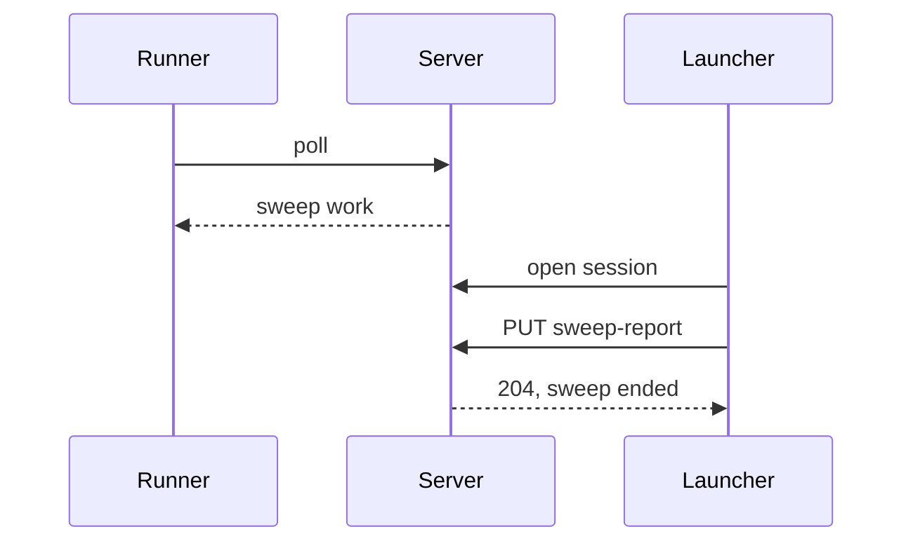
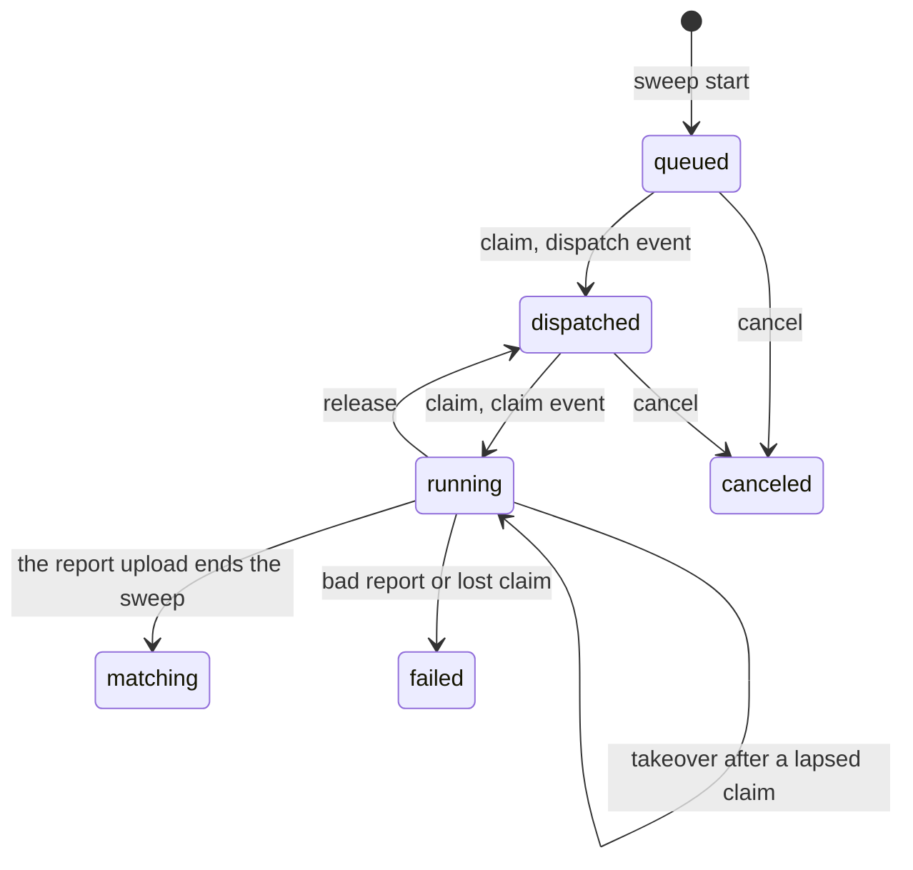
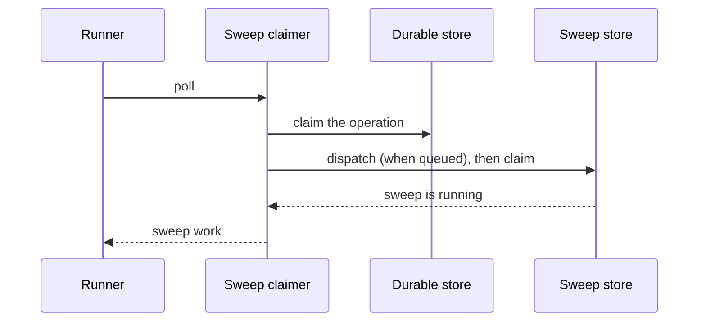
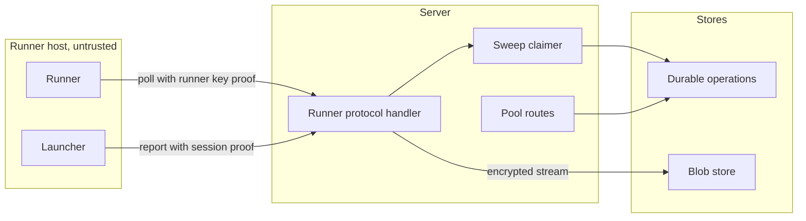

## Context

Sweep work flows from durable operations through the runner protocol to the blob store. A mixed purpose risks job credentials on sweep hosts. An unbounded report risks blob store exhaustion.

## Decisions

1. **Claim by stored purpose.** The claimer takes the pool ID and reads the purpose of the pool in the claim transaction. It claims only runner.SweepKind(pool) operations.
2. **Bounded streamed report.** The upload streams to the blob store under a per-attempt key, built by the server, with the data key of the namespace. It checks line, record, tag, scope and byte caps, the header format and version, each record, and the header scope subset. A scope with complete false closes no finding. A cut stream, a cap breach or a second upload drops the staged blob.
3. **Atomic guards.** The blob store, the durable claim and the sweep row are three stores, and no transaction spans the blob store. So the change follows the blob port rule: the report store writes the blob first, under a key that is unique for this attempt, and then calls the NEW port method `ScanStore.CompleteScan`. `CompleteScan` runs in ONE database transaction. It checks the fence and the claim token, applies the event uploaded (or fail) with `NextScan`, stores the key in the NEW column `unmanaged_scans.report_key`, ends the durable claim and appends the audit entry. The committed row names the winning key, so a second attempt cannot replace the report: its `CompleteScan` fails with a lost claim or a transition error, and its report store deletes its own blob. The upload is the end of the sweep (ADR 131: a sweep has no finish). Benchmark: AWS and Google practice is to commit a result and its state change in one transaction (the transactional outbox) and never to depend on the order of writes across stores.
   - Why not a fixed key: a second attempt could overwrite the blob of the winner before its transaction fails.
   - Why a read `ScanReportKey` and not a field of `unmanaged.Scan`: a new field forces every literal of `Scan` in the linted code to change. The key is read only by the report purge and the match, so a read by sweep ID is enough.
   - Why one method for uploaded and fail: the fail path must end the claim and the sweep together too, with no key.
4. **The claim moves the sweep.** The sweep claimer calls the NEW method `SweepStateStore.MarkClaimed` right after the durable claim. The sweep ID is the key of the claimed operation (`runner.SweepKind`, the start key of ADR 164 decision 3). The port reads the sweep, applies the event dispatch only when it is queued, and then applies the event claim (a takeover from running is allowed). If it fails, the claimer releases the durable claim and answers no work. `Release` of the claimer calls the NEW method `MarkReleased` after the durable release: the event release moves running to dispatched. Benchmark: lease then idempotent status update, as in SQS and Pub/Sub consumers. AWS and Google do not hold a lease and a status write in one transaction across two stores, and they fail closed: a consumer that cannot record a claim does not process the message. Alternatives that were not chosen:
   - One transaction across the durable store and the sweep row: the two ports have no shared transaction, and the change adds none.
   - The state move at the upload: `CompleteScan` needs a running sweep, and a sweep that shows queued while a runner works on it is wrong in the API.
   - A new `ScanStore` method: `AdvanceScan` already applies the three events along `NextScan`, so a new method would repeat it.
   The sweep API shows the status running after the claim and dispatched after a release. No state is hidden: a claim lapse leaves the sweep running until the next claim or the sweep timeout.
5. **No finish route.** The handler keeps the refusal of a finish for a sweep session. A report upload with a lost claim answers 409.
6. **Team pool with the sweep purpose.** The pool routes accept the sweep purpose on a namespace pool with the same rules as for the jobs purpose (Owner decision, 23 Nov 2026 (ADR 396, replaces the 13 Nov 2026 answer P14)). The server has no installation pool. The purpose of a pool never changes (ADR 130 decision 3), so no guard for a purpose change exists. The host identity of a sweep pool has no write access (ADR 164 decisions 1 and 5).

## Structure

Unexported sweepClaimer struct, built only by NewSweepClaimer with the store, pool, report store and sweep state store ports. The constructor rejects a nil port. The report store and the scope reader are two small ports with one implementation in pkg/dustpan/sweep_report.go. `pkg/runner` cannot import `internal/unmanaged`, so the implementation in pkg/dustpan is the only place that joins the two.

The state port, which the claimer consumes (NEW, in pkg/runner/sweep_claimer.go):

- `SweepStateStore.MarkClaimed(ctx, sweep string, c durable.Claim, fence namespace.Fence) error` moves the sweep to running. `MarkReleased(ctx, sweep string, c durable.Claim, fence namespace.Fence) error` moves it to dispatched.
- `ErrSweepState` is the sentinel for a sweep whose status takes no such event (canceled, expired, ended, matching, a state check) or that is not found. The claimer treats it as no work.
- The one implementation is in pkg/dustpan/sweep_state.go. It reads the sweep with `ScanStore.Scan` and applies each event with `ScanStore.AdvanceScan` under the fence. It passes an audit entry that names the runner (the field Owner of the claim), the operation and the token. `AdvanceScan` appends an entry only at an end status, so these events append none (see Risks).

The port method:

- `CompleteScan(ctx, c ScanCompletion, fence namespace.Fence, e audit.Entry) (Scan, error)`. `ScanCompletion` holds Namespace, ID, Claim (a `durable.Claim`), Event (only uploaded or fail), ReportKey (empty for fail, a valid blob key for uploaded) and Update (a `ScanUpdate`). `CheckCompletion` validates it at the port, as `CheckAdvance` does.
- `ScanReportKey(ctx, ns, id) (string, error)` returns the stored key, or the empty string.
- Errors: `ErrInvalidScan`, `ErrNotFound`, `ErrTransition`, `durable.ErrClaimLost` and `namespace.ErrFenced`. Any error rolls back the whole transaction: the claim stays open and the sweep state and key stay as they were.

The schema change is one column, `report_key TEXT NOT NULL DEFAULT ''`, in the one schema file of each dialect. No migration file is added, because no tag shipped the table.

## Contract

New in internal/unmanaged (the port of the sweep store):

```go
type ScanCompletion struct {
	Namespace namespace.Name
	ID        string
	Claim     durable.Claim
	Event     ScanEvent // ScanEventUploaded or ScanEventFail only
	ReportKey string    // empty for fail, a valid blob key for uploaded
	Update    ScanUpdate
}

CompleteScan(ctx context.Context, c ScanCompletion, fence namespace.Fence, e audit.Entry) (Scan, error)
ScanReportKey(ctx context.Context, ns namespace.Name, id string) (string, error)
```

- `CompleteScan` errors: `ErrInvalidScan`, `ErrNotFound`, `ErrTransition`, `durable.ErrClaimLost` and `namespace.ErrFenced`. It appends `e` when the new status ends the sweep, as `AdvanceScan` does.
- Table `unmanaged_scans`: the NEW column `report_key TEXT NOT NULL DEFAULT ''`, in both dialects. It is empty until `CompleteScan` stores the key of an uploaded report.
- New in pkg/runner: `SweepReportStore`, `SweepScopeReader` and `ErrReportTooLarge` (wraps `ErrInvalid`), in pkg/runner/sweep_claimer.go.
- New in pkg/runner (the claim moves the sweep): `SweepStateStore` and `ErrSweepState`, in pkg/runner/sweep_claimer.go. `unmanaged.ScanStore` gets no new method for them.

```go
type SweepStateStore interface {
	// MarkClaimed applies dispatch (when the sweep is queued) and then claim.
	// It returns ErrSweepState when the sweep takes no claim event.
	MarkClaimed(ctx context.Context, sweep string, c durable.Claim, fence namespace.Fence) error
	// MarkReleased applies release. It returns ErrSweepState when the sweep is not running.
	MarkReleased(ctx context.Context, sweep string, c durable.Claim, fence namespace.Fence) error
}

var ErrSweepState = errors.New("sweep takes no such event")
```

- Claim: the claimer answers `durable.ErrNoWork` after `MarkClaimed` fails, and it releases the durable claim first.
- Endpoint: `PUT /runner/v1/session/sweep-report` answers 204, 400, 401, 409 and 413 with the protocol error shape. No finish route.

## Risks

- A pool purpose that changes during a poll: the claim reads the purpose in its transaction.
- A stream cut by a crash, or a crash between the blob write and `CompleteScan`, leaves an unnamed blob. The report store deletes its own blob on every failure that it sees. No existing cleanup covers the sweep report prefix: the cleanup of ADR 151 decision 22 covers only the blobs of history items. This change adds no reaper. The loss is bounded to one encrypted blob of at most 1 GiB for each such crash, and the sweep ends failed when its claim lapses.

- The claim lapses between the durable claim and the state move. The next claim applies the events again, and no event is lost.
- `AdvanceScan` appends an audit entry only at an end status, so the events dispatch, claim and release append none. The claim is recorded by the durable claim (owner, token, attempt) and by the handoff record of the poll. The sweep API shows the status. A change that wants an entry for each move needs a change of `AdvanceScan`, and this change does not make one.

## Layers (defense in depth)

| Layer | Guard | Hostile test |
| --- | --- | --- |
| session auth | The handler checks the session proof, claim ownership and open session before it accepts a report. | Send a report with a runner key proof and no session proof; the server answers bad-proof. |
| purpose check | The claim transaction checks that the pool purpose matches the operation kind. | Poll a jobs pool for sweep work and a sweeps pool for job work; both get 204. |
| report bound | The stream counts bytes, records, tags, line length and scopes and refuses over a cap. | Upload a line above 64 KiB, and a scope outside the target; the server stops the stream and fails the sweep. |
| claim state | `MarkClaimed` applies only the events dispatch and claim along `NextScan`, and the claimer gives no work when it fails. | Claim a sweep that is canceled, expired, ended or in matching; each answers 204, the claim is released and the status stays. |
| completion | `CompleteScan` checks the fence, the claim token, the event and the key at the port, and it commits the key, the claim end and the sweep state together. | Call it with a stale token, a foreign namespace, an event that is not uploaded or fail, an empty or malformed key; each is refused and the claim and the sweep stay as they were. |
| pool purpose | The pool routes accept only the purposes jobs and sweeps, and refuse any change of the purpose. | Create a pool with an unknown purpose and update a pool with another purpose; each is refused and changes nothing. |

## Diagrams

After this change:



States and transitions after this change:



The claim, shown with its state moves:



## Quality attributes

| Attribute | Target | Unit | Scope |
| --- | --- | --- | --- |
| report size bound | 1073741824 bytes and 5000000 records, line 65536 bytes | bytes and records | one sweep report |
| poll wait | at most 50 | seconds | one poll request |
| memory of report upload | at most 8 | MiB of buffer | one upload, for any report size |

## Threat model

Data flow and trust boundaries:



| Boundary | STRIDE | Threat | Layer | Guard | Hostile test |
| --- | --- | --- | --- | --- | --- |
| Runner host to server | S | A caller sends a report with a runner key instead of a session key. | authorize at point of use | The handler requires the session proof and claim ownership. | Upload a chunk with a runner key proof; the server answers bad-proof. |
| Runner host to server | S | A caller sends a report with a runner key instead of a session key. | boundary check | The handler checks the proof header and the session ID before any read of the body. | Send a body with no proof header; the server reads no body and answers 401. |
| Runner host to server | S | A caller sends a report with a runner key instead of a session key. | fail closed | An unknown or closed session denies the request. | Upload to a closed session; the server refuses and stores nothing. |
| Runner host to server | S | A caller sends a report with a runner key instead of a session key. | encode or contain | The proof signs the body hash header, and the handler compares it with the streamed body hash. | Send a body that differs from the signed hash; the server refuses and drops the staged blob. |
| Runner host to server | S | A caller sends a report with a runner key instead of a session key. | limit | The proof nonce is kept for 2 minutes and a replay is refused. | Replay a signed upload request; the server answers bad-proof. |
| Runner host to server | T | A report names a scope outside the target. | boundary check | The header scopes must be a subset of the target scopes. | Upload a header with an extra scope; the server answers 400 and fails the sweep. |
| Runner host to server | T | A report names a scope outside the target. | fail closed | A bad report fails the sweep and drops the staged blob. | After the refusal, no staged blob exists. |
| Runner host to server | T | A report names a scope outside the target. | limit | The stream stops at the header cap of 1,000 scopes. | Upload a header with 1,001 scopes; the server refuses it. |
| Runner host to server | T | A report names a scope outside the target. | authorize at point of use | The advance call runs under the claim of the session. | Upload under a lost claim; the sweep state stays. |
| Runner host to server | T | A report names a scope outside the target. | encode or contain | The parser decodes each line as strict JSON with unknown fields refused and no text reaches a query or a path. | Upload a line with an unknown field and one with a path-like tag; the server refuses the first and stores the second only as data. |
| Runner host to server | D | A huge or endless report fills the blob store. | limit | The stream counts bytes, records and line length and stops over a cap. | Upload a 64 KiB plus one line; the server answers 413. |
| Runner host to server | D | A huge or endless report fills the blob store. | boundary check | The handler checks the declared size before the stream starts. | Declare 2 GiB; the server refuses before it reads. |
| Runner host to server | D | A huge or endless report fills the blob store. | fail closed | A stop over a cap drops the staged blob. | After a refused upload, the staged key does not exist. |
| Runner host to server | D | A huge or endless report fills the blob store. | authorize at point of use | Each attempt writes its own key, and the sweep row names one key. | Upload twice; the second answers 409. |
| Runner host to server | D | A huge or endless report fills the blob store. | encode or contain | The blob key is built by the server from the claim and a fresh attempt value, never from the request, and the stream uses a fixed buffer. | Send a key-like value in the path or body; the staged key does not change. |
| Server to blob store | I | Tags in the report show names in plain text at rest. | encode or contain | The stream is encrypted with the data key of the namespace. | Read the stored blob; it holds no plain tag text. |
| Server to blob store | I | Tags in the report show names in plain text at rest. | limit | A tag count and size cap limit what one record can hold. | Send 51 tags; the server refuses. |
| Server to blob store | I | Tags in the report show names in plain text at rest. | boundary check | The handler reads the namespace from the claim, not from the request. | Send a foreign namespace in the body; the server ignores it. |
| Server to blob store | I | Tags in the report show names in plain text at rest. | fail closed | A key lookup error fails the upload. | Fail the data key read; the upload ends failed with no blob. |
| Server to blob store | I | Tags in the report show names in plain text at rest. | authorize at point of use | The blob write checks that the session claim belongs to the namespace of the key. | Use a session of another namespace to write the staged key; the server refuses. |
| Sweep state port | T | A runner or a stale claim moves the state of a sweep that it does not hold, or a sweep gets work with no state move. | boundary check | `MarkClaimed` and `MarkReleased` accept only a valid sweep ID, a valid claim and a fence of the namespace of the sweep. The claimer takes the sweep ID from the key of the claimed operation, never from the request. | Call both methods with an empty ID, an ID with CR and LF, and a fence of another namespace; each is refused and the status stays. |
| Sweep state port | T | A runner or a stale claim moves the state of a sweep that it does not hold, or a sweep gets work with no state move. | authorize at point of use | The claimer applies `MarkReleased` only after the durable release accepted the claim token, and `MarkClaimed` only for the claim that the durable store just gave. | Release with a stale token and a token of another operation; the durable release returns ErrClaimLost and the status stays. |
| Sweep state port | T | A runner or a stale claim moves the state of a sweep that it does not hold, or a sweep gets work with no state move. | fail closed | When `MarkClaimed` fails, the claimer releases the durable claim and answers 204. | Make `AdvanceScan` fail; the poll answers 204, no work leaves, and the claim is released. |
| Sweep state port | T | A runner or a stale claim moves the state of a sweep that it does not hold, or a sweep gets work with no state move. | limit | The port applies only dispatch, claim and release, and `NextScan` allows claim only from dispatched and running. | Call `MarkClaimed` for a sweep in matching, succeeded, failed, canceled and expired; each returns ErrSweepState and the status stays. |
| Sweep state port | T | A runner or a stale claim moves the state of a sweep that it does not hold, or a sweep gets work with no state move. | encode or contain | The sweep ID reaches SQL only as a placeholder in `AdvanceScan`, and the log of a refusal holds the ID with CR and LF removed. | Send an operation key with CR and LF; the claimer gives no work and the log line holds none. |
| Pool routes | E | A pool gets a purpose that its host identity does not fit, so a sweep runs with write access. | boundary check | The pool routes accept only the closed set of purposes jobs and sweeps. | Create a pool with the purpose scan; the server answers 400 with "purpose: use jobs or sweeps." and stores nothing. |
| Pool routes | E | A pool gets a purpose that its host identity does not fit, so a sweep runs with write access. | fail closed | The claimer reads the purpose in the claim transaction and gives no work on a mismatch. | Poll a jobs pool for sweep work; the server answers 204. |
| Pool routes | E | A pool gets a purpose that its host identity does not fit, so a sweep runs with write access. | authorize at point of use | The routes check the grant of the caller for the pool object. | Call create with no grant; the server answers 403. |
| Pool routes | E | A pool gets a purpose that its host identity does not fit, so a sweep runs with write access. | limit | The purpose of a pool never changes, so a pool keeps one host identity role for its life. | Update a pool with another purpose; the server answers 409 and keeps the purpose. |
| Pool routes | E | A pool gets a purpose that its host identity does not fit, so a sweep runs with write access. | encode or contain | The purpose is parsed to a closed set of values and the store takes it only through placeholders. | Send a purpose value outside the set; the server answers 400 and stores nothing. |
| Sweep store port | T | A stale or foreign claim completes a sweep, or the sweep row names a blob of another sweep or namespace. | boundary check | `CheckCompletion` allows only the events uploaded and fail, a valid sweep ID and namespace, an empty key for fail, and a valid blob key of this sweep for uploaded. | Call `CompleteScan` with the event matched, an empty key for uploaded, a key for fail, and a key of another sweep; each returns ErrInvalidScan. |
| Sweep store port | T | A stale or foreign claim completes a sweep, or the sweep row names a blob of another sweep or namespace. | authorize at point of use | The transaction checks the claim token against the open claim of the operation of this sweep. | Call `CompleteScan` with a stale token and with a token of another operation; each returns ErrClaimLost and changes nothing. |
| Sweep store port | T | A stale or foreign claim completes a sweep, or the sweep row names a blob of another sweep or namespace. | fail closed | Any error rolls back the key, the claim end, the state and the audit entry together. | Fail the advance after the claim check; the claim stays open and the key stays empty. |
| Sweep store port | T | A stale or foreign claim completes a sweep, or the sweep row names a blob of another sweep or namespace. | limit | `NextScan` allows the move from running only once, so one key is stored for each sweep. | Call `CompleteScan` twice with two keys; the second returns ErrTransition and the first key stays. |
| Sweep store port | T | A stale or foreign claim completes a sweep, or the sweep row names a blob of another sweep or namespace. | encode or contain | The key and the IDs reach SQL only as placeholders, and the fence namespace must equal the namespace of the call. | Call with the fence of another namespace; the store returns namespace.ErrFenced and writes nothing. |
| Runner host to server | R | A runner denies that it sent a report. | authorize at point of use | The server records the report upload with the claim and session identity in the sweep record. | Upload a report; the sweep record names the claim and the session. |
| Runner host to server | R | A runner denies that it sent a report. | boundary check | The handler takes the identity from the proof, not from the body. | Send a false identity in the body; the record names the proof identity. |
| Runner host to server | R | A runner denies that it sent a report. | fail closed | A request with no valid proof writes no record of success. | Upload with a bad proof; the sweep record is unchanged. |
| Runner host to server | R | A runner denies that it sent a report. | limit | One report is stored for each session. | Upload twice; the second answers 409 and one report exists. |
| Runner host to server | R | A runner denies that it sent a report. | encode or contain | The record fields are written with placeholders, and CR and LF are removed from logged values. | Send a header value with CR and LF; the log line and the record hold none. |

## Failure modes

| Step | Failure | Retry | State after |
| --- | --- | --- | --- |
| Report upload | The connection drops before the end of the stream. | The claim lapses; the sweep can start again through the sweep start of the earlier part. | The staged blob is dropped and the sweep is failed. |
| Report upload | The server stops during the stream, or between the blob write and `CompleteScan`. | The claim lapses and the sweep fails. | The blob has no row that names it. No cleanup covers it yet (see Risks); the sweep row is consistent. |
| Report upload | `CompleteScan` fails after the blob write. | The report store deletes its blob; the launcher may retry while its claim holds. | The transaction rolled back: the claim is open, the sweep state and the key are unchanged. |
| Report upload | Two uploads arrive at once. | The second answers 409. | The first report is named by the row and ends the sweep. The second blob is deleted by its own report store. |
| Claim | The pool purpose changes during the claim. | The runner polls again. | The operation stays queued. |
| Claim | The server stops between the durable claim and `MarkClaimed`, or between the event dispatch and the event claim. | The claim lapses. The next claim applies the events again. | The sweep is queued or dispatched, with a lapsed claim. The next claim moves it to running. |
| Claim | A person cancels the sweep between the durable claim and `MarkClaimed`. | None. The poll answers 204. | `AdvanceScan` returns ErrTransition, the claimer releases the claim, and the sweep stays canceled. The cancel already stopped the operation. |
| Claim | `MarkClaimed` fails for another reason, such as a store error or a stale fence. | The runner polls again. | The poll answers 204, the claimer releases the durable claim and no work leaves. The sweep keeps the status that the last successful event gave. |
| Claim | The release of the claim in the failure above fails. | The claim lapses, and the next claim takes it. | No work left the server. The operation has a lapsed claim. |
| Claim | A runner takes over a lapsed claim of a running sweep. | None. | The event claim from running is a takeover, so the sweep stays running with the new claim. |
| Release | The durable release succeeds and `MarkReleased` fails. | The runner may call release again and gets ErrClaimLost. The next claim applies the claim event from running. | The operation is queued, and the sweep shows running until the next claim. |
| Release | The sweep is canceled or ended when `MarkReleased` runs. | None. | `ErrSweepState` is no error for the release. The sweep keeps its status. |
| Report upload | The server stops after the blob write and before `CompleteScan`: the staged blob has no row that names it. | The claim lapses and the sweep fails. | An unnamed blob stays. The reaper is the work of issue #4297 and no part of this change. |
