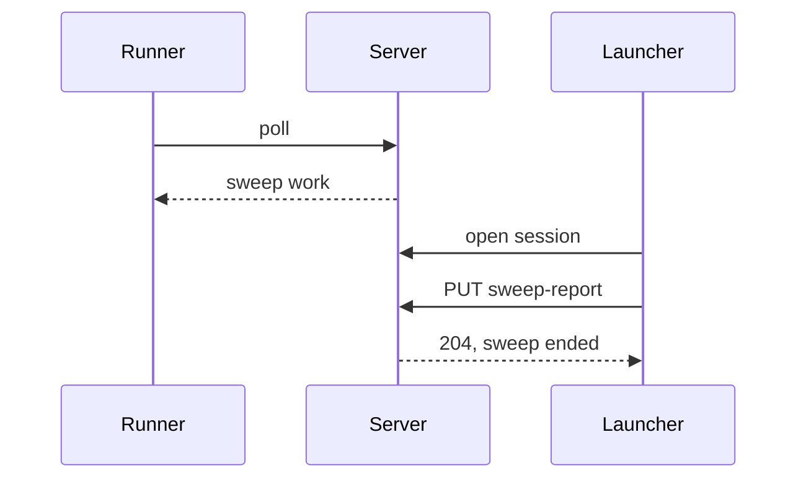
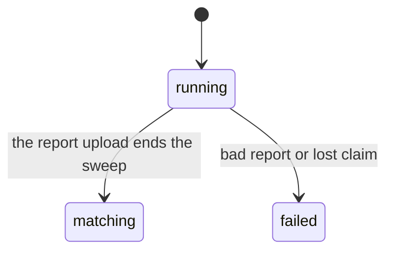
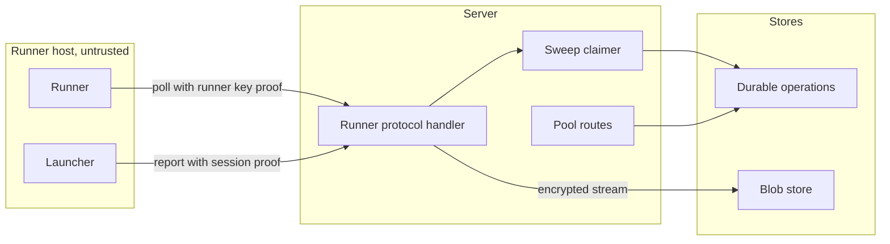

## Context

Sweep work flows from durable operations through the runner protocol to the blob store. A mixed purpose risks job credentials on sweep hosts. An unbounded report risks blob store exhaustion.

## Decisions

1. **Claim by stored purpose.** The claimer takes the pool ID and reads the purpose of the pool in the claim transaction. It claims only runner.SweepKind(pool) operations.
2. **Bounded streamed report.** The upload streams to the blob store under a staging key with the data key of the namespace. It checks line, record, tag, scope and byte caps, the header format and version, each record, and the header scope subset. A scope with complete false closes no finding. A cut stream, a cap breach or a second upload drops the staged blob.
3. **Atomic guards.** One staged key for each session makes a second upload lose. `SweepClaimer.Report` stores the report, ends the claim and advances the sweep in one transaction, so the upload is the end of the sweep (ADR 131: a sweep has no finish).
4. **No finish route.** The handler keeps the refusal of a finish for a sweep session. A report upload with a lost claim answers 409.
5. **Team pool with the sweep purpose.** The pool routes accept the sweep purpose on a namespace pool with the same rules as for the jobs purpose (Owner decision, 23 Nov 2026 (ADR 396, replaces the 13 Nov 2026 answer P14)). The server has no installation pool. The purpose of a pool never changes (ADR 130 decision 3), so no guard for a purpose change exists. The host identity of a sweep pool has no write access (ADR 164 decisions 1 and 5).

## Structure

Unexported sweepClaimer struct, built only by NewSweepClaimer with the store, pool and report store ports. The constructor rejects a nil port. The report store and the scope reader are two small ports with one implementation in pkg/dustpan/sweep_report.go.

## Risks

- A pool purpose that changes during a poll: the claim reads the purpose in its transaction.
- A stream cut by a crash leaves a partial staged blob: orphan cleanup deletes it.

## Layers (defense in depth)

| Layer | Guard | Hostile test |
| --- | --- | --- |
| session auth | The handler checks the session proof, claim ownership and open session before it accepts a report. | Send a report with a runner key proof and no session proof; the server answers bad-proof. |
| purpose check | The claim transaction checks that the pool purpose matches the operation kind. | Poll a jobs pool for sweep work and a sweeps pool for job work; both get 204. |
| report bound | The stream counts bytes, records, tags, line length and scopes and refuses over a cap. | Upload a line above 64 KiB, and a scope outside the target; the server stops the stream and fails the sweep. |
| pool purpose | The pool routes accept only the purposes jobs and sweeps, and refuse any change of the purpose. | Create a pool with an unknown purpose and update a pool with another purpose; each is refused and changes nothing. |

## Diagrams

After this change:

States and transitions after this change:

## Quality attributes

| Attribute | Target | Unit | Scope |
| --- | --- | --- | --- |
| report size bound | 1073741824 bytes and 5000000 records, line 65536 bytes | bytes and records | one sweep report |
| poll wait | at most 50 | seconds | one poll request |
| memory of report upload | at most 8 | MiB of buffer | one upload, for any report size |

## Threat model

Data flow and trust boundaries:

| Boundary | STRIDE | Threat | Layer | Guard | Hostile test |
| --- | --- | --- | --- | --- | --- |
| Runner host to server | S | A caller sends a report with a runner key instead of a session key. | authorize at point of use | The handler requires the session proof and claim ownership. | Upload a chunk with a runner key proof; the server answers bad-proof. |
| Runner host to server | S | A caller sends a report with a runner key instead of a session key. | boundary check | The handler checks the proof header and the session ID before any read of the body. | Send a body with no proof header; the server reads no body and answers 401. |
| Runner host to server | S | A caller sends a report with a runner key instead of a session key. | fail closed | An unknown or closed session denies the request. | Upload to a closed session; the server refuses and stores nothing. |
| Runner host to server | S | A caller sends a report with a runner key instead of a session key. | encode or contain | The proof signs the body hash header, and the handler compares it with the streamed body hash. | Send a body that differs from the signed hash; the server refuses and drops the staged blob. |
| Runner host to server | S | A caller sends a report with a runner key instead of a session key. | limit | The proof nonce is kept for 2 minutes and a replay is refused. | Replay a signed upload request; the server answers bad-proof. |
| Runner host to server | T | A report names a scope outside the target. | boundary check | The header scopes must be a subset of the target scopes. | Upload a header with an extra scope; the server answers 400 and fails the sweep. |
| Runner host to server | T | A report names a scope outside the target. | fail closed | A bad report fails the sweep and drops the staged blob. | After the refusal, no staged blob exists. |
| Runner host to server | T | A report names a scope outside the target. | limit | The stream stops at the header cap of 1,000 scopes. | Upload a header with 1,001 scopes; the server refuses it. |
| Runner host to server | T | A report names a scope outside the target. | authorize at point of use | The advance call runs under the claim of the session. | Upload under a lost claim; the sweep state stays. |
| Runner host to server | T | A report names a scope outside the target. | encode or contain | The parser decodes each line as strict JSON with unknown fields refused and no text reaches a query or a path. | Upload a line with an unknown field and one with a path-like tag; the server refuses the first and stores the second only as data. |
| Runner host to server | D | A huge or endless report fills the blob store. | limit | The stream counts bytes, records and line length and stops over a cap. | Upload a 64 KiB plus one line; the server answers 413. |
| Runner host to server | D | A huge or endless report fills the blob store. | boundary check | The handler checks the declared size before the stream starts. | Declare 2 GiB; the server refuses before it reads. |
| Runner host to server | D | A huge or endless report fills the blob store. | fail closed | A stop over a cap drops the staged blob. | After a refused upload, the staged key does not exist. |
| Runner host to server | D | A huge or endless report fills the blob store. | authorize at point of use | One staged key for each session. | Upload twice; the second answers 409. |
| Runner host to server | D | A huge or endless report fills the blob store. | encode or contain | The staged key is built by the server from the claim, never from the request, and the stream uses a fixed buffer. | Send a key-like value in the path or body; the staged key does not change. |
| Server to blob store | I | Tags in the report show names in plain text at rest. | encode or contain | The stream is encrypted with the data key of the namespace. | Read the stored blob; it holds no plain tag text. |
| Server to blob store | I | Tags in the report show names in plain text at rest. | limit | A tag count and size cap limit what one record can hold. | Send 51 tags; the server refuses. |
| Server to blob store | I | Tags in the report show names in plain text at rest. | boundary check | The handler reads the namespace from the claim, not from the request. | Send a foreign namespace in the body; the server ignores it. |
| Server to blob store | I | Tags in the report show names in plain text at rest. | fail closed | A key lookup error fails the upload. | Fail the data key read; the upload ends failed with no blob. |
| Server to blob store | I | Tags in the report show names in plain text at rest. | authorize at point of use | The blob write checks that the session claim belongs to the namespace of the key. | Use a session of another namespace to write the staged key; the server refuses. |
| Pool routes | E | A pool gets a purpose that its host identity does not fit, so a sweep runs with write access. | boundary check | The pool routes accept only the closed set of purposes jobs and sweeps. | Create a pool with the purpose scan; the server answers 400 with "purpose: use jobs or sweeps." and stores nothing. |
| Pool routes | E | A pool gets a purpose that its host identity does not fit, so a sweep runs with write access. | fail closed | The claimer reads the purpose in the claim transaction and gives no work on a mismatch. | Poll a jobs pool for sweep work; the server answers 204. |
| Pool routes | E | A pool gets a purpose that its host identity does not fit, so a sweep runs with write access. | authorize at point of use | The routes check the grant of the caller for the pool object. | Call create with no grant; the server answers 403. |
| Pool routes | E | A pool gets a purpose that its host identity does not fit, so a sweep runs with write access. | limit | The purpose of a pool never changes, so a pool keeps one host identity role for its life. | Update a pool with another purpose; the server answers 409 and keeps the purpose. |
| Pool routes | E | A pool gets a purpose that its host identity does not fit, so a sweep runs with write access. | encode or contain | The purpose is parsed to a closed set of values and the store takes it only through placeholders. | Send a purpose value outside the set; the server answers 400 and stores nothing. |
| Runner host to server | R | A runner denies that it sent a report. | authorize at point of use | The server records the report upload with the claim and session identity in the sweep record. | Upload a report; the sweep record names the claim and the session. |
| Runner host to server | R | A runner denies that it sent a report. | boundary check | The handler takes the identity from the proof, not from the body. | Send a false identity in the body; the record names the proof identity. |
| Runner host to server | R | A runner denies that it sent a report. | fail closed | A request with no valid proof writes no record of success. | Upload with a bad proof; the sweep record is unchanged. |
| Runner host to server | R | A runner denies that it sent a report. | limit | One report is stored for each session. | Upload twice; the second answers 409 and one report exists. |
| Runner host to server | R | A runner denies that it sent a report. | encode or contain | The record fields are written with placeholders, and CR and LF are removed from logged values. | Send a header value with CR and LF; the log line and the record hold none. |

## Failure modes

| Step | Failure | Retry | State after |
| --- | --- | --- | --- |
| Report upload | The connection drops before the end of the stream. | The claim lapses; the sweep can start again through the sweep start of the earlier part. | The staged blob is dropped and the sweep is failed. |
| Report upload | The server stops during the stream. | The claim lapses and the sweep fails. | The staged blob has no record; orphan cleanup deletes it. |
| Report upload | Two uploads arrive at once. | The second answers 409. | The first staged report stays and ends the sweep. |
| Claim | The pool purpose changes during the claim. | The runner polls again. | The operation stays queued. |
