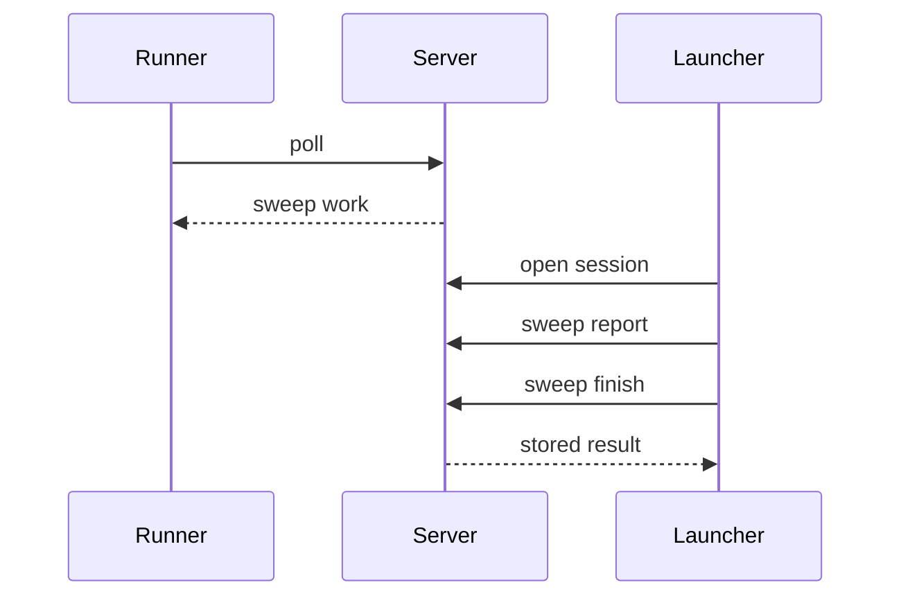
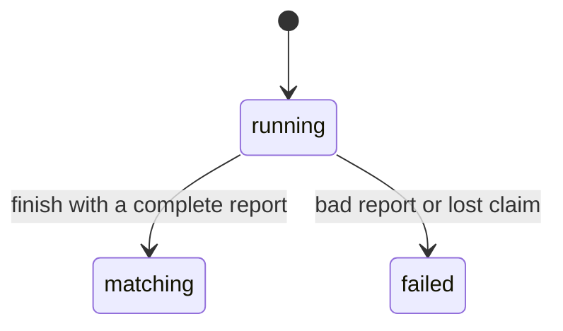
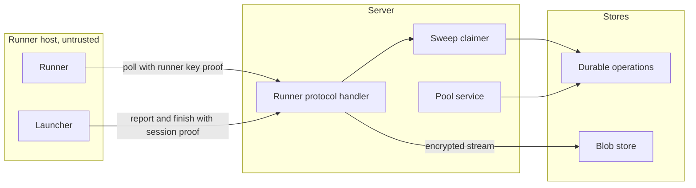

## Context

Sweep work flows from durable operations through the runner protocol to the blob store. A mixed purpose risks job credentials on sweep hosts. An unbounded report risks blob store exhaustion.

## Decisions

1. **Claim by stored purpose.** The claimer takes the pool ID and reads the purpose of the pool in the claim transaction. It claims only runner.SweepKind(pool) operations.
2. **Bounded streamed report.** The upload streams to the blob store under a staging key with the data key of the namespace. It checks line, record, tag, scope and byte caps, the header format and version, each record, and the header scope subset. A scope with complete false closes no finding. A cut stream, a cap breach or a second upload drops the staged blob.
3. **Atomic guards.** One staged key for each session makes a second upload lose. Finish runs in one store transaction that checks the claim and the report state, so a double finish answers the stored result.
4. **Idempotent finish.** Finish closes the session once. A finish with a lost claim answers 409.
5. **Installation pool only.** The pool service checks that a pool with the sweep purpose has no namespace, at create and at update, and refuses a purpose change while operations of the old purpose are queued or claimed (Owner decision, 13 Nov 2026 (queue P14)).

## Structure

Unexported sweepClaimer struct, built only by NewSweepClaimer with the store, pool and blob ports. The constructor rejects a nil port.

## Risks

- A pool purpose that changes during a poll: the claim reads the purpose in its transaction.
- A stream cut by a crash leaves a partial staged blob: orphan cleanup deletes it.

## Layers (defense in depth)

| Layer | Guard | Hostile test |
| --- | --- | --- |
| session auth | The handler checks the session proof, claim ownership and open session before it accepts a chunk or finish. | Send report chunks with a runner key proof and no session proof; the server answers bad-proof. |
| purpose check | The claim transaction checks that the pool purpose matches the operation kind. | Poll a jobs pool for sweep work and a sweeps pool for job work; both get 204. |
| report bound | The stream counts bytes, records, tags, line length and scopes and refuses over a cap. | Upload a line above 64 KiB, and a scope outside the target; the server stops the stream and fails the sweep. |
| pool service | The service refuses a namespace pool with the sweep purpose before it stores the pool. | Create and update a namespace pool with the sweep purpose; each answers 422 and stores nothing. |

## Diagrams

After this change:

States and transitions after this change:

## Quality attributes

| Attribute | Target | Unit | Scope |
| --- | --- | --- | --- |
| report size bound | 1073741824 bytes and 5000000 records, line 65536 bytes | bytes and records | one sweep report |
| poll wait | at most 50 | seconds | one poll request |
| memory of report upload | at most 8 | MiB of buffer | one upload, for any report size |

## Threat model

Data flow and trust boundaries:

| Boundary | STRIDE | Threat | Layer | Guard | Hostile test |
| --- | --- | --- | --- | --- | --- |
| Runner host to server | S | A caller sends a report with a runner key instead of a session key. | authorize at point of use | The handler requires the session proof and claim ownership. | Upload a chunk with a runner key proof; the server answers bad-proof. |
| Runner host to server | S | A caller sends a report with a runner key instead of a session key. | boundary check | The handler checks the proof header and the session ID before any read of the body. | Send a body with no proof header; the server reads no body and answers 401. |
| Runner host to server | S | A caller sends a report with a runner key instead of a session key. | fail closed | An unknown or closed session denies the request. | Upload to a closed session; the server refuses and stores nothing. |
| Runner host to server | S | A caller sends a report with a runner key instead of a session key. | encode or contain | The proof signs the body hash header, and the handler compares it with the streamed body hash. | Send a body that differs from the signed hash; the server refuses and drops the staged blob. |
| Runner host to server | S | A caller sends a report with a runner key instead of a session key. | limit | The proof nonce is kept for 2 minutes and a replay is refused. | Replay a signed upload request; the server answers bad-proof. |
| Runner host to server | T | A report names a scope outside the target. | boundary check | The header scopes must be a subset of the target scopes. | Upload a header with an extra scope; the server answers 400 and fails the sweep. |
| Runner host to server | T | A report names a scope outside the target. | fail closed | A bad report fails the sweep and drops the staged blob. | After the refusal, no staged blob exists. |
| Runner host to server | T | A report names a scope outside the target. | limit | The stream stops at the header cap of 1,000 scopes. | Upload a header with 1,001 scopes; the server refuses it. |
| Runner host to server | T | A report names a scope outside the target. | authorize at point of use | The advance call runs under the claim of the session. | Finish under a lost claim; the sweep state stays. |
| Runner host to server | T | A report names a scope outside the target. | encode or contain | The parser decodes each line as strict JSON with unknown fields refused and no text reaches a query or a path. | Upload a line with an unknown field and one with a path-like tag; the server refuses the first and stores the second only as data. |
| Runner host to server | D | A huge or endless report fills the blob store. | limit | The stream counts bytes, records and line length and stops over a cap. | Upload a 64 KiB plus one line; the server answers 413. |
| Runner host to server | D | A huge or endless report fills the blob store. | boundary check | The handler checks the declared size before the stream starts. | Declare 2 GiB; the server refuses before it reads. |
| Runner host to server | D | A huge or endless report fills the blob store. | fail closed | A stop over a cap drops the staged blob. | After a refused upload, the staged key does not exist. |
| Runner host to server | D | A huge or endless report fills the blob store. | authorize at point of use | One staged key for each session. | Upload twice; the second answers 409. |
| Runner host to server | D | A huge or endless report fills the blob store. | encode or contain | The staged key is built by the server from the claim, never from the request, and the stream uses a fixed buffer. | Send a key-like value in the path or body; the staged key does not change. |
| Server to blob store | I | Tags in the report show names in plain text at rest. | encode or contain | The stream is encrypted with the data key of the namespace. | Read the stored blob; it holds no plain tag text. |
| Server to blob store | I | Tags in the report show names in plain text at rest. | limit | A tag count and size cap limit what one record can hold. | Send 51 tags; the server refuses. |
| Server to blob store | I | Tags in the report show names in plain text at rest. | boundary check | The handler reads the namespace from the claim, not from the request. | Send a foreign namespace in the body; the server ignores it. |
| Server to blob store | I | Tags in the report show names in plain text at rest. | fail closed | A key lookup error fails the upload. | Fail the data key read; the upload ends failed with no blob. |
| Server to blob store | I | Tags in the report show names in plain text at rest. | authorize at point of use | The blob write checks that the session claim belongs to the namespace of the key. | Use a session of another namespace to write the staged key; the server refuses. |
| Pool service | E | A namespace pool gets the sweep purpose and sweep hosts hold job credentials. | boundary check | The pool service refuses a namespace pool with the sweep purpose at create and update. | Create and update a namespace pool with the sweep purpose; each answers 422. |
| Pool service | E | A namespace pool gets the sweep purpose and sweep hosts hold job credentials. | fail closed | The claimer reads the purpose in the claim transaction and gives no work on a mismatch. | Poll a jobs pool for sweep work; the server answers 204. |
| Pool service | E | A namespace pool gets the sweep purpose and sweep hosts hold job credentials. | authorize at point of use | The service checks the grant of the caller for the pool object. | Call create with no grant; the server answers 403. |
| Pool service | E | A namespace pool gets the sweep purpose and sweep hosts hold job credentials. | limit | A purpose change is refused while operations of the old purpose wait. | Change the purpose with a queued operation; the server answers 422. |
| Pool service | E | A namespace pool gets the sweep purpose and sweep hosts hold job credentials. | encode or contain | The purpose is parsed to a closed set of values and the store takes it only through placeholders. | Send a purpose value outside the set; the server answers 422 and stores nothing. |
| Runner host to server | R | A runner denies that it sent a report or finish. | authorize at point of use | The server records the finish with the claim and session identity in the sweep record. | Finish a sweep; the sweep record names the claim and the session. |
| Runner host to server | R | A runner denies that it sent a report or finish. | boundary check | The handler takes the identity from the proof, not from the body. | Send a false identity in the body; the record names the proof identity. |
| Runner host to server | R | A runner denies that it sent a report or finish. | fail closed | A request with no valid proof writes no record of success. | Finish with a bad proof; the sweep record is unchanged. |
| Runner host to server | R | A runner denies that it sent a report or finish. | limit | One finish result is stored for each session. | Finish twice; one result exists. |
| Runner host to server | R | A runner denies that it sent a report or finish. | encode or contain | The record fields are written with placeholders, and CR and LF are removed from logged values. | Send a header value with CR and LF; the log line and the record hold none. |

## Failure modes

| Step | Failure | Retry | State after |
| --- | --- | --- | --- |
| Report upload | The connection drops before the end of the stream. | The claim lapses; the sweep can start again through the sweep start of the earlier part. | The staged blob is dropped and the sweep is failed. |
| Report upload | The server stops during the stream. | The claim lapses and the sweep fails. | The staged blob has no record; orphan cleanup deletes it. |
| Finish | The launcher calls finish twice, or two calls arrive at once. | Safe to repeat. | The stored result is answered and nothing changes. |
| Claim | The pool purpose changes during the claim. | The runner polls again. | The operation stays queued. |
