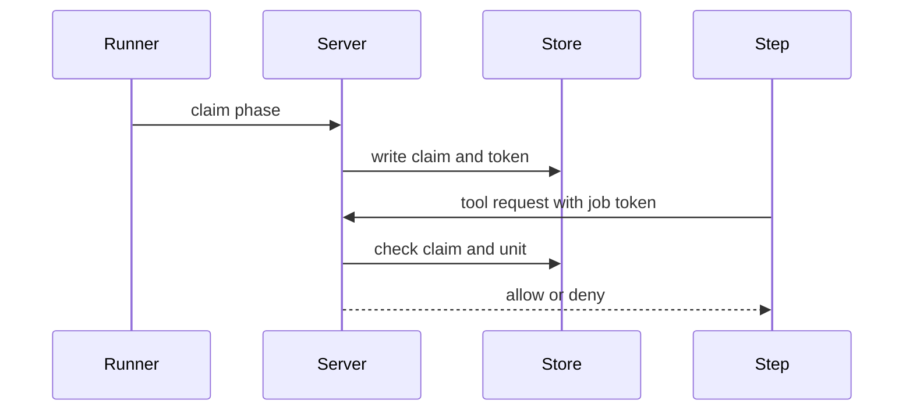
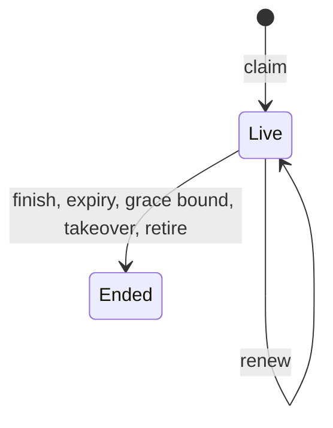
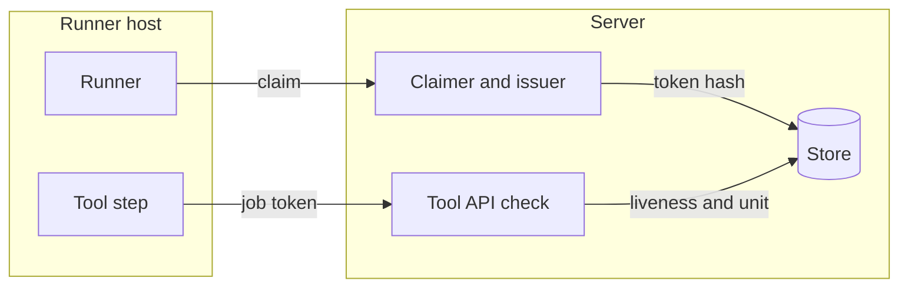

## Context

The tool step needs a credential that acts as the starter on one unit and stops with the claim or the step. The issuer sits behind job.Claimer.

## Decisions

1. **Issuer behind the claim.** The issuer stores the token hash, job ID, stable unit ID, claim ID and expiry in the claim transaction.
2. **End in the same transaction.** Finish, takeover and retire end the token rows in the same transaction as their own write.
3. **Routes.** The token is accepted on the Pulumi Cloud-compatible state routes and the OpenTofu HTTP backend route of its unit. It is refused on the REST API and on other units.
4. **JobID only on job tokens.** Principal.JobID is set only when the credential is CredentialJobToken.

## Structure

Unexported struct jobToken with fields jobID, unitID, claimID and expiry. Only its constructor makes a value. It refuses an empty unit ID and a past expiry. The stable unit ID is used, so a deleted and recreated unit does not match.

## Risks

- A token that outlives its claim lets a step write after takeover.
- A token valid on more than one unit breaks the one-unit limit.

## Layers (defense in depth)

| Layer | Guard | Hostile test |
| --- | --- | --- |
| service | The constructor binds one job ID, one stable unit ID and the expiry. | Use a token on another unit and on a recreated unit with the same name and get 403. |
| port adapter | The store checks claim liveness and expiry at each use. Unknown, malformed or ended tokens fail closed. | Replay an ended, a malformed and an unknown token and get 401 with no read. |
| HTTP handler | A job token is accepted only on the state routes of its unit. | Send a job token to the REST API and a runner key to a tool path and get 403. |

## Diagrams

After this change:

States and transitions after this change:

## Quality attributes

| Attribute | Target | Unit | Scope |
| --- | --- | --- | --- |
| Token check latency | 5 | ms at the 95th percentile added to a tool request | job token check on the tool state routes |
| Token end delay | 0 | requests accepted after the claim ends | each use after job end, takeover or retire |

## Threat model

Data flow and trust boundaries:

| Boundary | STRIDE | Threat | Layer | Guard | Hostile test |
| --- | --- | --- | --- | --- | --- |
| Runner host to server | E | A step uses its job token on another unit. | boundary check | The route accepts the job token kind only on state routes. | Send the token to the REST API and expect 403. |
| Runner host to server | E | A step uses its job token on another unit. | encode or contain | The token binds the stable unit ID, not a name. | Use the token on a recreated unit and expect 403. |
| Runner host to server | E | A step uses its job token on another unit. | limit | The token holds only the actions of the starter on that unit. | Ask for a write the starter lacks and expect 403. |
| Runner host to server | E | A step uses its job token on another unit. | authorize at point of use | The check compares the unit ID of the request with the token. | Use a token on another unit and expect 403. |
| Runner host to server | E | A step uses its job token on another unit. | fail closed | An unknown or malformed token is denied. | Send an unknown token and expect 401. |
| Runner host to server | S | A step replays a token after its claim ended. | boundary check | The handler reads the token only as a bearer credential of the job-token kind. | Send a malformed bearer and expect 401. |
| Runner host to server | S | A step replays a token after its claim ended. | encode or contain | The store keeps only the hash and compares in constant time. | Send a token with one changed byte and expect 401. |
| Runner host to server | S | A step replays a token after its claim ended. | limit | The token expires with the claim and the step grace bound. | Replay after takeover and expect 401. |
| Runner host to server | S | A step replays a token after its claim ended. | authorize at point of use | The store checks claim liveness at each use. | Replay after retire and expect 401. |
| Runner host to server | S | A step replays a token after its claim ended. | fail closed | A store error denies the request. | Fail the store read and expect 401. |
| Runner host to server | E | A runner key is used on a tool path. | boundary check | Only the job token kind is accepted on tool paths for jobs. | Send a runner key on a tool path and expect 403. |
| Runner host to server | E | A runner key is used on a tool path. | encode or contain | A runner key has no access token form and never parses as a bearer token. | Send the runner key as a bearer and expect 401. |
| Runner host to server | E | A runner key is used on a tool path. | limit | A runner key holds only runner:claim on its pool. | Call a state route with the key and expect 403. |
| Runner host to server | E | A runner key is used on a tool path. | authorize at point of use | Each tool route checks the action on the unit. | Call with a key and expect no read. |
| Runner host to server | E | A runner key is used on a tool path. | fail closed | An unknown credential kind is denied. | Send an unknown kind and expect 401. |

## Failure modes

| Step | Failure | Retry | State after |
| --- | --- | --- | --- |
| Make the token in the claim transaction | The transaction fails. | The runner polls again and the claim repeats. | No claim and no token. |
| Renew the claim | The renew fails or the lease passes. | The holder renews again before expiry. | The claim expires and the token ends with it. |
| Takeover of the phase | The old runner still holds a token. | None. The takeover ends the old token in the same transaction. | Only the new claim has a live token. |
| Finish the job | The finish write fails. | The caller repeats the finish. | The job is not finished and the token stays live by the same rule. A finish that commits ends the token in the same transaction. |
